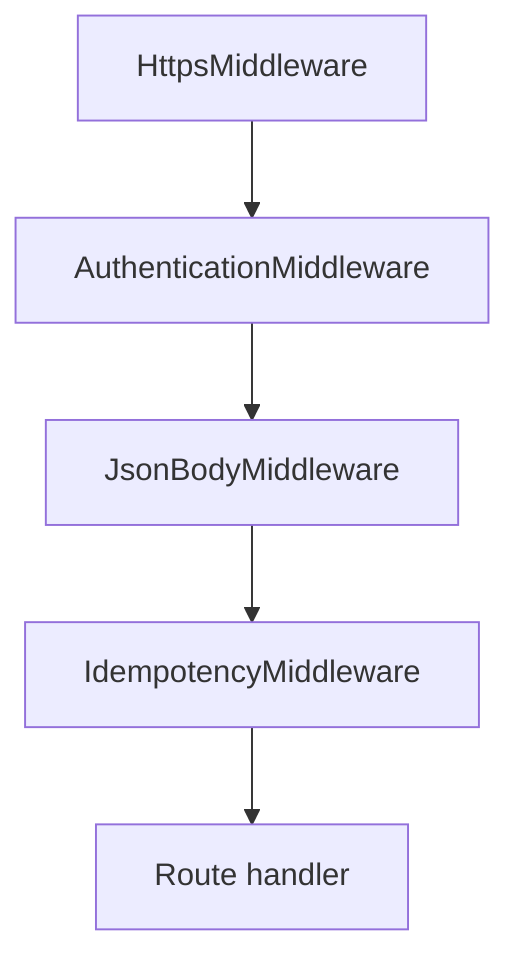
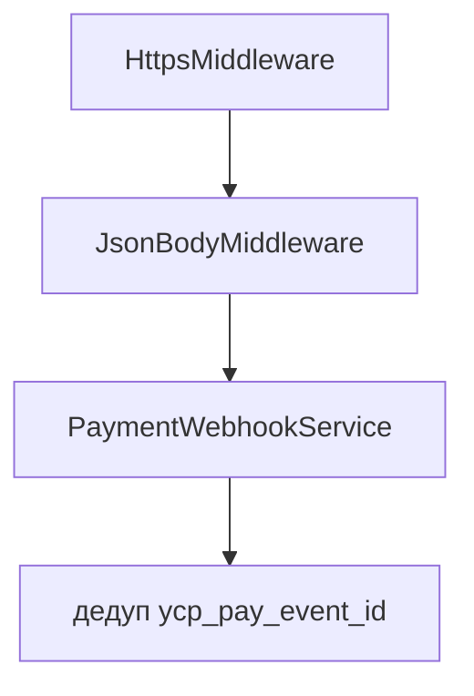
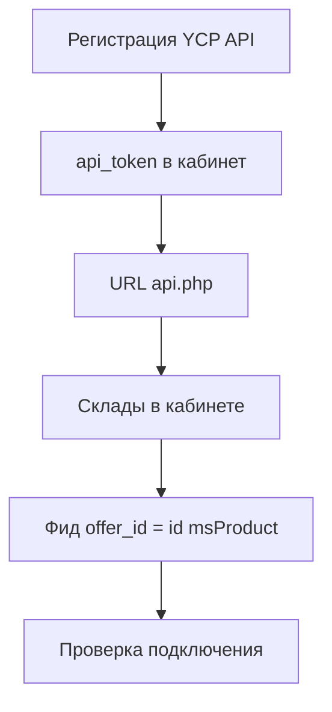

# YCP API

```text
https://ваш-домен/assets/components/msyandexcommerce/api.php
```

Маршрутизация: `PATH_INFO` или путь после `api.php`.

```text
GET  https://shop.example/assets/components/msyandexcommerce/api.php/health
GET  https://shop.example/assets/components/msyandexcommerce/api.php/api/v1/warehouses
POST https://shop.example/assets/components/msyandexcommerce/api.php/api/v1/checkout/basket/check
```

Кабинет Яндекс Товаров склеивает base URL с путями `/api/v1/...`, см. [справку YCP](https://yandex.ru/support/merchants-ru-ycp/ru/). Rewrite на `api.php` укорачивает base. Он не обязателен, если PATH_INFO доходит до PHP.

Нет `config.core.php` рядом с деревом `api.php` → HTTP 500, `{"error":{"code":"CONFIG","message":"Config not found"}}` (не `INTERNAL_ERROR` из `ErrorMapper`).

## Авторизация

```http
Authorization: Bearer <msyandexcommerce_api_token>
Content-Type: application/json
```

Сравнение: `hash_equals`.

| Случай | HTTP | `error.code` |
|--------|------|--------------|
| Пустой токен в настройках | `503` | `UNAUTHORIZED` («API token is not configured») |
| Нет или неверный Bearer | `401` | `UNAUTHORIZED` |

`/health` и `/v1/webhook` Bearer не требуют. `/health` также не требует HTTPS.

## Эндпоинты

Контракт путей из интеграций YCP (Webasyst / Woo). Справка Яндекса описывает операции. Полного OpenAPI нет. После проверки подключения в кабинете сверяйте поля ответа с логом.

| Method | Path | Handler | Назначение |
|--------|------|---------|------------|
| GET | `/health` | DiagnosticsService | `{"status":"ok"}` |
| GET | `/api/v1/warehouses` | Config::warehousesResponse | Список складов |
| POST | `/api/v1/checkout/basket/check` | CartService | Цены и остатки (см. ниже) |
| POST | `/api/v1/checkout/delivery/options` | DeliveryService | Тарифы, даты, `ms2ycpOnDeliveryOptions` |
| GET | `/api/v1/checkout/delivery/pickup_points` | Config::pickupPointsResponse | Свои ПВЗ |
| POST | `/api/v1/checkout` | CheckoutService | Сессия + soft-reserve |
| POST | `/api/v1/checkout/placed` | OrderService | Создание заказа MS2 |
| POST | `/api/v1/checkout/cancel` | CancelService | Отмена сессии |
| GET | `/api/v1/order` | OrderStatusSyncService | Статус заказа (см. ниже) |
| POST | `/api/v1/order/cancel` | CancelService | Отмена заказа |
| POST | `/api/v1/order/delivered` | OrderStatusSyncService | Доставлен |
| POST | `/v1/webhook` | PaymentWebhookService | JWT Яндекс Пэй (без Bearer; `yapay_webhook_enabled`) |

## Тела `items` / `products`

Общий разбор позиций (`InboundNormalizer`): массив `items` или `products`.

| Что | Откуда |
|-----|--------|
| Id товара | `offer_id`, иначе `id`, иначе `product_id` (целое = id `msProduct`) |
| Количество | `count` или `quantity`, пустое → `1` |

Checkout дополнительно копирует в сессию `delivery`, `payment`, `customer`, `address`.

## `POST …/basket/check`

Ответ: `{"items":[…]}`.

| Поле | Значение |
|------|----------|
| `final_price` / `regular_price` | целые рубли (`floor`), не копейки. `toMinor()` в runtime не вызывается |
| `decimal_final_price` / `decimal_regular_price` | всегда рядом, строки (`number_format` на 2 знака) |
| `items[].warehouses[].available_quantity` | склад минус soft-reserve |
| `warehouses[].id` | `warehouse_id` (по умолчанию `main`) |
| `dimensions.weight` | граммы (`round(кг × 1000)`) |

В публичном item нет `count`, `currency`, `valid`.

Ошибки корзины на этом маршруте и на `POST /checkout`: верхний код `422 BASKET_CHECK_FAILED`. `PRODUCT_NOT_FOUND` и `INSUFFICIENT_STOCK` лежат в `details.errors[]` (`code`, `id`, не `offer_id`; у нехватки ещё `available`). Как верхний `error.code` эти два значения бросает только сниппет кнопки, не `Kernel`.

## `POST …/delivery/options`

Ответ: `delivery_options[]` с `id` (строка), `title`, `type` (`courier` \| `pickup`), `cost`, `currency: RUB`.

`cost` в рублях: фикс или `%` от суммы корзины у `msDelivery`, плюс `weight_price × вес`. Поле `price` после `publishCosts` снимается. `date_from` / `date_to` из настроек сроков. Пустой список → `422 NO_DELIVERY`. Пустые `items` в `INVALID_CART` этот маршрут не роняют.

## `POST …/checkout`

Успех: `session_id`, `status: checkout`, `currency: RUB`, `order_number` = `session_id`, `expires_at`.

`total`: сумма рублёвых `final_price × count`, float, без `floor` и без `× 100`.

Пустой `session_id` генерируется (это не `SESSION_REQUIRED`). Пишет сессию и soft-reserve в `ms_yandexcommerce_reservations`. Остаток в каталоге не уменьшается. Ошибки корзины (`400 INVALID_CART`, `422 BASKET_CHECK_FAILED`) приходят и сюда.

## `GET …/order`

Строка YCP в `delivery_statuses[0].status`, не в корне.

| `status_id` заказа | `delivery_statuses[0].status` |
|--------------------|-------------------------------|
| = `status_delivered_id` | `delivered` |
| = `status_cancelled_id` | `cancelled` |
| иначе, в том числе `status_placed_id` и `status_paid_id` | `in_progress` |

Рядом: числовой `status_id`, `order_id`, `num`, `cost`, `currency: RUB`, `datetime` = `time()`.

## Middleware (порядок)

1. `HttpsMiddleware`
2. `AuthenticationMiddleware`
3. `JsonBodyMiddleware` (лимит `max_request_bytes`)
4. `IdempotencyMiddleware` для `POST /api/v1/checkout`, `placed`, `checkout/cancel`, `order/cancel`, `order/delivered`

Ключ идемпотентности, по приоритету: заголовок `Idempotency-Key`, иначе поля тела `idempotency_key` или `session_id`. Пустой ключ: middleware пропускает запрос без записи. Ответы хранятся в `ms_yandexcommerce_requests`.

`POST /v1/webhook` в этот список **не** входит. Дедуп Pay по `ycp_pay_event_id` в заказе ([payment](payment)).

Маршруты YCP (кроме Pay webhook):



`POST /v1/webhook`:



## Ошибки

Формат YCP (все маршруты кроме Pay webhook):

```json
{
  "error": {
    "code": "UNAUTHORIZED",
    "message": "Missing Bearer token",
    "details": {}
  }
}
```

Частые `error.code` на `api.php` (YCP): `UNAUTHORIZED`, `DISABLED`, `HTTPS_REQUIRED`, `NOT_FOUND`, `SESSION_REQUIRED`, `SESSION_NOT_FOUND`, `INVALID_SESSION_STATE`, `EMPTY_CART`, `INVALID_CART`, `NO_DELIVERY`, `ORDER_IN_PROGRESS`, `ORDER_NOT_FOUND`, `ORDER_STATUS_FAILED`, `PAYLOAD_TOO_LARGE`, `INVALID_JSON`, `PAYMENT_NOT_CONFIGURED`, `BASKET_CHECK_FAILED`, `ORDER_CREATE_FAILED`, `MS2_UNAVAILABLE`, `DB_ERROR`.

В `details.errors[]` корзины (не верхний код): `PRODUCT_NOT_FOUND`, `INSUFFICIENT_STOCK`.

`ORDER_NOT_FOUND` (HTTP 404). `GET /order` и `POST /order/delivered`: нет сессии YCP или у сессии нет `order_id`. `POST /order/cancel`: нет сессии по `session_id` / внешнему id / id заказа (`checkout/cancel` при пустом `session_id` → `SESSION_REQUIRED`).

`ORDER_STATUS_FAILED` (HTTP 502): `changeOrderStatus` miniShop2 вернул не `true` (`order/delivered`, отмена при уже созданном заказе).

HTTP-код совпадает с `YcpException` (400–503). Неизвестные исключения → `500 INTERNAL_ERROR` без stack trace.

`BUTTON_DISABLED` бросает сниппет кнопки, не `Kernel` ([button](button)).

`POST /v1/webhook` (Яндекс Пэй): тело ошибок `{"reasonCode":"…"}`. HTTPS и тело длиннее лимита → `FORBIDDEN` (для размера HTTP становится 403, не 413). JWT: также `TOKEN_EXPIRED` и др. как `reasonCode`. См. [payment](payment).

| Случай | Ответ |
|--------|--------|
| `enabled=false` | HTTP 503 и `reasonCode: FORBIDDEN` (не `error.code=DISABLED`) |
| Нет `orderId` / заказ не найден | `ORDER_NOT_FOUND` |
| Сбой смены статуса при `CAPTURED` | `ORDER_STATUS_FAILED` (в `FORBIDDEN` не входит) |
| Исключение не `YcpException` | HTTP 500 и `reasonCode: FORBIDDEN` |

## Кабинет Яндекс Товаров

Шаги UI кабинета по [справке Яндекса](https://yandex.ru/support/merchants/ru/buy-button). Со стороны пакета:

1. Способ подключения **YCP протокол (API)**.
2. Access token магазина = `msyandexcommerce_api_token` (из CMP).
3. Настройка `ycp_api_token` в транспорте есть. Рантайм значение не читает (исходящих вызовов YCP нет).
4. URL API на `api.php` (примеры выше).
5. Оплата и доставка в кабинете в соответствии с mapping в MODX ([configuration](configuration)).
6. Импорт складов в кабинете Яндекса, не в MODX. Путь: [configuration](configuration#где-кнопка-обновить-склады-через-ycp).
7. Фид пакет не генерирует. `offer_id` в запросах = id товара `msProduct`.
8. Проверка подключения и тестовый заказ в кабинете. Полный план: [testing](testing).



Официальные инструкции:

- [Введение в YCP](https://yandex.ru/support/merchants-ru-ycp/ru/)
- [Кнопка «Купить в 1 клик»](https://yandex.ru/support/merchants/ru/buy-button)
- [Кнопка на сайте](https://yandex.ru/support/merchants/ru/buy-button-site)

## Логи

Файл: `{core_path}cache/logs/msyandexcommerce.log`.

Префикс строки: `[YCP][request:<id>]`. Request id из заголовка `X-Request-Id` или генерируется (`bin2hex(random_bytes(8))`).
