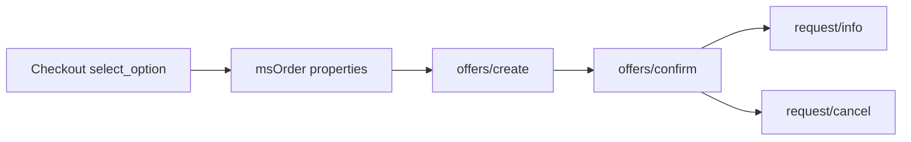

# Заявки и менеджер

## Жизненный цикл



1. На чекауте выбор сохраняется в `properties.msyandexdelivery`.
2. В менеджере на вкладке заказа вы вызываете **Create** → Platform `offers/create`.
3. **Confirm** → `offers/confirm` с `offer_id`.
4. **Refresh status** → `request/info`.
5. **Отменить** → `request/cancel` (пока заявка ещё не у курьера).

Push-уведомлений (webhook) **нет**. Other-day API их не даёт. Статус обновляйте опросом вручную или пакетно.

Данные заявки хранятся в таблице **`msyandex_requests`** (модель `msydRequest`) и в properties заказа.

## Вкладка заказа MiniShop3


Плагин `msYandexDelivery Manager order tab` на `msOnManagerCustomCssJs` (страница заказа) регистрирует вкладку через `MS3OrderTabsRegistry`. Нужен **VueTools**.

На вкладке: статус, offer/request id, цена, tracking, кнопки Create / Confirm / Refresh / Cancel.

Кнопка **Отменить** доступна после подтверждения заявки и до передачи посылки курьеру. Недоступна для завершённых заявок (доставлена, отменена, возвращена, ошибка), заказа в пункте выдачи, возврата и статуса «Едет к получателю». После успешной отмены на вкладке будет «Отменена».

## Опрос статусов

Пакетный опрос подтягивает актуальные статусы из Яндекс Доставки для активных заявок. Завершённые (доставлена, отменена, возвращена, ошибка) пропускаются. В первую очередь обновляются заявки, которые давно не синхронизировались.

После каждого изменения статус сохраняется в карточке заказа MiniShop3. Чтобы автоматически менять статус заказа или слать уведомления, подключите плагин на событие смены статуса (см. ниже).

### Scheduler

Файл задачи: `core/components/msyandexdelivery/elements/tasks/sync_statuses.php`

1. Установите [Scheduler](https://modx.com/extras/package/scheduler) или аналог.
2. Создайте File task на этот путь.
3. Интервал 15–30 минут.
4. В свойствах задачи можно задать `limit`. Иначе берётся `msyandexdelivery_sync_poll_limit`.

### Cron без Scheduler

Задайте длинный `msyandexdelivery_sync_secret` и вызовите коннектор:

```bash
curl -sS 'https://example.com/assets/components/msyandexdelivery/connector.php?action=sync_statuses&secret=YOUR_SECRET'
```

Работает и через POST. Без секрета и без сессии менеджера ответ `unauthorized`. Если вы уже вошли в менеджер, `action=sync_statuses` можно без секрета.

### Плагин на смену статуса

```php
<?php
/** @var modX $modx */
switch ($modx->event->name) {
    case 'msYandexDeliveryOnStatusChange':
        $orderId = (int) ($modx->event->params['order_id'] ?? 0);
        $normalized = (string) ($modx->event->params['normalized_status'] ?? '');
        // например сменить статус MS3 при delivered
        break;
}
```

Подпишите плагин на событие. MODX создаст имя при первом `invokeEvent`, либо добавьте `msYandexDeliveryOnStatusChange` в Events пакета.

## Connector

Единая точка: `assets/components/msyandexdelivery/connector.php`.

| action | Контекст | Назначение |
| --- | --- | --- |
| `calculate` | web | Расчёт стоимости |
| `select_option` | web | Сохранить выбор (нужен `ms3_token`) |
| `list_pickup_points` | web / mgr | Список ПВЗ |
| `get_order_summary` | mgr | Сводка по заказу |
| `create_request` | mgr | Создать offer |
| `confirm_request` | mgr | Подтвердить offer |
| `refresh_status` | mgr | Обновить статус |
| `cancel_request` | mgr | Отменить заявку |
| `sync_statuses` | mgr или secret | Пакетный опрос активных заявок |
| `ping` | mgr | Проверка соединения с API |

### Идемпотентность создания заявки {#идемпотентность}

`create_request` проверяет существующие заявки по `order_id` и `operator_request_id`. Повторный вызов для того же заказа вернет существующую заявку, а не создаст дубликат.

Параметр `force=true` позволяет принудительно создать новую заявку даже при наличии существующей (например, если предыдущая была отменена).

```php
// В MsYandexDelivery\Service\YandexDeliveryService::createRequest()
$existing = $repository->findByOrderId($orderId);
if ($existing && !$force) {
    return $existing; // идемпотентный ответ
}
```

### Retry при задержке статуса {#retry-логика}

При опросе статуса (`request/info`) API может вернуть временный статус `missing_status`. В этом случае компонент автоматически повторяет запрос через **800 мс** (не более 3 попыток).

Логика реализована в `YandexDeliveryService::getRequestStatus()`:

```php
// Повтор при missing_status с задержкой 800 мс
if ($status === 'missing_status' && $retryCount < 3) {
    usleep(800000); // 800 мс
    return $this->getRequestStatus($requestId, $retryCount + 1);
}
```

### Восстановление цены {#восстановление-цены}

Если при опросе статуса цена не вернулась из API, компонент пытается восстановить её из:

1. `create_response.price` — цена из ответа на создание заявки
2. `msOrder.properties.msyandexdelivery.price` — сохранённая цена при выборе на чекауте

Это защищает от потери данных при временных сбоях API. Логика в `YandexDeliveryService::updateRequestFromApi()`.

## Platform API (клиент)

Базовый host: `msyandexdelivery_base_url`. Пути клиента:

| Метод | Path |
| --- | --- |
| POST | `/api/b2b/platform/pricing-calculator` |
| POST | `/api/b2b/platform/offers/create` |
| POST | `/api/b2b/platform/offers/confirm` |
| GET | `/api/b2b/platform/request/info` |
| GET | `/api/b2b/platform/request/actual_info` |
| GET | `/api/b2b/platform/request/history` |
| POST | `/api/b2b/platform/request/cancel` |
| POST | `/api/b2b/platform/location/detect` |
| POST | `/api/b2b/platform/pickup-points/list` |

Сервис: `MsYandexDelivery\Service\YandexDeliveryService`. HTTP: `MsYandexDelivery\Api\YandexPlatformClient`.

::: warning Недокументированные параметры API
В коде встречаются query-параметры `?is_oversized` и `?send_unix`, которые не описаны в официальной документации Yandex Delivery API. Они могут измениться или быть удалены без предупреждения.
:::

## Вспомогательные классы и хелперы {#helpers}

### StationId

`MsYandexDelivery\Support\StationId::normalize(string $id): string`

Нормализует ID ПВЗ: удаляет дефисы и преобразует к формату, ожидаемому Platform API.

```php
// Пример: виджет вернул "MSK-01-01", API ждёт "MSK0101"
$normalized = StationId::normalize('MSK-01-01'); // "MSK0101"
```

Используется в `YandexDeliveryService::selectOption()` после выбора точки на чекауте.

### PickupStationMatcher

`MsYandexDelivery\Support\PickupStationMatcher`

Сопоставляет точку из CDN‑виджета (prod‑каталог) с точкой в тестовом API. Если API не знает точку, сервис ищет ближайшую по адресу через `pickup-points/list`.

```php
if (!$apiKnowsStation) {
    $matched = $matcher->findBestMatch($widgetPoint, $apiPoints);
    // возвращает ближайшую точку из API или null
}
```

### Хелперы {#helper-functions}

Файл: `core/components/msyandexdelivery/include/helpers.php`

| Функция | Описание |
| --- | --- |
| `msyd_get_draft_order()` | Получить черновик заказа из сессии или БД |
| `msyd_build_cargo(array $products): array` | Сформировать массив грузов из товаров заказа (вес, габариты, стоимость) |
| `msyd_resolve_widget_city(): string` | Определить город для виджета по цепочке: `$city` параметр → `geo_id` → адрес заказа → `widget_city` → Москва |

Пример использования `msyd_build_cargo()`:

```php
$products = $order->getMany('Product'); // msOrderProduct
$cargo = msyd_build_cargo($products);
// ['weight' => 2.5, 'dimensions' => [30, 20, 10], 'value' => 5000]
```

Эти хелперы подключаются через `require_once` в сниппетах и процессорах.

## Плагины

| Плагин | События |
| --- | --- |
| msYandexDelivery Autoload | `OnMODXInit` (priority -100) |
| msYandexDelivery Delivery | `msOnGetDeliveryCost` |
| msYandexDelivery Order persist | `msOnSubmitOrder`, `msOnBeforeCreateOrder`, `msOnCreateOrder` |
| msYandexDelivery Manager order tab | `msOnManagerCustomCssJs` |


