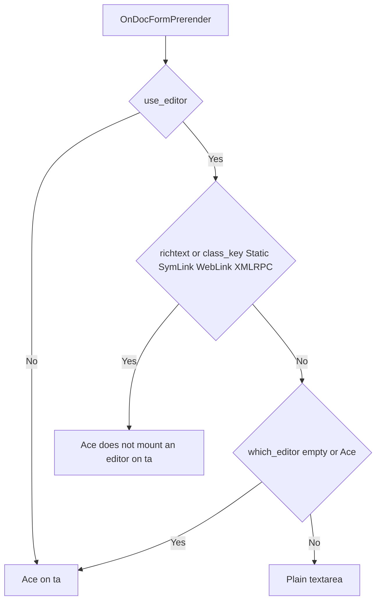

# Integration

Plugin **Ace** listens to manager events: element forms, files, resource, resource overview cache tab, RTE registration, and TV input list.

## Where the editor runs

| Context | Event / field | Default mime |
| --- | --- | --- |
| Snippet | `OnSnipFormPrerender` → `modx-snippet-snippet` | PHP |
| Plugin | `OnPluginFormPrerender` | PHP |
| Template | `OnTempFormPrerender` | `ace.html_elements_mime` or auto |
| Chunk | `OnChunkFormPrerender` | HTML/Fenom/Twig. Static chunks use the chunk name extension first, then the source file extension, otherwise `text/plain` |
| New file | `OnFileCreateFormPrerender` | `text/plain`, MODX tags off |
| Existing file | `OnFileEditFormPrerender` | by extension. An unknown extension uses the Ace mode for the file name, and MODX tags stay off |
| Resource (content) | `OnDocFormPrerender` → `#ta` | content type. `text/html` is replaced with `ace.html_elements_mime` |
| Resource overview → cache | `OnManagerPageBeforeRender` → `modx-rdata-buffer` | html mime |
| TV | input type **Ace** | always `text/html`, MODX tags on |

If `which_element_editor` is not `Ace`, the plugin returns immediately. The plugin does not initialize elements, files, the resource, the `resource/data` cache tab, or the TV list. `OnRichTextEditorRegister` runs earlier and still outputs the name `Ace`. An empty or missing setting counts as `Ace`.

## Resources and RTE



1. `use_editor` and `which_editor` respect the resource context.
2. `use_editor = No`: Ace replaces `#ta` and every textarea with class `modx-richtext` (`text/html`, MODX tags on).
3. `use_editor = Yes` and richtext, or class_key `modStaticResource`, `modSymLink`, `modWebLink`, `modXMLRPCResource`. Ace does not touch `#ta`. The plugin has no `OnRichTextEditorInit` handler.
4. `use_editor = Yes`, richtext off, `which_editor` empty or `Ace` (case-insensitive): Ace on `#ta`.
5. `use_editor = Yes` and `which_editor` is not `Ace`: `#ta` stays a plain textarea.

| Setup | Settings |
| --- | --- |
| Ace in content on every resource | `use_editor = No` |
| Ace only on resources without richtext | `use_editor = Yes`, `which_editor` empty or `Ace`, richtext off |
| RTE for articles, textarea for code pages | `use_editor = Yes`, another `which_editor`, richtext only where needed |

## Mime and MODX / Fenom highlighting

MODX tag highlighting is enabled only for HTML-like mimes:

- `text/html`
- `text/x-smarty` (Fenom / Smarty)
- `text/x-twig`

For CSS/SCSS/LESS/static chunks with a `.css` extension, MODX mixed mode is **off**: `//` and `/* */` comments highlight as CSS.

Auto `ace.html_elements_mime` when empty:

| Condition | Mime |
| --- | --- |
| `twiggy_class` present | `text/x-twig` |
| `pdotools_fenom_parser` on | `text/x-smarty` |
| Otherwise | `text/html` |

Set `ace.html_elements_mime = text/x-smarty` explicitly if Fenom in chunks is always required.

Extension of an existing file:

| Extension | Mime |
| --- | --- |
| `tpl` | `text/x-smarty` |
| `htm`, `html` | `text/html` |
| `css` | `text/css` |
| `scss` | `text/x-scss` |
| `less` | `text/x-less` |
| `svg` | `image/svg+xml` |
| `xml`, `xsl` | `application/xml` |
| `js` | `application/javascript` |
| `json` | `application/json` |
| `php` | `application/x-php` |
| `sql` | `text/x-sql` |
| `md` | `text/x-markdown` |
| `txt` | `text/plain` |
| `twig` | `text/x-twig` |

A new file is always `text/plain`. A static chunk checks the name extension first (`header.css` stays CSS even when the source file differs).

## Saving PHP

For mime `application/x-php` and `text/x-php`, the editor does not replace the buffer after a snippet or plugin save. Condition: the only difference is the `<?php` / `?>` wrapper. The undo history stays. MODX stores the code without that wrapper. After a reload the editor shows the database text, already without the wrapper. HTML chunks are not affected.

## Tab snippets

`ace.snippets` format (Ace snippets):

```text
snippet getr
    [[!getResources? &parents=`${1}` &limit=`${2:10}` &tpl=`${3}`]]
```

Ace definitions need a real Tab after the snippet name (**Alt+09** in the setting), not spaces. The indent above is spaces for markdown only. Expand in the editor: name + **Tab**.

Default set (when `ace.snippets` is empty on install/upgrade): `getr`, `getResources`, `pdoResources`, `pdoMenu`, `chunk`, `snippet`, `tv`, `formit`, and more. Reference file: `assets/components/ace/snippets/modx.default.snippets`.

Add your own abbreviations in the system setting. Do not edit the assets file: package upgrades may overwrite it.

## Completions

**Ctrl+Space**, **Ctrl+Shift+Space**, or **Alt+Space**. Request: `assets/components/ace/completions.php`. Actions: `getFunctions`, `getProperties`, `getFilters`, `getObjects`, `getResourceFields`. `getFilters` also offers snippets. `getObjects` returns chunks, snippets, TVs, and system settings. Resource fields are requested next to a TV.

## Ace TV type

1. Create a TV and choose input type **Ace**
2. Assign the TV to a resource template

This type has no mime property. The field is always `text/html` with MODX tag highlighting. Height comes from the textarea style or is 200. `ace.height` does not apply to TVs.

## Drafts

With `ace.draft_restore = Yes`, Ace writes field text to localStorage. After a reload Ace offers restore or discard. The banner stays hidden when the draft is empty or matches the text already open. Ace clears the draft in `MODx.onSaveEditor` when the field is already replaced by Ace. TTL: 7 days.

## Related

- [System settings](settings)
- [Keyboard shortcuts](hotkeys)
- [Troubleshooting](troubleshooting)
