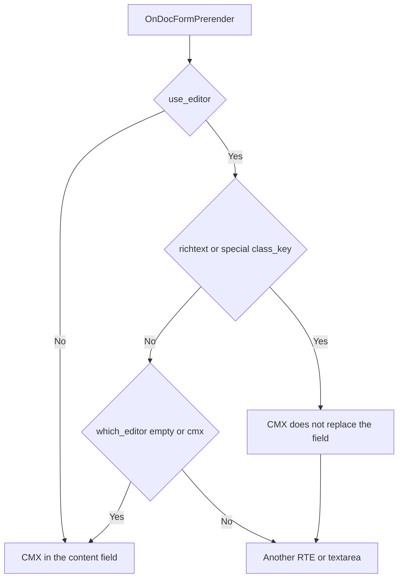

# Integration

The **CMX** plugin replaces fields on manager forms, registers the TV input type, creates snapshots when objects are saved, and deletes the history of deleted objects. The editor is loaded only on pages containing a supported field.

## Where the Editor Works

| Context | Event / field | Default language |
| --- | --- | --- |
| Snippet | `OnSnipFormPrerender` → `modx-snippet-snippet` | PHP without the opening `<?php` |
| Plugin | `OnPluginFormPrerender` → `modx-plugin-plugincode` | PHP without the opening `<?php` |
| Template | `OnTempFormPrerender` → `modx-template-content` | HTML, Fenom, or Twig |
| Chunk | `OnChunkFormPrerender` → `modx-chunk-snippet` | HTML/Fenom/Twig; for static chunks, the language is determined by the extension |
| New file | `OnFileCreateFormPrerender` → `modx-file-content` | `text/plain`, MODX tags disabled |
| Existing file | `OnFileEditFormPrerender` → `modx-file-content` | Determined by the extension |
| Resource (content) | `OnDocFormPrerender` → `ta` | MIME type of the content type; HTML is replaced with the selected template mode |
| Resource Overview → Cache | `OnManagerPageBeforeRender` → `modx-rdata-buffer` | HTML/Fenom/Twig |
| TV | **cmx** input type | TV `language` property; HTML by default |

The main form replacement occurs when `which_element_editor = cmx`. Registration of the `cmx` name in the RTE list, the TV input type, and history events are handled separately.

## Resources and RTE



1. `use_editor` and `which_editor` are read with the resource context taken into account.
2. `use_editor = No`: CMX replaces the content field and textareas with the `modx-richtext` class.
3. `use_editor = Yes` and richtext enabled: CMX does not take over the field.
4. For `modStaticResource`, `modSymLink`, `modWebLink`, and `modXMLRPCResource`, the field is also not replaced in the RTE branch.
5. `use_editor = Yes`, richtext disabled, `which_editor` empty or `cmx`: CMX is used.
6. `use_editor = Yes` and another `which_editor` selected: another RTE or a regular textarea remains in use.

| Workflow | Settings |
| --- | --- |
| CMX in content for all resources | `use_editor = No` |
| CMX only for resources without richtext | `use_editor = Yes`, `which_editor` empty or `cmx`, richtext disabled |
| RTE for articles, CMX for elements | `use_editor = Yes`, another `which_editor`, richtext enabled for the appropriate resources |

## MIME and Language

MODX tag highlighting and autocompletion are enabled for:

- `text/html`;
- `text/x-smarty` - Fenom;
- `text/x-twig` - Twig.

These features are not enabled for CSS, SCSS, and Less: the code remains CSS rather than becoming a mixed HTML document.

The optional `cmx.html_elements_mime` setting defines the mode for templates, regular chunks, and HTML resources. If it is not set, CMX selects:

| Condition | MIME |
| --- | --- |
| `twiggy_class` is set | `text/x-twig` |
| `pdotools_fenom_parser` is enabled | `text/x-smarty` |
| Otherwise | `text/html` |

File and static chunk extensions:

| Extension | MIME |
| --- | --- |
| `tpl` | `text/x-smarty` |
| `htm`, `html` | Selected HTML/Fenom/Twig mode for files; `text/html` in the static map |
| `css` | `text/css` |
| `scss` | `text/x-scss` |
| `less` | `text/x-less` |
| `svg` | `image/svg+xml` |
| `xml`, `xsl` | `application/xml` |
| `js` | `application/javascript` |
| `json` | `application/json` |
| `php` | `text/x-php` for files |
| `sql` | `text/x-sql` |
| `md` | `text/x-markdown` |
| `twig` | `text/x-twig` |
| `txt` | `text/plain` |

For a static chunk, CMX first checks the extension of the chunk name and then the extension of the source file. A new file starts as `text/plain`.

## Autocompletion

Suggestions appear automatically or when you press **Ctrl+Space**.

| Context | Data |
| --- | --- |
| `[[`, `[[!` | Snippets and MODX tag type prefixes |
| `[[$` | Chunks |
| `[[*` | TVs and resource fields; on a resource form, TVs assigned to the current template |
| `[[+` | Resource fields and placeholders from the document |
| `[[~` | Resources with IDs and titles |
| `[[++` | System settings and current values |
| `[[%` | Lexicon entries in the manager language |
| `&property` | Snippet/chunk properties, descriptions, and default values |
| `:filter` | MODX output filters |
| `@set` | Property sets |
| Fenom / Twig | Tags, blocks, modifiers, filters, and objects |
| `$modx->`, `$xpdo->` | MODX/xPDO API methods |
| Regular word in PHP | PHP functions and custom snippets |

When suggestions are shown again, parameters that have already been used are hidden. The `cmx.autocomplete.*` settings control default values, tag closing, and block skeletons.

Custom snippets are defined in `cmx.snippets`:

```text
Label :: text to insert
```

## Navigation and Hover Tooltips

With `cmx.goto_definition = Yes`, **Ctrl/Cmd + click** opens a snippet, chunk, TV, or resource in a new browser tab.

With `cmx.hovers = Yes`, hovering displays:

- the resource title and URI;
- the description of a snippet, chunk, or TV;
- the description of a resource field;
- help for MODX output filters;
- help for Fenom modifiers.

## Code Validation

- **PHP:** browser-based scanning of brackets, strings, comments, and heredoc/nowdoc; additionally, server-side `php -l` validation.
- **CSS:** unknown properties, likely typos, and curly brackets in CSS files and `<style>` blocks.
- **Fenom/MODX:** unclosed and mismatched blocks, quotation marks, apostrophes, and brackets.

Server-side validation uses `cmx.php_path`. If PHP CLI or `exec()` is unavailable, browser-based diagnostics remain available. `cmx.warn_on_save` enables confirmation before saving code with critical errors but does not block saving completely.

## CMX TVs

1. Create a TV and select the **cmx** input type
2. Assign the TV to a resource template
3. Configure input properties if necessary:

| Property | Default | Description |
| --- | --- | --- |
| `language` | `text/html` | `text/html`, `text/css`, `application/javascript`, `application/json`, `text/x-sql`, `application/xml`, `text/x-markdown`, or `application/x-php` |
| `height` | `260` | Editor height in px, minimum 100 |

The value is saved like a regular TV and remains in the editor after the resource is saved. The input type is disabled with the `cmx.tv` setting.

## Drafts

With `cmx.autosave = Yes`, CMX saves a working copy to the current browser's `localStorage`. After reopening the document, you can:

- compare the saved document and the draft in a side-by-side diff;
- restore the draft;
- delete it.

The retention period is set by `cmx.autosave_lifetime` in minutes. Drafts are not sent to the server or synchronized between browsers.

## Version History

With `cmx.versions = Yes`, snapshots of snippets, chunks, templates, plugins, and resources are stored in the `cmx_revision` table.

The history panel supports viewing, loading into the editor, copying, comparing two versions, and exporting JSON. Loading a version does not save the element itself: you must click the standard MODX save button.

`cmx.versions_max` limits the number of snapshots. Repeated identical saves within a short interval do not create a new version. When an element is deleted, its history is deleted; when the trash is permanently emptied, resource history is deleted. Files in the file manager are not versioned.

## CMX Scratchpad

The widget is added via **Dashboard → Edit → Widgets → CMX Scratchpad**. Text is stored only in the manager browser's `localStorage` and is not sent to the server.

## Related Sections

- [System Settings](settings)
- [Keyboard Shortcuts](hotkeys)
- [Troubleshooting](troubleshooting)
