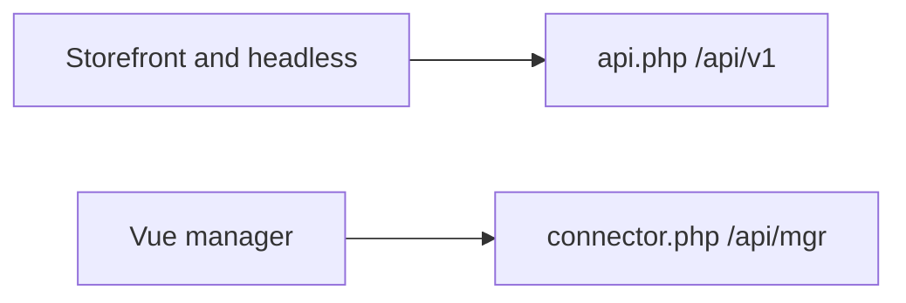

# REST API

MiniShop3 Web API (`api.php`) handles the storefront and headless clients: cart, checkout, customer account, public catalog. Manager API (`connector.php`) runs under a MODX session for the Vue admin and is not covered here.

```text
/assets/components/minishop3/api.php?route=/api/v1/...
```

| File | What is inside |
| --- | --- |
| `core/components/minishop3/config/routes/web.php` | Web API routes |
| `core/config/ms3_routes_web.custom.php` | Your own routes. Not shipped — you create it |
| `core/config/ms3.routes.d/web/*.php` | Add-on route fragments. The directory is not shipped |

## Documentation



| Section | Contents |
| --- | --- |
| [Overview](web-api/) | Envelope, middleware, base URL |
| [Authorization](web-api/auth) | Token, cookie, Bearer, login, `me`, refresh |
| [Endpoint map](web-api/endpoints) | Full path table from `web.php` |
| [Catalog](web-api/catalog) | product, category, filters, ACL |
| [Cart](web-api/cart) | Mutations and `cart/get` format |
| [Checkout](web-api/checkout) | delivery/payment list, order, cost, submit |
| [Customer](web-api/customer) | Profile, addresses, orders, email |
| [Errors](web-api/errors) | `code`, `errors`, `error_code`, HTTP |
| [CORS and rate limit](web-api/cors) | Origins, credentials, 429 |
| [Examples](web-api/examples) | curl and TypeScript/`$fetch` |

- Routing and your own routes — [API Router](routing)
- Storefront JS on the same domain — [Frontend JavaScript](frontend-js)
