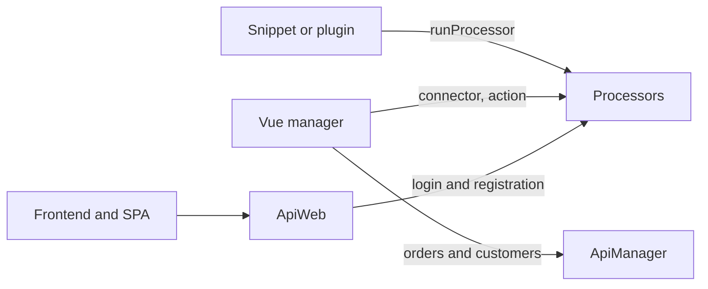

# Backend API

Work with products, orders, options, and customers from PHP: in plugins, snippets, console scripts, and third-party components.

## Processors

Processors live in `core/components/minishop3/src/Processors/`, namespace `MiniShop3\Processors\`. Call them by **full class name**. In PHP that is `$modx->runProcessor()`. In the connector and in Vue manager requests put the same name in the `action` parameter.

```php
$response = $modx->runProcessor('MiniShop3\\Processors\\Gallery\\Upload', [
    'id' => $productId,
    'file' => $path,
]);

$response->isError();
$response->getMessage();
$response->getObject();
```

Without a product (`id` = 0) `isError()` is true, `getMessage()` returns "Product not found.", and `getObject()` is empty. On success `isError()` is false, `getMessage()` is empty, and `getObject()` is the saved `msProductFile`.

::: warning A processor checks its permission wherever you call it from
Almost every MS3 processor declares a `$permission` (`msproductfile_save` for `Gallery\Upload`), and `ModelProcessor::checkPermissions()` boils down to `$modx->hasPermission($this->permission)`. The check runs inside `run()`, **before** `process()`, including a call from PHP.

A frontend snippet, where the visitor has no manager permissions, gets a refusal rather than a result: `isError()` is true and the message is `permission_denied_processor` with the permission name. When the operation has to run on behalf of a visitor, call a service (`$ms3->product`, `ProductImageService`, and the rest) instead of a processor. Services do not check permissions. The check stays with you.

Processor permissions are listed on the section pages: [products](./product#processors), [orders](./order), [customers](./customer).
:::

A short name such as `Gallery\Upload` does not work. When MODX does not recognize a full class name, it falls back to the old lookup: it joins `processors_path` with the action and expects the file `<processors_path>/gallery/upload.class.php`. MS3 processors are PSR-4 classes loaded by the autoloader, and those files are not in the package. The call answers "Requested processor not found", and the expected path goes to the MODX log. `RunsMs3Processors` passes `processors_path` next to the full class name, not instead of it.

## Manager API vs processors



| Layer | When to use |
| --- | --- |
| `Controllers\Api\Manager\*` | Vue manager UI (orders, customers, settings) |
| `Controllers\Api\Web\*` | Frontend, SPA, mobile apps |
| `MiniShop3\Processors\*` | `runProcessor()` from PHP, legacy connector, utilities with `RunsMs3Processors` |

Processor groups:

| Group | What is inside |
| --- | --- |
| `Product/*`, `Product/ProductLink/*` | Products and the links between them |
| `Category/*` | Product categories |
| `Gallery/*`, `Utilities/Gallery/*` | Product images and gallery utilities |
| `Customer/*`, `Customer/Address/*` | Customers and their addresses |
| `Api/Customer/*` | Login, registration, password reset, email verification. Web API delegates authentication here |
| `Settings/Vendor/*`, `Settings/Delivery/*`, `Settings/Payment/*`, `Settings/Status/*`, `Settings/Link/*` | Reference data: vendors, delivery methods, payment methods, statuses, link types |
| `Utilities/Import/*` | Product import from CSV |
| `System/*`, `System/Element/*`, `System/User/*` | Service operations |

Exception: Vue settings CRUD does **not** call `Processors/Settings/Vendor/*`. See [Vendor events](../events/vendor).

## Contents

- [Product API](product): create, update, options, images, categories, links, vendors
- [Order API](order): checkout, statuses, cost, addresses, items, log
- [Options API](options): create options, assign to categories, read and write values
- [Customer API](customer): authentication, registration, verification, addresses, tokens
