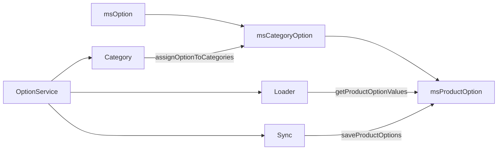

# Options API

Options in MiniShop3 follow the EAV pattern (Entity-Attribute-Value) and consist of three models:

- **msOption** — option definition (key, caption, type)
- **msCategoryOption** — option-to-category link (active, required, position)
- **msProductOption** — option value for a specific product

```
msOption (color, "Color", comboMultiple)
    ├── msCategoryOption (option → category "Clothing", active=true)
    │       ├── msProductOption (product=10, key=color, value="Red")
    │       ├── msProductOption (product=10, key=color, value="Blue")
    │       └── msProductOption (product=11, key=color, value="Green")
    └── msCategoryOption (option → category "Shoes", active=true)
            └── msProductOption (product=20, key=color, value="Black")
```

## OptionService (facade)

`OptionService` reads and writes values and assigns options to categories. It brings three services together.



```php
$optionService = $modx->services->get('ms3_option_service');
```

### Reading product options

```php
// All option values for a product
$values = $optionService->getProductOptionValues($productId);
// ['color' => ['Red', 'Blue'], 'size' => ['L', 'XL']]

// Specific options
$values = $optionService->getProductOptionValues($productId, ['color']);
// ['color' => ['Red', 'Blue']]
```

### Loading for templates

`loadOptionsForProduct` returns values together with metadata — for Fenom templates:

```php
$options = $optionService->loadOptionsForProduct($productId);
// [
//     'color' => ['Red', 'Blue'],
//     'color.caption' => 'Color',
//     'color.type' => 'comboMultiple',
//     'color.description' => 'Select color',
//     'color.measure_unit' => null,
//     'color.group_name' => 'Product properties',
//     'size' => ['L', 'XL'],
//     'size.caption' => 'Size',
//     ...
// ]

// Without metadata (keys and values only)
$options = $optionService->loadOptionsForProduct($productId, false);
```

The loader does not list metadata keys in advance. It puts **every** column of the query into the array as `key.column`. That covers all `msOption` fields (`caption`, `description`, `type`, `measure_unit`, `properties`, and the rest) plus `group_name`, the option group name joined from `msOptionGroup`. The group name lives in `group_name`. There is no `category_name` key.

### Batch loading

For catalogs use batch loading — it avoids N+1 queries:

```php
$allOptions = $optionService->loadOptionsForProducts([1, 2, 3, 4, 5]);
// [
//     1 => ['color' => ['Red'], 'size' => ['L']],
//     2 => ['color' => ['Blue', 'Green']],
//     ...
// ]
```

### Saving options

```php
// Save options (default removeOther=true — removes unspecified)
$optionService->saveProductOptions($productId, [
    'color' => ['Red', 'Blue'],
    'size' => ['L', 'XL'],
    'material' => ['Cotton'],
]);

// Add options without removing existing
$optionService->saveProductOptions($productId, [
    'brand' => ['Nike'],
], false);  // removeOther = false
```

On save, values are normalized: trimmed, deduplicated, and empty strings dropped.

### Available option keys

```php
// Which options are available for the product (from its categories)
$keys = $optionService->getAvailableOptionKeys($productId);
// ['color', 'size', 'material']
```

### Assigning options to categories

```php
// Assign option to several categories
$assigned = $optionService->assignOptionToCategories($optionId, [5, 12, 18]);
// [5, 12, 18] — category IDs the option was assigned to

// Assign with parameters
$optionService->addOptionToCategory(
    $optionId,
    $categoryId,
    '',       // default value
    true,     // active
    0         // position
);

// Remove option from category
$optionService->removeOptionFromCategory($optionId, $categoryId);

// Force remove (removes values even if option is active in other categories)
$optionService->removeOptionFromCategory($optionId, $categoryId, true);
```

::: info Auto-assignment to products
When an option is assigned to a category it is automatically added to all products in that category (including products in additional categories). On remove — values are kept if the option is active in another category of the product.
:::

### Accessing sub-services

```php
$loader = $optionService->getLoader();     // OptionLoaderService — read
$sync = $optionService->getSync();         // OptionSyncService — write
$category = $optionService->getCategory(); // OptionCategoryService — categories
```

## msOption model

Option definition is stored in table `ms3_options`.

### msOption fields

| Field | Type | Default | Description |
| --- | --- | --- | --- |
| `key` | varchar(191) | '' | Unique key. The allowed character set is wider than it looks. See [Key validation](#key-validation) |
| `caption` | varchar(191) | '' | Display name |
| `description` | text | null | Description |
| `measure_unit` | tinytext | null | Unit of measure |
| `option_group_id` | integer \| null | null | Option group ID (`msOptionGroup`); `null` — no group |
| `type` | varchar(191) | '' | Option type (comboMultiple, textfield, numberfield, etc.) |
| `properties` | json | null | Extra properties |

### Key validation {#key-validation}

The `msOption` model map sets a regex for the key and a list of reserved names (`id`, `type`, `price`, `color`, `size`, and other product and resource fields).

`POST /api/mgr/options` and a direct `save()` do not run these rules. The controller trims the key, replaces a dot with `_`, and checks uniqueness. The map rules run only when code calls `$option->validate()`.

The map regex is `/^(?!\W+)(?!\d)[a-zA-Z0-9\x2d-\x2f\x7f-\xff-_]+(?!\s)$/`. Three rules follow from it, and none of them is in the field description:

- the key does not start with a digit: the map rejects `1c_code` and accepts `c1_code`;
- the key does not start with a non-word character and does not end with a space;
- the character set is wider than you would expect: besides Latin letters and digits it allows `-`, `.`, `/`, `_`, and bytes `\x7f-\xff`, so a Cyrillic key passes.

Because of that, `1c_code` is saved through the Manager API, while code that writes the option through the model with `validate()` rejects the same key.

A reserved key such as `color` is saved through the Manager API and then shadowed by the product column in the template ([#841](https://github.com/modx-pro/MiniShop3/issues/841)).

### Programmatic usage

```php
use MiniShop3\Model\msOption;

// Create option
$option = $modx->newObject(msOption::class);
$option->set('key', 'material');
$option->set('caption', 'Material');
$option->set('type', 'comboMultiple');
$option->save();

// Get option
$option = $modx->getObject(msOption::class, ['key' => 'color']);

// Assign to categories
$assigned = $option->setCategories([5, 12, 18]);

// Get all options
$options = $modx->getIterator(msOption::class);
```

## msCategoryOption model

Option–category link. Table `ms3_category_options`.

### msCategoryOption fields

| Field | Type | Default | Description |
| --- | --- | --- | --- |
| `option_id` | integer | 0 | Option ID (part of PK) |
| `category_id` | integer | 0 | Category ID (part of PK) |
| `position` | integer | 0 | Sort order |
| `active` | boolean | false | Whether option is active in category |
| `required` | boolean | false | Whether option is required |
| `caption` | string \| null | null | Option caption in this category; `null` — falls back to `msOption` |
| `description` | string \| null | null | Option description in this category; `null` — falls back to `msOption` |
| `value` | text | null | Default value |

::: info Composite primary key
`msCategoryOption` uses composite PK of `option_id` + `category_id`.
:::

### Cascade behavior

On **save** of `msCategoryOption` the option is automatically added to all products in the category that don’t have it yet.

On **remove** of `msCategoryOption`, `msProductOption` values are deleted only for products where the option is not active in any other category. This avoids data loss when a product belongs to multiple categories with the same option.

### Programmatic usage

```php
use MiniShop3\Model\msCategoryOption;

// Assign option to category
$link = $modx->newObject(msCategoryOption::class);
$link->set('option_id', $optionId);
$link->set('category_id', $categoryId);
$link->set('active', true);
$link->set('position', 0);
$link->save();
// On save() option is auto-added to all products in the category

// Get category options
$categoryOptions = $modx->getIterator(msCategoryOption::class, [
    'category_id' => $categoryId,
    'active' => true,
]);

// Deactivate option in category
$link = $modx->getObject(msCategoryOption::class, [
    'option_id' => $optionId,
    'category_id' => $categoryId,
]);
$link->set('active', false);
$link->save();

// Remove option from category (cascade deletes product values)
$link->remove();
```

## msProductOption model

Option value for a product. Table `ms3_product_options`. One row per value. For multi-value options (comboMultiple) multiple rows with the same `key` are created.

### msProductOption fields

| Field | Type | Default | Description |
| --- | --- | --- | --- |
| `product_id` | integer | null | Product ID |
| `key` | varchar(191) | null | Option key |
| `value` | text | '' | Value |

::: warning Use OptionService
Always use `OptionService` for product options. Creating `msProductOption` directly bypasses sync with `msProductData` JSON fields (`tags`, `color`, `size`) and category cascade logic.
:::

## CategoryOptionService

`CategoryOptionService` returns the options of a category. The manager list is built on it.

```php
use MiniShop3\Model\msCategory;

$categoryOptionService = $modx->services->get('ms3_category_option_service');

// Get category option keys
$category = $modx->getObject(msCategory::class, $categoryId);
$keys = $categoryOptionService->getOptionKeys($category);
// ['color', 'size', 'material']

// Get full field configs
$fields = $categoryOptionService->getOptionFields($category);

// Clear options cache
$categoryOptionService->clearCache($categoryId);
// Or full cache
$categoryOptionService->clearCache();
```

## OptionService sub-services

### OptionLoaderService

All option read operations.

```php
$loader = $optionService->getLoader();

// Load options for one product (with metadata)
$data = $loader->loadForProduct($productId, true);

// Load options for multiple products (no metadata)
$data = $loader->loadForProducts([1, 2, 3], false);

// Get field configs for manager
$fields = $loader->getFieldsForProduct($productId, $parentId);

// Get keys only
$keys = $loader->getOptionKeys($productId, $parentId);
```

### OptionSyncService

Writing and syncing option values.

```php
$sync = $optionService->getSync();

// Save options
$sync->saveProductOptions($productId, [
    'color' => ['Red', 'Blue'],
], true);

// Read current values
$values = $sync->getForProduct($productId);

// Rename option key across all products
$sync->updateOptionKey('old_key', 'new_key');
```

::: warning Renaming key
`updateOptionKey()` runs a bulk `UPDATE` on all `ms3_product_options` rows. Use only when renaming an option in settings.
:::

### OptionCategoryService

```php
$categoryService = $optionService->getCategory();

// Assign option to categories
$assigned = $categoryService->assignToCategories($optionId, [5, 12]);

// Add with parameters
$categoryService->addToCategory($optionId, $categoryId, '', true, 0);

// Remove from category
$categoryService->removeFromCategory($optionId, $categoryId);

// Get products in category
$productIds = $categoryService->getProductsInCategory($categoryId);

// Find products that already have the option
$withOption = $categoryService->getProductsWithOption($productIds, 'color');

// Batch insert option for products
$categoryService->batchInsertOptions($productIds, 'color', 'Red');

// Batch remove from categories
$categoryService->removeFromCategories($optionId, [5, 12, 18]);
```

## REST API

::: info Since v1.10.0-beta1
The old processors `Processors/Settings/Option/*` and `Processors/Category/Option/*` were removed together with the ExtJS interface. Every operation goes through two REST controllers: `OptionsController` and `CategoryOptionsController`.
:::

### Option management — `/api/mgr/options/*`

Controller `MiniShop3\Controllers\Api\Manager\OptionsController`, permission `mssetting_save`.

| Method | Path | Description |
| --- | --- | --- |
| `GET` | `/api/mgr/options` | List options with filters: `query`, `option_group_id`, `category_id`, `categories[]`. `option_group_id=0` selects options without a group |
| `GET` | `/api/mgr/options/{id}` | One option + linked categories map |
| `POST` | `/api/mgr/options` | Create: normalizes `key`, checks uniqueness, links to categories |
| `PUT` | `/api/mgr/options/{id}` | Partial update; on `key` change resyncs `msProductOption` via `OptionSyncService::updateOptionKey` |
| `DELETE` | `/api/mgr/options/{id}` | Delete. Cascade: `msOption::remove` → `msCategoryOption` → `msProductOption` |
| `DELETE` | `/api/mgr/options/bulk` | Bulk delete: `ids[]` |
| `POST` | `/api/mgr/options/bulk/assign` | Assign `options[]` to `categories[]` |
| `GET` | `/api/mgr/options/types` | Type list with localized names |
| `GET` | `/api/mgr/options/tree` | Resource tree for linking options to product categories, lazy by `parent`. Since 1.11.0 `msCategory` nodes are selectable, while `modResource`/`modDocument`/`modWebLink` with `isfolder=1` are navigation only; every node carries a `selectable: bool` flag. The `checked` flag marks categories where the option is already assigned (if `option_id` is passed) |
| `GET` | `/api/mgr/options/suggestions` | Unique `msProductOption.value` values by `key` for `comboOptions` autocomplete on the product card |

> Since 1.11.0 the `GET /api/mgr/options/modcategories` endpoint has been removed. Option grouping goes through `msOptionGroup` — see "Option groups" below.

### Option groups — `/api/mgr/option-groups/*`

Controller `MiniShop3\Controllers\Api\Manager\OptionGroupsController`, permission `mssetting_save`. Added in 1.11.0 — replace grouping via `modCategory`.

| Method | Path | Description |
| --- | --- | --- |
| `GET` | (root) | Group list. Params: `start`, `limit` (`0` = all), `query` (search by `name` / `description`). Every group in the response carries `options_count` — the number of options in it |
| `GET` | `/{id}` | One group + `options_count` |
| `POST` | (root) | Create group: `name` (required), `description`, `sort_order` |
| `PUT` | `/{id}` | Update: `name`, `description`, `sort_order` |
| `DELETE` | `/{id}` | Delete group. Options are not deleted — `option_group_id` is cleared, so they move to "No group" |
| `PUT` | `/positions` | Save new order: either `positions: { id: position, ... }` or `ids: [id, id, ...]` (ordered list) |
| `DELETE` | `/bulk` | Bulk delete: `ids[]`. Options are unlinked (not deleted), then groups are removed |

### Category options — `/api/mgr/categories/{category_id}/options/*`

Controller `MiniShop3\Controllers\Api\Manager\CategoryOptionsController`, permission `mscategory_save`.

| Method | Path | Description |
| --- | --- | --- |
| `GET` | (root) | Options linked to the category. Each row returns the effective `caption` and, next to it, `global_caption`/`global_description` plus the `category_caption`/`category_description` overrides |
| `POST` | (root) | Link option to category: `option_id`, `value`, `active`, `required`, `caption`, `description` |
| `PUT` | `/{option_id}` | Partial update of link: `value`, `active`, `required`, `position`, `caption`, `description` |
| `DELETE` | `/{option_id}` | Remove link. Product values are deleted only if the option is not active in any other product category |
| `POST` | `/sort` | Save new order (`option_ids[]`) |
| `POST` | `/bulk` | Bulk actions: `activate` / `deactivate` / `require` / `unrequire` / `remove` for `option_ids[]` |
| `POST` | `/duplicate` | Copy links from `category_from`; links that already exist in the current category are skipped |

### Schema API — `msOptionType::getSchema()`

Since v1.10.0-beta1 every type class in `Controllers/Options/Types/` has `getField()` (a string for ExtJS) and `getSchema()`.

```php
abstract class msOptionType
{
    abstract public function getField($field);
    public function getSchema(array $field): array;
}
```

::: warning Nothing calls `getSchema()` yet
The method is declared on `msOptionType` and duplicated on the `msOption` model, but the package never calls it. `OptionLoaderService::getFieldsForProduct()` does not put it into `option_fields`. The Vue product card does not request it and builds the field from `type`. The core still fills `ext_field` with the string from `getField()`.

Overriding `getSchema()` in your own option type does nothing. The result is not used. Until schema rendering is wired up, field behavior is set through `getField()` and `type`.
:::
