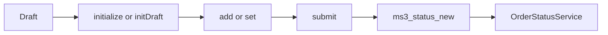
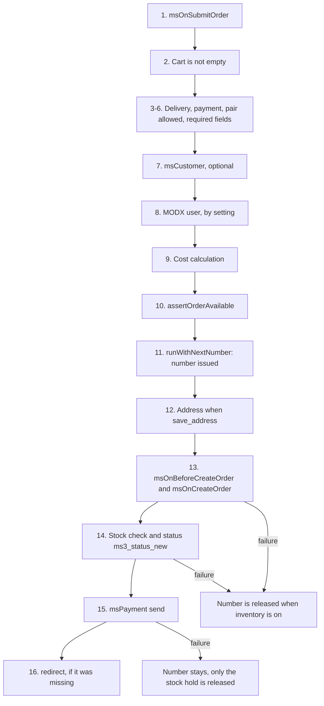

# Order API

Programmatic interface for working with MiniShop3 orders from PHP.

An order in MiniShop3 is made up of several models:

- **msOrder** — main order model (cost, status, delivery, payment)
- **msOrderAddress** — order address and contact data
- **msOrderProduct** — order lines (products)
- **msOrderLog** — order change log

Order lifecycle: **draft** → **submit** → **status changes**.

## Order controller (facade)

The `Order` controller (`$ms3->order`) is the PHP entry point to the order services.



::: warning The result comes in an envelope
Every controller method that returns an `array` returns the envelope `['success' => bool, 'message' => string, 'data' => array]` — the same `Utils::success()` / `Utils::error()` shape the Web API uses. The values you need are in `data`; for `get()` they sit one level deeper, in `data['order']`.

Only these return a value directly: `initialize()`, `initDraft()`, `remove()`, and `hasPayment()` (`bool`); `getDraft()` (an `msOrder` object or `null`); `getUserId()` (`int`); `getNewOrderNum()` (`string`).

`restrictDraft()` is the special case: it is declared `void`. The method recalculates the draft (`OrderDraftManager::recalculate()`), and success is judged by the order state, not by a return value.
:::

```php
$ms3 = $modx->services->get('ms3');

// Get current order data
$response = $ms3->order->get();
$order = $response['data']['order'];

// Add field
$result = $ms3->order->add('email', 'user@example.com');

// Set multiple fields
$result = $ms3->order->set([
    'email' => 'user@example.com',
    'phone' => '+79991234567',
    'first_name' => 'John',
    'delivery_id' => 1,
    'payment_id' => 1,
    'order_comment' => 'Call before delivery',
]);

// Submit order
$result = $ms3->order->submit();
// The payment response. With DefaultPayment data holds order_id, order_num, payment_link.
/ The redirect key is redirect, and the msorder query parameter carries the order uuid.

// Clear draft
$ms3->order->clean();

```

::: info Initialization
Initialize the controller with the client token before the first call:

```php
$ms3->order->initialize($token);
$ms3->order->initDraft();

```

In the REST API and in snippets this happens automatically.
:::

### Controller methods

| Method | Description |
| --- | --- |
| `initialize($token, $config)` | Initialize with client token |
| `initDraft()` | Load existing draft |
| `get()` | Order data (fields + address) |
| `add($key, $value)` | Add/update field |
| `set($fields)` | Set multiple fields |
| `remove($key)` | Remove field (set to null) |
| `validate($key, $value)` | Validate field value |
| `submit($data)` | Submit order |
| `clean()` | Clear draft |
| `getCost($onlyCost)` | Total cost (cart + delivery + payment) |
| `getCartCost()` | Cart cost |
| `getDeliveryCost()` | Delivery cost |
| `getPaymentCost()` | Payment fee |
| `setCustomerAddress($hash)` | Apply saved customer address |
| `cleanCustomerAddress()` | Clear address fields |
| `getDeliveryValidationRules($deliveryId)` | Delivery validation rules |
| `getDeliveryRequiresFields($deliveryId)` | Required delivery fields. The name is not a typo: the controller and the Web API method are called `Requires`, while `OrderFieldManager` has `getDeliveryRequiredFields()` |
| `getDraft()` | The draft `msOrder` object |
| `hasPayment($deliveryId, $paymentId)` | Whether the delivery and payment pair is allowed |
| `getUserId()` | MODX user ID for the current order. Registers one if there is none |
| `getNewOrderNum()` | Deprecated. Shows the next number without taking it. On submit, `OrderNumberGenerator::runWithNextNumber()` issues the number |
| `restrictDraft($draft)` | Recalculate the draft cost through `OrderDraftManager::recalculate()` |

## Drafts (OrderDraftManager)

A draft is an `msOrder` in `draft` status. It appears on the first cart request and holds the data until submit.

```php
$draftManager = $modx->services->get('ms3_order_draft_manager');

// Get or create draft
$draft = $draftManager->getOrCreateDraft($token, 'web');

// Get existing draft (no create)
$draft = $draftManager->getDraft($token, 'web');

// Get draft by customer ID (restore after login)
$draft = $draftManager->getDraftByCustomer($customerId, 'web');

// Draft data as array (order + address)
$data = $draftManager->toArray($draft);
// Address fields have prefix address_:
// ['email' => '...', 'address_city' => 'Moscow', 'address_street' => '...']

// Update one field
$draftManager->updateField($draft, 'order_comment', 'Call before delivery');
// Since 1.14.2-beta1 a key is written to one table only: the order wins over
// the address. For the shared columns (id, createdon, updatedon, properties)
// the address is no longer touched — set address properties directly:
// $draft->Address->set('properties', [...]); $draft->Address->save();

// Attach customer to draft
$draftManager->attachCustomer($draft, $customerId);

// Recalculate cost
$draftManager->recalculate($draft);

// Set delivery cost
$draftManager->setDeliveryCost($draft, 350.00);

// Check if cart is empty
if ($draftManager->isEmpty($draft)) {
    // No products
}

// Clear all fields
$draftManager->clean($draft);

// Delete draft (with products and address)
$draftManager->deleteDraft($draft);

```

Other public methods:

| Method | Description |
| --- | --- |
| `findDraftByToken($token, $ctx)` | Draft by token, without creating one |
| `createDraft($token, $ctx)` | A new draft |
| `ensureAddress($draft)` | The draft address. Creates the row if it is missing |
| `syncToken($draft, $newToken)` | Write the new token onto the draft |
| `getSessionCustomerId()` | Customer ID from the session |
| `bindDraftToCustomer($token, $customerId, $ctx)` | Bind the token's draft to a customer |
| `transferDraftToToken($fromToken, $toToken, $customerId, $ctx)` | Move the draft to a new token after the session changes |
| `fillAddressFromArray($order, $addressData)` | Fill the address from an array |
| `addProductFromSnapshot($order, $snapshot, $origin)` | Add a line from a snapshot, without a product resource |

## Fields and validation (OrderFieldManager)

The service manages order fields and their validation, and fires events on every change.

::: warning `add()` will not write internal fields
Since 1.14.2-beta1 `add()` and `remove()` reject the internal draft columns — the same ones closed for the Web API (see [checkout](/en/components/minishop3/development/web-api/checkout#protected-fields)). The rule is static: it does not care whether the call arrived over HTTP or from an add-on, and it runs before the `msOnBeforeAddToOrder` event, so a plugin that used to intercept writes to `status_id` or `customer_id` never sees them.

From PHP the internal fields are written directly: `OrderDraftManager::updateField()`, `attachCustomer()`, `setDeliveryCost()` skip the filter.
:::

```php
$fieldManager = $modx->services->get('ms3_order_field_manager');

// Add field (with validation and events)
$result = $fieldManager->add($draft, $orderData, 'email', 'user@example.com');
// ['success' => true, 'data' => [...]]

// Remove field
$fieldManager->remove($draft, $orderData, 'email');

// Validate without saving
$result = $fieldManager->validate($orderData, 'phone', '+79991234567');
// ['success' => true] or ['success' => false, 'message' => 'Error']

```

### Validation rules

By default `delivery_id` and `payment_id` are validated as `required|numeric`. The rest of the rules come from the delivery settings.

```php
// Get validation rules for delivery
$rules = $fieldManager->getDeliveryValidationRules($deliveryId);
// ['city' => 'required|min:2', 'street' => 'required', ...]

// Get required fields list
$required = $fieldManager->getDeliveryRequiredFields($deliveryId);
// ['city', 'street', 'building', 'phone']

// Add custom rules
$fieldManager->setValidationRules([
    'company_name' => 'required|min:3',
]);

```

## Cost calculation (OrderCostCalculator)

```php
$calculator = $modx->services->get('ms3_order_cost_calculator');

// Cart cost
$result = $calculator->getCartCost($draft, $token);
// ['cost' => 5000.00]

// Delivery cost
$result = $calculator->getDeliveryCost($draft, $orderData, $token);
// ['cost' => 300.00]

// Payment fee
$result = $calculator->getPaymentCost($draft, $orderData, $token);
// ['cost' => 150.00]

// Total cost
$result = $calculator->getTotalCost($draft, $orderData, $token);
// ['cost' => 5450.00, 'cart_cost' => 5000.00, 'delivery_cost' => 300.00, 'payment_cost' => 150.00]

```

Each method fires a pair of `msOnBefore...` / `msOn...` events — that is where a plugin changes the cost.

### Manager cost recalculation — `POST /api/mgr/orders/{id}/recalculate-cost`

Added in 1.11.0. The `ManagerOrderCostRecalculator` service recalculates `cart_cost`, `weight`, `delivery_cost` and the total `cost` from the saved order lines and the current `delivery_id` / `payment_id`. It touches no other order field.

Request body:

```json
{
  "mode": "auto",
  "manual_delivery_cost": 500.0
}

```

Modes (`mode`):

| Mode | Behavior |
| --- | --- |
| `auto` (default) | Recalculates only for `DefaultDelivery` / `DefaultPayment` (from `price`, `weight_price`, `free_delivery_amount` and the percentages). For custom handlers it returns the warning `delivery_manual_required` / `payment_manual_required` and keeps the previous `delivery_cost` and a fee of 0 — it calls no external API. |
| `manual` | Takes the `manual_delivery_cost` you pass. The payment fee is still calculated automatically, from the field. |
| `force_provider` | Explicitly calls `loadController()` → `getCost()` and `loadHandler()` → `getCost()` in `try/catch`. A delivery failure keeps the previous `delivery_cost` and adds the warning `delivery_provider_error`. A payment failure sets the fee to 0, rebuilds `cost` and adds `payment_provider_error` ([#897](https://github.com/modx-pro/MiniShop3/issues/897)) |

The response repeats the order data from `GET /api/mgr/orders/{id}` and adds:

```json
{
  "breakdown": {
    "cart_cost": 5000.0,
    "weight": 1.5,
    "delivery_cost": 300.0,
    "payment_cost": 150.0,
    "cost": 5450.0
  },
  "warnings": ["delivery_manual_required"]
}

```

The total passes through the shared clamp `OrderService::clampComputedTotal()`, so it never goes below zero. Delivery and payment discounts and markups (negative `price`, see 1.11.0) go through `MiniShop3\Utils\PriceAdjustment`.

Example call from JS (the order card in the manager):

```javascript
const response = await fetch(`/api/mgr/orders/${orderId}/recalculate-cost`, {
  method: 'POST',
  headers: {
    'Content-Type': 'application/json',
    'modAuth': MODx.modxConfig.auth, // or the current mgr-auth header
  },
  body: JSON.stringify({
    mode: 'manual',
    manual_delivery_cost: 500,
  }),
})
const json = await response.json()
// json.data.breakdown — cart_cost / delivery_cost / payment_cost / cost
// json.data.warnings — e.g. delivery_manual_required
```

Via HTTP (Manager API):

```bash
curl -X POST 'https://example.com/api/mgr/orders/42/recalculate-cost' \
  -H 'Content-Type: application/json' \
  -H 'Cookie: …' \
  -d '{"mode":"auto"}'
```

See also [API Router](/en/components/minishop3/development/routing).

## Order submit (OrderSubmitHandler)

`OrderSubmitHandler` runs the full submit cycle, from validation through the payment call.



```php
$submitHandler = $modx->services->get('ms3_order_submit_handler');

$result = $submitHandler->submit($draft, $orderData, $token);
// On success the handler returns whatever $msPayment->send() returned,
// so the exact payload depends on the payment provider.
// DefaultPayment answers with message = ms3_payment_link_created and data:
// payment_link (success page URL, msorder = order number), order_id, order_num.
// When data holds no 'redirect' key, the handler appends one itself:
// the ms3_order_redirect_thanks_id page with msorder = order uuid.

```

### Submit steps

1. Event `msOnSubmitOrder`. Fields a plugin returned in `data['data']` are written to the order through `OrderFieldManager::add()` — so protected columns are dropped here as well, see [Fields the frontend may not change](/en/components/minishop3/development/web-api/checkout#protected-fields)
2. Check: cart not empty (`ms3_order_err_empty`)
3. Both `delivery_id` and `payment_id` are set
4. The payment method exists and is active (`ms3_order_err_payment_not_found`)
5. The chosen delivery + payment pair is allowed (`DeliveryService::getDeliveryPaymentPairError()`)
6. Required fields of the chosen delivery are filled. A field counts as filled when the value itself arrives, the value arrives with an `address_` prefix, or the key is already in `properties['_validated']`
7. Find or create the customer (`msCustomer`) — an optional step: without an email and a phone no customer is created, and the order proceeds with the data in `msOrderAddress` only
8. Optionally: create a MODX user (setting `ms3_order_register_user_on_submit`). Unlike the previous step, failure here aborts the submit with `ms3_err_user_nf`
9. Calculate cost (cart + delivery + payment)
10. Check stock with `inventory()->assertOrderAvailable()` before allocating a number
11. `OrderNumberGenerator::runWithNextNumber()` writes the number and the totals — allocation and save share one lock
12. The address goes to the customer's address book only if `properties` holds `save_address` and the order has a `customer_id`
13. Events `msOnBeforeCreateOrder` / `msOnCreateOrder`
14. Stock is checked again, and the status changes to `ms3_status_new` (default: 2)
15. Call `$msPayment->send()`
16. If the payment response has no `data.redirect`, the handler appends the thank-you page URL with the order uuid

From step 11 the order holds a number. What happens to that number on failure:

| Where it fails | Order number |
| --- | --- |
| Steps 13–14, including the repeated stock check before the status change | Released through `revertAllocatedNumber()`, but only when inventory tracking is on |
| Steps 15–16, the payment call and the redirect | Stays with the order. The handler only releases the stock hold (`abortInventoryHold()`) and returns an error |

### Order number generation

::: warning `getNewOrderNum()` is deprecated
The method is marked `@deprecated` and writes a warning to the MODX error log on every call. It reads the next number but **does not reserve it**: between the read and the save the same number can go to another order. Allocate numbers through `OrderNumberGenerator::runWithNextNumber()` — there the allocation and the save share one lock.

It stays for backward compatibility with older plugins: use it to show "the number the next order will get", not to assign one.
:::

```php
$num = $submitHandler->getNewOrderNum();
// "26/02-15" — format is configurable:
// ms3_order_format_num — date format (default 'ym')
// ms3_order_format_num_separator — separator (default '/')
```

## Status management (OrderStatusService)

```php
$statusService = $modx->services->get('ms3_order_status');

// Change order status
$result = $statusService->change($orderId, $newStatusId);
// true — success
// string — error message from lexicon

// Change status without notifications
$result = $statusService->change($orderId, $newStatusId, true);

```

### Status constraints

| Status property | Behavior |
| --- | --- |
| `final = true` | Cannot change to another status |
| `fixed = true` | Can only switch to status with higher `position` |

On top of those two rules sits a list of allowed transitions — the `ms3_order_status_transitions` system setting. While it is empty, only `final` and `fixed` apply. Once the list is filled in, a transition has to be in it and must not break `final` or `fixed`.

The format is "from status : to status" pairs, comma-separated or as a JSON array:

```text
2:3,3:4,2:5
```

```json
[[2,3],[3,4]]
```

If the setting cannot be parsed, **every** status change is blocked with the `ms3_err_status_transitions_invalid` error. A typo in the list is not ignored: it halts order processing.

### Notifications

On a status change, `NotificationManager` sends the notifications itself:

- **To customer** — email, phone from `msCustomer` or `modUserProfile`
- **To managers** — from settings `ms3_email_manager`, `ms3_phone_manager`, `ms3_telegram_manager`

## Order products (msOrderProduct)

An order's products are stored in the `msOrderProduct` model (table `ms3_order_products`), one row per line.

### msOrderProduct fields

| Field | Type | Description |
| --- | --- | --- |
| `product_id` | integer | Product ID (msProduct) |
| `order_id` | integer | Order ID |
| `product_key` | string | Unique line key (e.g. `123_a1b2c3d4`) |
| `name` | string | Product name |
| `count` | integer | Quantity |
| `price` | float | Unit price |
| `weight` | float | Unit weight |
| `cost` | float | Line cost (price × count) |
| `options` | json | Selected options |
| `properties` | json | Extra properties |

### Working with products in code

```php
use MiniShop3\Model\msOrder;
use MiniShop3\Model\msOrderProduct;

$order = $modx->getObject(msOrder::class, $orderId);

// Get all order products
$products = $order->getMany('Products');
foreach ($products as $product) {
    echo $product->get('name') . ': ' . $product->get('count') . ' × ' . $product->get('price');
}

// Add product
$item = $modx->newObject(msOrderProduct::class);
$item->set('order_id', $orderId);
$item->set('product_id', $productId);
$item->set('product_key', $productId . '_' . md5(json_encode($options)));
$item->set('name', 'Product');
$item->set('count', 2);
$item->set('price', 1500.00);
$item->set('cost', 3000.00);
$item->set('weight', 0.5);
$item->set('options', $options);
$item->save();

// Recalculate order totals after changing products
$order->updateProducts();

```

::: warning Recalculating totals
After adding, removing or changing products call `$order->updateProducts()`. It recalculates `cart_cost`, `weight` and `cost` from all `msOrderProduct` of the order.
:::

## Order address (msOrderAddress)

Every order has exactly one related `msOrderAddress` (table `ms3_order_addresses`).

### msOrderAddress fields

| Field | Type | Description |
| --- | --- | --- |
| `order_id` | integer | Order ID |
| `createdon` | datetime | Created at |
| `updatedon` | datetime | Updated at |
| `first_name` | string | First name |
| `last_name` | string | Last name |
| `phone` | string | Phone |
| `email` | string | Email |
| `country` | string | Country |
| `index` | string | Postal code |
| `region` | string | Region |
| `city` | string | City |
| `metro` | string | Metro station |
| `street` | string | Street |
| `building` | string | Building |
| `entrance` | string | Entrance |
| `floor` | string | Floor |
| `room` | string | Apartment/office |
| `comment` | string | Address comment |
| `text_address` | string | Full address as single line |
| `properties` | json | Extra properties |

### Working with address in code

```php
use MiniShop3\Model\msOrder;

$order = $modx->getObject(msOrder::class, $orderId);
$address = $order->getOne('Address');

// Read
echo $address->get('city');       // "Moscow"
echo $address->get('street');     // "Lenina"

// Update
$address->set('city', 'Saint Petersburg');
$address->save();

```

### OrderAddressManager

The service works with the addresses of a draft:

```php
$addressManager = $modx->services->get('ms3_order_address_manager');

// Apply saved customer address to draft
$result = $addressManager->setCustomerAddress($draft, $orderData, $addressHash);

// Clear all address fields
$result = $addressManager->cleanCustomerAddress($draft, $orderData);

// Save order address to customer addresses
$savedAddress = $addressManager->saveToCustomerAddresses($customerId, $orderData);

```

## Order log (OrderLogService)

The log records order changes: status, fields, products.

```php
$logService = $modx->services->get('ms3_order_log');

// Add log entry
$logService->addEntry($orderId, 'status', [
    'old' => 1,
    'new' => 2,
]);

// Add custom action entry
$logService->addEntry($orderId, 'field', [
    'key' => 'delivery_id',
    'old_value' => 1,
    'new_value' => 2,
], true);  // visible = true (shown to customer)

// Get log entries
$entries = $logService->getEntries($orderId);
// Only customer-visible
$entries = $logService->getEntries($orderId, true);
// With limit
$entries = $logService->getEntries($orderId, false, 50);

// The previous method: add($orderId, $entry, $action, $visible = true)
$logService->add($orderId, ['old' => 1, 'new' => 2], 'status');

// Check if action is logged (setting ms3_order_log_actions)
if ($logService->shouldLog('status')) {
    // ...
}

```

### Action types

| Constant | Value | Description |
| --- | --- | --- |
| `msOrderLog::ACTION_STATUS` | `status` | Status change |
| `msOrderLog::ACTION_PAYMENT` | `payment` | Payment change |
| `msOrderLog::ACTION_PRODUCTS` | `products` | Products change |
| `msOrderLog::ACTION_ADDRESS` | `address` | Address change |
| `msOrderLog::ACTION_FIELD` | `field` | Order field change |

The `ms3_order_log_actions` setting lists the actions to log. The default is `status,products,field,address`; `*` logs everything.

## Finalize from manager (OrderFinalizeService)

`OrderFinalizeService` finalizes orders created in the manager.

```php
use MiniShop3\Services\Order\OrderOrigin;

$finalizeService = $modx->services->get('ms3_order_finalize');

$result = $finalizeService->finalize($orderId, [
    'skip_validation' => false,
    'skip_notifications' => false,
    'create_customer' => true,
    'force_create_customer' => false,
    'origin' => OrderOrigin::MANAGER, // default; for CRM use OrderOrigin::INTEGRATION
]);
```

Finalize accepts the `skip_*` keys and works with an existing draft. It never calls the payment service — unlike `submit` on the frontend.

The `origin` parameter (`OrderOrigin`): `manager` (default), `storefront`, `integration`. With `manager`, `msOnBeforeMgrCreateOrder` / `msOnMgrCreateOrder` also fire. The `from_manager` key in events is `true` only for `origin=manager`.

## Programmatic order creation (ProgrammaticOrderService) {#programmatic-order}

An API without an HTTP session — for extras, cron and integrations. This is **not** the Web API: `routes/web.php` has no dedicated endpoint.

| | |
| --- | --- |
| Key | `ms3_programmatic_order` |
| Class | `MiniShop3\Services\Order\ProgrammaticOrderService` |
| Draft | `OrderDraftManager::createSessionlessDraft()` (no PHP session or cart token) |
| Finalization | `OrderFinalizeService::finalize(..., origin=integration)` |
| Idempotency | column `ms3_orders.idempotency_key` (unique, nullable) |

```php
use MiniShop3\Services\Order\OrderOrigin;

$orders = $modx->services->get('ms3_programmatic_order');

$result = $orders->create([
    'idempotency_key' => 'crm-invoice-10042', // required
    'products' => [
        ['product_id' => 15, 'count' => 2],
        // or a snapshot without a resource:
        // ['name' => 'Service', 'price' => 500, 'count' => 1, 'weight' => 0, 'options' => []],
    ],
    'customer_id' => 0,
    'delivery_id' => 1,
    'payment_id' => 1,
    'address' => [
        'first_name' => 'John',
        'email' => 'user@example.com',
        'phone' => '+79991234567',
    ],
    'order_comment' => 'From CRM',
    'context' => 'web',
    'origin' => OrderOrigin::INTEGRATION,
    // 'delivery_cost' => 300, // → cost_mode=manual on finalize
    // 'skip_notifications' => true,
    // 'skip_validation' => false,
    // 'properties' => ['source' => 'crm'],
]);

if (!$result['success']) {
    // Common messages:
    // ms3_order_err_idempotency_key_required
    // ms3_order_err_products_required
    // ms3_order_err_programmatic_create
    // or finalize / validation errors
    return $result;
}

// Success: data = { order_id, uuid, num, status_id }
// Same idempotency_key again:
//   already finalized order → success + ms3_order_programmatic_idempotent
//   draft with draft status → finalize again
```

Events: `msOnBeforeCreateOrder` / `msOnCreateOrder` with `origin=integration` and **without** `from_manager`. Events `msOnBeforeMgrCreateOrder` / `msOnMgrCreateOrder` are **not** fired.

Differs from `POST /api/mgr/orders` (a manager creates an empty or partial order in the UI) and from `POST /api/v1/order/submit` on the frontend (needs a token and a cart).

## User resolution (OrderUserResolver)

The service finds or creates the MODX user from the order data.

```php
$userResolver = $modx->services->get('ms3_order_user_resolver');

// Get or create MODX user_id
$userId = $userResolver->getUserId($orderData);

// Check if user exists
$user = $userResolver->checkUserExists([
    'email' => 'user@example.com',
    'phone' => '+79991234567',
]);

// Create user
$user = $userResolver->createUser([
    'email' => 'user@example.com',
    'first_name' => 'John',
    'last_name' => 'Doe',
    'phone' => '+79991234567',
]);

```

The `ms3_order_user_groups` setting defines the groups for new users. The format is `group_id:role_id`, comma-separated.

## msOrder fields

| Field | Type | Default | Description |
| --- | --- | --- | --- |
| `user_id` | integer | 0 | MODX user ID |
| `customer_id` | integer | 0 | Customer ID (msCustomer) |
| `token` | string | — | Client session token |
| `uuid` | string | — | Order UUID |
| `createdon` | datetime | null | Created at |
| `updatedon` | datetime | null | Updated at |
| `num` | string | '' | Order number |
| `cost` | float | 0.0 | Total cost |
| `cart_cost` | float | 0.0 | Products cost |
| `delivery_cost` | float | 0.0 | Delivery cost |
| `weight` | float | 0.0 | Total weight |
| `status_id` | integer | 0 | Current status ID |
| `delivery_id` | integer | 0 | Delivery method ID |
| `payment_id` | integer | 0 | Payment method ID |
| `context` | string | 'web' | MODX context |
| `order_comment` | string | null | Order comment |
| `idempotency_key` | string | null | Idempotency key (programmatic orders, unique) |
| `properties` | json | null | Extra properties (incl. `origin` for integrations) |

### msOrder relations

| Relation | Model | Type | Description |
| --- | --- | --- | --- |
| `Address` | msOrderAddress | composite (one) | Order address |
| `Products` | msOrderProduct | composite (many) | Order products |
| `Log` | msOrderLog | composite (many) | Change log |
| `msCustomer` | msCustomer | aggregate | Customer. That is the actual alias — `getOne('Customer')` returns `null` |
| `Status` | msOrderStatus | aggregate | Status |
| `Delivery` | msDelivery | aggregate | Delivery method |
| `Payment` | msPayment | aggregate | Payment method |
| `User` | modUser | aggregate | MODX user |

::: info Composite vs Aggregate
Composite relations are deleted with the order (address, products, log). Aggregate relations are references only; related objects are not deleted.
:::

## Events

| Event | When fired | Who calls it |
| --- | --- | --- |
| `msOnBeforeSaveOrder` / `msOnSaveOrder` | Any order save, including a draft save | `msOrder` (the model) |
| `msOnBeforeRemoveOrder` / `msOnRemoveOrder` | Order removal | `msOrder` (the model) |
| `msOnBeforeGetOrderCost` / `msOnGetOrderCost` | Building the order total | `OrderCostCalculator` |
| `msOnBeforeGetCartCost` / `msOnGetCartCost` | Cart cost calculation | `OrderCostCalculator` |
| `msOnBeforeGetDeliveryCost` / `msOnGetDeliveryCost` | Delivery cost calculation | `OrderCostCalculator` |
| `msOnBeforeGetPaymentCost` / `msOnGetPaymentCost` | Payment fee calculation | `OrderCostCalculator` |
| `msOnBeforeAddToOrder` / `msOnAddToOrder` | Adding or changing a field | `OrderFieldManager` |
| `msOnBeforeRemoveFromOrder` / `msOnRemoveFromOrder` | Removing a field | `OrderFieldManager` |
| `msOnBeforeValidateOrderValue` / `msOnValidateOrderValue` | Value validation | `OrderFieldManager` |
| `msOnErrorValidateOrderValue` | Validation error | `OrderFieldManager` |
| `msOnSubmitOrder` | Submit starts | `OrderSubmitHandler` |
| `msOnBeforeCreateOrder` / `msOnCreateOrder` | Order creation, all three sources. See the note below | `OrderSubmitHandler`, `OrderFinalizeService` |
| `msOnBeforeCreateOrderProduct` / `msOnCreateOrderProduct` | Adding an order line | `ManagerOrderProductsService` (manager), `OrderDraftManager` (programmatic creation) |
| `msOnBeforeUpdateOrderProduct` / `msOnUpdateOrderProduct` | Changing a line, manager only | `ManagerOrderProductsService` |
| `msOnBeforeRemoveOrderProduct` / `msOnRemoveOrderProduct` | Removing a line, manager only | `ManagerOrderProductsService` |
| `msOnBeforeEmptyOrder` / `msOnEmptyOrder` | Clearing the order | `OrderDraftManager` |
| `msOnBeforeChangeOrderStatus` / `msOnChangeOrderStatus` | Status change | `OrderStatusService` |
| `msOnBeforeGetOrderUser` / `msOnGetOrderUser` | Finding or creating a user | `OrderUserResolver` |
| `msOnBeforeMgrCreateOrder` / `msOnMgrCreateOrder` | Manager finalization (only `origin=manager`) | `OrderFinalizeService` |

The customer works with the cart, not with order lines. None of the six line events fire on the storefront, even when a product is added to the cart, although an `msOrderProduct` row is created there (`CartItemManager`). Cart changes use the cart events: `msOnBeforeAddToCart`, `msOnBeforeChangeInCart`, `msOnBeforeRemoveFromCart` (see [Cart events](../events/cart)).

The call from `OrderDraftManager` is `addProductFromSnapshot()`, and it comes only from `ProgrammaticOrderService` (sessionless order creation for integrations and cron). That call has an extra `origin` key, which the manager call does not. Parameter details are on the [order line events](../events/order-product) page.

### Parameters of msOnBeforeCreateOrder and msOnCreateOrder {#create-order-event-params}

Two different services create an order, and their parameter sets do not match. A plugin that expects one source gets `null` instead of the object on the other.

| Source | Parameters |
| --- | --- |
| Storefront submit (`OrderSubmitHandler`) | `handler` is the handler itself, `msOrder` is the draft, `customFields` are the extra fields from `properties['_validated']` |
| Manager finalization and programmatic creation (`OrderFinalizeService`) | `service` is the service itself, `msOrder` is the order, `origin` is `manager` or `integration`, `from_manager` is `true` only when `origin=manager` |

The two cases are easy to tell apart by which key is present:

```php
$order = $params['msOrder'] ?? null;
$origin = $params['origin'] ?? 'storefront'; // no key means storefront submit
```

Returning an error from either event cancels creation: the order stays a draft, and the response carries the plugin message. The number has already been issued by then. On storefront submit it is released (`revertAllocatedNumber()`), but only when inventory tracking is on. Without tracking the number stays on the draft. Manager finalization never rolls the number back.

## Manager REST API

Endpoints of the Vue orders UI. They run under an mgr session — see [API Router](../routing).

| Method | Path | Description |
| --- | --- | --- |
| `GET` | `/api/mgr/orders` | Order list |
| `GET` | `/api/mgr/orders/filters` | Grid filter values |
| `GET` | `/api/mgr/orders/stats` | Aggregates for filters and the dashboard |
| `GET` | `/api/mgr/orders/{id}` | Order card |
| `PUT` | `/api/mgr/orders/{id}` | Update order |
| `DELETE` | `/api/mgr/orders/{id}` | Delete order |
| `DELETE` | `/api/mgr/orders/bulk` | Bulk delete |
| `POST` | `/api/mgr/orders` | Create order from the manager |
| `POST` | `/api/mgr/orders/{id}/finalize` | Finalize draft |
| `POST` | `/api/mgr/orders/{id}/recalculate-cost` | Recalculate via `ManagerOrderCostRecalculator` |
| `GET` | `/api/mgr/orders/{id}/logs` | Order log |
| `GET` | `/api/mgr/orders/{id}/products` | Order products |
| `POST` | `/api/mgr/orders/{id}/products` | Add a product |
| `PUT` | `/api/mgr/orders/{id}/products/{product_id}` | Update a product |
| `DELETE` | `/api/mgr/orders/{id}/products/{product_id}` | Delete a product |
| `GET` | `/api/mgr/orders/{id}/shipment` | Order shipment |
| `PUT` | `/api/mgr/orders/{id}/shipment` | Update shipment |

Reading the list, the card, filters, stats, lines, the log, and the shipment requires `msorder_list`. Writing, including both `DELETE` routes, requires `msorder_save`. These routes have no separate `msorder_remove`.

::: warning Editing lines is checked against stock {#inventory-reconcile}
With inventory tracking on (`ms3_inventory_enabled`), adding a line, changing its quantity, and deleting it bring the warehouse reserve to the final quantity of each product, and move the stock by the difference. Since 1.14.3-beta1 this happens before the row is saved. If stock is short, the row is not saved, and the reserve and the stock stay as they were.

The refusal comes as `409 Conflict` with one of two keys:

| Key | When |
| --- | --- |
| `ms3_err_inventory_short` | Stock is short of the requested quantity |
| `ms3_err_inventory_adjust_unsupported` | The stock service was replaced and does not implement `AdjustableInventoryInterface`, and the order already holds stock |

The refusal `data` includes details, among them `can_override`: whether the current user has the `msorder_inventory_override` permission. The interface uses it to decide whether to offer a retry:

```json
{
  "success": false,
  "message": "Not enough stock",
  "code": 409,
  "errors": null,
  "error_code": "conflict",
  "data": {
    "product_id": 15,
    "available": 3,
    "required": 10,
    "can_override": true
  }
}
```

To push the edit through a shortage, send `force: true` in the body. Without the permission the response is `403 Forbidden` with the same message: the `force` flag grants nothing by itself. For `ms3_err_inventory_adjust_unsupported`, `can_override` is always `false`. The problem is the replaced service, not the permission.
:::

`POST /api/mgr/orders` creates a draft (`ms3_status_draft`, fallback id 1) and does not fire `msOnBeforeMgrCreateOrder` / `msOnMgrCreateOrder`. Those events are fired by `POST /api/mgr/orders/{id}/finalize`, when `OrderFinalizeService` runs with `origin=manager`.

Event parameters: [Events](../events).
