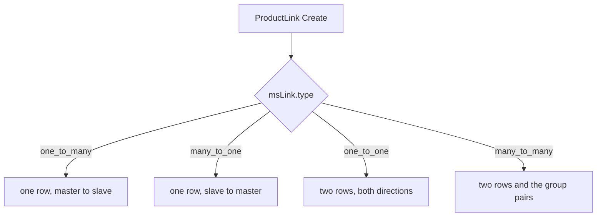

# Product API

A product is two models:

- **msProduct**: extends `modResource` and stores the resource fields (pagetitle, content, parent, and the rest)
- **msProductData**: extends `xPDOSimpleObject` and stores the commerce fields (price, article, stock, and the rest) in the `ms3_products` table

The relation is one to one, by `id`.

## Calling the processors

MiniShop3 processors are classes in the namespace `MiniShop3\Processors\`. Call them by **full class name**. The connector and Vue manager requests pass the same name in the `action` parameter. A short name such as `Gallery\Upload` does not work.

```php
// Correct — the full class name
$response = $modx->runProcessor('MiniShop3\\Processors\\Gallery\\Upload', [
    'id' => $productId,
    'file' => '/path/to/image.jpg',
]);

// Wrong — a short path without the namespace
$response = $modx->runProcessor('Gallery\\Upload', [...], [
    'processors_path' => $modx->getOption('core_path') . 'components/minishop3/src/Processors/',
]);
```

Next to the full name, callers sometimes also pass `processors_path`. `RunsMs3Processors` does that. It is an addition to the full name, not a replacement: a short name still fails when the path is set.

The tables below shorten names to the part after `MiniShop3\Processors\`: `Product\Create` means `MiniShop3\Processors\Product\Create`.

## Creating a product

### Via processor

Recommended way is processor `MiniShop3\Processors\Product\Create`: it creates both models at once and fires system events.

```php
$response = $modx->runProcessor('MiniShop3\\Processors\\Product\\Create', [
    'pagetitle' => 'New product',
    'parent' => 5,          // Category ID (msCategory)
    'price' => 1500,
    'article' => 'ART-001',
    'published' => true,
    'stock' => 100,
    'weight' => 500,

    // Options use prefix options-
    'options-color' => ['Red', 'Blue'],
    'options-size' => ['L', 'XL'],
]);

if ($response->isError()) {
    $modx->log(1, $response->getMessage());
} else {
    $productId = $response->getObject()['id'];
}
```

The processor automatically:

- Sets `class_key = msProduct`, `show_in_tree`, `template` from system settings
- Creates related `msProductData`
- If `ms3_product_id_as_alias` is on — sets alias to product ID
- Saves options (fields with prefix `options-`)

### Via model

For simple cases you can create a product with xPDO directly:

```php
use MiniShop3\Model\msProduct;

$product = $modx->newObject(msProduct::class);
$product->set('pagetitle', 'New product');
$product->set('parent', 5);
$product->set('published', true);
$product->set('template', $modx->getOption('ms3_template_product_default'));

if ($product->save()) {
    // msProductData is created on msProduct save
    $productData = $product->getOne('Data');
    $productData->set('price', 1500);
    $productData->set('article', 'ART-001');
    $productData->set('stock', 100);
    $productData->save();
}
```

::: warning Difference between approaches
Creating via model does not fire system events (`OnBeforeDocFormSave`, `OnDocFormSave`), does not set defaults and does not refresh resource cache. Use the processor for full product creation.
:::

## Reading and updating

### Reading product data

```php
use MiniShop3\Model\msProduct;
use MiniShop3\Model\msProductData;

// Via msProduct → Data relation
$product = $modx->getObject(msProduct::class, $productId);
$productData = $product->getOne('Data');
$price = $productData->get('price');
$article = $productData->get('article');

// Directly via msProductData
$productData = $modx->getObject(msProductData::class, $productId);
$price = $productData->get('price');
```

### msProductData virtual fields

The `get()` method of `msProductData` supports virtual keys and loads related data from the database:

| Key | Type | Description |
| --- | --- | --- |
| `categories` | `array` | Additional category IDs |
| `options` | `array` | Options: `['color' => ['Red'], 'size' => ['L']]` |
| `links` | `array` | Links: `['master' => [...], 'slave' => [...]]` |

```php
$categories = $productData->get('categories');  // [5, 12, 18]
$options = $productData->get('options');          // ['color' => ['Red', 'Blue']]
$links = $productData->get('links');             // ['master' => [...], 'slave' => [...]]
```

### Update via processor

```php
$response = $modx->runProcessor('MiniShop3\\Processors\\Product\\Update', [
    'id' => $productId,
    'price' => 2000,
    'old_price' => 2500,
    'popular' => true,
    'options-color' => ['Red', 'Green'],
]);
```

### Update via model

```php
$productData = $modx->getObject(msProductData::class, $productId);
$productData->set('price', 2000);
$productData->set('old_price', 2500);
$productData->set('popular', true);
$productData->save();
```

### Update via service

`ProductDataService` methods for reading and updating:

```php
$service = $modx->services->get('ms3_product_data_service');

// Get all data (msProduct + msProductData in one array)
$data = $service->getProductData($productId);

// Update
$updated = $service->updateProductData($productId, [
    'price' => 2000,
    'old_price' => 2500,
]);
```

The other public methods of the service — product processors call them, but they are available from your own code too:

| Method | Description |
| --- | --- |
| `prepareObject($product, $data)` | Split the incoming array between `msProduct` and `msProductData` before saving |
| `saveCategories($productId, $categories)` | Rewrite the set of extra categories |
| `saveOptions($productId, $options)` | Rewrite the product option values. This is what `Product\Create` calls |
| `saveLinks($productId, $links)` | Rewrite the product links |
| `removeProduct($productId)` | Delete the product together with its data |
| `getModifiedPrice()`, `getModifiedWeight()`, `getModifiedFields()` | What changed in the last save — for events and the log |
| `getOptionKeys($productId)`, `getOptionFields($productId)` | Keys and descriptions of the product options |

### msProductData fields

| Field | DB type | PHP type | Default | Description |
| --- | --- | --- | --- | --- |
| `article` | varchar(50) | string | null | SKU |
| `price` | decimal(12,2) | float | 0.0 | Price |
| `old_price` | decimal(12,2) | float | 0.0 | Old price |
| `stock` | decimal(13,3) | float | 0.0 | Stock |
| `weight` | decimal(13,3) | float | 0.0 | Weight |
| `image` | varchar(255) | string | null | Main image path |
| `thumb` | varchar(255) | string | null | Thumb path |
| `vendor_id` | int unsigned | integer | 0 | Vendor ID |
| `made_in` | varchar(100) | string | '' | Country of origin |
| `new` | tinyint(1) | boolean | false | "New" flag |
| `popular` | tinyint(1) | boolean | false | "Popular" flag |
| `favorite` | tinyint(1) | boolean | false | "Favorite" flag |
| `tags` | text | json | null | Tags (string array) |
| `color` | text | json | null | Colors (string array) |
| `size` | text | json | null | Sizes (string array) |
| `source_id` | int unsigned | integer | 1 | Media source ID |

::: info JSON fields and options
`tags`, `color`, `size` are stored in `msProductData` as JSON but on save are synced to options table `ms3_product_options`. This allows filtering by these fields via the EAV options system.
:::

::: warning `preview_file_id` cannot be written directly
The field is excluded from the writable set by two different filters: `ProductDataColumnPolicy::writableNames()` for REST (`PUT /api/mgr/product-data/{id}`) and `getAllowedProductDataFieldNames()` for the product save processors. The same REST filter also closes `id`, `source_id`, `image` and `thumb`.

The only way to set it is `Gallery\SetPreview`, which hands the work to `ProductImageService::setProductPreview()` — and that first verifies the file really belongs to this product's gallery.

`ProductImageService::updateProductImage()` clears the field in two cases: the chosen file disappeared from the gallery, and the gallery became empty. Then `preview_file_id` goes back to `null` and the first image by position becomes the main one again.
:::

### Price and weight modification via events

`getPrice()` and `getWeight()` fire events where a plugin can change the value:

```php
// Get price with plugin logic
$price = $productData->getPrice();

// Get weight with plugin logic
$weight = $productData->getWeight();

// All fields with plugin logic
$fields = $productData->modifyFields();
```

Events used: `msOnGetProductPrice`, `msOnGetProductWeight`, `msOnGetProductFields`.

## Product options

Product options live in the `ms3_product_options` table (EAV: `product_id`, `key`, `value`). Write them through `OptionService`. The full reference is the [Options API](options).

```php
$optionService = $modx->services->get('ms3_option_service');

$optionService->saveProductOptions($productId, [
    'color' => ['Red', 'Blue'],
    'size' => ['L', 'XL'],
    'material' => ['Cotton'],
]);

// By default removeOther=true: options missing from the array are deleted.
// To add options without deleting the existing ones:
$optionService->saveProductOptions($productId, [
    'brand' => ['Nike'],
], false);  // removeOther = false

$options = $optionService->getProductOptionValues($productId);
$keys = $optionService->getAvailableOptionKeys($productId);
```

For a template, call `loadOptionsForProduct`. The loader puts values under `color` and copies each selected column to `color.caption`, `color.type`, and the other `color.<column>` keys. The second argument defaults to `true` and adds `color.group_name` from the option group. With `false`, the group name is left out.

`loadOptionsForProducts` reads the same shape for several products at once and returns `[id => data]`. Its second argument defaults to `false`. The full key list is in the [Options API](options).

```php
$options = $optionService->loadOptionsForProduct($productId);
$allOptions = $optionService->loadOptionsForProducts([1, 2, 3]);
```

::: warning Do not use the msProductOption model directly
Always use `OptionService` for options. Creating and saving `msProductOption` objects directly bypasses the sync with JSON fields and categories.
:::

## Images (gallery)

Product images are `msProductFile` objects in table `ms3_product_files`. The files themselves live in the media source configured for the product.

### Upload via processor

Main upload path is processor `MiniShop3\Processors\Gallery\Upload`:

```php
// Upload from URL
$response = $modx->runProcessor('MiniShop3\\Processors\\Gallery\\Upload', [
    'id' => $productId,
    'file' => 'https://example.com/image.jpg',
    'description' => 'Product photo',
]);

// Upload from local file
$response = $modx->runProcessor('MiniShop3\\Processors\\Gallery\\Upload', [
    'id' => $productId,
    'file' => '/path/to/image.jpg',
]);
```

Pass a `$_FILES` upload (multipart/form-data) the usual PHP way — the processor picks it up itself.

The processor:

- Checks extension against the media source allow list
- Computes hash to avoid duplicates
- Generates thumbnails
- Updates `image` and `thumb` in `msProductData` if this is the first image

### ProductImageService

```php
$imageService = $modx->services->get('ms3_product_image');

// Update product main image (from first gallery file)
$imageService->updateProductImage($productData);

// Generate thumbnails for all images
$imageService->generateAllThumbnails($productData);

// Reorder images
$imageService->rankProductImages($productData, [
    $fileId1 => 0,  // first
    $fileId2 => 1,
    $fileId3 => 2,
]);

// Remove product folder from media source
$imageService->removeProductCatalog($productData);

// Bring up the product media source (needed before working with files directly)
$source = $imageService->initializeMediaSource($productData);

// Reorder images by file name
$imageService->sortProductImagesByName($productData);

// Which file becomes the product preview
$fileId = $imageService->resolvePreviewFileId($productData);
```

### Gallery processors

| Processor | Permission | Description |
| --- | --- | --- |
| `Gallery\Upload` | `msproductfile_save` | Upload an image (file, URL, or path) |
| `Gallery\GetList` | `msproductfile_list` | List of product images |
| `Gallery\Update` | `msproductfile_save` | Update the image description |
| `Gallery\Remove` | `msproductfile_save` | Delete one image |
| `Gallery\RemoveAll` | `msproductfile_save` | Delete all images of the product |
| `Gallery\Sort` | `msproductfile_save` | Sort images |
| `Gallery\SortByName` | `msproductfile_save` | Sort by file name (natural order), after a batch upload |
| `Gallery\Multiple` | `msproductfile_save` | Bulk operations (delete several) |
| `Gallery\Generate` | `msproductfile_generate` | Generate thumbnails for one image |
| `Gallery\GenerateAll` | `msproductfile_generate` | Generate thumbnails for every image of the product |
| `Gallery\SetPreview` | `msproductfile_save` | Set the main image (`preview_file_id` in `msProductData`) |

## Additional categories

The main category is the `parent` field of `msProduct`. Additional categories live in the `ms3_product_categories` table (model `msCategoryMember`).

The card, the category tree, and the links, the whole `/api/mgr/product-data` group, require an mgr session and the `msproduct_save` permission:

| Method | Path | Description |
| --- | --- | --- |
| `GET` | `/api/mgr/product-data/{id}` | Product data card |
| `PUT` | `/api/mgr/product-data/{id}` | Update product data |
| `GET` | `/api/mgr/product-data/{id}/categories/tree` | Product category tree (`getCategoriesTree()`) |
| `GET` | `/api/mgr/product-data/{id}/links` | Product links |
| `POST` | `/api/mgr/product-data/{id}/links` | Create a link |
| `DELETE` | `/api/mgr/product-data/{id}/links` | Delete links |

### Managing in code

```php
use MiniShop3\Model\msCategoryMember;

// Add product to additional category
$member = $modx->newObject(msCategoryMember::class);
$member->set('product_id', $productId);
$member->set('category_id', $categoryId);
$member->set('menuindex', 10); // product order inside that category, 0 by default
$member->save();

// Get product additional categories
$categories = $modx->getIterator(msCategoryMember::class, [
    'product_id' => $productId,
]);
foreach ($categories as $member) {
    echo $member->get('category_id');
}

// Remove from additional category
$member = $modx->getObject(msCategoryMember::class, [
    'product_id' => $productId,
    'category_id' => $categoryId,
]);
if ($member) {
    $member->remove();
}
```

### Via msProductData

Pass a categories array when saving `msProductData` — the table syncs itself:

```php
$productData = $modx->getObject(msProductData::class, $productId);

// fromArray + save replaces all additional categories
$productData->fromArray(['categories' => [5, 12, 18]]);
$productData->save();
// save() calls saveCategories(), which removes old and creates new records
```

::: info Composite primary key
`msCategoryMember` uses composite PK `product_id` + `category_id`. Pass both in criteria when getting an object.
:::

## Product links

Links join products: "Similar", "Bought with this". Two models:

- **msLink**: the link type (id, type, name, description)
- **msProductLink**: one link between products (link, master, slave)



### Link types (msLink)

```php
use MiniShop3\Model\msLink;

// Get all link types
$links = $modx->getIterator(msLink::class);
foreach ($links as $link) {
    echo $link->get('name');  // "Similar products"
    echo $link->get('type');  // "similar"
}
```

Link types are managed by processors `MiniShop3\Processors\Settings\Link\*` and by the manager.

### Managing links in code

::: warning Create links through the processor, not through `newObject`
One link in the manager is not necessarily one `msProductLink` row. `ProductLinkService` decides how many rows appear, and it goes by the link type:

| `msLink.type` | What gets created |
| --- | --- |
| `one_to_many` | one row, `master` → `slave` |
| `many_to_one` | one row, reversed: `slave` → `master` |
| `one_to_one` | two rows, one in each direction |
| `many_to_many` | two rows in both directions, plus the service links every member of the group pairwise |

A type outside this list fails with `ms3_err_no_link`. The service also rejects a product linked to itself and a reference to a link type that does not exist.

Write through the processor `MiniShop3\Processors\Product\ProductLink\Create`. It hands the work to `ProductLinkService`, and the service creates the right set of rows (the calls are in [Via processors](#link-processors)). Keep `newObject` for reads and for the cases where you assemble every pair yourself.
:::

Working with the model directly:

```php
use MiniShop3\Model\msProductLink;

// Create one link row
$productLink = $modx->newObject(msProductLink::class);
$productLink->set('link', $linkTypeId);   // Link type ID (msLink)
$productLink->set('master', $productId);  // Master product ID
$productLink->set('slave', $relatedId);   // Related product ID
$productLink->save();

// Get related products
$related = $modx->getIterator(msProductLink::class, [
    'master' => $productId,
    'link' => $linkTypeId,
]);
foreach ($related as $rel) {
    echo $rel->get('slave');  // Related product ID
}

// Remove link
$link = $modx->getObject(msProductLink::class, [
    'link' => $linkTypeId,
    'master' => $productId,
    'slave' => $relatedId,
]);
if ($link) {
    $link->remove();
}
```

### Via processors {#link-processors}

```php
// Create a link. The service decides how many rows the link type needs
$response = $modx->runProcessor('MiniShop3\\Processors\\Product\\ProductLink\\Create', [
    'link' => $linkTypeId,
    'master' => $productId,
    'slave' => $relatedId,
]);

// Remove link
$response = $modx->runProcessor('MiniShop3\\Processors\\Product\\ProductLink\\Remove', [
    'link' => $linkTypeId,
    'master' => $productId,
    'slave' => $relatedId,
]);
```

Both processors require the `msproduct_save` permission.

::: info Composite primary key
`msProductLink` uses composite PK `link` + `master` + `slave`. Pass all three when getting or removing.
:::

### Via msProductData

The `links` virtual field returns links from both sides:

```php
$links = $productData->get('links');
// [
//     'master' => [linkTypeId => [slaveId1, slaveId2, ...]],
//     'slave' => [linkTypeId => [masterId1, ...]],
// ]
```

## Vendors

Vendors are model `msVendor` (table `ms3_vendors`). The link to a product is `vendor_id` on `msProductData`.

### msVendor fields

| Field | Type | Description |
| --- | --- | --- |
| `name` | varchar(100) | Name |
| `resource_id` | int | Related resource ID (vendor page) |
| `country` | varchar(100) | Country |
| `logo` | varchar(255) | Logo path |
| `address` | text | Address |
| `phone` | varchar(20) | Phone |
| `email` | varchar(255) | Email |
| `description` | text | Description |
| `position` | int | Sort order |
| `properties` | json | Extra properties |

### Linking vendor to product

```php
use MiniShop3\Model\msVendor;
use MiniShop3\Model\msProductData;

// Create vendor
$vendor = $modx->newObject(msVendor::class);
$vendor->set('name', 'Samsung');
$vendor->set('country', 'South Korea');
$vendor->save();

// Link to product
$productData = $modx->getObject(msProductData::class, $productId);
$productData->set('vendor_id', $vendor->get('id'));
$productData->save();

// Get product vendor
$vendor = $productData->getOne('Vendor');
echo $vendor->get('name');  // "Samsung"
```

### Vendor Manager API

These are the endpoints the vendors grid calls. The whole group is protected by the `mssetting_save` permission.

| Method | Route | Description |
| --- | --- | --- |
| `GET` | `/api/mgr/vendors` | List. Parameters: `start`, `limit`, `query` (LIKE on name, description, country and email) |
| `POST` | `/api/mgr/vendors` | Create |
| `GET` | `/api/mgr/vendors/{id}` | Read one |
| `PUT` | `/api/mgr/vendors/{id}` | Update |
| `DELETE` | `/api/mgr/vendors/{id}` | Delete |
| `DELETE` | `/api/mgr/vendors/bulk` | Delete several, an `ids` list in the body |
| `POST` | `/api/mgr/vendors/sort` | Save the order after a drag |

### Vendor processors

The `MiniShop3\Processors\Settings\Vendor\*` processors remain a working entry point for `runProcessor()`, but the Vue manager does not use them: the vendors grid calls the Manager REST endpoint `/api/mgr/vendors`.

The processors are:

| Processor | Description |
| --- | --- |
| `Settings\Vendor\Create` | Create |
| `Settings\Vendor\Get` | Get |
| `Settings\Vendor\GetList` | List |
| `Settings\Vendor\Update` | Update |
| `Settings\Vendor\Remove` | Remove |
| `Settings\Vendor\Multiple` | Bulk operations |

## Product processors

All product processors live in `core/components/minishop3/src/Processors/Product/`:

| Processor | Permission | Description |
| --- | --- | --- |
| `Product\Create` | `msproduct_save` | Create a product |
| `Product\Update` | `msproduct_save` | Update a product |
| `Product\UpdateFromGrid` | `msproduct_save` | Update from the grid (inline edit). The permission is inherited from `Product\Update` |
| `Product\Delete` | `msproduct_delete` | Mark as deleted |
| `Product\Undelete` | `msproduct_delete` | Clear the deleted mark |
| `Product\Get` | not set | Get a product |
| `Product\GetList` | not set | Product list |
| `Product\GetOptions` | not set | Get product options |
| `Product\Publish` | `msproduct_publish` | Publish |
| `Product\Unpublish` | `msproduct_publish` | Unpublish |
| `Product\Show` | `msproduct_save` | Show in the tree. The permission is inherited from `Product\Update` |
| `Product\Hide` | `msproduct_save` | Hide from the tree. The permission is inherited from `Product\Update` |
| `Product\Sort` | `msproduct_save` | Sort |
| `Product\Multiple` | `msproduct_save` | Bulk operations |
| `Product\Category` | `msproduct_save` | Work with the product categories |
| `Product\UpdateSource` | `msproduct_save` | Change the product media source |

Autocomplete (product search) is not a processor. It is a Manager API method: `GET /api/mgr/references/products`. See [References](../routing#references).

### Calling from PHP

```php
// combo is required: without it initialize() adds the field error
// ms3_err_processor_combo_required and the processor does not run
$response = $modx->runProcessor('MiniShop3\\Processors\\Product\\GetList', [
    'combo' => true,
    'query' => 't-shirt',   // substring search
    'limit' => 20,
]);

if (!$response->isError()) {
    $products = json_decode($response->getResponse(), true);
}
```

::: warning What the processor does not do
It never reads the `parent` property — there is no category filter here. Sorting goes through the `ProductComboSort::COLUMNS` allowlist (`id`, `pagetitle`, `longtitle`, `alias`, `menuindex`, `published`, `context_key`, `createdon`): anything outside it, `price` included, is silently replaced with `menuindex`.

Category products come from another route — `GET /api/mgr/categories/{id}/products` (the `view_document` permission) or directly:

```php
$products = $modx->getIterator(msProduct::class, [
    'class_key' => msProduct::class,  // getIterator does not add it for you
    'parent' => $categoryId,
]);
```

:::
