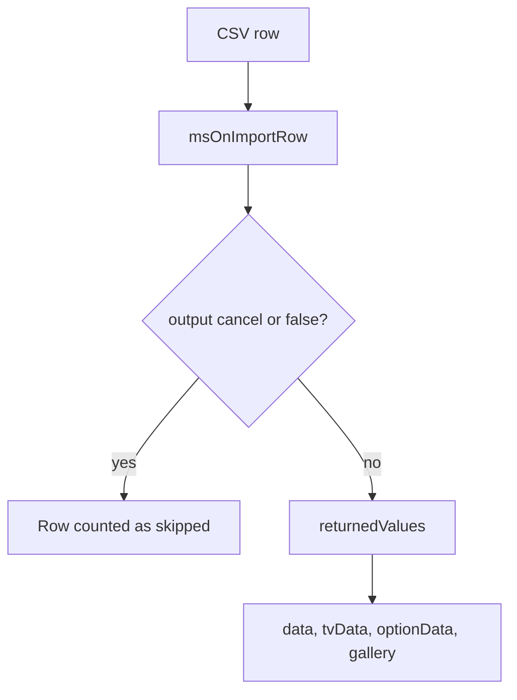

# Import events

Events of the product CSV import utility in the manager.

## msOnBeforeImport

Fired **before** the import of a file starts.

### Parameters

| Parameter | Type | Description |
| --- | --- | --- |
| `file` | `string` | Path to the import file |
| `params` | `array` | Import parameters. Change them only through `returnedValues['params']` |

**params structure:**

```php
[
    'file' => 'path/to/file.csv',
    'fields' => 'pagetitle,price,parent', // or mapping
    'mapping' => [0 => 'pagetitle', 1 => 'price', ...],
    'update' => true,           // allow updates
    'key' => 'article',         // field used to find duplicates
    'skip_header' => true,      // skip the header row
    'is_debug' => false,        // debug mode
    'delimiter' => ';',         // delimiter
    'keys' => ['pagetitle', 'price', ...], // final field list
    'tv_enabled' => false,      // TV fields are present
    'option_enabled' => false,  // options are present
]
```

### Aborting the operation

Cancel the import with `output('cancel')` or `output(false)`. The cancellation message is always taken from the lexicon key `ms3_utilities_import_cancelled`. Your own text passed to `output()` is not used.

```php
<?php
switch ($modx->event->name) {
    case 'msOnBeforeImport':
        $file = $scriptProperties['file'];

        // Check the file size
        if (filesize($file) > 10 * 1024 * 1024) { // 10MB
            $modx->event->output('cancel');
            return;
        }

        // Check business hours
        $hour = (int)date('G');
        if ($hour >= 10 && $hour < 18) {
            $modx->event->output('cancel');
            return;
        }
        break;
}
```

### Modifying parameters

An associative array in `returnedValues['params']` is applied with `array_replace`. A list replaces the parameters entirely.

```php
<?php
switch ($modx->event->name) {
    case 'msOnBeforeImport':
        $params = $scriptProperties['params'];

        // Default for a field that is not in the CSV
        $params['default_vendor'] = 1;

        // Duplicate lookup key
        if (empty($params['key'])) {
            $params['key'] = 'article';
        }

        $modx->event->returnedValues['params'] = $params;
        break;
}
```

Short form:

```php
<?php
switch ($modx->event->name) {
    case 'msOnBeforeImport':
        $modx->event->returnedValues = [
            'params' => ['key' => 'article', 'delimiter' => ';'],
        ];
        break;
}
```

---

## msOnAfterImport

Fired **after** the import finishes.

### Parameters

| Parameter | Type | Description |
| --- | --- | --- |
| `stats` | `array` | Import statistics |

**stats structure:**

```php
[
    'total' => 150,    // rows in total
    'created' => 120,  // products created
    'updated' => 25,   // products updated
    'errors' => 3,     // errors
    'skipped' => 2,    // skipped
]
```

### Example

```php
<?php
switch ($modx->event->name) {
    case 'msOnAfterImport':
        $stats = $scriptProperties['stats'];

        // Log the totals
        $modx->log(modX::LOG_LEVEL_INFO, sprintf(
            '[Import] Finished: total %d, created %d, updated %d, errors %d',
            $stats['total'],
            $stats['created'],
            $stats['updated'],
            $stats['errors']
        ));

        // Clear the MODX cache
        $modx->cacheManager->refresh();

        if ($stats['errors'] > 0) {
            $message = "Import finished with errors!\n\n";
            $message .= "Created: {$stats['created']}\n";
            $message .= "Updated: {$stats['updated']}\n";
            $message .= "Errors: {$stats['errors']}\n";

            // Email to the administrator. The package has no mail queue of its own.
            // mail($adminEmail, 'Import report', $message);
        }
        break;
}
```

---

## msOnImportRow



Fired while processing **each row** of the CSV file.

### Parameters

| Parameter | Type | Description |
| --- | --- | --- |
| `row` | `int` | Current row number |
| `csv` | `array` | Raw CSV row |
| `data` | `array` | Data for creating or updating the resource |
| `tvData` | `array` | TV field data |
| `optionData` | `array` | Product option data |
| `gallery` | `array` | Gallery image paths |

After the event the core applies `EventGate::applyReturnedArray()` to the keys `data`, `tvData`, `optionData` and `gallery`. A list in `returnedValues` replaces that channel entirely. An associative array patches individual fields.

::: warning Changing `$scriptProperties` by reference does nothing
`modX::invokeEvent()` builds the parameters with `array_merge()`, and the reference never reaches the import. Write the changed array to `$modx->event->returnedValues`.
:::

### Skipping a row

```php
<?php
switch ($modx->event->name) {
    case 'msOnImportRow':
        $data = $scriptProperties['data'];
        $row = $scriptProperties['row'];

        // Skip a row without a price
        if (empty($data['price']) || $data['price'] <= 0) {
            $modx->log(modX::LOG_LEVEL_WARN, sprintf(
                '[Import] Row %d skipped: no price',
                $row
            ));
            $modx->event->output('cancel');
            return;
        }

        // Skip rows from excluded categories
        $excludedParents = [10, 15, 20];
        if (in_array($data['parent'], $excludedParents)) {
            $modx->event->output('cancel');
            return;
        }
        break;
}
```

### Modifying data

```php
<?php
switch ($modx->event->name) {
    case 'msOnImportRow':
        $data = $scriptProperties['data'];
        $csv = $scriptProperties['csv'];
        $tvData = $scriptProperties['tvData'];
        $optionData = $scriptProperties['optionData'];

        // Alias from the title
        if (empty($data['alias'])) {
            $data['alias'] = $modx->filterPathSegment($data['pagetitle']);
        }

        // Default template
        if (empty($data['template'])) {
            $data['template'] = 5;
        }

        // Old price when the column is missing
        if (!empty($data['price']) && empty($data['old_price'])) {
            $data['old_price'] = round($data['price'] * 1.2, 2);
        }

        // Brand goes into a TV and is removed from the resource fields
        if (!empty($data['brand'])) {
            $tvData['product_brand'] = $data['brand'];
            unset($data['brand']);
        }

        // Option from CSV column 10
        if (!empty($csv[10])) {
            $optionData['color'] = $csv[10];
        }

        $modx->event->returnedValues['data'] = $data;
        $modx->event->returnedValues['tvData'] = $tvData;
        $modx->event->returnedValues['optionData'] = $optionData;
        break;
}
```

Short form:

```php
<?php
switch ($modx->event->name) {
    case 'msOnImportRow':
        $modx->event->returnedValues = [
            'data' => [
                'vendor_id' => 1,
                'template' => 5,
            ],
            'optionData' => [
                'color' => $scriptProperties['csv'][10] ?? '',
            ],
            // a list in gallery replaces the gallery entirely
            // 'gallery' => ['assets/gallery/sku-001.jpg'],
        ];
        break;
}
```

### Gallery handling

```php
<?php
switch ($modx->event->name) {
    case 'msOnImportRow':
        $data = $scriptProperties['data'];
        $gallery = $scriptProperties['gallery'];

        // Local paths from the external_images column
        if (!empty($data['external_images'])) {
            $images = explode(',', $data['external_images']);
            foreach ($images as $imageUrl) {
                $localPath = ltrim(trim($imageUrl), '/');
                if ($localPath !== '' && file_exists(MODX_BASE_PATH . $localPath)) {
                    $gallery[] = $localPath;
                }
            }
            unset($data['external_images']);
        }

        // Main photo from `article` when the gallery is empty
        if (!empty($data['article']) && empty($gallery)) {
            $imagePath = "assets/images/products/{$data['article']}.jpg";
            if (file_exists(MODX_BASE_PATH . $imagePath)) {
                $gallery[] = $imagePath;
            }
        }

        $modx->event->returnedValues['data'] = $data;
        $modx->event->returnedValues['gallery'] = $gallery;
        break;
}
```

### Validation and data cleanup

```php
<?php
switch ($modx->event->name) {
    case 'msOnImportRow':
        $data = $scriptProperties['data'];
        $row = $scriptProperties['row'];

        // Price: drop spaces and replace a comma with a dot
        if (!empty($data['price'])) {
            $data['price'] = preg_replace('/[^\d.,]/', '', $data['price']);
            $data['price'] = str_replace(',', '.', $data['price']);
            $data['price'] = (float)$data['price'];
        }

        // Article in upper case, then a format check
        if (!empty($data['article'])) {
            $data['article'] = mb_strtoupper(trim($data['article']));

            if (!preg_match('/^[A-Z0-9\-]+$/', $data['article'])) {
                $modx->log(modX::LOG_LEVEL_ERROR, sprintf(
                    '[Import] Row %d: invalid article "%s"',
                    $row,
                    $data['article']
                ));
                $modx->event->output('cancel');
                return;
            }
        }

        // HTML out of the title
        $data['pagetitle'] = strip_tags($data['pagetitle']);
        $data['pagetitle'] = html_entity_decode($data['pagetitle'], ENT_QUOTES, 'UTF-8');

        // Description no longer than 500 characters
        if (!empty($data['description']) && mb_strlen($data['description']) > 500) {
            $data['description'] = mb_substr($data['description'], 0, 497) . '...';
        }

        $modx->event->returnedValues['data'] = $data;
        break;
}
```
