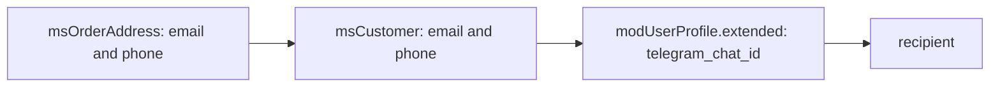

# Notification events

Events for the notification system: sending, modifying, registering channels.

## Built-in channels

| Channel | Class | Description |
| --- | --- | --- |
| `email` | `EmailChannel` | Sends via MODX modMail. Templates are set by chunks |
| `telegram` | `TelegramChannel` | Sends via the Telegram Bot API |

### Telegram channel

The channel needs two system settings:

- `ms3_telegram_bot_token` is the bot token.
- `ms3_telegram_manager` is the managers' Chat IDs, separated by commas.

::: warning Telegram limitation
A Telegram bot cannot start a conversation. The customer must send the first message to the bot. So Telegram notifications only work for managers who have set their Chat ID in advance.
:::

### Telegram notifications for customers

The built-in channel does not notify customers. You assemble that flow yourself. You need the customer's consent, a link to their Telegram account, and a stored Chat ID.

#### Step 1: Where the channel reads the Chat ID

The channel looks for a Chat ID in two places, in this order:

1. **`modUserProfile.extended`**, key `telegram_chat_id`, on the MODX user whose id is stored in `msOrder.user_id`. Works when the customer is tied to an account.
2. **A `telegram_chat_id` extra field on `msCustomer`** — it reaches the recipient payload through `CustomerPublicDto`, which adds the keys of active fields from the [Extra fields](/en/components/minishop3/interface/utilities/extra-fields) utility to the public set. This path also covers customers without a MODX account.

::: warning A column added by hand will not work
`ALTER TABLE modx_ms3_customers ADD COLUMN telegram_chat_id …` looks like a shortcut, but only the keys of **active fields** registered through the utility reach the recipient payload. A column created outside it never shows up in `{$customer}` — the utility creates the column itself.

There is a third path, and it does not work. `OrderStatusService` reads `extended` on `msCustomer` itself, and the customer schema has no such field. See [bug #900](https://github.com/modx-pro/MiniShop3/issues/900). It does not affect the two sources above.
:::

#### Step 2: Bot with Deep Linking

Link the Telegram account through [Deep Linking](https://core.telegram.org/bots/features#deep-linking):

```php
<?php
// Link: the customer id and a short token in the start parameter
$customerId = $msCustomer->get('id');
$token = hash('sha256', $customerId . $modx->getOption('ms3_snippet_token_secret'));
$linkCode = base64_encode($customerId . ':' . substr($token, 0, 16));

$botUsername = 'YourShopBot'; // bot username without @
$telegramLink = "https://t.me/{$botUsername}?start={$linkCode}";
```

#### Step 3: Handle /start on the bot side

The bot handles the `start` parameter and writes the Chat ID into `extended` of the linked user's profile:

```php
<?php
$update = json_decode(file_get_contents('php://input'), true);
$message = $update['message'] ?? null;

if ($message && str_starts_with($message['text'], '/start ')) {
    $linkCode = substr($message['text'], 7);
    $decoded = base64_decode($linkCode);
    [$customerId, $tokenPart] = explode(':', $decoded);

    $expectedToken = hash('sha256', $customerId . $modx->getOption('ms3_snippet_token_secret'));
    // Compare the token tail from the link
    if (substr($expectedToken, 0, 16) === $tokenPart) {
        // Save the Chat ID on the customer's profile
        $customer = $modx->getObject(\MiniShop3\Model\msCustomer::class, $customerId);
        $userId = $customer ? (int) $customer->get('user_id') : 0;
        $profile = $userId
            ? $modx->getObject(\MODX\Revolution\modUserProfile::class, ['internalKey' => $userId])
            : null;
        if ($profile) {
            $extended = $profile->get('extended');
            if (!is_array($extended)) {
                $extended = [];
            }
            // The Chat ID is written to the profile extended field, not to msCustomer
            $extended['telegram_chat_id'] = (string) $message['chat']['id'];
            $profile->set('extended', $extended);
            $profile->save();
        }
    }
}
```

#### Step 4: Plugin to send notifications to the customer

```php
<?php
/**
 * Plugin: Telegram notifications to customers
 * Events: msOnChangeOrderStatus
 */

switch ($modx->event->name) {
    case 'msOnChangeOrderStatus':
        $order = $scriptProperties['msOrder'];
        $statusId = (int) $scriptProperties['status'];

        // The order's customer
        $customer = $order->getOne('Customer');
        if (!$customer) {
            return;
        }

        // Same order as the built-in channel: the linked user's profile first,
        // then the customer's own extra field
        $userId = (int) $order->get('user_id');
        $profile = $userId
            ? $modx->getObject(\MODX\Revolution\modUserProfile::class, ['internalKey' => $userId])
            : null;
        $extended = $profile ? $profile->get('extended') : [];
        $chatId = is_array($extended) ? ($extended['telegram_chat_id'] ?? '') : '';
        if ($chatId === '') {
            $chatId = (string) $customer->get('telegram_chat_id');
        }
        if ($chatId === '') {
            return; // The customer has not linked Telegram
        }

        $status = $modx->getObject(\MiniShop3\Model\msOrderStatus::class, $statusId);
        $statusName = $status ? $status->get('name') : (string) $statusId;
        $orderNum = $order->get('num');

        // The message text
        $message = "Order #{$orderNum}\n";
        $message .= "Status changed to: {$statusName}";

        // Sending through the Bot API
        $botToken = $modx->getOption('ms3_telegram_bot_token');
        $url = "https://api.telegram.org/bot{$botToken}/sendMessage";

        $ch = curl_init($url);
        curl_setopt_array($ch, [
            CURLOPT_POST => true,
            CURLOPT_POSTFIELDS => [
                'chat_id' => $chatId,
                'text' => $message,
                'parse_mode' => 'HTML',
            ],
            CURLOPT_RETURNTRANSFER => true,
        ]);
        curl_exec($ch);
        curl_close($ch);
        break;
}
```

#### Step 5: Link button in the customer account

Show the link from step 2 in the account. Take the "already linked" flag from the same two sources as the channel (step 1).

Add this to the customer profile template:

```fenom
{if $telegramLinked}
    <p>Telegram notifications are connected</p>
{else}
    <a href="{$telegramLink}" target="_blank">Connect Telegram notifications</a>
{/if}
```

::: tip Alternative
Instead of your own bot you can connect a mailing service (SendPulse, Unisender and others). They have a Telegram API, and they handle subscriptions.
:::

## msOnBeforeSendNotification



Fired **before** sending a notification. You can change the recipient, replace the channel list, or cancel sending.

### Parameters

| Parameter | Type | Description |
| --- | --- | --- |
| `notification` | `Notification` | A concrete subclass of the abstract `Notification`, for example `StatusChangedNotification` |
| `recipient` | `array` | Recipient data, see the structure below |
| `recipientType` | `string` | Recipient type: `customer` or `manager` |
| `channels` | `string[]` | Channel list, for example `['email', 'telegram']` |

### The `recipient` payload {#recipient}

For a `customer` recipient (since 1.12.0) `recipient` is assembled by `OrderStatusService::getCustomerRecipient()`. Source priority:

1. **`msOrderAddress`** of the order — the email and phone from the checkout form of **this particular** order.
2. **`msCustomer`** is the fallback for email and phone, and the source of the `customer` array. An extra field `telegram_chat_id` arrives with that array when the field exists.
3. **`modUserProfile`** is the last fallback for email and phone. For `telegram_chat_id` it is the primary source: the `extended` key on the user profile whose id is stored in `msOrder.user_id`.

| Key | Type | Source | Description |
| --- | --- | --- | --- |
| `type` | `string` | — | `customer` or `manager` (duplicates `recipientType`) |
| `email` | `string \| null` | address → customer → profile | Resulting recipient email |
| `phone` | `string \| null` | address → customer → profile | Resulting phone number |
| `telegram_chat_id` | `string \| null` | `modUserProfile.extended` | Telegram chat ID of the user linked to the order. A customer extra field arrives separately, inside `customer` |
| `address` | `array` | `msOrderAddress->toArray()` | The full order address (`customer` recipient only) |
| `customer` | `array` | `CustomerPublicDto::fromCustomer()` | The customer's public fields (`customer` recipient only); its `email` and `phone` already match the resulting values |

::: warning No customer secrets in `customer`
Since 1.14.2-beta1 the array is built by `CustomerPublicDto`, not by a raw `toArray()`. It leaves out `password`, `token`, `user_id`, `customer_group_id`, login attempt counters and the IP the privacy policy was accepted from. The public set is `id`, `first_name`, `last_name`, `email`, `phone`, `email_verified_at`, `is_active`, `created_at`, `updated_at`, `last_login_at`, `orders_count`, `total_spent`, `last_order_at`, `privacy_accepted_at` plus the customer's active extra fields.
:::

::: tip Why the address and the customer are kept apart
Before 1.12.0 notifications went to the contacts stored on `msCustomer`, which could differ from the contacts of the order at hand: if two orders were placed in one session with different emails, both notifications went to the `msCustomer` email.
:::

### Aborting the operation

Sending is cancelled by `$modx->event->output('cancel')` or `output(false)`. Any other text, and a plain `return`, do not cancel anything: `EventGate::isCancelled()` inspects the values plugins passed to `output()`. The event goes through `EventGate::invokeRaw()`, not `Utils::invokeEvent()`.

```php
<?php
switch ($modx->event->name) {
    case 'msOnBeforeSendNotification':
        $recipient = $scriptProperties['recipient'];

        // Disallow sending at night
        $hour = (int)date('G');
        if ($hour >= 23 || $hour < 8) {
            $modx->event->output(false);
            return;
        }

        // Block temporary emails
        if (!empty($recipient['email'])) {
            $domain = substr($recipient['email'], strpos($recipient['email'], '@') + 1);
            if (in_array($domain, ['tempmail.com', 'throwaway.com'], true)) {
                $modx->event->output('cancel');
                return;
            }
        }
        break;
}
```

### Modifying via returnedValues

Change the recipient and the channel list with the `recipient` and `channels` keys in `returnedValues`. Editing `$recipient` and `$channels` by reference also works, and the keys make the change explicit.

::: tip Why a reference works here and not on the other pages
`NotificationManager` passes these two parameters as explicit references (`'recipient' => &$recipient`), so the change reaches the caller. That is an exception. Events that go through `Utils::invokeEvent` build parameters with `array_merge()`, and the reference is lost there. See the [plugin guide](./plugins-guide).
:::

```php
<?php
switch ($modx->event->name) {
    case 'msOnBeforeSendNotification':
        $values = &$modx->event->returnedValues;
        $values['recipient'] = array_replace(
            $scriptProperties['recipient'],
            ['email' => 'ops@example.com']
        );
        // the list replaces the channel set entirely
        $values['channels'] = ['email'];
        break;
}
```

---

## msOnAfterSendNotification

Fired **after** the notification has been processed — once for all the selected channels together.

### Parameters

| Parameter | Type | Description |
| --- | --- | --- |
| `notification` | `Notification` | A concrete subclass of the abstract `Notification`, for example `StatusChangedNotification` |
| `recipient` | `array` | Recipient data — see [the `recipient` payload](#recipient) above |
| `recipientType` | `string` | `customer` or `manager` |
| `results` | `array<string,bool>` | The send result per channel, e.g. `['email' => true, 'telegram' => false]` |

::: warning The event does not always fire
`msOnAfterSendNotification` only fires once the channel loop has been reached. If `msOnBeforeSendNotification` cancelled the send, or the channel list came out empty, `NotificationManager::send()` returns earlier and no event happens at all. For analytics these are different cases: "no event" and "every channel returned `false`".
:::

::: warning `false` in `results` is not necessarily a failed send
The same value lands in the array when a channel is not registered or its `isAvailable()` returned `false` — no send was attempted in those cases. The event cannot tell them apart, so check channel registration and availability yourself if you need the exact reason.
:::

### Example

```php
<?php
switch ($modx->event->name) {
    case 'msOnAfterSendNotification':
        $notification = $scriptProperties['notification'];
        $recipient = $scriptProperties['recipient'];
        $results = $scriptProperties['results']; // ['email' => true, 'telegram' => false]

        foreach ($results as $channelName => $success) {
            $contact = $recipient['email'] ?? $recipient['phone'] ?? 'unknown';
            $level = $success ? modX::LOG_LEVEL_INFO : modX::LOG_LEVEL_ERROR;
            $modx->log($level, sprintf(
                '[Notification] %s → %s (%s): %s',
                $notification::class,
                $contact,
                $channelName,
                $success ? 'ok' : 'fail'
            ));
        }
        break;
}
```

### Retry on failure

```php
<?php
switch ($modx->event->name) {
    case 'msOnAfterSendNotification':
        $results = $scriptProperties['results'];

        if (in_array(false, $results, true)) {
            // Your own retry queue — the package has no msNotificationQueue
            $modx->log(modX::LOG_LEVEL_WARN, '[Notification] Partial failure: ' . json_encode($results));
        }
        break;
}
```

---

## msOnRegisterNotificationChannels

Fired when registering notification channels. Lets you add your own channels.

### Parameters

| Parameter | Type | Description |
| --- | --- | --- |
| `manager` | `NotificationManager` | Notification manager |

### Registering your own channel

`NotificationManager::registerChannel()` takes a `ChannelInterface` object, not a callback.

::: tip SMS already has a base class
The package ships an abstract `MiniShop3\Notifications\Channels\SmsChannel`. It already reports the channel name `sms`, reads the phone from the recipient, the customer or the address, and normalises it. The channel is not registered by default. Extend it and implement `sendSms(string $phone, SmsMessage $message): bool` for your provider.
:::

```php
<?php
switch ($modx->event->name) {
    case 'msOnRegisterNotificationChannels':
        /** @var \MiniShop3\Notifications\NotificationManager $manager */
        $manager = $scriptProperties['manager'];

        $manager->registerChannel(new MyComponent\Notifications\SmsChannel($modx));
        break;
}
```

### Example of your own channel

```php
<?php
namespace MyComponent\Notifications;

use MiniShop3\Model\msOrder;
use MiniShop3\Notifications\ChannelInterface;
use MiniShop3\Notifications\Notification;
use MODX\Revolution\modX;

class SmsChannel implements ChannelInterface
{
    public function __construct(protected modX $modx) {}

    public function getName(): string
    {
        return 'sms';
    }

    public function isAvailable(): bool
    {
        return (bool) $this->modx->getOption('my_sms_api_key');
    }

    public function getRequirements(): array
    {
        return ['my_sms_api_key'];
    }

    public function send(Notification $notification, array $recipient, msOrder $order): bool
    {
        $phone = $recipient['phone'] ?? null;
        if (!$phone) {
            return false;
        }

        // Call your SMS API
        return true;
    }
}
```
