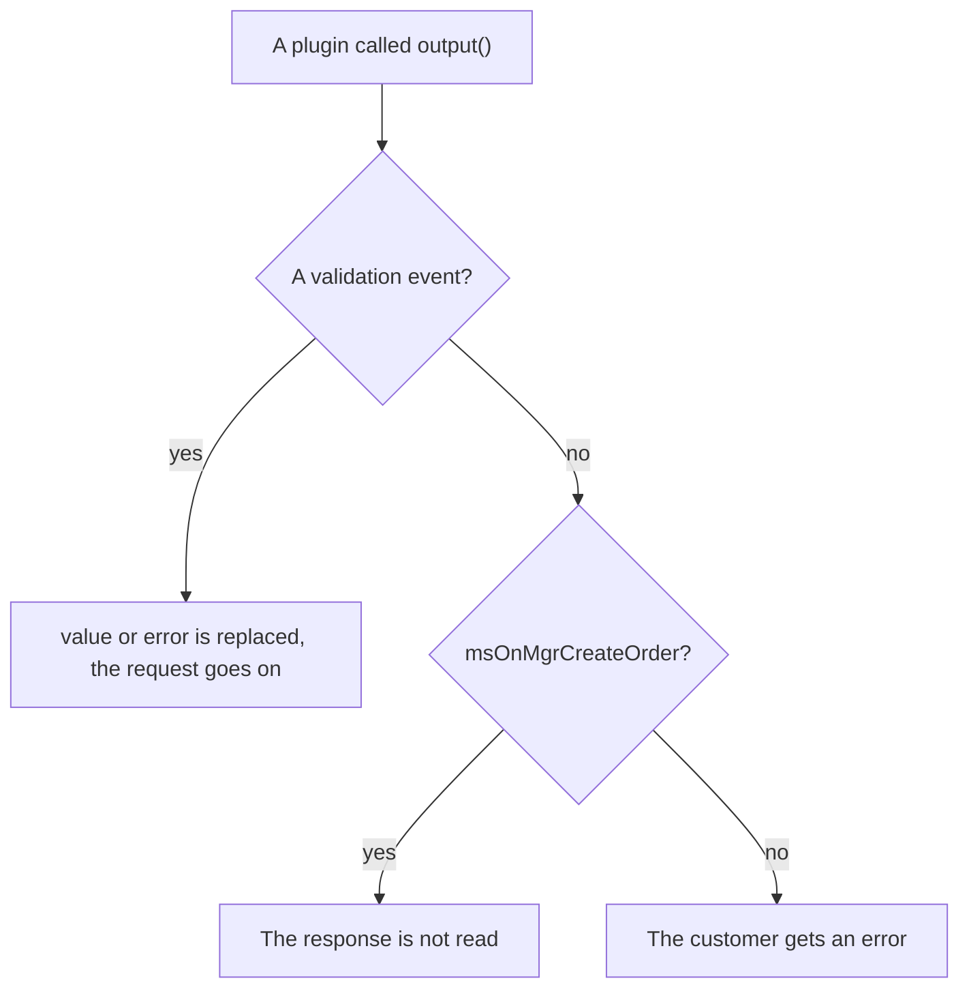
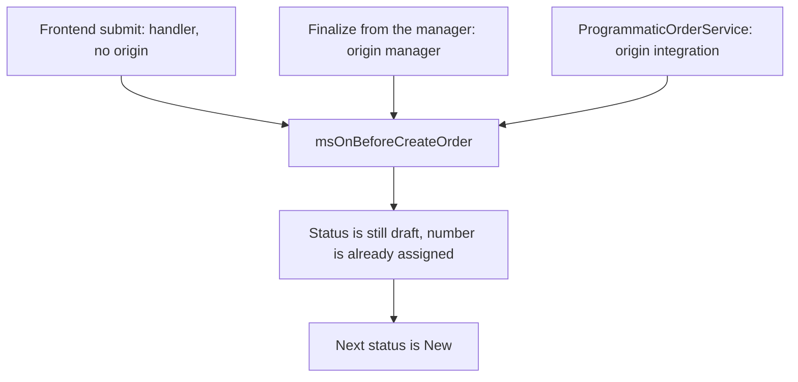

# Order events

Adding, validating and removing order fields, and submitting the order.

## Which events can abort the operation



Unlike the [cart events](cart), the core reads the plugin response almost everywhere here, including after-events. You can return an error with `$modx->event->output(...)` from any event on this page except `msOnMgrCreateOrder` and the three validation events.

So `msOnRemoveFromOrder`, `msOnEmptyOrder` and `msOnCreateOrder` can fail an operation that already happened: the field is removed or the order is created, yet the client gets an error.

The validation events use the response differently — not to abort the operation but to substitute the value: `msOnBeforeValidateOrderValue` and `msOnValidateOrderValue` return `value`. `msOnErrorValidateOrderValue` returns `error` and, alongside it, `value` as well — that is what lands in the draft once the error is cleared.

## msOnBeforeAddToOrder

Fired **before** adding or changing an order field.

::: warning No event arrives for internal fields
Since 1.14.2-beta1 `OrderFieldManager` rejects the internal draft columns before the event is fired. A plugin that used to intercept writes to `customer_id`, `status_id`, `cost` or `properties` no longer runs. The same check covers all four field events: `msOnBeforeAddToOrder`, `msOnAddToOrder`, `msOnBeforeRemoveFromOrder`, `msOnRemoveFromOrder`. The list of closed columns is in [fields the frontend may not change](/en/components/minishop3/development/web-api/checkout#protected-fields).
:::

### Parameters

| Parameter | Type | Description |
| --- | --- | --- |
| `key` | `string` | Field key |
| `value` | `mixed` | Field value |
| `draft` | `msOrder` \| `null` | Current order draft (may be absent on the first step) |

### Aborting the operation

```php
<?php
switch ($modx->event->name) {
    case 'msOnBeforeAddToOrder':
        $key = $scriptProperties['key'];
        $value = $scriptProperties['value'];

        // Disallow selecting a specific delivery method
        if ($key === 'delivery_id' && $value == 5) {
            $modx->event->output('Delivery is temporarily unavailable');
            return;
        }
        break;
}
```

### Modifying data

```php
<?php
switch ($modx->event->name) {
    case 'msOnBeforeAddToOrder':
        $key = $scriptProperties['key'];
        $value = $scriptProperties['value'];

        $values = &$modx->event->returnedValues;

        // Phone: keep the digits only
        if ($key === 'phone') {
            $values['value'] = preg_replace('/\D/', '', $value);
        }
        // Email in lower case
        if ($key === 'email') {
            $values['value'] = strtolower(trim($value));
        }
        break;
}
```

---

## msOnAddToOrder

Fired after successful validation and before the draft is saved. `output()` cancels the save. If nothing cancelled it, the draft receives the value from `returnedValues['value']`.

### Parameters

| Parameter | Type | Description |
| --- | --- | --- |
| `key` | `string` | Field key |
| `value` | `mixed` | Validated value |
| `draft` | `msOrder` \| `null` | Current order draft |

### Example

```php
<?php
switch ($modx->event->name) {
    case 'msOnAddToOrder':
        $key = $scriptProperties['key'];
        $value = $scriptProperties['value'];
        /** @var \MiniShop3\Model\msOrder|null $draft */
        $draft = $scriptProperties['draft'];

        // Log the field change
        $modx->log(modX::LOG_LEVEL_INFO,
            "[Order] Field {$key} set: {$value}"
        );

        if ($key === 'delivery_id' && !empty($value) && $draft) {
            // ... through MS3 services when needed
        }
        break;
}
```

---

## msOnBeforeValidateOrderValue

Fired **before** validating a field value.

### Parameters

| Parameter | Type | Description |
| --- | --- | --- |
| `key` | `string` | Field key |
| `value` | `mixed` | Value to validate |
| `orderData` | `array` | Snapshot of the current order fields (neighbouring values, for example `delivery_id` while validating `payment_id`) |

### Modifying data

```php
<?php
switch ($modx->event->name) {
    case 'msOnBeforeValidateOrderValue':
        $key = $scriptProperties['key'];
        $value = $scriptProperties['value'];

        $values = &$modx->event->returnedValues;

        // Strip spaces out of the postcode
        if ($key === 'index') {
            $values['value'] = str_replace(' ', '', $value);
        }
        break;
}
```

---

## msOnValidateOrderValue

Fired **after** successful field validation.

### Parameters

| Parameter | Type | Description |
| --- | --- | --- |
| `key` | `string` | Field key |
| `value` | `mixed` | Validated value |

### Modifying data

```php
<?php
switch ($modx->event->name) {
    case 'msOnValidateOrderValue':
        $key = $scriptProperties['key'];
        $value = $scriptProperties['value'];

        $values = &$modx->event->returnedValues;

        // Append the region to the city
        if ($key === 'city') {
            $values['value'] = $value . ', Moscow Region';
        }
        break;
}
```

---

## msOnErrorValidateOrderValue

Fired on validation **error**.

### Parameters

| Parameter | Type | Description |
| --- | --- | --- |
| `key` | `string` | Field key |
| `value` | `mixed` | Invalid value |
| `error` | `array` | Errors array `['field' => 'message']` |

### Customizing error message

```php
<?php
switch ($modx->event->name) {
    case 'msOnErrorValidateOrderValue':
        $key = $scriptProperties['key'];
        $error = $scriptProperties['error'];

        $values = &$modx->event->returnedValues;

        // A custom email error message
        if ($key === 'email') {
            $values['error'] = [$key => 'Enter a valid email to receive the receipt'];
        }
        if ($key === 'phone') {
            $values['error'] = [$key => 'Phone is required for courier contact'];
        }
        break;
}
```

### Clearing the error

```php
<?php
switch ($modx->event->name) {
    case 'msOnErrorValidateOrderValue':
        $key = $scriptProperties['key'];
        $value = $scriptProperties['value'];

        if ($key === 'comment') {
            $values = &$modx->event->returnedValues;
            $values['error'] = []; // Empty array means no error
            $values['value'] = mb_substr((string) $value, 0, 500); // and what to store instead
        }
        break;
}
```

Return `value` together with the empty `error`: that is what the core writes to the draft. Leave `value` alone and the order keeps the original value — the one the validator has just rejected.

---

## msOnBeforeRemoveFromOrder

Fired **before** removing a field from the order.

### Parameters

| Parameter | Type | Description |
| --- | --- | --- |
| `key` | `string` | Field key to remove |
| `draft` | `msOrder` | Current order draft |

### Aborting the operation

```php
<?php
switch ($modx->event->name) {
    case 'msOnBeforeRemoveFromOrder':
        $key = $scriptProperties['key'];

        // Fields the draft must have
        $required = ['delivery_id', 'payment_id', 'email'];
        if (in_array($key, $required)) {
            $modx->event->output('This field cannot be removed');
            return;
        }
        break;
}
```

---

## msOnRemoveFromOrder

Fired **after** removing a field from the order.

### Parameters

| Parameter | Type | Description |
| --- | --- | --- |
| `key` | `string` | Removed field key |
| `draft` | `msOrder` | Current order draft |

### Example

```php
<?php
switch ($modx->event->name) {
    case 'msOnRemoveFromOrder':
        $key = $scriptProperties['key'];
        /** @var \MiniShop3\Model\msOrder $draft */
        $draft = $scriptProperties['draft'];

        if ($key === 'delivery_id') {
            // ... through MS3 services when needed
        }
        break;
}
```

---

## msOnBeforeEmptyOrder

Fired **before** clearing the order draft (`OrderDraftManager::clean`, API/controller `order/clean`). Abort with `$modx->event->output(...)`.

### Parameters

| Parameter | Type | Description |
| --- | --- | --- |
| `draft` | `msOrder` | Draft about to be cleared |

### What stays after cleanup

Core nulls address and order fields except: address `id`, `order_id`, `user_id`, `createdon`; order `id`, `user_id`, `token`, `status_id`, `createdon`.

```php
<?php
switch ($modx->event->name) {
    case 'msOnBeforeEmptyOrder':
        /** @var \MiniShop3\Model\msOrder $draft */
        $draft = $scriptProperties['draft'];

        if ($draft->get('delivery_id') && /* your “already booked” flag */) {
            $modx->event->output('Cannot clear draft: delivery already reserved');
            return;
        }
        break;
}
```

---

## msOnEmptyOrder

Fired **after** the draft fields are cleared — address and order fields are already nulled and saved. A plugin `output` makes the caller treat the operation as failed but does **not** roll the save back: the draft stays cleared.

### Parameters

| Parameter | Type | Description |
| --- | --- | --- |
| `draft` | `msOrder` | Draft with fields already nulled |

---

## msOnSubmitOrder

Fired on order **submission** (Submit button).

### Parameters

| Parameter | Type | Description |
| --- | --- | --- |
| `handler` | `\MiniShop3\Services\Order\OrderSubmitHandler` | Submit handler |
| `draft` | `msOrder` | Order draft at submit time |
| `orderData` | `array` | Snapshot of the current order fields, including address fields |
| `data` | `array` | Extra form data |

### Aborting the operation

```php
<?php
switch ($modx->event->name) {
    case 'msOnSubmitOrder':
        /** @var \MiniShop3\Model\msOrder $draft */
        $draft = $scriptProperties['draft'];
        $orderData = $scriptProperties['orderData'];

        // Minimum total
        if (($draft->get('cart_cost') ?? 0) < 1000) {
            $modx->event->output('Minimum order amount is 1000');
            return;
        }

        // Order-taking hours
        $hour = (int)date('G');
        if ($hour < 9 || $hour > 21) {
            $modx->event->output('Orders accepted from 9:00 to 21:00');
            return;
        }
        break;
}
```

### Modifying data

Return extra order fields in the `data` key. The core applies them to the draft through `add()` before the order is created.

```php
<?php
switch ($modx->event->name) {
    case 'msOnSubmitOrder':
        $data = $scriptProperties['data'];

        $values = &$modx->event->returnedValues;

        // UTM out of the session into the order properties
        if (!empty($_SESSION['utm'])) {
            $data['properties']['utm'] = $_SESSION['utm'];
            $values['data'] = $data;
        }

        // Referrer
        $data['properties']['source'] = $_SERVER['HTTP_REFERER'] ?? 'direct';
        $values['data'] = $data;
        break;
}
```

---

## msOnBeforeCreateOrder



Fired when the order number is already assigned and the status is still draft. The New status is set later. When the event returns an error, the number is cleared on the frontend path only, and only with inventory tracking on (`OrderSubmitHandler::revertAllocatedNumber()`). The manager and programmatic paths never clear it: the allocated number stays with the draft.

The event arrives in three scenarios, and the parameter set differs:

1. Frontend submit: `OrderSubmitHandler`.
2. Finalization in the admin: `OrderFinalizeService`.
3. Programmatic creation: `ProgrammaticOrderService` → `finalize`.

### Parameters

| Parameter | Type | Description |
| --- | --- | --- |
| `msOrder` | `msOrder` | Order object (always) |
| `handler` | `\MiniShop3\Services\Order\OrderSubmitHandler` | Frontend submit only |
| `service` | `\MiniShop3\Services\Order\OrderFinalizeService` | Finalize paths only (admin / integration) |
| `origin` | `string` | Finalize paths only: `manager` from the admin, `integration` from programmatic creation. The `OrderOrigin::STOREFRONT` constant exists but no path sets it — a frontend submit carries no `origin` key at all |
| `from_manager` | `bool` | Finalize paths only: `true` when `origin=manager`, `false` when `origin=integration` |
| `customFields` | `array` | Frontend only — fields from `properties._validated` |

::: tip Distinguishing scenarios

```php
$origin = $scriptProperties['origin'] ?? null;
$fromManager = !empty($scriptProperties['from_manager']);

if ($fromManager) {
    // order card in the admin
} elseif ($origin === \MiniShop3\Services\Order\OrderOrigin::INTEGRATION) {
    // ProgrammaticOrderService / cron
} elseif (!empty($scriptProperties['handler'])) {
    // frontend
}
```

:::

### Aborting the operation

```php
<?php
switch ($modx->event->name) {
    case 'msOnBeforeCreateOrder':
        /** @var \MiniShop3\Model\msOrder $order */
        $order = $scriptProperties['msOrder'];

        // Stock check (msProductData.stock field, available via msProduct::get)
        foreach ($order->getMany('Products') as $product) {
            $msProduct = $product->getOne('Product');
            if (!$msProduct) {
                continue;
            }
            $stock = (float) ($msProduct->get('stock') ?? 0);
            if ($product->get('count') > $stock) {
                $modx->event->output(sprintf(
                    'Product "%s" is not available in the requested quantity',
                    $msProduct->get('pagetitle')
                ));
                return;
            }
        }
        break;
}
```

### Modifying the order

```php
<?php
switch ($modx->event->name) {
    case 'msOnBeforeCreateOrder':
        $order = $scriptProperties['msOrder'];

        // A note for the manager in properties
        $properties = $order->get('properties') ?? [];
        $properties['manager_note'] = 'Order created ' . date('d.m.Y H:i');
        $order->set('properties', $properties);
        break;
}
```

---

## msOnCreateOrder

Fired right after `msOnBeforeCreateOrder`, while the status is still draft: the same three scenarios and the same parameter set. `msOnMgrCreateOrder` arrives after the status change.

### Parameters

| Parameter | Type | Description |
| --- | --- | --- |
| `msOrder` | `msOrder` | Created order (always) |
| `handler` | `\MiniShop3\Services\Order\OrderSubmitHandler` | Frontend only |
| `service` | `\MiniShop3\Services\Order\OrderFinalizeService` | Admin or integration |
| `origin` | `string` | Finalize paths only |
| `from_manager` | `bool` | Finalize paths only: `true` in the admin, `false` for programmatic creation |
| `customFields` | `array` | Frontend only |

### Example

Do not change stock here. With `ms3_inventory_enabled=1`, `ms3_inventory` moves it: reserve on `ms3_status_new`, commit on `ms3_status_paid`, release on `ms3_status_canceled`. The customer has no `bonus` field.

```php
<?php
switch ($modx->event->name) {
    case 'msOnCreateOrder':
        /** @var \MiniShop3\Model\msOrder $order */
        $order = $scriptProperties['msOrder'];

        $modx->log(modX::LOG_LEVEL_INFO, sprintf(
            '[Order] Created order #%s, amount: %s',
            $order->get('num'),
            $order->get('cost')
        ));
        break;
}
```

---

## msOnBeforeMgrCreateOrder

Fired **before** finalizing an order in the admin — when a manager turns a draft into a full order with the "Submit" button on the order page. This is the admin counterpart of `msOnSubmitOrder`.

::: tip Relation to msOnBeforeCreateOrder
After `msOnBeforeMgrCreateOrder`, the universal `msOnBeforeCreateOrder` still runs with the same parameters. Use `msOnBeforeMgrCreateOrder` when the logic is admin-only, and `msOnBeforeCreateOrder` when the same logic is needed on the frontend and in the admin.
:::

### Parameters

| Parameter | Type | Description |
| --- | --- | --- |
| `service` | `\MiniShop3\Services\Order\OrderFinalizeService` | Order finalization service |
| `msOrder` | `msOrder` | Order being finalized |
| `origin` | `string` | `manager` |
| `from_manager` | `bool` | Always `true` |

---

## msOnMgrCreateOrder

Fired **after** an order has been finalized in the admin. Pair to `msOnBeforeMgrCreateOrder`.

### Parameters

| Parameter | Type | Description |
| --- | --- | --- |
| `service` | `\MiniShop3\Services\Order\OrderFinalizeService` | Order finalization service |
| `msOrder` | `msOrder` | Finalized order (status already changed to "New") |
| `origin` | `string` | `manager` |
| `from_manager` | `bool` | Always `true` |
