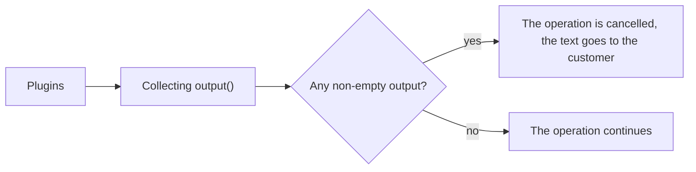
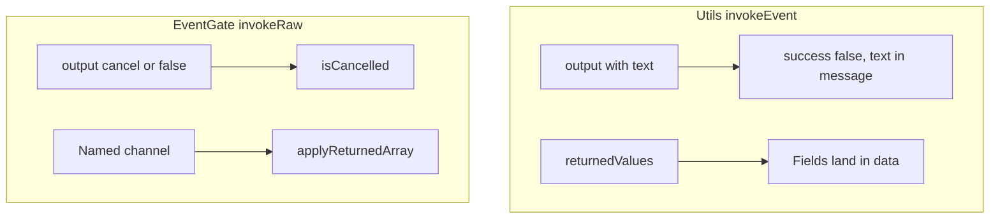

# Working with plugins

A plugin on MiniShop3 events: how to get the parameters, return data, abort an operation and pass data to another plugin.

## Component plugin (MODX events)

The package installs a system plugin `minishop3.php` on core MODX events (not to be confused with `msOn*`):

| MODX event | Purpose |
| --- | --- |
| `OnMODXInit` | The `ms3` service is already registered. The plugin calls `loadMap()`, and in the `mgr` context it schedules a reset of the catalog ACL cache |
| `OnManagerPageBeforeRender` | Loads the lexicon and `ms3.manager.js`. If the files on disk are older than the installed package, it shows a banner |
| `OnLoadWebDocument` | Initialises the frontend and loads its files through `initialize()` and `registerFrontend()`; the context key goes into `ms3Config.ctx`. On a product page the `msProductData` fields are merged into the resource metadata, so the template reaches them as `[[*article]]`, `[[*price]]` and the rest |
| `OnDocFormSave` | Converts a resource into a product through `ProductService::handleConversion()` |
| `OnBeforeUserFormSave` / `OnUserSave` | Syncs `msCustomer` and `modUser` when `ms3_customer_sync_enabled` is on |
| `OnUserRemove` | When both `ms3_customer_sync_enabled` and `ms3_customer_sync_delete_with_user` are on, it clears `msCustomer.user_id`. It does not delete the customer. Without the second flag the handler does nothing |
| `OnResourceGroupSave`, `OnResourceGroupRemove`, `OnResourceAddToResourceGroup`, `OnResourceRemoveFromResourceGroup`, `OnUserGroupRemove` | Resets the catalog ACL cache |

For cart and order business logic, subscribe to the events in [Events](../events).

## Basic plugin structure

```php
<?php
/**
 * MiniShop3 plugin
 * Events: msOnBeforeAddToCart, msOnAddToCart
 */

switch ($modx->event->name) {
    case 'msOnBeforeAddToCart':
        // Before adding to the cart
        break;

    case 'msOnAddToCart':
        // After adding to the cart
        break;
}
```

## Getting incoming parameters

### Method 1: $scriptProperties array

```php
<?php
switch ($modx->event->name) {
    case 'msOnBeforeAddToCart':
        $product = $scriptProperties['msProduct'];
        $count = $scriptProperties['count'];
        $options = $scriptProperties['options'];
        $controller = $scriptProperties['controller'];
        break;
}
```

### Method 2: extract()

```php
<?php
switch ($modx->event->name) {
    case 'msOnBeforeAddToCart':
        extract($scriptProperties);
        // Available: $msProduct, $count, $options, $controller
        break;
}
```

### Debug: list all parameters

```php
<?php
$modx->log(modX::LOG_LEVEL_ERROR, '[' . $modx->event->name . '] Parameters: ' . print_r(array_keys($scriptProperties), true));

$modx->log(modX::LOG_LEVEL_ERROR, '[' . $modx->event->name . '] ' . print_r($scriptProperties, true));
```

## controller parameter

::: info Not passed to every event
The `controller` parameter — the controller instance — is mixed in by `Cart::invokeEvent()` and `CartMutationHandler::invokeEvent()`, so every cart event carries it. Apart from those, only the `msOnBeforeGetOrderCustomer` / `msOnGetOrderCustomer` pair passes it.

In the other groups the controller arrives under a different name, or not at all: customer events carry `customer`, cost events carry `cart` or `cartController`, and order field events carry no controller. Check the parameter table on the page you need.
:::

The controller gives access to MiniShop3 and MODX:

```php
<?php
switch ($modx->event->name) {
    case 'msOnBeforeAddToCart':
        /** @var \MiniShop3\Controllers\Cart\Cart $controller */
        $controller = $scriptProperties['controller'];

        $ms3 = $controller->ms3;
        $modx = $controller->modx;

        // Cart internals: public controller methods only
        break;
}
```

## Aborting the operation

Aborting works only where the calling code reads the response. The `Before` prefix does not guarantee that by itself. `msOnBeforeSaveOrder` and `msOnBeforeRemoveOrder` do not read the plugin response, and `msOnBeforeValidateOrderValue` takes only `value` from it.

### $modx->event->output()

```php
<?php
switch ($modx->event->name) {
    case 'msOnBeforeAddToCart':
        $product = $scriptProperties['msProduct'];

        // Disallow a product with a zero price
        if ($product->get('price') <= 0) {
            $modx->event->output('Product is not available for order');
            return; // leave the switch, otherwise the code below still runs
        }

        // No more than 10 units
        if ($scriptProperties['count'] > 10) {
            $modx->event->output('Maximum 10 units per product');
            return;
        }
        break;
}
```

### How it works



1. MiniShop3 `invokeEvent()` collects every plugin output.
2. If there is at least one non-empty output, the operation is aborted.
3. The message is returned to the user, on the frontend or in the API response.

::: warning A plugin `return` does not cancel the operation
Only what the plugin passed to `output()` reaches the event result. `modX::invokeEvent()` puts `$this->event->_output` into the result array and uses the plugin's return value for something else. A string is written to `error.log` as an event error, and `false` as "Plugin … failed!".

So `return 'cancel'` does not cancel. It also adds an error line to the log. Cancel through `output()`, and use `return` only to leave the `switch`.

`output()` has one more property. A second call **appends** text to what is already stored. It does not replace it. Two calls in one plugin are joined into one message.
:::

### Events that support aborting

- `msOnBeforeGetCart`
- `msOnBeforeAddToCart`
- `msOnBeforeChangeInCart`
- `msOnBeforeChangeOptionsInCart`
- `msOnBeforeRemoveFromCart`
- `msOnBeforeEmptyCart`
- `msOnBeforeAddToOrder`
- `msOnAddToOrder`
- `msOnBeforeRemoveFromOrder`
- `msOnBeforeEmptyOrder`
- `msOnEmptyOrder`
- `msOnSubmitOrder`
- `msOnBeforeCreateOrder`
- `msOnBeforeChangeOrderStatus`

The list is not exhaustive — these are the cart, order and status events. Around thirty more events read the plugin response: every cost, customer, stock and shipment event, plus the manager order line, import and vendor events. For those, see the «Reaction to `output()`» table on the page of the section you need.

## Modifying data

### returnedValues

To change the parameters the core continues with:

```php
<?php
switch ($modx->event->name) {
    case 'msOnBeforeAddToCart':
        $values = &$modx->event->returnedValues;

        // At least 2 units
        if ($scriptProperties['count'] < 2) {
            $values['count'] = 2;
        }

        // Source mark in the options
        $options = $scriptProperties['options'] ?? [];
        $options['source'] = 'promo_landing';
        $values['options'] = $options;
        break;
}
```

Changing `$scriptProperties` by reference does nothing. `modX::invokeEvent()` builds the parameters with `array_merge()`, and the reference never reaches the caller. The only channel is `returnedValues`. After the merge the caller reads `$response['data']['count']`.

### Take returnedValues by reference (&)

```php
// Correct: the changes apply
$values = &$modx->event->returnedValues;
$values['count'] = 5;

// Wrong: the changes are lost
$values = $modx->event->returnedValues;
$values['count'] = 5;
```

## Utils::invokeEvent and EventGate



Most cart, order, cost and customer events go through `MiniShop3\Utils\Utils::invokeEvent()`, not directly through `$modx->invokeEvent()`. The core clears `returnedValues` before the call and builds the response afterwards:

| Response field | Meaning |
| --- | --- |
| `success` | `true` when no plugin returned a non-empty `output` |
| `message` | `output` texts joined with `<br/>` |
| `data` | The original `$scriptProperties`, with `returnedValues` keys laid on top (a shallow merge) |
| `values` | The raw `returnedValues` array — **of the last plugin that ran only**, see the warning below |

The merge is shallow. If two plugins return `returnedValues['count']`, the plugin with the **higher** priority wins. MODX runs plugins in ascending priority order.

::: warning returnedValues does not accumulate across plugins
What wins is not the last value per key but the last plugin as a whole: `modX::invokeEvent()` calls `resetEventObject()` before every plugin, and that nulls `returnedValues`. The calling code receives the set of the last plugin that ran.

For a single key the outcome matches the expectation — the higher priority wins. Different keys from different plugins, however, **do not add up**: if the plugin with priority 0 wrote `count` and the plugin with priority 10 wrote `options`, `count` disappears silently.

To let plugins build on each other, use `$modx->eventData` — see [Passing data between plugins](#passing-data).
:::

### Abort: output, false and cancel

| Signal | Where it works | Effect |
| --- | --- | --- |
| `$modx->event->output('cancel')` or `output(false)` | import, notifications | `EventGate::isCancelled()` becomes `true` |
| `$modx->event->output('text')` | `Utils::invokeEvent` | `success = false`, the text is in `message`. Any non-empty output does this |

`return false` and `return 'cancel'` do not cancel. The core reads only `output()`. For `isCancelled()`, `false` and the string `cancel` are equivalent. What the cancellation means is decided by the calling code:

| Event | What the core does on cancellation |
| --- | --- |
| `msOnBeforeImport` | The whole import aborts with the `ms3_utilities_import_cancelled` error |
| `msOnImportRow` | The current row goes into the `skipped` counter, and the import continues |
| `msOnBeforeSendNotification` | The notification is not sent, and there is no error |

```php
<?php
// Import: skip the row without an error
case 'msOnImportRow':
    if (empty($scriptProperties['data']['price'])) {
        $modx->event->output('cancel');
    }
    break;
```

::: warning After-events in the order manager
`msOnCreateOrderProduct`, `msOnUpdateOrderProduct` and `msOnRemoveOrderProduct` run **after** `save()` / `remove()`. In the Manager API a plugin error is written to the log, and the HTTP response stays successful. `OrderDraftManager::addProductFromSnapshot()` does not read the after-event response and does not write it to the log. The operation can be aborted only in the paired `msOnBefore*`. See [Order product events](order-product).
:::

### Named returnedValues channels (import, msProducts, notifications)

For some events the core does not use the general merge. It applies a channel by key through `EventGate::applyReturnedArray()`:

| Event | Key in `returnedValues` | Behaviour |
| --- | --- | --- |
| `msOnBeforeImport` | `params` | A list replaces the channel entirely. An associative array is applied with `array_replace` |
| `msOnImportRow` | `data`, `tvData`, `optionData`, `gallery` | The same |
| `msOnProductsLoad` | `rows` | The same |
| `msOnProductPrepare` | `row` | The same |
| `msOnBeforeSendNotification` | `recipient` | The same |
| `msOnBeforeSendNotification` | `channels` | No `applyReturnedArray()` channel here: any array replaces the channel set entirely, an associative one included |

```php
<?php
case 'msOnImportRow':
    $modx->event->returnedValues = [
        'data' => ['vendor_id' => 1],           // patch individual resource fields
        // 'gallery' => ['/path/a.jpg', '/path/b.jpg'], // a list: full gallery replacement
    ];
    break;
```

These events are called through `EventGate::invokeRaw()`, not through `Utils::invokeEvent()`.

## Passing data between plugins {#passing-data}

`$modx->eventData` passes data between plugins of one event, or between different events of one request.

### Example: price modification

```php
<?php
switch ($modx->event->name) {
    case 'msOnGetProductPrice':
        $price = $modx->eventData['msOnGetProductPrice']['price']
            ?? $scriptProperties['price'];

        $data = $scriptProperties['data'];

        if ($data['parent'] == 5) {
            $price = $price * 0.85;
        }

        $modx->eventData['msOnGetProductPrice']['price'] = $price;
        break;
}
```

### Example: passing data between events

```php
<?php
switch ($modx->event->name) {
    case 'msOnBeforeAddToCart':
        $modx->eventData['myPlugin']['original_count'] = $scriptProperties['count'];
        $modx->eventData['myPlugin']['added_at'] = time();
        break;

    case 'msOnAddToCart':
        $originalCount = $modx->eventData['myPlugin']['original_count'] ?? null;
        $addedAt = $modx->eventData['myPlugin']['added_at'] ?? null;

        if ($originalCount) {
            $modx->log(modX::LOG_LEVEL_INFO,
                "Product added. Original quantity: {$originalCount}, time: {$addedAt}"
            );
        }
        break;
}
```

### eventData structure

```php
$modx->eventData = [
    'msOnGetProductPrice' => [
        'price' => 1500.00,
    ],
    'msOnGetProductFields' => [
        'data' => [...],
    ],
    'myPlugin' => [
        'custom_key' => 'custom_value',
    ],
];
```

::: warning The data lives for one request
`$modx->eventData` is cleared when the request ends. To keep data between requests, use `$_SESSION` or the database.
:::

## Showing messages in the manager

### JavaScript alert via addHtml

```php
<?php
switch ($modx->event->name) {
    case 'msOnManagerCustomCssJs':
        $page = $scriptProperties['page'];

        if ($page === 'product_update') {
            $controller = $scriptProperties['controller'];

            $controller->addHtml('<script>
                Ext.onReady(function() {
                    MODx.msg.alert("Notice", "Remember to check the prices!");
                });
            </script>');
        }
        break;
}
```

### Toast notification

```php
<?php
switch ($modx->event->name) {
    case 'msOnManagerCustomCssJs':
        $page = $scriptProperties['page'];
        $controller = $scriptProperties['controller'];

        if ($page === 'orders') {
            $controller->addHtml('<script>
                Ext.onReady(function() {
                    Ext.Msg.notify("MiniShop3", "There are new orders!");
                });
            </script>');
        }
        break;
}
```

## Plugin priority

The order is the **priority** field in the plugin settings. A smaller value runs earlier. The default is 0, and any integer is allowed.

### When priority matters

- **Price modification:** plugins apply discounts one after another.
- **Validation:** one plugin can depend on the result of another.
- **Passing data:** the source plugin must run before the plugin that reads the data.

## Debugging plugins

### Logging

```php
<?php
$modx->log(modX::LOG_LEVEL_ERROR, 'Error');     // Always visible
$modx->log(modX::LOG_LEVEL_WARN, 'Warning');    // Important warnings
$modx->log(modX::LOG_LEVEL_INFO, 'Info');       // Informational messages
$modx->log(modX::LOG_LEVEL_DEBUG, 'Debug');     // Detailed debugging

$modx->log(modX::LOG_LEVEL_ERROR,
    '[MyPlugin::' . $modx->event->name . '] ' . $message
);
```

### Checking whether the plugin fires

```php
<?php
$modx->log(modX::LOG_LEVEL_ERROR, '=== PLUGIN START: ' . $modx->event->name . ' ===');

switch ($modx->event->name) {
    case 'msOnBeforeAddToCart':
        $modx->log(modX::LOG_LEVEL_ERROR, 'msOnBeforeAddToCart triggered');
        break;
}

$modx->log(modX::LOG_LEVEL_ERROR, '=== PLUGIN END ===');
```

In `core/cache/logs/error.log` after a product is added:

```text
[2026-10-15 18:00:01] (ERROR) === PLUGIN START: msOnBeforeAddToCart ===
[2026-10-15 18:00:01] (ERROR) msOnBeforeAddToCart triggered
[2026-10-15 18:00:01] (ERROR) === PLUGIN END ===
```

### Checking whether the event exists

```php
<?php
$plugins = $modx->getCollection('modPluginEvent', [
    'event' => 'msOnBeforeAddToCart'
]);

foreach ($plugins as $pluginEvent) {
    $plugin = $pluginEvent->getOne('Plugin');
    $modx->log(modX::LOG_LEVEL_INFO,
        'Plugin: ' . $plugin->get('name') . ', priority: ' . $pluginEvent->get('priority')
    );
}
```

## Common mistakes

### 1. Forgot return after output()

```php
// Wrong: the code below still runs
if ($error) {
    $modx->event->output('Error');
}
doSomething();

// Correct
if ($error) {
    $modx->event->output('Error');
    return;
}
```

### 2. Checking in an after-event instead of a before-event

```php
// msOnAddToCart fires AFTER the add.
// The product is already in the cart, and output() will not remove it.
// The response still becomes an error: the customer sees a message while the cart has changed
case 'msOnAddToCart':
    $modx->event->output('Error');
    break;

// msOnBeforeAddToCart fires BEFORE the add
case 'msOnBeforeAddToCart':
    $modx->event->output('Error'); // Stops the add
    break;
```

A cart that no longer matches the response is worse than an honest refusal. The frontend shows an error, and the product counter has already grown. Put checks in `msOnBefore*`.

### 3. Forgot break in switch

```php
switch ($modx->event->name) {
    case 'msOnBeforeAddToCart':
        // code
        // Missing break: the next case runs too

    case 'msOnAddToCart':
        // This code also runs for msOnBeforeAddToCart
        break;
}
```
