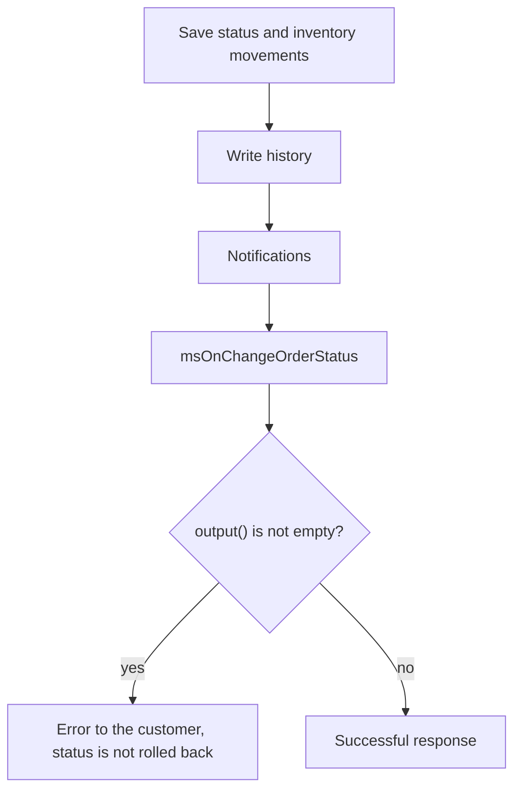

# Order status events

Tracking and controlling order status changes.

## msOnBeforeChangeOrderStatus

Fired **before** changing order status. Lets you validate or abort the change.

### Parameters

| Parameter | Type | Description |
| --- | --- | --- |
| `msOrder` | `msOrder` | Order object |
| `old_status` | `int` \| `null` | Current status ID. `null` when the order has an empty `status_id` |
| `status` | `int` | New status ID |

### Aborting the operation

```php
<?php
switch ($modx->event->name) {
    case 'msOnBeforeChangeOrderStatus':
        /** @var \MiniShop3\Model\msOrder $order */
        $order = $scriptProperties['msOrder'];
        $oldStatus = $scriptProperties['old_status'];
        $newStatus = $scriptProperties['status'];

        // 5 is ms3_status_canceled. The order has no payment_status field.
        if ($newStatus == 5) {
            $modx->event->output('Cannot cancel a paid order');
            return;
        }

        $hour = (int)date('G');
        if ($hour < 9 || $hour > 18) {
            $modx->event->output('Status change available from 9:00 to 18:00');
            return;
        }
        break;
}
```

### Redirecting to a different status

Besides aborting through `output()`, a plugin can **redirect** the change to another status: the core re-validates the transition and applies the returned status instead of the requested one.

```php
<?php
switch ($modx->event->name) {
    case 'msOnBeforeChangeOrderStatus':
        $newStatus = $scriptProperties['status'];

        if ($newStatus === 3) { // ms3_status_paid
            $modx->event->returnedValues = ['status' => 4]; // ms3_status_sent
        }
        break;
}
```

### Checking whether the transition is allowed

```php
<?php
switch ($modx->event->name) {
    case 'msOnBeforeChangeOrderStatus':
        $order = $scriptProperties['msOrder'];
        $oldStatus = $scriptProperties['old_status'];
        $newStatus = $scriptProperties['status'];

        switch ($newStatus) {
            case 4: // ms3_status_sent
                $properties = $order->get('properties') ?? [];
                if (empty($properties['tracking_number'])) {
                    $modx->event->output('Enter a tracking number');
                    return;
                }
                break;

            case 5: // ms3_status_canceled
                if ($oldStatus == 4) {
                    $modx->event->output('A shipped order cannot be cancelled');
                    return;
                }
                break;
        }
        break;
}
```

---

## msOnChangeOrderStatus



Fired **after** successful order status change.

::: warning A plugin error does not undo the status change
By the time this fires, the status is already persisted along with the inventory movements, and the transition is written to the order history — the entry is made before the event on purpose, so that a plugin error cannot erase that history.

If a plugin calls `output()`, the caller receives the error message but the status stays new: there is no rollback. Status-change notifications are sent as well — the core dispatches them first and only then returns the error.

Put any check that should abort the transition into `msOnBeforeChangeOrderStatus`.
:::

### Parameters

| Parameter | Type | Description |
| --- | --- | --- |
| `msOrder` | `msOrder` | Order object |
| `old_status` | `int` \| `null` | Previous status ID. `null` when the order has an empty `status_id` |
| `status` | `int` | New status ID |

### Example

```php
<?php
switch ($modx->event->name) {
    case 'msOnChangeOrderStatus':
        /** @var \MiniShop3\Model\msOrder $order */
        $order = $scriptProperties['msOrder'];
        $oldStatus = $scriptProperties['old_status'];
        $newStatus = $scriptProperties['status'];

        $modx->log(modX::LOG_LEVEL_INFO, sprintf(
            '[Status] Order #%s: status %d → %d',
            $order->get('num'),
            $oldStatus,
            $newStatus
        ));
        break;
}
```

### After payment

```php
<?php
switch ($modx->event->name) {
    case 'msOnChangeOrderStatus':
        $order = $scriptProperties['msOrder'];
        $newStatus = $scriptProperties['status'];

        if ($newStatus == 3) { // ms3_status_paid
            $modx->log(modX::LOG_LEVEL_INFO, sprintf(
                '[Status] Order #%s is paid, total %s',
                $order->get('num'),
                $order->get('cost')
            ));
        }
        break;
}
```

### Send SMS when order ships

```php
<?php
switch ($modx->event->name) {
    case 'msOnChangeOrderStatus':
        $order = $scriptProperties['msOrder'];
        $newStatus = $scriptProperties['status'];

        if ($newStatus == 4) { // ms3_status_sent
            $address = $order->getOne('Address');
            $phone = $address->get('phone');
            $trackingNumber = $order->get('properties')['tracking_number'] ?? '';

            if ($phone && $trackingNumber) {
                $message = sprintf(
                    'Your order #%s has shipped. Tracking: %s',
                    $order->get('num'),
                    $trackingNumber
                );

                // $smsService->send($phone, $message);
            }
        }
        break;
}
```
