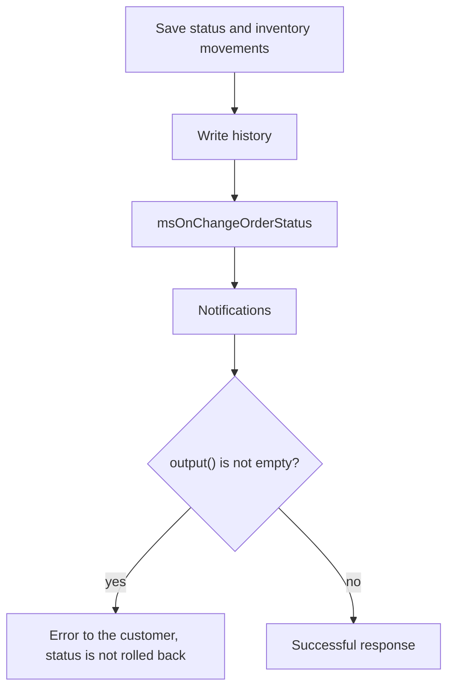

# Order status events

Tracking and controlling order status changes.

## msOnBeforeChangeOrderStatus

Fired **before** changing order status. Lets you validate or abort the change.

### Parameters

| Parameter | Type | Description |
| --- | --- | --- |
| `msOrder` | `msOrder` | Order object |
| `old_status` | `int` \| `null` | Current status ID. `null` when the order has an empty `status_id` |
| `status` | `int` | New status ID |

### Aborting the operation

```php
<?php
switch ($modx->event->name) {
    case 'msOnBeforeChangeOrderStatus':
        /** @var \MiniShop3\Model\msOrder $order */
        $order = $scriptProperties['msOrder'];
        $oldStatus = $scriptProperties['old_status'];
        $newStatus = $scriptProperties['status'];

        // 5 is ms3_status_canceled. The order has no payment_status field.
        if ($newStatus == 5) {
            $modx->event->output('Order cancellation is not allowed');
            return;
        }

        // Status changes only during working hours
        $hour = (int)date('G');
        if ($hour < 9 || $hour > 18) {
            $modx->event->output('Status change available from 9:00 to 18:00');
            return;
        }
        break;
}
```

### Redirecting to a different status

Besides aborting through `output()`, a plugin can **redirect** the change to another status: the core re-validates the transition and applies the returned status instead of the requested one.

```php
<?php
switch ($modx->event->name) {
    case 'msOnBeforeChangeOrderStatus':
        $newStatus = $scriptProperties['status'];

        if ($newStatus === 3) { // ms3_status_paid
            $modx->event->returnedValues = ['status' => 4]; // ms3_status_sent
        }
        break;
}
```

The core validates the substituted status by the same rules as the requested one. Mind that status 4 is final: an order moved there goes nowhere afterwards. When the order has to live on after the substitution, create a status of your own without the `final` flag.

### Checking whether the transition is allowed

::: warning The core rejects some transitions before the event
`OrderStatusService::validateStatusTransition()` runs **before** `msOnBeforeChangeOrderStatus`, so a transition it rejects never reaches a plugin. The rules:

- a status flagged `final` cannot be left at all — the answer is `ms3_err_status_final`. Out of the box `final` is set on 4 (shipped) and 5 (cancelled);
- from a status flagged `fixed` you cannot move to a status whose `position` is lower or equal — the answer is `ms3_err_status_fixed`;
- when `ms3_order_status_transitions` is set, the transition has to be listed there.

Do not repeat a check the core already made — it will not run. Forbidding the cancellation of a shipped order, for one: status 4 is final, so 4 → 5 is rejected earlier.
:::

```php
<?php
switch ($modx->event->name) {
    case 'msOnBeforeChangeOrderStatus':
        $order = $scriptProperties['msOrder'];
        $oldStatus = $scriptProperties['old_status'];
        $newStatus = $scriptProperties['status'];

        switch ($newStatus) {
            case 4: // ms3_status_sent
                $properties = $order->get('properties') ?? [];
                if (empty($properties['tracking_number'])) {
                    $modx->event->output('Enter a tracking number');
                    return;
                }
                break;

            case 5: // ms3_status_canceled
                if ($oldStatus == 3) { // ms3_status_paid
                    $modx->event->output('Refund a paid order instead of cancelling it');
                    return;
                }
                break;
        }
        break;
}
```

---

## msOnChangeOrderStatus



Fired **after** successful order status change.

::: warning A plugin error does not undo the status change
By the time this fires, the status is already persisted along with the inventory movements, and the transition is written to the order history — the entry is made before the event on purpose, so that a plugin error cannot erase that history.

If a plugin calls `output()`, the caller receives the error message but the status stays new: there is no rollback. Status-change notifications are sent as well — the core dispatches them first and only then returns the error.

Put any check that should abort the transition into `msOnBeforeChangeOrderStatus`.
:::

Do not touch stock in this event. Before the plugin runs, `OrderStatusService` has already called `applyStatusChange()`: `ms3_status_new` reserves, `ms3_status_paid` writes off the reserve, and `ms3_status_canceled` returns it. Writing `stock` again from the plugin changes the quantity a second time.

### Parameters

| Parameter | Type | Description |
| --- | --- | --- |
| `msOrder` | `msOrder` | Order object |
| `old_status` | `int` \| `null` | Previous status ID. `null` when the order has an empty `status_id` |
| `status` | `int` | New status ID |

### Example

```php
<?php
switch ($modx->event->name) {
    case 'msOnChangeOrderStatus':
        /** @var \MiniShop3\Model\msOrder $order */
        $order = $scriptProperties['msOrder'];
        $oldStatus = $scriptProperties['old_status'];
        $newStatus = $scriptProperties['status'];

        // Log the status change
        $modx->log(modX::LOG_LEVEL_INFO, sprintf(
            '[Status] Order #%s: status %d → %d',
            $order->get('num'),
            $oldStatus,
            $newStatus
        ));
        break;
}
```

### After payment

```php
<?php
switch ($modx->event->name) {
    case 'msOnChangeOrderStatus':
        $order = $scriptProperties['msOrder'];
        $newStatus = $scriptProperties['status'];

        if ($newStatus == 3) { // ms3_status_paid
            $modx->log(modX::LOG_LEVEL_INFO, sprintf(
                '[Status] Order #%s is paid, total %s',
                $order->get('num'),
                $order->get('cost')
            ));
        }
        break;
}
```

### Send SMS when order ships

```php
<?php
switch ($modx->event->name) {
    case 'msOnChangeOrderStatus':
        $order = $scriptProperties['msOrder'];
        $newStatus = $scriptProperties['status'];

        if ($newStatus == 4) { // ms3_status_sent
            $address = $order->getOne('Address');
            $phone = $address->get('phone');
            $trackingNumber = $order->get('properties')['tracking_number'] ?? '';

            if ($phone && $trackingNumber) {
                $message = sprintf(
                    'Your order #%s has shipped. Tracking: %s',
                    $order->get('num'),
                    $trackingNumber
                );

                // $smsService->send($phone, $message);
            }
        }
        break;
}
```
