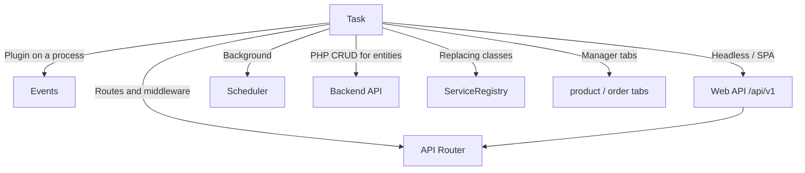

# Development

## Contents

- [Events](events) — plugin hook points
- [Web API](api) — frontend and Nuxt, [endpoint map](web-api/endpoints)
- [API Router](routing) — routing, middleware, your own routes
- [Scheduler](scheduler) — background tasks
- [Models and DB schema](models) — xPDO models
- [Service layer](services) — DI container, extending and replacing services
- [JavaScript API](javascript) — Headless API for SPA (Vue, React, Vanilla JS)
- [Frontend JavaScript](frontend-js) — site-side modules, including the UI layer
- [Product tabs integration](product-tabs-integration)
- [Order tabs integration](order-tabs-integration)
- [Backend API](backend-api/) — products, orders, options and customers from PHP

## Manager API and processors

As of **1.10+**, the screens for orders, customers, settings and utilities run through the **Manager REST API** (`Controllers\Api\Manager\*` on FastRoute). The product and category forms are the exception: those are plain MODX resource screens, and Vue only lives in their tabs. The older **processors** (`MiniShop3\Processors\*`) remain only for:

- the previous connector and `runProcessor()` calls from PHP;
- utilities where the controller calls a processor explicitly: `ImportController` (product import) and `UtilitiesGalleryController` (bulk gallery operations), both through the `RunsMs3Processors` trait.

The other eighteen controllers call no processors — they work through the service layer. Events are not always lost that way: orders, their statuses and items go through services that fire events themselves, so a plugin on `msOnChangeOrderStatus` does run from the admin UI. Vue CRUD for the settings directories, however, writes to the database directly, bypassing `Processors/Settings/*` — plugins on vendor, delivery, payment and link type events will not run from the admin UI. See [Vendor events](events/vendor).

The headless frontend goes without processors too: it runs through the Web API (`/api/v1/*`).
