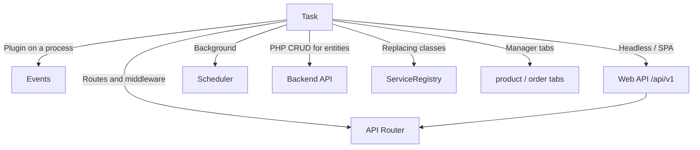
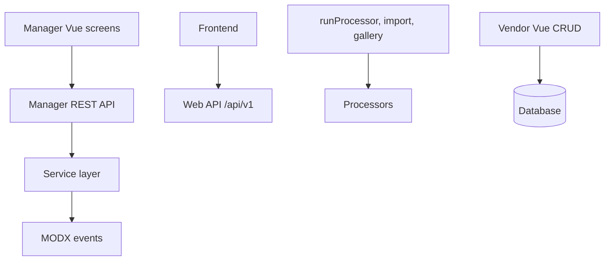

# Development

## Contents

- [Events](events) — plugin hook points
- [Web API](api) — frontend and Nuxt, [endpoint map](web-api/endpoints)
- [API Router](routing) — routing, middleware, your own routes
- [Scheduler](scheduler) — background tasks
- [Models and DB schema](models) — xPDO models
- [Service layer](services) — DI container, extending and replacing services
- [JavaScript API](javascript) — Headless API for SPA (Vue, React, Vanilla JS)
- [Frontend JavaScript](frontend-js) — site-side modules, including the UI layer
- [Product tabs integration](product-tabs-integration)
- [Order tabs integration](order-tabs-integration)
- [Backend API](backend-api/) — products, orders, options and customers from PHP

## Manager API and processors

As of **1.10+**, the screens for orders, customers, settings and utilities run through the **Manager REST API** (`Controllers\Api\Manager\*` on FastRoute). The product and category cards stay ordinary MODX resource screens. Vue is only in the tabs.

**Processors** (`MiniShop3\Processors\*`) are still used by:

- the previous connector and `runProcessor()` calls from PHP;
- utilities where the controller calls a processor explicitly: `ImportController` (product import) and `UtilitiesGalleryController` (bulk gallery operations), both through the `RunsMs3Processors` trait;
- customer authentication in the Web API: login, registration, logout, password reset request and password reset all run through `Processors\Api\Customer\*`.

The remaining Manager API controllers call no processors: they work through the service layer.

Events are not always lost. Orders, their statuses and lines go through services that fire the events themselves. A plugin on `msOnChangeOrderStatus` does run from the manager.

Vue CRUD for directories writes straight to the database and skips `Processors/Settings/Vendor/*`. Vendor CRUD plugins do not run from the manager. Deliveries and payments have cost events in `events.php`, not CRUD events. Link types have no CRUD events. See [Vendor events](events/vendor).

The headless frontend uses the Web API (`/api/v1/*`). Processors there remain only for customer authentication, so plugins on those events fire from a headless client.
