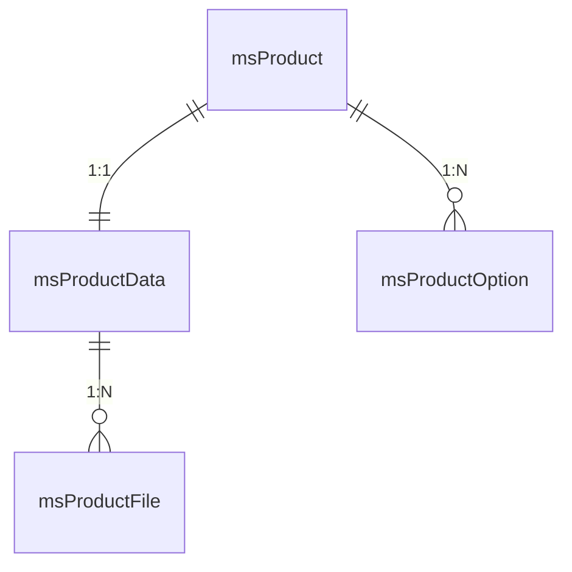
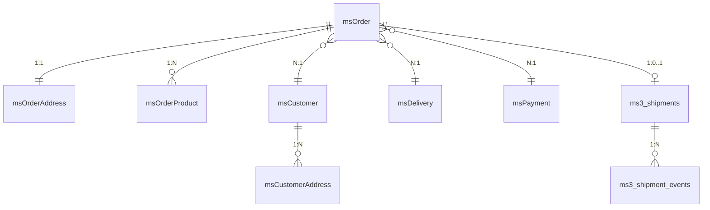

# Models and database schema

MiniShop3 models are xPDO classes in the `MiniShop3\Model` namespace.

## Core classes

```php
use MiniShop3\Model\msProduct;
use MiniShop3\Model\msProductData;
use MiniShop3\Model\msOrder;
use MiniShop3\Model\msCustomer;

// Get product
$product = $modx->getObject(msProduct::class, $id);

// Get product data
$data = $product->getOne('Data');

// Get order with address
$order = $modx->getObject(msOrder::class, $id);
$address = $order->getOne('Address');

// Get customer
$customer = $modx->getObject(msCustomer::class, ['email' => $email]);
```

## Model relations

`getOne()` — for 1:1 and N:1, `getMany()` — for 1:N.

| Model | Alias | Type | Returns |
| --- | --- | --- | --- |
| `msProduct` | `Data` | 1:1 | product data (`msProductData`) |
| `msProduct` | `Options` | 1:N | product option values |
| `msProductData` | `Files` | 1:N | gallery files |
| `msOrder` | `Address` | 1:1 | order address (`msOrderAddress`) |
| `msOrder` | `Products` | 1:N | order line items |
| `msOrder` | `msCustomer` | N:1 | the customer. That is the alias, not `Customer` |
| `msCustomer` | `Tokens` | 1:N | auth tokens |
| `msCustomerAddress` | `Customer` | N:1 | the customer — the reverse relation from an address |
| `msCustomerToken` | `Customer` | N:1 | the customer — the reverse relation from a token |

`msCustomer` has no `Addresses` relation: addresses are read with a direct query to `msCustomerAddress` by `customer_id` — see [Working with a customer](#customer-example).

## Schema file

```
core/components/minishop3/schema/minishop3.mysql.schema.xml
```

| Attribute | Value |
| --- | --- |
| `package` | `MiniShop3\Model` |
| `baseClass` | `xPDO\Om\xPDOObject` |
| `platform` | `mysql` |
| `version` | `3.0` |

## Database tables

### Products

| Model | Table | Description |
| --- | --- | --- |
| `msProduct` | `site_content` | Product (extends modResource) |
| `msProductData` | `ms3_products` | Product data (price, article, weight) |
| `msProductFile` | `ms3_product_files` | Product gallery files |
| `msProductOption` | `ms3_product_options` | Product option values |
| `msLink` | `ms3_links` | Product link types |
| `msProductLink` | `ms3_product_links` | Product-to-product links |

#### msProductData — main fields

| Field | Type | Description |
| --- | --- | --- |
| `id` | int | ID (matches resource ID) |
| `article` | varchar(50) | Article/SKU |
| `price` | decimal(12,2) | Price |
| `old_price` | decimal(12,2) | Old price |
| `stock` | decimal(13,3) | Stock quantity |
| `weight` | decimal(13,3) | Weight |
| `image` | varchar(255) | Main image |
| `thumb` | varchar(255) | Thumbnail |
| `preview_file_id` | int | Gallery file ID used as the main preview (gallery order is not changed) |
| `vendor_id` | int | Vendor ID |
| `made_in` | varchar(100) | Country of origin |
| `new` | tinyint(1) | "New" flag |
| `popular` | tinyint(1) | "Popular" flag |
| `favorite` | tinyint(1) | "Favorite" flag |
| `tags` | json | Tags |
| `color` | json | Colors |
| `size` | json | Sizes |

### Categories

| Model | Table | Description |
| --- | --- | --- |
| `msCategory` | `site_content` | Category (extends modResource) |
| `msCategoryMember` | `ms3_product_categories` | Product–category relation |
| `msCategoryOption` | `ms3_category_options` | Category options |

### Orders

| Model | Table | Description |
| --- | --- | --- |
| `msOrder` | `ms3_orders` | Order |
| `msOrderAddress` | `ms3_order_addresses` | Order delivery address |
| `msOrderProduct` | `ms3_order_products` | Order line items |
| `msOrderLog` | `ms3_order_logs` | Order change history |
| `msOrderStatus` | `ms3_order_statuses` | Order statuses |

#### msOrder — main fields

| Field | Type | Description |
| --- | --- | --- |
| `id` | int | Order ID |
| `user_id` | int | MODX user ID |
| `customer_id` | int | msCustomer ID |
| `token` | varchar(128) | Session token |
| `uuid` | char(36) | Order UUID |
| `num` | varchar(20) | Order number |
| `cost` | decimal(12,2) | Total cost |
| `cart_cost` | decimal(12,2) | Products cost |
| `delivery_cost` | decimal(12,2) | Delivery cost |
| `weight` | decimal(13,3) | Total weight |
| `status_id` | int | Status ID |
| `delivery_id` | int | Delivery method ID |
| `payment_id` | int | Payment method ID |
| `context` | varchar(100) | MODX context |
| `order_comment` | text | Order comment |
| `idempotency_key` | varchar | Idempotency key (programmatic orders) |
| `createdon` | datetime | Created at |
| `updatedon` | datetime | Updated at |

### Customers

| Model | Table | Description |
| --- | --- | --- |
| `msCustomer` | `ms3_customers` | Store customer |
| `msCustomerGroup` | `ms3_customer_groups` | Customer groups (segmentation, catalogue ACL) |
| `msCustomerAddress` | `ms3_customer_addresses` | Saved customer addresses |
| `msCustomerToken` | `ms3_customer_tokens` | Auth tokens |

#### msCustomerGroup — main fields

| Field | Type | Description |
| --- | --- | --- |
| `id` | int | Group ID |
| `name` | varchar(191) | Group name |
| `user_group_id` | int | MODX user group ID (the principal for modAccessResourceGroup) |
| `active` | tinyint(1) | Active |
| `created_at` | datetime | Creation date |
| `updated_at` | datetime | Update date |

#### msCustomer — main fields

| Field | Type | Description |
| --- | --- | --- |
| `id` | int | Customer ID |
| `user_id` | int | Linked modUser ID (optional) |
| `first_name` | varchar(191) | First name |
| `last_name` | varchar(191) | Last name |
| `phone` | varchar(50) | Phone |
| `email` | varchar(191) | Email |
| `password` | varchar(255) | Password hash |
| `is_active` | tinyint(1) | Active |
| `is_blocked` | tinyint(1) | Blocked |
| `email_verified_at` | datetime | Email verification date |
| `orders_count` | int | Order count |
| `total_spent` | decimal(12,2) | Total order sum |
| `last_order_at` | datetime | Last order date |
| `privacy_accepted_at` | datetime | Privacy policy acceptance date |

::: tip Difference from miniShop2
In miniShop2 customer = modUser. In MiniShop3 customer is a separate entity msCustomer, which can optionally be linked to modUser.
:::

### Delivery and payment

| Model | Table | Description |
| --- | --- | --- |
| `msDelivery` | `ms3_deliveries` | Delivery methods |
| `msPayment` | `ms3_payments` | Payment methods |
| `msDeliveryMember` | `ms3_delivery_payments` | Delivery–payment link |

### Shipments

Tables without xPDO models: access goes through `PdoShipmentStore` and the `ms3_shipment_lifecycle` DI key (`ShipmentLifecycleService`). Phinx migrations: `create_shipments`, `create_shipment_events`.

| Table | Description |
| --- | --- |
| `ms3_shipments` | One shipment per order (`uniq_shipment_order`) |
| `ms3_shipment_events` | Webhook idempotency: `provider_event_id` per shipment |

#### ms3_shipments — fields

| Field | Type | Description |
| --- | --- | --- |
| `id` | int | Shipment ID |
| `order_id` | int unsigned | Order ID (unique) |
| `delivery_id` | int unsigned | Delivery method ID |
| `status` | varchar(32) | `preparing`, `shipped`, `in_transit`, `delivered`, `cancelled`, `returned`, `failed` |
| `tracking_number` | varchar(191) | Tracking number |
| `external_id` | varchar(191) | ID on the provider side |
| `provider` | varchar(191) | Provider class or name |
| `carrier` | varchar(191) | Carrier |
| `shipped_at` | int unsigned | Unix time of dispatch |
| `delivered_at` | int unsigned | Unix time of delivery |
| `last_event_id` | varchar(191) | Latest `provider_event_id` |
| `meta` | text | JSON metadata |
| `createdon` / `updatedon` | int unsigned | Unix time |

With `ms3_shipment_enabled=1`, `OrderStatusService` carries the shipment status over to the order: `shipped` → `ms3_status_sent`, `cancelled` / `failed` → `ms3_status_canceled`. For `delivered` / `in_transit` see the `ms3_shipment_on_*_status` settings.

### Vendors

| Model | Table | Description |
| --- | --- | --- |
| `msVendor` | `ms3_vendors` | Product vendors |

### Options

| Model | Table | Description |
| --- | --- | --- |
| `msOption` | `ms3_options` | Option catalog |
| `msOptionGroup` | `ms3_option_groups` | Option groups (replaced the use of `modCategory` for grouping, since 1.11.0) |

### Field configuration

| Model | Table | Description |
| --- | --- | --- |
| `msModelField` | `ms3_model_fields` | Model field settings |
| `msModelFieldSection` | `ms3_model_field_sections` | Field sections |
| `msGridField` | `ms3_grid_fields` | Grid column configuration (customers, orders, products) |
| `msProductField` | `ms3_product_fields` | Product fields (legacy) |
| `msPageSection` | `ms3_page_sections` | Page sections (legacy) |
| `msExtraField` | `ms3_extra_fields` | Extra fields |

### Notifications

| Model | Table | Description |
| --- | --- | --- |
| `msNotificationConfig` | `ms3_notification_configs` | Notification configuration |

## Working with models

### Creating an order

::: warning This is not how to create an order
The example below only shows how order records are laid out in the database. An order assembled this way has passed no validation, got no cost or delivery calculation, fired no events and sent no notifications.

To create orders from code there is the `ms3_programmatic_order` service (`ProgrammaticOrderService`): it builds a draft and finalises it the usual way, and with `idempotency_key` a repeated call will not produce a duplicate.

```php
$result = $modx->services->get('ms3_programmatic_order')->create([
    'idempotency_key' => 'crm-order-15', // required
    'products' => [
        ['id' => $productId, 'count' => 2],
    ],
    'delivery_id' => $deliveryId,
    'payment_id' => $paymentId,
]);
```

:::

```php
use MiniShop3\Model\msOrder;
use MiniShop3\Model\msOrderProduct;

// Create order
$order = $modx->newObject(msOrder::class);
$order->fromArray([
    'customer_id' => $customerId,
    'user_id' => $modx->user->get('id') ?: 0,
    'status_id' => $modx->getOption('ms3_status_new'),
    'delivery_id' => $deliveryId,
    'payment_id' => $paymentId,
    'context' => $modx->context->key,
]);
$order->save();

// Add product to order
$orderProduct = $modx->newObject(msOrderProduct::class);
$orderProduct->fromArray([
    'order_id' => $order->get('id'),
    'product_id' => $productId,
    'name' => $productName,
    'price' => $price,
    'count' => $count,
    'cost' => $price * $count,
    'options' => json_encode($options),
]);
$orderProduct->save();
```

### Working with a customer {#customer-example}

```php
use MiniShop3\Model\msCustomer;
use MiniShop3\Model\msCustomerAddress;

// Find or create customer
$customer = $modx->getObject(msCustomer::class, ['email' => $email]);
if (!$customer) {
    $customer = $modx->newObject(msCustomer::class);
    $customer->fromArray([
        'email' => $email,
        'first_name' => $firstName,
        'phone' => $phone,
    ]);
    $customer->save();
}

// Add address
$address = $modx->newObject(msCustomerAddress::class);
$address->fromArray([
    'customer_id' => $customer->get('id'),
    'city' => $city,
    'street' => $street,
    'building' => $building,
]);
$address->save();

// Get all customer addresses with a direct query —
// msCustomer has no Addresses relation
$addresses = $modx->getIterator(msCustomerAddress::class, [
    'customer_id' => $customer->get('id'),
]);
```

### Iterating records

`getIterator()` fetches rows one at a time and never holds the whole set in memory — on large result sets it beats `getCollection()`:

```php
use MiniShop3\Model\msOrder;

foreach ($modx->getIterator(msOrder::class, ['status_id' => 2]) as $order) {
    // Process order
}
```

::: danger getIterator() and classes without their own table
`getCollection()` and `getObject()` add a `class_key` filter to the criteria themselves — that is what `addDerivativeCriteria()` does. On top of that, `msProduct` and `msCategory` duplicate the guard in their own `loadCollection()` and `load()`. **`getIterator()` goes through neither: it builds the iterator directly, and no filter is applied.**

For `msProduct` and `msCategory` this matters: they have no table of their own and live in `site_content` along with every other MODX resource. Without the filter the query picks up foreign rows, and the first of them raises an error along the lines of "Instantiated a derived class msProduct that is not a subclass of the requested class msCategory".

So with `getIterator()` on such classes, set `class_key` by hand:

```php
$criteria = [
    'class_key' => msProduct::class, // required
    'parent' => $categoryId,
];

foreach ($modx->getIterator(msProduct::class, $criteria) as $product) {
    // …
}
```

Models with a table of their own — `msOrder`, `msCustomer`, `msProductData` and the rest from the tables above — are unaffected.
:::

## Model architecture

A model owns its table and relations, business logic lives in services — see [Service layer](/en/components/minishop3/development/services).

The models never became fully "thin": `msProduct` and `msCategory` extend `modResource`, and MODX keeps business logic in models. So a model may call a service:

```php
// src/Model/msProductData.php
class msProductData extends xPDOSimpleObject
{
    public function getPrice(array $data = []): float
    {
        // Delegate to formatting service
        $ms3 = $this->xpdo->services->get('ms3');
        return $ms3->format->price($this->get('price'));
    }
}
```

## Regenerating models

::: warning Models are maintained manually
In MiniShop3 models are NOT auto-generated from the XML schema via `buildModel()`. They are created and maintained manually in `src/Model/`.

This allows:

- Custom methods in models
- Full PHP 8 type hints
- Full control over model code

**Important:** Do not run `buildModel()` — it will overwrite custom model methods.
:::

### Model file structure

```
src/Model/
├── msProduct.php           # Main model class
├── mysql/
│   └── msProduct.php       # MySQL-specific mapping
```

### Example model

```php
<?php
namespace MiniShop3\Model;

use MODX\Revolution\modResource;

class msProduct extends modResource
{
    // Custom model methods
    public function getPrice(): float
    {
        $data = $this->getOne('Data');
        return $data ? (float)$data->get('price') : 0.0;
    }
}
```

### Example mapping

```php
<?php
namespace MiniShop3\Model\mysql;

class msProduct extends \MiniShop3\Model\msProduct
{
    public static $metaMap = [
        'package' => 'MiniShop3\\Model\\',
        'version' => '3.0',
        'extends' => 'MODX\\Revolution\\modResource',
        'fields' => [
            'class_key' => 'MiniShop3\\Model\\msProduct',
        ],
        // ... other metadata
    ];
}
```

## Phinx migrations

Phinx migrations change the database schema:

```
core/components/minishop3/migrations/
├── 20251020000000_initial_schema.php
├── 20251021000000_seed_page_sections.php
├── 20251023000000_seed_order_statuses.php
└── ...
```

### Running migrations

You normally do not run them by hand: on install and upgrade the `resolver_02_migrations` resolver applies them, and `ExtraFieldsService` does when you work with extra fields. Both use the `production` environment, which is also the default in `phinx.php`.

For development, run them from the CLI:

```bash
cd /path/to/modx
php core/components/minishop3/vendor/bin/phinx migrate -c core/components/minishop3/phinx.php
```

### Example migration

```php
<?php
use Phinx\Migration\AbstractMigration;

class CreateCustomersTable extends AbstractMigration
{
    public function change()
    {
        $table = $this->table('ms3_customers', [
            'engine' => 'InnoDB',
            'collation' => 'utf8mb4_unicode_ci',
        ]);

        $table
            ->addColumn('email', 'string', ['limit' => 191])
            ->addColumn('first_name', 'string', ['limit' => 191, 'null' => true])
            ->addColumn('phone', 'string', ['limit' => 50, 'null' => true])
            ->addIndex(['email'], ['unique' => true])
            ->create();
    }
}
```

## Relation diagram

### Product



### Order



`ms3_shipments` / `ms3_shipment_events` are PDO tables, not `MiniShop3\Model\*` classes.

The `msCustomer → msCustomerAddress` line shows the relation in the database: addresses point at the customer through `customer_id`. The schema has no alias for walking from a customer to the addresses — only the other way round, `$address->getOne('Customer')`.
