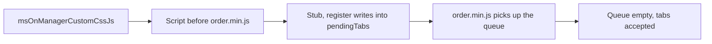

# Order tabs integration

A MODX plugin adds your own tab to the order page in the manager: it registers a Vue component or an ExtJS panel in `window.MS3OrderTabsRegistry`.

::: info Similar API
For product tabs use [`MS3ProductTabsRegistry`](/en/components/minishop3/development/product-tabs-integration).
:::

## Architecture

The order page is a fully Vue application (unlike the product page, where Vue is embedded in ExtJS):

```
Vue OrderView (root component)
├── Info (position: 0)
├── Products (position: 1, hidden on create)
├── Address (position: 2)
├── Shipment (position: 3, hidden on create)
├── History (position: 4, hidden on create)
└── [Your tabs] (position: 100 by default)
```

## Tab registration

The `window.MS3OrderTabsRegistry.register(tabConfig)` method accepts:

| Parameter | Type | Required | Description |
| --- | --- | --- | --- |
| `key` | string | Yes | Unique tab identifier |
| `title` | string | Yes | Tab title |
| `type` | string | No | `'vue'` (default) or `'extjs'` |
| `component` | object/string | For Vue | A component object (an imported SFC, for one) or a name **already registered** on the app via `app.component()`. The core does not register arbitrary names coming from plugins |
| `xtype` | string | For ExtJS | ExtJS component xtype |
| `extConfig` | object | No | Additional ExtJS configuration |
| `props` | object | No | Additional props for the Vue component |
| `position` | number | No | Tab position among the others (default `100`) |
| `hideOnCreate` | boolean | No | Hide when creating a new order |

**Returns:** `boolean` — whether registration succeeded.

**Reserved keys:** `info`, `products`, `address`, `ms3_shipment`, `history` — cannot be used.

## What the component receives

The tab receives this data automatically:

| Parameter | Type | Description |
| --- | --- | --- |
| `orderId` | number \| string | Order ID. The create page passes the string `'new'` |
| `order` | object \| null | Order data. `null` on create and until the API responds — hence `order?.num` in the examples |
| `config` | object | ms3 configuration (`ms3.config`) |
| `isCreateMode` | boolean | New order creation mode |

These four values are applied **last**, so keys of the same name coming from `props` (Vue) or `extConfig` (ExtJS) get overwritten.

## Connecting via MODX plugin



The plugin loads the registration script on the `msOnManagerCustomCssJs` event, after checking `page === 'order'`:

```php
<?php
/**
 * Event: msOnManagerCustomCssJs
 */

$page = $scriptProperties['page'] ?? '';
if ($page !== 'order') {
    return;
}

/** @var msManagerController $controller */
$controller = $scriptProperties['controller'];

$controller->addHtml('
<script>
// tab registration
</script>
');
```

::: warning Load order
The script from `msOnManagerCustomCssJs` runs **before** the Vue module (`order.min.js`) loads.
At that moment `MS3OrderTabsRegistry` does not exist yet — create a stub with a queue. The Vue module picks up `pendingTabs` from the stub on load.
:::

### Stub with a queue {#registry-stub}

```javascript
if (!window.MS3OrderTabsRegistry) {
    window.MS3OrderTabsRegistry = {
        pendingTabs: [],
        register: function(c) { this.pendingTabs.push(c); return true; }
    };
}
```

The examples below mark it with a comment.

## Vue component integration

### Inline component

Suitable for simple tabs without a build step:

```php
<?php
// MODX plugin — event: msOnManagerCustomCssJs

$page = $scriptProperties['page'] ?? '';
if ($page !== 'order') {
    return;
}

$controller = $scriptProperties['controller'];

$controller->addHtml('
<script>
(function() {
    // Stub with a queue — code above

    window.MS3OrderTabsRegistry.register({
        key: "delivery-tracking",
        title: "Tracking",
        type: "vue",
        component: {
            props: ["orderId", "order", "config", "isCreateMode"],
            template: "<div style=\"padding: 20px\">"
                + "<h3>Delivery tracking</h3>"
                + "<p>Order #{{ order?.num }}, ID: {{ orderId }}</p>"
                + "</div>"
        },
        position: 5,
        hideOnCreate: true
    });
})();
</script>
');
```

### SFC component (recommended)

For full components built with Vite/Webpack:

**1. Create a Vue component:**

```vue
<!-- my-addon/src/OrderTrackingTab.vue -->
<template>
  <div class="tracking-tab">
    <h3>Delivery tracking</h3>
    <p>Order #{{ order?.num }}</p>
    <p>Status: {{ trackingStatus }}</p>
    <button @click="refreshTracking">Refresh</button>
  </div>
</template>

<script setup>
import { ref, onMounted } from 'vue'

const props = defineProps({
  orderId: { type: [Number, String], required: true },  // On create this is 'new'
  order: { type: Object, default: null },
  config: { type: Object, default: () => ({}) },
  isCreateMode: { type: Boolean, default: false }
})

const trackingStatus = ref('Loading...')

async function refreshTracking() {
  // Your data fetch logic
  const response = await fetch(`/api/tracking/${props.orderId}`)
  const data = await response.json()
  trackingStatus.value = data.status
}

onMounted(() => {
  if (props.orderId) {
    refreshTracking()
  }
})
</script>
```

**2. Create an entry point:**

```javascript
// my-addon/src/entries/order-tab.js
import OrderTrackingTab from '../components/OrderTrackingTab.vue'

;(function() {
  // Stub with a queue — code above

  window.MS3OrderTabsRegistry.register({
    key: 'tracking',
    title: 'Tracking',
    type: 'vue',
    component: OrderTrackingTab, // SFC object, not a string
    position: 5,
    hideOnCreate: true
  })
})()
```

**3. Connect in a MODX plugin:**

```php
<?php
// Event: msOnManagerCustomCssJs

$page = $scriptProperties['page'] ?? '';
if ($page !== 'order') {
    return;
}

$controller = $scriptProperties['controller'];
$assetsUrl = MODX_ASSETS_URL . 'components/myaddon/';

// ES module from build
$controller->addHtml(
    '<script type="module" src="' . $assetsUrl . 'js/order-tab.min.js"></script>'
);
```

::: tip Reactivity
Vue tabs receive **reactive** props: they update automatically when the order loads, saves, or is edited.
:::

The tab component mounts only while its tab is open and unmounts when you switch away. Two consequences:

- `mounted` fires the first time the tab is opened, not when the order page loads;
- state inside the component does not survive switching — keep what must persist outside the component, or fetch it again.

## ExtJS component integration

### 1. Create an ExtJS panel

```javascript
// assets/components/myaddon/js/mgr/delivery-panel.js
Ext.define('MyAddon.panel.DeliveryInfo', {
  extend: 'Ext.Panel',
  xtype: 'myaddon-delivery-panel',

  initComponent: function() {
    // this.orderId, this.order, this.config, this.isCreateMode
    // are available from configuration
    Ext.apply(this, {
      border: false,
      bodyStyle: 'padding: 15px',
      html: '<h3>Delivery information</h3>'
          + '<p>Order ID: ' + this.orderId + '</p>'
    })

    MyAddon.panel.DeliveryInfo.superclass.initComponent.call(this)
  }
})
```

### 2. Register the tab and load scripts

```php
<?php
// Plugin — event: msOnManagerCustomCssJs

$page = $scriptProperties['page'] ?? '';
if ($page !== 'order') {
    return;
}

$controller = $scriptProperties['controller'];
$assetsUrl = MODX_ASSETS_URL . 'components/myaddon/';

// Panel first
$controller->addJavascript($assetsUrl . 'js/mgr/delivery-panel.js');

// Then registration
$controller->addHtml('
<script>
(function() {
    // Stub with a queue — code above

    window.MS3OrderTabsRegistry.register({
        key: "delivery-info",
        title: "Delivery",
        type: "extjs",
        xtype: "myaddon-delivery-panel",
        extConfig: {
            customParam: "value"
        },
        position: 6,
        hideOnCreate: true
    });
})();
</script>
');
```

::: warning Data snapshot
The ExtJS tab is created **once** on first switch and lives until the order page is closed: switching to other tabs does not destroy the panel, and its state survives. Values `order`, `orderId`, `config`, `isCreateMode` are a snapshot at creation time. If the order is saved or changed, the ExtJS panel **does not** receive updated data automatically. Implement your own refresh logic (polling, event subscription).
:::

## Tab positioning

Built-in tabs have fixed positions:

| Tab | Key | Position | Hidden on create |
| --- | --- | --- | --- |
| Info | `info` | 0 | No |
| Products | `products` | 1 | Yes |
| Address | `address` | 2 | No |
| Shipment | `ms3_shipment` | 3 | Yes |
| History | `history` | 4 | Yes |

A custom tab with no `position` gets `100`. A value from the **5–99** range puts it after the built-in tabs but ahead of the ones left at the default.

The built-in tabs occupy the integers 0–4, so no integer will place a tab between them — sorting is numeric, and `2.5` lands between Address and Shipment.

Tabs with the same position sort in registration order. Built-in tabs enter the list first, so `position: 0` puts your tab right after Info rather than before it — a negative number is what makes it first.

::: tip `position: 0` works here, on product tabs it does not
An order tab reads the value as `position ?? 100`, so zero survives. On [product tabs](product-tabs-integration.md#tab-positioning) the core reads `position || 100` and replaces zero with `100`.
:::

## If the tab does not appear

A tab is rejected when:

- `key` or `title` is missing;
- `key` matches a reserved one (`info`, `products`, `address`, `ms3_shipment`, `history`);
- `type` is neither `vue` nor `extjs`;
- `component` is missing for `type: 'vue'`, or `xtype` for `type: 'extjs'`;
- `key` is already registered.

The first four cases log the reason to `console.error`, a duplicate key goes to `console.warn`. A rejected tab simply does not appear, and the order page keeps working.

::: warning The stub checks nothing
The stub's `register()` pushes the config into `pendingTabs` and always returns `true`. The validation happens later, when the loaded Vue module walks the queue — so in the plugin scenario you never see `false` in your own code, and the reason shows up in the console as the page loads.

The message prefix tells you at which stage the rejection happened: `[OrderTabsRegistry]` while the queue is being walked, `[OrderView]` for a `register()` call on an already open page.
:::

What to check in the browser console:

```javascript
// Full MS3OrderTabsRegistry state
console.log(window.MS3OrderTabsRegistry)

// Queue before Vue mounts — must be empty once the page has loaded
console.log(window.MS3OrderTabsRegistry.pendingTabs)
```

Draining the queue from the stub prints this:

```text
console.error [OrderTabsRegistry] Tab must have key and title {…}
console.error [OrderTabsRegistry] Tab key "info" is reserved {key: "info", …}
console.error [OrderTabsRegistry] Unsupported tab type "custom" (use vue or extjs) {type: "custom", …}
console.error [OrderTabsRegistry] Vue tab requires component (component name or definition) {type: "vue", …}
console.error [OrderTabsRegistry] ExtJS tab requires xtype {type: "extjs", …}
console.warn [OrderTabsRegistry] Tab "tracking" already registered
```

On a page that is already open the same refusals carry the `[OrderView]` prefix. After a load with one accepted tab `pendingTabs` is `[]`.
