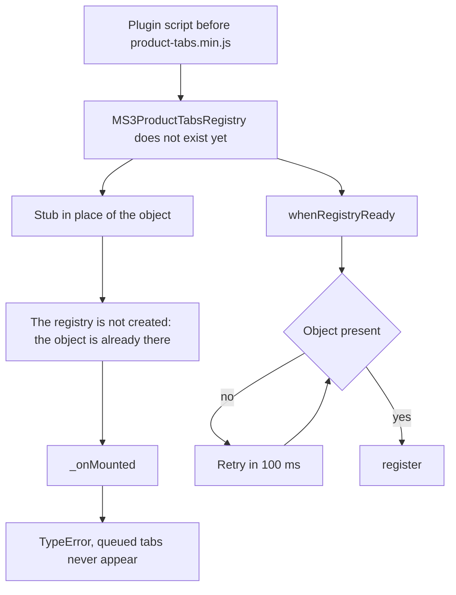

# Product tabs integration

A MODX plugin adds your own tab to the product edit page: it registers a Vue component or an ExtJS panel in `window.MS3ProductTabsRegistry`.

::: info Similar API
For order tabs use [`MS3OrderTabsRegistry`](/en/components/minishop3/development/order-tabs-integration).
:::

## Architecture

The product edit page is a hybrid: Vue tabs run inside an ExtJS TabPanel.

```
ExtJS TabPanel (top level)
├── Document (MODX system tab)
├── Product (Vue ProductTabs)
│   ├── Product Properties (Vue)
│   ├── Gallery (Vue)
│   ├── Categories (Vue ProductCategoriesTab)
│   ├── Links (Vue ProductLinksTab)
│   ├── Product options (Vue)
│   └── [Your tabs]
├── Template Variables (MODX system tab)
├── Settings (MODX system tab)
└── Resource Groups (MODX system tab)
```

Not every built-in tab is always there:

| Tab | Key | Position | Shown when |
| --- | --- | --- | --- |
| Product Properties | `properties` | 0 | Always |
| Gallery | `gallery` | 1 | Unless `show_gallery` is off |
| Categories | `categories` | 2 | Unless `show_categories` is off |
| Links | `links` | 3 | Unless `show_links` is off |
| Product options | `options` | 4 | Unless `show_options` is off, and the product has options |

## Tab registration

The `window.MS3ProductTabsRegistry.register(tabConfig)` method accepts:

| Parameter | Type | Required | Description |
| --- | --- | --- | --- |
| `key` | string | Yes | Unique tab identifier |
| `title` | string | Yes | Tab title |
| `type` | string | No | `'vue'` (default) or `'extjs'` |
| `component` | object | For Vue | The component object — an imported SFC, for one. A string name only works if the component is already registered on the app via `app.component()`; the core does not look names up in `window` |
| `xtype` | string | For ExtJS | ExtJS component xtype |
| `extConfig` | object | No | Additional ExtJS configuration |
| `props` | object | No | Additional props for the Vue component |
| `position` | number | No | Tab position among the others (default `100`) |

**Returns:** `boolean` — whether registration succeeded.

**Keys of the built-in tabs** (`properties`, `gallery`, `categories`, `links`, `options`) must not be taken: the core checks for duplicates among plugin tabs only and does not catch such a clash.

## What the component receives

The tab receives this data automatically:

| Parameter | Type | Description | Where available |
| --- | --- | --- | --- |
| `productId` | number | Product ID | props of the Vue component |
| `record` | object | Product data | props of the Vue component, `config.record` in the ExtJS panel |

`record` is the product record the edit screen initialised the ExtJS panel with: the resource fields together with the product data as the controller returned them. The built-in tabs read `id`, `parent`, `thumb` and `categories` from it; the full set depends on the product fields configured on the site, extra fields included.

For ExtJS tabs the core injects `record` into `extConfig` itself — you do not need to pass it.

## Load order



`product-tabs.min.js` is included as an ES module, and modules run after the page has been parsed. A plain plugin script therefore always runs earlier, and at that moment `window.MS3ProductTabsRegistry` does not exist yet.

::: warning Do not create a stub
The [order page](/en/components/minishop3/development/order-tabs-integration#registry-stub) uses a stub-with-a-queue approach. It does not work here: the registry is created as `window.MS3ProductTabsRegistry || new ProductTabsRegistry()`, so your stub object stays where the real registry should be. Tab initialisation then calls `_onMounted()` on it, which the stub does not have, and not a single queued tab appears.

Wait for the registry instead — see [the function below](#waiting-for-registry).
:::

### Waiting for the registry {#waiting-for-registry}

This function defers the registration; it works for both Vue and ExtJS tabs:

```javascript
function whenRegistryReady(callback, attemptsLeft) {
    if (window.MS3ProductTabsRegistry) {
        callback(window.MS3ProductTabsRegistry)
        return
    }
    if (attemptsLeft === undefined) attemptsLeft = 50 // ~5 seconds
    if (attemptsLeft <= 0) return
    setTimeout(function() { whenRegistryReady(callback, attemptsLeft - 1) }, 100)
}
```

The attempt limit is not optional: without it the polling never stops where no registry exists — on the product create page, for one.

The examples below call it by name.

## Vue component integration

### 1. Create the component

```vue
<!-- my-component/src/components/VariantsTab.vue -->
<template>
  <div class="variants-tab">
    <h3>Product #{{ productId }} variants</h3>
    <!-- Your content -->
  </div>
</template>

<script setup>
defineProps({
  productId: {
    type: Number,
    required: true
  },
  record: {
    type: Object,
    required: true
  }
})
</script>
```

### 2. Create the entry point

```javascript
// my-component/src/entries/variants-tab.js
import VariantsTab from '../components/VariantsTab.vue'

whenRegistryReady(registry => {
  registry.register({
    key: 'variants',
    title: 'Variants',
    type: 'vue',
    component: VariantsTab, // the component object, not a string
    position: 5, // after "Product options"
  })
})
```

### 3. Load the script from a MODX plugin

```php
<?php
// MODX plugin — event: msOnManagerCustomCssJs

$page = $scriptProperties['page'] ?? '';
if ($page !== 'product_update') {
    return;
}

$controller = $scriptProperties['controller'];
$assetsUrl = MODX_ASSETS_URL . 'components/mycomponent/';

$controller->addHtml(
    '<script type="module" src="' . $assetsUrl . 'js/variants-tab.min.js"></script>'
);
```

::: warning There are no tabs on the create page
The event fires on the create page as well, with `page => 'product_create'`, but `product-tabs.min.js` is not included there, the Product tab is absent and no registry ever appears. So checking for `product_create` buys you nothing: the script runs for nothing, and waiting for the registry would poll the page until it is closed. Custom tabs are only available for a saved product.
:::

A Vue component inside `ProductTabs` inherits the styles of the `.vueApp` container.

## ExtJS component integration

### 1. Create an ExtJS panel

```javascript
// assets/components/mycomponent/js/mgr/widgets/custom.panel.js
MyComponent.panel.CustomTab = function(config) {
    config = config || {};

    Ext.apply(config, {
        border: false,
        layout: 'anchor',
        items: [{
            xtype: 'modx-grid',
            // ... grid config
        }]
    });

    MyComponent.panel.CustomTab.superclass.constructor.call(this, config);
};
Ext.extend(MyComponent.panel.CustomTab, MODx.Panel);
Ext.reg('mycomponent-custom-tab', MyComponent.panel.CustomTab);
```

### 2. Register the tab

```javascript
// assets/components/mycomponent/js/mgr/product-integration.js
whenRegistryReady(function(registry) {
    registry.register({
        key: 'custom',
        title: 'Custom tab',
        type: 'extjs',
        xtype: 'mycomponent-custom-tab',
        extConfig: {
            // the core injects record itself, put only your own params here
            myParam: 'value'
        },
        position: 6
    });
});
```

`Ext.onReady()` will not do for registration: it fires before the ES module with the registry runs. Wait for the registry with [the function from the section above](#waiting-for-registry).

### 3. Load scripts

```php
<?php
// MODX plugin — event: msOnManagerCustomCssJs

$page = $scriptProperties['page'] ?? '';
if ($page !== 'product_update') {
    return;
}

$controller = $scriptProperties['controller'];
$assetsUrl = MODX_ASSETS_URL . 'components/mycomponent/';

// The panel first, the registration second
$controller->addLastJavascript($assetsUrl . 'js/mgr/widgets/custom.panel.js');
$controller->addLastJavascript($assetsUrl . 'js/mgr/product-integration.js');
```

An ExtJS panel is mounted only when the tab is opened and is destroyed together with the page.

## Tab positioning

Built-in tabs occupy positions 0–4, and a tab without `position` gets `100`. To land right after the built-in ones, set a value between 5 and 99.

`position: 0` never reaches the tab: the core reads the value as `position || 100` and substitutes `100`. To sit ahead of Product Properties you need a negative number.

::: warning A negative `position` is safe for Vue tabs only
An ExtJS panel is mounted from the tab-change handler, and that handler is bound to a watcher on the active tab. On page load the active tab is index `0`, the value never changes — and the watcher never fires. A tab of type `extjs` that ends up first stays an empty `div` until the user switches away and back.

For `type: 'extjs'` use a `position` of 5 or above, or create the panel yourself on an event of your own.
:::

## If the tab does not appear

The core logs the reason, and the prefix depends on when the tab was rejected:

| Message | When |
| --- | --- |
| `[ProductTabsRegistry] Tab must have key and title` | `key` or `title` missing |
| `[ProductTabsRegistry] Tab "…" already registered` | Duplicate key in the queue, before it reaches Vue |
| `[ProductTabs] Tab with key "…" already registered` | Duplicate key registered on an already open page |
| `[ProductTabs] Invalid plugin tab data` | `key` or `title` missing and the call bypassed `register()` — that one would have rejected the tab earlier with its own message |
| `TypeError: … _onMounted is not a function` | You created a stub — see the warning in Load order |

Filtering the console by `[ProductTabs]` is not enough: some messages arrive with the `[ProductTabsRegistry]` prefix.

What to look at in the browser console:

```javascript
// Tabs still waiting to reach Vue
console.log(window.MS3ProductTabsRegistry.pendingTabs);
```

A queue that is not empty after the page has loaded means the tabs never reached Vue.

```text
console.error [ProductTabsRegistry] Tab must have key and title {…}
console.warn [ProductTabsRegistry] Tab "specs" already registered
console.warn [ProductTabs] Invalid plugin tab data: {…}
console.warn [ProductTabs] Tab with key "specs" already registered
TypeError: window.MS3ProductTabsRegistry._onMounted is not a function
```

`pendingTabs` after the page has loaded: `[]` when the tabs reached Vue. If a stub sits in place of the registry, the queued tab stays there — for example `[{ key: "specs", title: "Specs" }]`.
