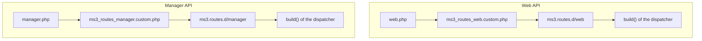

# API Router

MiniShop3 uses [FastRoute](https://github.com/nikic/FastRoute) for API request routing. The component provides two separate APIs with different authorization mechanisms.

## Architecture

### Two API types

| Parameter | Manager API | Web API |
| --- | --- | --- |
| **Prefix** | `/api/mgr/*` | `/api/v1/*` |
| **Purpose** | MODX manager | Store frontend |
| **Entry point** | `connector.php` | `assets/.../api.php` |
| **Authorization** | MODX session + HTTP_MODAUTH | MS3TOKEN tokens |
| **Middleware** | AuthMiddleware, PermissionMiddleware, AnyPermissionMiddleware | ServiceCheckMiddleware, TokenMiddleware, CorsMiddleware, RateLimitMiddleware |
| **Routes file** | `config/routes/manager.php` | `config/routes/web.php` |

### File structure

```
core/components/minishop3/
├── config/
│   ├── routes/
│   │   ├── manager.php                    # Manager API system routes
│   │   └── web.php                        # Web API system routes
│   ├── ms3.routes.d/
│   │   ├── manager/example-addon.php.dist # Addon example (Manager)
│   │   └── web/example-addon.php.dist     # Addon example (Web)
│   └── routes_manager.custom.example.php  # Custom routes example

core/config/
├── ms3_routes_manager.custom.php          # Custom Manager routes
├── ms3_routes_web.custom.php              # Custom Web routes
└── ms3.routes.d/                          # Modular addon routes
    ├── manager/                           # Manager API fragments
    └── web/                               # Web API fragments
```

## Basic usage

### Defining routes

```php
use MiniShop3\Router\Response;

// Simple GET route
$router->get('/api/mgr/my-endpoint', function($params) use ($modx) {
    return Response::success(['data' => 'value']);
});

// Middleware can also be attached fluently, on the returned Route
$router->get('/api/mgr/other', $handler)
    ->middleware(new AuthMiddleware($modx, 'mgr'));

// Middleware is accepted as a class name too — the router builds it with $modx
$router->get('/api/mgr/third', $handler, [\My\Addon\Middleware\Check::class]);

// The handler can be a 'Class@method' string as well
$router->get('/api/mgr/fourth', '\My\Addon\Controller@index');

// POST route
$router->post('/api/mgr/items', function($params) use ($modx) {
    $data = json_decode(file_get_contents('php://input'), true);
    return Response::success(['created' => true]);
});

// PUT route
$router->put('/api/mgr/items/{id}', function($params) use ($modx) {
    $id = $params['id'];
    return Response::success(['updated' => $id]);
});

// DELETE route
$router->delete('/api/mgr/items/{id}', function($params) use ($modx) {
    return Response::success(['deleted' => true]);
});
```

### URL parameters

```php
// Single parameter
$router->get('/api/mgr/products/{id}', function($params) use ($modx) {
    $id = $params['id'];  // Value from URL
    return Response::success(['product_id' => $id]);
});

// Multiple parameters
$router->get('/api/mgr/orders/{order_id}/products/{product_id}', function($params) use ($modx) {
    $orderId = $params['order_id'];
    $productId = $params['product_id'];
    return Response::success([
        'order_id' => $orderId,
        'product_id' => $productId
    ]);
});
```

### Route groups

```php
use MiniShop3\Router\Middleware\AuthMiddleware;
use MiniShop3\Router\Middleware\PermissionMiddleware;

$router->group('/api/mgr/catalog', function($router) use ($modx) {

    // GET /api/mgr/catalog/products
    $router->get('/products', function($params) use ($modx) {
        return Response::success(['products' => []]);
    });

    // GET /api/mgr/catalog/categories
    $router->get('/categories', function($params) use ($modx) {
        return Response::success(['categories' => []]);
    });

    // POST /api/mgr/catalog/products
    $router->post('/products', function($params) use ($modx) {
        return Response::success(['created' => true]);
    });

}, [
    // Middleware for the whole group
    new AuthMiddleware($modx, 'mgr'),
    new PermissionMiddleware($modx, 'msproduct_save')
]);
```

### Controllers

For complex logic use controllers:

```php
$router->group('/api/mgr/orders', function($router) use ($modx) {

    $router->get('', function($params) use ($modx) {
        $controller = new \MiniShop3\Controllers\Api\Manager\OrdersController($modx);
        return $controller->getList($params);
    });

    $router->get('/{id}', function($params) use ($modx) {
        $controller = new \MiniShop3\Controllers\Api\Manager\OrdersController($modx);
        return $controller->get($params);
    });

    $router->put('/{id}', function($params) use ($modx) {
        $body = json_decode(file_get_contents('php://input'), true) ?: [];
        $allParams = array_merge($params, $body);

        $controller = new \MiniShop3\Controllers\Api\Manager\OrdersController($modx);
        return $controller->update($allParams);
    });

});
```

## Response

All API endpoints return JSON via `MiniShop3\Router\Response`:

```php
use MiniShop3\Router\Response;

// Success response
Response::success($data, $message, $statusCode);

// Error response
Response::error($message, $statusCode, $errors, $errorCode, $data);

// The same, with a mandatory machine code — handier for the Web API
Response::errorWithCode($errorCode, $message, $statusCode, $errors, $data);

// Redirect and a response built from a MODX processor
Response::redirect($url);
Response::fromProcessor($processorResponse);
```

The fourth argument of `error()` is the very `error_code` promised below in every error response; without it the router derives one from the HTTP status. The fifth, `data`, carries context that is not tied to a field: `existing_id` on a conflict, the cart state on a stock refusal. Headers are added with `->header()` on the finished response.

### Response format

**Success:**

```json
{
  "success": true,
  "message": "Operation completed",
  "data": {
    "id": 123,
    "name": "Product"
  }
}
```

**Error:**

```json
{
  "success": false,
  "message": "Validation failed",
  "code": 422,
  "errors": {
    "name": "Field is required"
  },
  "error_code": "validation_failed"
}
```

The keys `code` and `error_code` are present in every error response, even when `errors` is empty. `data` is added only where it was passed.

### HTTP status codes

| Code | Description | Usage |
| --- | --- | --- |
| 200 | OK | Successful request |
| 201 | Created | An object was created: customer addresses |
| 400 | Bad Request | A broken request with no field map |
| 401 | Unauthorized | Not authenticated |
| 403 | Forbidden | No permission |
| 404 | Not Found | Route or resource not found |
| 405 | Method Not Allowed | Method not allowed. An `OPTIONS` preflight lands here too when the route stack has no `CorsMiddleware` |
| 409 | Conflict | A state conflict: not enough stock while editing the order lines |
| 422 | Unprocessable Entity | Validation error with a field map in `errors` |
| 429 | Too Many Requests | Rate limit exceeded |
| 500 | Internal Server Error | Server error |
| 503 | Service Unavailable | The `ms3` service did not start |

## Middleware

Middleware runs in sequence before the route handler. If middleware returns a `Response`, execution stops.

### Interface

```php
namespace MiniShop3\Router\Middleware;

interface MiddlewareInterface
{
    /**
     * @param array $params URL parameters
     * @return Response|null Response to stop, null to continue
     */
    public function handle(array $params);
}
```

### Built-in middleware

#### AuthMiddleware

Checks MODX user authentication. For `mgr` context also validates `HTTP_MODAUTH` token.

```php
use MiniShop3\Router\Middleware\AuthMiddleware;

// Auth check in manager
$router->get('/api/mgr/secure', function($params) use ($modx) {
    return Response::success(['user' => $modx->user->get('username')]);
}, [
    new AuthMiddleware($modx, 'mgr')  // 'mgr' or 'web'
]);
```

**Checks:**

- Authenticated user `$modx->user`
- For `mgr`: valid `HTTP_MODAUTH` token

#### PermissionMiddleware

Checks permissions via `$modx->hasPermission()`.

```php
use MiniShop3\Router\Middleware\PermissionMiddleware;

$router->post('/api/mgr/products', function($params) use ($modx) {
    // Create product
}, [
    new PermissionMiddleware($modx, 'msproduct_save')
]);
```

**MiniShop3 permissions.** The `miniShopManagerPolicy` template declares fifteen permissions of its own; `view_document` from the MODX core joins them.

| Permission | What it opens | Enforced in |
| --- | --- | --- |
| `msproduct_save` | creating and editing products, sorting, editing product data in the grid | routes |
| `msproduct_publish` | publishing a product from the category grid | routes |
| `msproduct_delete` | bulk deletion of category products | routes |
| `mscategory_save` | the whole category options group | routes |
| `msorder_list` | order and customer lists, customer addresses, customer groups | routes |
| `msorder_view` | the customer card, a customer group by ID | routes |
| `msorder_save` | editing orders and customers, order line mutations, shipment | routes |
| `msorder_remove` | deleting orders, customers, groups, bulk deletion | routes |
| `msorder_inventory_override` | editing order contents past a stock shortage (since 1.14.3-beta1) | service |
| `mssetting_list` | reading the reference data of the forms | routes, `AnyPermissionMiddleware` |
| `mssetting_view` | the same, viewing | routes, `AnyPermissionMiddleware` |
| `mssetting_save` | deliveries, payments, vendors, statuses, link types, options, extra fields, grid config | routes |
| `msproductfile_generate` | bulk gallery operations | routes |
| `msproductfile_list` | reading the product gallery | processors |
| `msproductfile_save` | uploading, editing and deleting gallery files | processors |
| `view_document` | reference lists, the category product grid, grid config for reading | routes |

::: warning The permission to go negative is granted separately
With inventory tracking on (`ms3_inventory_enabled`), an edit of the order lines compares the reserve with the resulting quantity and refuses when there is not enough stock: a `409` with the key `ms3_err_inventory_short`. If the request sends `force` and the user has no permission for it, the answer is `403`. In both cases `data` contains `product_id`, `available`, `required` and `can_override`. The last one shows whether a repeat with `force` would help.

`msorder_inventory_override` lets that edit through anyway, and the stock goes negative. The permission is in the policy template, but **it is not granted in the policy itself**, so after an update you assign it explicitly. A user with `sudo` receives it automatically, like any other MODX permission.
:::

The two gallery permissions are not part of the route map: they are checked by the `Processors\Gallery\*` processors that `UtilitiesGalleryController` calls.
::: tip Where a user gets these permissions
They all live in the `miniShopManagerPolicy` access policy created by the install. The policy grants nothing until it is assigned to a user group: since 1.14.2-beta1 install and upgrade assign it to every group that already has access to the `mgr` context, as an additional record with `authority 9999` — the group's own permissions still win.

A group created after the install does not get the policy: the resolver only runs while the package is being installed or upgraded. Details in the [quick start](/en/components/minishop3/quick-start#install-creates).
:::

#### AnyPermissionMiddleware

Lets the request through when the user holds **at least one** permission from the list. Needed where the controller does the exact check itself: bulk actions on category products check a permission per action.

```php
use MiniShop3\Router\Middleware\AnyPermissionMiddleware;

$router->post('/multiple', $handler, [
    new AnyPermissionMiddleware($modx, ['msproduct_save', 'msproduct_publish', 'msproduct_delete'])
]);
```

#### ServiceCheckMiddleware

Checks that the `ms3` service started. If it did not, the answer is `503` with `error_code: internal_error` and the handler never runs. In the Web API stack it is the third of the three group layers — after `CorsMiddleware` and `RateLimitMiddleware`, but before the route-level `TokenMiddleware`. One consequence: when `ms3` fails to start, the request still consumes a rate-limit slot.

#### TokenMiddleware

Validates and auto-mints the customer token for Web API when needed.

Resolve order: `Authorization: Bearer` → legacy `MS3TOKEN` header → httpOnly cookie `ms3_token` → `$_REQUEST` → session. The middleware removes the `ms3_token` query parameter from the request; `token` in the query stays but does not authorize either — e-mail confirmation uses it.

```php
use MiniShop3\Middleware\TokenMiddleware;

$tokenMiddleware = new TokenMiddleware($modx);

$router->group('/api/v1/cart', function($router) use ($modx) {
    // Cart routes
}, [$tokenMiddleware]);
```

On a route carrying the middleware the server mints a guest token when the request has no token at all. The middleware also holds a `publicRoutes` list of fifteen prefixes and one path pattern: a path from the list passes without a guest token and without a 401. There is no separate `optional` mode in the code — membership in the list is what decides.

The list is not fixed. To make a route of your own public, build your own middleware instance, extend the list and pass it to the group.

```php
$tokenMiddleware = new TokenMiddleware($modx);
$tokenMiddleware->addPublicRoute('/api/v1/myaddon/callback');
// or replace the whole list: setPublicRoutes([...])
```

The middleware lets an `OPTIONS` preflight straight through: no token is minted, no session is started and the handler is not called.

```text
/api/v1/product/get          /api/v1/delivery/get
/api/v1/product/list         /api/v1/delivery/list
/api/v1/product/filters      /api/v1/delivery/webhook
/api/v1/category/get         /api/v1/payment/get
/api/v1/category/list        /api/v1/payment/list
/api/v1/category/tree        /api/v1/payment/webhook/
/api/v1/health               /api/v1/customer/token/get
                             /api/v1/customer/logout
```

The pattern is `/api/v1/product/*/images`, where `*` covers exactly one segment: the product gallery stays public without opening the whole `/api/v1/product/*` branch.

A match is tested as `path === prefix` or `path starts with prefix and a slash`. The payment entry already ends with a slash, so the code compares it with two slashes in a row and `/api/v1/payment/webhook/{id}` never matches it ([details](https://github.com/modx-pro/MiniShop3/issues/903)).

In practice the list works on two paths — `GET /customer/token/get` and `POST /customer/logout` — because those are the only public paths the middleware is attached to. Catalog, health and the webhooks in `web.php` do not use it at all.

Details: [Web API authorization](/en/components/minishop3/development/web-api/auth).

#### CorsMiddleware

Sets CORS headers for cross-origin requests.

```php
use MiniShop3\Middleware\CorsMiddleware;

$corsMiddleware = new CorsMiddleware([
    'allowed_origins' => ['https://shop.example.com', 'https://admin.example.com'],
    'allowed_methods' => ['GET', 'POST', 'PUT', 'DELETE', 'OPTIONS'],
    'allowed_headers' => ['Content-Type', 'Authorization', 'MS3TOKEN'],
    'allow_credentials' => true,
    'max_age' => 86400  // Preflight cache (24 hours)
]);
```

System setting: `ms3_cors_allowed_origins`. Empty = same-origin; `*` = any origin without credentials; a domain list is required for cookies from another origin. See [CORS](/en/components/minishop3/development/web-api/cors).

#### RateLimitMiddleware

Limits request rate to prevent abuse.

```php
use MiniShop3\Middleware\RateLimitMiddleware;
use MiniShop3\Services\RateLimit\RateLimitStoreFactory;

$rateLimitMiddleware = new RateLimitMiddleware(
    60,                                      // Max 60 requests
    60,                                      // Per 60 seconds
    RateLimitStoreFactory::fromModx($modx)   // Limit store (optional)
);
```

**System settings:**

- `ms3_rate_limit_max_attempts` — max requests (default: 60)
- `ms3_rate_limit_decay_seconds` — window in seconds (default: 60)

**Response headers:**

```
X-RateLimit-Limit: 60
X-RateLimit-Remaining: 45
X-RateLimit-Reset: 1703001234
```

### Custom middleware

```php
<?php
namespace MyComponent\Middleware;

use MiniShop3\Router\Middleware\MiddlewareInterface;
use MiniShop3\Router\Response;
use MODX\Revolution\modX;

class LoggingMiddleware implements MiddlewareInterface
{
    private modX $modx;

    public function __construct(modX $modx)
    {
        $this->modx = $modx;
    }

    public function handle(array $params)
    {
        // Log request
        $this->modx->log(
            modX::LOG_LEVEL_INFO,
            sprintf(
                '[API] %s %s from %s',
                $_SERVER['REQUEST_METHOD'],
                $_SERVER['REQUEST_URI'],
                $_SERVER['REMOTE_ADDR']
            )
        );

        // null = continue
        return null;
    }
}
```

Usage:

```php
use MyComponent\Middleware\LoggingMiddleware;

$router->get('/api/mgr/logged-endpoint', function($params) use ($modx) {
    return Response::success(['logged' => true]);
}, [
    new LoggingMiddleware($modx),
    new AuthMiddleware($modx, 'mgr')
]);
```

### Middleware order

Middleware runs in the order they are listed:

```php
$router->get('/api/mgr/endpoint', $handler, [
    new CorsMiddleware(),        // 1. CORS first
    new RateLimitMiddleware(),   // 2. Rate limit
    new AuthMiddleware($modx),                          // 3. Auth
    new PermissionMiddleware($modx, 'msproduct_save'),  // 4. Permission
]);
```

If middleware returns a `Response`, the rest of the middleware and the handler are **not run**.

## Route map

### Manager API (`/api/mgr/*`)

#### General

| Method | Route | Description |
| --- | --- | --- |
| GET | `/health` | API health check |
| GET | `/user/info` | Current user info |

#### References (`/references`) {#references}

Reading the reference lists (permission `view_document`): all eight routes of the group are `GET`. They back the autocomplete and value pickers in the manager forms.

| Method | Route | Description |
| --- | --- | --- |
| GET | `/vendors` | Vendor list |
| GET | `/autocomplete` | Product autocomplete |
| GET | `/options` | Option list |
| GET | `/product-option-fields` | Product option fields |
| GET | `/product-field-values` | Product field values |
| GET | `/products` | Product search / autocomplete |
| GET | `/link-types` | Link types (`msLink`) |
| GET | `/customers` | Customer search / autocomplete |

#### Model fields by alias (`/models/{alias}/fields`)

Model fields by `alias`. The product and order forms take their field configuration from here.

| Method | Route | Description |
| --- | --- | --- |
| GET | `/{alias}/fields` | Model fields by `alias`. No permission of its own: an mgr session is enough |

#### Extra fields (`/extra-fields`)

CRUD for the extra fields of orders and products. Reading needs no `mssetting_save`, writing does.

| Method | Route | Description |
| --- | --- | --- |
| GET | `/` | List the extra fields |
| GET | `/{id}` | Get an extra field by ID |
| POST | `/` | Create an extra field |
| PUT | `/{id}` | Update an extra field |
| DELETE | `/{id}` | Delete an extra field |

#### Options (`/options`)

CRUD for the shop option settings. Permission `mssetting_save`.

| Method | Route | Description |
| --- | --- | --- |
| GET | `/types` | Option types |
| GET | `/tree` | Option tree |
| GET | `/suggestions` | Option suggestions |
| POST | `/bulk/assign` | Bulk assignment of options |
| DELETE | `/bulk` | Bulk deletion of options |
| POST | `/` | Create an option |
| GET | `/` | List the options |
| GET | `/{id}` | Get an option by ID |
| PUT | `/{id}` | Update an option |
| DELETE | `/{id}` | Delete an option |

#### Option groups (`/option-groups`)

Grouping of options, replacing the former approach built on `modCategory`. Permission `mssetting_save`.

| Method | Route | Description |
| --- | --- | --- |
| GET | `/` | List the option groups |
| POST | `/` | Create an option group |
| GET | `/{id}` | Get an option group by ID |
| PUT | `/{id}` | Update an option group |
| DELETE | `/{id}` | Delete an option group |
| DELETE | `/bulk` | Bulk deletion |
| PUT | `/positions` | Update positions (sorting) |

#### Customer groups (`/customer-groups`)

The link to MODX user groups for catalog ACL. Reading: `msorder_list`. Writing: `msorder_save`.

| Method | Route | Description | Permission |
| --- | --- | --- | --- |
| GET | `/` | List the customer groups | `msorder_list` |
| POST | `/` | Create a customer group | `msorder_save` |
| GET | `/{id}` | Get a customer group | `msorder_view` |
| PUT | `/{id}` | Update a customer group | `msorder_save` |
| DELETE | `/{id}` | Delete a customer group | `msorder_remove` |

#### Category options (`/categories/{category_id}/options`)

Options of one category. The permission for the whole group is `mscategory_save`.

| Method | Route | Description |
| --- | --- | --- |
| GET | `/` | List the category options |
| POST | `/` | Create a category option |
| POST | `/sort` | Sort the category options |
| POST | `/bulk` | Bulk operations on category options |
| POST | `/duplicate` | Duplicate an option |
| PUT | `/{option_id}` | Update a category option |
| DELETE | `/{option_id}` | Delete a category option |

#### Category products (`/categories/{id}/products`)

| Method | Route | Description | Permission |
| --- | --- | --- | --- |
| GET | `/{id}/products` | Products of the category | `view_document` |
| GET | `/{id}/products/filters` | Filter configuration | `view_document` |
| POST | `/{id}/products/sort` | Sorting | `msproduct_save` |
| DELETE | `/{id}/products/bulk` | Bulk deletion | `msproduct_delete` |
| POST | `/{id}/products/multiple` | Batch actions. The route admits any product mutation permission; the controller makes the exact check | see `CategoryProductActionPermissions` |
| PUT | `/{id}/products/{productId}/data` | Edit product data | `msproduct_save` |
| POST | `/{id}/products/{productId}/publish` | Publication | `msproduct_publish` |

#### Config (`/config`)

| Method | Route | Description |
| --- | --- | --- |
| GET | `/page-fields/{page_key}` | Get page fields (no `mssetting_save`) |
| GET | `/page-fields/{page_key}/all` | All page fields |
| PUT | `/page-fields/{page_key}` | Update fields (body: `{ "fields": [...] }`, needs `mssetting_save`) |
| GET | `/sections/{page_key}` | Get sections |
| PUT | `/sections/{page_key}` | Update sections (body: `{ "sections": [...] }`) |
| DELETE | `/sections/{page_key}/{section_key}` | Delete section by key |

#### Grid config (`/grid-config`)

CRUD for admin grid column configuration. Read: `view_document`, write: `mssetting_save`.

| Method | Route | Description |
| --- | --- | --- |
| GET | `/{grid_key}` | Get grid configuration. `include_hidden=1` adds the hidden columns — the editor reads the configuration in that mode |
| PUT | `/{grid_key}` | Update grid configuration (body: `fields`) |
| POST | `/{grid_key}/field` | Add column |
| PUT | `/{grid_key}/field/{field_name}` | Update column |
| DELETE | `/{grid_key}/{field_name}` | Delete column |

**Six grids have a configuration in the database:** `orders`, `order_products`, `customers`, `vendors`, `category-products`, `deliveries` — their columns come from seed migrations. The payments grid asks for the `payments` key, but no seed exists for it: the answer comes back empty and the grid draws its built-in columns. The grid picker in the settings offers five keys, without `deliveries` and `payments`.

##### `GET /grid-config/{grid_key}` response

```json
{
  "columns": [
    { "name": "id", "label": "ID", "type": "model", "visible": true, ... }
  ],
  "direct_filter_keys": ["query", "status_id", "delivery_id", ...],
  "editor_references": [
    { "key": "vendors", "path": "/api/mgr/references/vendors" }
  ]
}
```

| Field | Type | Description |
| --- | --- | --- |
| `columns` | `array` | Grid columns with configuration (type, visibility, filtering, editor) |
| `direct_filter_keys` | `string[]` | Filter keys the controller expects as **direct** request parameters (no `filter_` prefix). Others must be sent with the prefix. Source of truth is the backend; the frontend reads the array from here. Added in MiniShop3 1.12.0 — removes duplication between frontend and controllers. |
| `editor_references` | `array<{key,path}>` | **Only for `grid_key=category-products`.** Whitelist of allowed reference keys for inline-edit combo editor. Each entry is a key/path pair to a reference API endpoint. Used by the column settings UI for select dropdown. Added in MiniShop3 1.12.0. |

##### Filter contract (`direct_filter_keys`)

Frontend code decides how to serialize a filter value:

```js
// Pseudocode: composable useGridFilterParams
function addFilterParam(params, key, value) {
    if (directFilterKeys.has(key)) {
        params[key] = value         // direct: ?status_id=2
    } else {
        params['filter_' + key] = value   // prefixed: ?filter_customer_name=...
    }
}
```

When adding a new direct filter on the backend, **always** add its key to the `DIRECT_FILTER_KEYS` constant in the corresponding controller. Otherwise the frontend sends it with a prefix and filtering will not work.

For a new grid the constant alone is not enough: `GridConfigController` serves `direct_filter_keys` only for the grids listed in its provider map, which today holds orders and customers. For orders the constant itself lives in `ManagerOrderListService`, and the controller points at it.

#### Orders (`/orders`)

Read and write are split into two middleware groups.

**Read** — permission `msorder_list`:

| Method | Route | Description |
| --- | --- | --- |
| GET | (root) | List orders |
| GET | `/filters` | Filter config |
| GET | `/stats` | Aggregates for dashboard and filters |
| GET | `/{id}` | Get order |
| GET | `/{id}/products` | Order products |
| GET | `/{id}/logs` | Change history |

**Write** — permission `msorder_save`:

| Method | Route | Description |
| --- | --- | --- |
| POST | (root) | Create order from manager |
| DELETE | `/bulk` | Bulk delete |
| POST | `/{id}/finalize` | Finalize draft |
| POST | `/{id}/recalculate-cost` | Recalculate cost |
| PUT | `/{id}` | Update order |
| DELETE | `/{id}` | Delete order |
| POST | `/{id}/products` | Add product |
| PUT | `/{id}/products/{product_id}` | Update line |
| DELETE | `/{id}/products/{product_id}` | Remove line |

**Order shipment:**

| Method | Route | Description | Permission |
| --- | --- | --- | --- |
| GET | `/{id}/shipment` | Get the shipment data of an order | `msorder_list` |
| PUT | `/{id}/shipment` | Save or update the shipment of an order | `msorder_save` |

**Form references** (no separate PermissionMiddleware, mgr session). These routes are declared on the `/api/mgr` group, not inside `/orders`, so the full path is given:

| Method | Route | Description |
| --- | --- | --- |
| GET | `/api/mgr/statuses-dropdown` | Statuses with translations |
| GET | `/api/mgr/deliveries-active` | Active deliveries for select |
| GET | `/api/mgr/payments-active` | Active payment methods for select |

#### Model field metadata (`/model-fields`)

Field metadata of the models, used by the dynamic forms. Reading needs no special permission, writing needs `mssetting_save`.

**Reading (metadata):**

| Method | Route | Description |
| --- | --- | --- |
| GET | `/models` | List of available models |
| GET | `/sections/{model}` | Sections of a model |
| GET | `/` | Field list (parameters: `model`, `section`) |
| GET | `/{id}` | Get a field by ID |

**Reading (data with combo options):**

| Method | Route | Description | Permission |
| --- | --- | --- | --- |
| GET | `/visible/{model}` | Visible fields of a model | any one from the list below |
| GET | `/combo-options/{model}` | Combo options of a model | any one from the list below |
| GET | `/combo-options/{model}/{field_name}` | Combo options of one field | any one from the list below |

`AnyPermissionMiddleware` on those three GETs: `msorder_list`, `msorder_view`, `msorder_save`, `msproduct_save`, `mscategory_save`, `mssetting_list`, `mssetting_view`, `mssetting_save`, `view_document`.

**Writing**, permission `mssetting_save`:

| Method | Route | Description |
| --- | --- | --- |
| POST | `/sections` | Create a section |
| PUT | `/sections/ranks` | Section order |
| PUT | `/sections/{id}` | Update a section |
| DELETE | `/sections/{id}` | Delete a section |
| POST | (root) | Create a field |
| PUT | `/ranks` | Field order |
| PUT | `/{id}` | Update a field |
| DELETE | `/{id}` | Delete a field |

#### Customers (`/customers`)

| Method | Route | Description | Permission |
| --- | --- | --- | --- |
| GET | (root) | List customers | `msorder_list` |
| DELETE | `/bulk` | Bulk delete | `msorder_remove` |
| GET | `/{id}` | Get customer | `msorder_view` |
| PUT | `/{id}` | Update customer | `msorder_save` |
| DELETE | `/{id}` | Delete customer | `msorder_remove` |
| GET | `/{id}/addresses` | Customer addresses | `msorder_list` |
| POST | `/{id}/addresses` | Add address | `msorder_save` |
| PUT | `/{id}/addresses/{address_id}` | Update address | `msorder_save` |
| DELETE | `/{id}/addresses/{address_id}` | Delete address | `msorder_remove` |

#### Store settings

##### Deliveries (`/deliveries`)

CRUD for the delivery methods. Permission `mssetting_save`.

| Method | Route | Description |
| --- | --- | --- |
| GET | `/` | List the delivery methods |
| POST | `/` | Create a delivery method |
| DELETE | `/bulk` | Bulk deletion of delivery methods |
| POST | `/sort` | Sort the delivery methods |
| PUT | `/positions` | Update delivery positions |
| GET | `/{id}` | Get a delivery method by ID |
| PUT | `/{id}` | Update a delivery method |
| DELETE | `/{id}` | Delete a delivery method |
| GET | `/{id}/payments` | Payment methods of a delivery |
| POST | `/{id}/payments` | Add a payment method to a delivery |
| DELETE | `/{id}/payments/{payment_id}` | Remove a payment method from a delivery |

##### Payments (`/payments`)

CRUD for the payment methods. Permission `mssetting_save`.

| Method | Route | Description |
| --- | --- | --- |
| GET | `/` | List the payment methods |
| POST | `/` | Create a payment method |
| DELETE | `/bulk` | Bulk deletion of payment methods |
| POST | `/sort` | Sort the payment methods |
| PUT | `/positions` | Update payment positions |
| GET | `/{id}` | Get a payment method by ID |
| PUT | `/{id}` | Update a payment method |
| DELETE | `/{id}` | Delete a payment method |
| GET | `/{id}/deliveries` | Delivery methods of a payment method |
| POST | `/{id}/deliveries` | Add a delivery to a payment method |
| DELETE | `/{id}/deliveries/{delivery_id}` | Remove a delivery from a payment method |

##### Vendors (`/vendors`)

CRUD for the vendors. Permission `mssetting_save`.

| Method | Route | Description |
| --- | --- | --- |
| GET | `/` | List the vendors |
| POST | `/` | Create a vendor |
| DELETE | `/bulk` | Bulk deletion of vendors |
| POST | `/sort` | Sort the vendors |
| GET | `/{id}` | Get a vendor by ID |
| PUT | `/{id}` | Update a vendor |
| DELETE | `/{id}` | Delete a vendor |

##### Statuses (`/statuses`)

CRUD for the order statuses. Permission `mssetting_save`.

| Method | Route | Description |
| --- | --- | --- |
| GET | `/` | List the statuses |
| POST | `/` | Create a status |
| DELETE | `/bulk` | Bulk deletion of statuses |
| POST | `/sort` | Sort the statuses |
| GET | `/{id}` | Get a status by ID |
| PUT | `/{id}` | Update a status |
| DELETE | `/{id}` | Delete a status |

##### Link types (`/links`)

CRUD for the product link types. Permission `mssetting_save`.

| Method | Route | Description |
| --- | --- | --- |
| GET | `/` | List the link types |
| POST | `/` | Create a link type |
| DELETE | `/bulk` | Bulk deletion of link types |
| GET | `/types` | Get the link types (alias kept for backward compatibility) |
| GET | `/{id}` | Get a link type |
| PUT | `/{id}` | Update a link type |
| DELETE | `/{id}` | Delete a link type |

#### Product data (`/product-data`)

“Categories” and “Links” tabs on the product card (Vue). Permission `msproduct_save` / mgr session:

| Method | Route | Description |
| --- | --- | --- |
| GET | `/{id}` | Product data |
| PUT | `/{id}` | Save product data |
| GET | `/{id}/categories/tree` | Category tree (`ms3_product_category_tree`) |
| GET | `/{id}/links` | Link list |
| POST | `/{id}/links` | Add link `{ slave, link }` |
| DELETE | `/{id}/links` | Remove link `{ link, master, slave }` |
| GET | `/references/link-types` | `msLink` types (references group) |
| GET | `/references/products` | Product autocomplete |

#### Notifications (`/notifications`)

| Method | Route | Description | Permission |
| --- | --- | --- | --- |
| GET | `/references` | Form references | `mssetting_save` |
| GET | (root) | List notifications | `mssetting_save` |
| GET | `/{id}` | Get notification | `mssetting_save` |
| POST | (root) | Create notification | `mssetting_save` |
| PUT | `/{id}` | Update | `mssetting_save` |
| DELETE | `/{id}` | Delete | `mssetting_save` |

#### Import (`/import`)

| Method | Route | Description | Permission |
| --- | --- | --- | --- |
| GET | `/fields` | Mapping fields | `msproduct_save` |
| POST | `/upload` | Upload CSV | `msproduct_save` |
| POST | `/preview` | Preview | `msproduct_save` |
| POST | `/start` | Start import | `msproduct_save` |
| GET | `/progress/{import_id}` | Import progress | `msproduct_save` |

#### Gallery (`/utilities/gallery`)

| Method | Route | Description | Permission |
| --- | --- | --- | --- |
| POST | `/update` | Bulk gallery operations | `msproductfile_generate` |

### Web API (`/api/v1/*`)

Full path table: [Web API → Endpoint map](/en/components/minishop3/development/web-api/endpoints).

Guides: [auth](/en/components/minishop3/development/web-api/auth), [catalog](/en/components/minishop3/development/web-api/catalog), [cart](/en/components/minishop3/development/web-api/cart), [checkout](/en/components/minishop3/development/web-api/checkout), [customer](/en/components/minishop3/development/web-api/customer).

## Customizing routes

### Adding custom routes

Create `core/config/ms3_routes_manager.custom.php`:

```php
<?php
use MiniShop3\Router\Middleware\AuthMiddleware;
use MiniShop3\Router\Middleware\PermissionMiddleware;
use MiniShop3\Router\Response;

// Simple route
$router->get('/api/mgr/my-custom-endpoint', function() use ($modx) {
    return Response::success(['custom' => true]);
}, [
    new AuthMiddleware($modx, 'mgr')
]);

// Route group
$router->group('/api/mgr/my-module', function($router) use ($modx) {

    $router->get('/dashboard', function() use ($modx) {
        return Response::success([
            'stats' => ['orders' => 100, 'revenue' => 50000]
        ]);
    });

    $router->post('/action', function($params) use ($modx) {
        $data = json_decode(file_get_contents('php://input'), true);
        // Process...
        return Response::success(['processed' => true]);
    });

}, [
    new AuthMiddleware($modx, 'mgr'),
    new PermissionMiddleware($modx, 'my_module_permission')
]);
```

For Web API create `core/config/ms3_routes_web.custom.php`.

### Overriding system routes

Custom routes load **after** system routes and override them:

```php
<?php
// core/config/ms3_routes_manager.custom.php

use MiniShop3\Router\Response;

// Override system route /api/mgr/health
$router->get('/api/mgr/health', function() use ($modx) {
    return Response::success([
        'status' => 'custom_ok',
        'version' => '1.0.0-custom',
        'timestamp' => time()
    ]);
});
```

### Third-party integration

A third-party component can add routes via config:

```php
<?php
// core/config/ms3_routes_manager.custom.php

use MiniShop3\Router\Response;
use MiniShop3\Router\Middleware\AuthMiddleware;

// Routes for msPromoCode component
$router->group('/api/mgr/promocodes', function($router) use ($modx) {

    $router->get('', function($params) use ($modx) {
        $codes = $modx->getCollection('msPromoCode');
        $result = [];
        foreach ($codes as $code) {
            $result[] = $code->toArray();
        }
        return Response::success(['codes' => $result]);
    });

    // POST '' and DELETE '/{id}' are declared the same way: the request body is
    // read from php://input, and the answer is built with Response::success()
    // or Response::error() with the right code

}, [
    new AuthMiddleware($modx, 'mgr')
]);
```

## Modular addon routes (`ms3.routes.d`)



`ms3_routes_*.custom.php` files suit manual customization but **not addons** — if two components write to the same file, install/uninstall conflicts occur.

Third-party components use the `core/config/ms3.routes.d/` directory — each addon creates its own file, so there are no conflicts.

::: tip The same approach exists for services
The `ms3.services.d/` directory for [services](/en/components/minishop3/development/services) is arranged the same way.
:::

### Structure

```
core/config/ms3.routes.d/
├── web/                          # Web API routes (api.php)
│   ├── 50-mydelivery.php
│   └── 50-mypayment.php
└── manager/                      # Manager API routes (connector)
    ├── 50-mydelivery.php
    └── 50-myadmin.php
```

Files load in **alphabetical order**. Use a numeric prefix to control priority (`01-`, `50-`, `99-`).

### Load order

**Web API (`api.php`):**

1. `config/routes/web.php` — system routes
2. `core/config/ms3_routes_web.custom.php` — manual customizations
3. `core/config/ms3.routes.d/web/*.php` — addons
4. Dispatcher `build()`

**Manager API (`connector.php` → `Processors\Api\Router`):**

1. `config/routes/manager.php` — system routes
2. `core/config/ms3_routes_manager.custom.php` — manual customizations
3. `core/config/ms3.routes.d/manager/*.php` — addons
4. Dispatcher `build()`

Each subsequent level can override routes from the previous level by `METHOD:PATTERN` key.

### Example: delivery addon Web API routes

```php
<?php
// core/config/ms3.routes.d/web/50-mydelivery.php

use MiniShop3\Router\Response;
use MiniShop3\Middleware\TokenMiddleware;

$router->group('/api/v1/delivery/mydelivery', function ($router) use ($modx) {

    $router->post('/calculate', function (array $vars, \MODX\Revolution\modX $modx) {
        $input = json_decode(file_get_contents('php://input'), true) ?: [];
        $cost = MyDelivery::calculate($input['address'] ?? '', $input['weight'] ?? 0);
        return Response::success(['cost' => $cost]);
    });

    $router->get('/points', function (array $vars, \MODX\Revolution\modX $modx) {
        $city = $vars['city'] ?? '';
        $points = MyDelivery::getPickupPoints($city);
        return Response::success(['points' => $points]);
    });

}, [new TokenMiddleware($modx)]);
```

### Example: addon Manager API routes

```php
<?php
// core/config/ms3.routes.d/manager/50-mydelivery.php

use MiniShop3\Router\Middleware\AuthMiddleware;
use MiniShop3\Router\Response;

$router->group('/api/mgr/mydelivery', function ($router) use ($modx) {

    $router->get('/settings', function (array $vars, \MODX\Revolution\modX $modx) {
        return Response::success([
            'api_key' => $modx->getOption('mydelivery_api_key'),
            'enabled' => (bool) $modx->getOption('mydelivery_enabled'),
        ]);
    });

    $router->put('/settings', function (array $vars, \MODX\Revolution\modX $modx) {
        $data = json_decode(file_get_contents('php://input'), true) ?: [];
        // Save settings...
        return Response::success(['saved' => true]);
    });

}, [new AuthMiddleware($modx, 'mgr')]);
```

### Install and uninstall

In the addon resolver:

```php
<?php
// resolver on install
$routesDir = MODX_CORE_PATH . 'config/ms3.routes.d/';

// Copy route files
copy(
    $source . 'routes/web.php',
    $routesDir . 'web/50-mydelivery.php'
);
copy(
    $source . 'routes/manager.php',
    $routesDir . 'manager/50-mydelivery.php'
);
```

```php
<?php
// resolver on uninstall
@unlink(MODX_CORE_PATH . 'config/ms3.routes.d/web/50-mydelivery.php');
@unlink(MODX_CORE_PATH . 'config/ms3.routes.d/manager/50-mydelivery.php');
```

Each addon removes only its own file — other addons are unaffected.

### Error handling

If a route file has a syntax error or throws an exception, it is logged and skipped — **other files load normally**:

```
[MiniShop3 Router] Failed to load routes file /path/to/50-broken.php: syntax error...
```

### Custom file vs ms3.routes.d

| | `ms3_routes_*.custom.php` | `ms3.routes.d/` |
| --- | --- | --- |
| **For** | Site developer | Addon authors |
| **Files** | One per API type | One file per addon |
| **Conflicts** | Possible with multiple addons | None |
| **Install/uninstall** | Manual editing required | Atomic: create/delete file |
| **Created by** | The MiniShop3 install creates the manager file from the example. It does not create the web file: the package has no stub, so you create that file yourself | An add-on, through a resolver |

## System settings

| Setting | Default | Description |
| --- | --- | --- |
| `ms3_cors_allowed_origins` | empty string | Allowed CORS origins. Empty means same-origin |
| `ms3_rate_limit_max_attempts` | `60` | Request limit |
| `ms3_rate_limit_decay_seconds` | `60` | Limit window (seconds) |

## Debugging

### Request logging

```php
$router->get('/api/mgr/debug', function($params) use ($modx) {
    $modx->log(
        \MODX\Revolution\modX::LOG_LEVEL_INFO,
        '[API Debug] ' . json_encode([
            'method' => $_SERVER['REQUEST_METHOD'],
            'uri' => $_SERVER['REQUEST_URI'],
            'params' => $params,
            'body' => file_get_contents('php://input')
        ])
    );

    return Response::success(['debug' => true]);
});
```

### Common errors

**401 Unauthorized:**

- Not logged in to MODX
- Missing or invalid `HTTP_MODAUTH` token
- For Web API: missing or expired `MS3TOKEN`

**403 Forbidden:**

- No permission (check user ACL)

**404 Not Found:**

- Route not registered
- URL typo

**405 Method Not Allowed:**

- Wrong HTTP method (e.g. GET instead of POST)

**429 Too Many Requests:**

- Rate limit exceeded; wait `Retry-After` seconds
