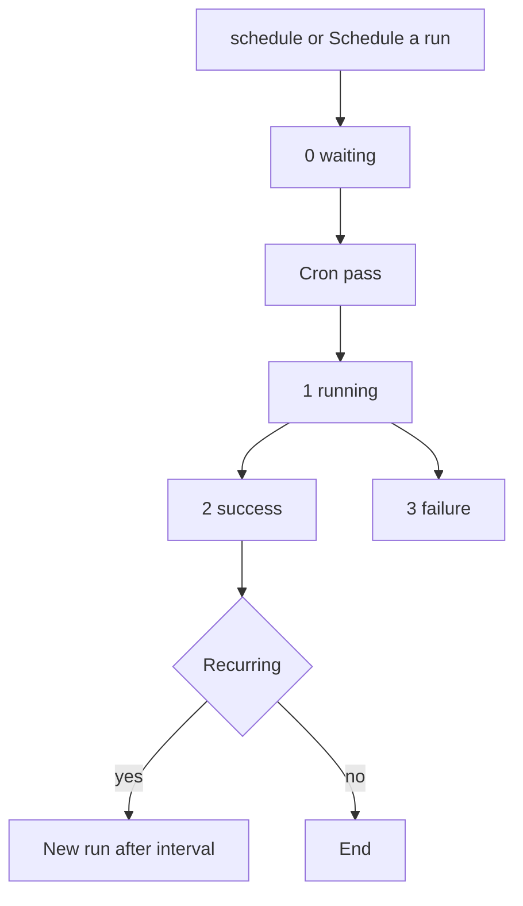

# Scheduler integration

MiniShop3 runs background tasks through the [Scheduler](https://modstore.pro/packages/utilities/scheduler) component.

## Requirements

Scheduler 1.8.0 or higher. Tasks also work on older versions, but recurring ones are not restarted automatically.

## Enabling integration

1. Install the Scheduler component and configure cron for it — see [Installation and run setup](../../scheduler/installation#cron).
2. Enable the `ms3_use_scheduler` setting: **System → System Settings → minishop3**.

::: warning The setting only governs notifications
`ms3_use_scheduler` is read in a single place — when deciding whether to send a notification right away or queue it. It does not affect the other tasks:

- **notifications** go to the background only with the setting on and Scheduler installed;
- **import** is queued by a switch in the import form, regardless of the setting;
- **token and draft cleanup** runs on schedule; the setting neither enables nor disables it. The tasks are registered by the MiniShop3 installer, and only when Scheduler is already in place: otherwise the resolver exits silently and no schedule appears. If Scheduler came second, upgrade MiniShop3 again or create the tasks by hand.
:::


In code the setting is changed through the `modSystemSetting` object:

```php
$setting = $modx->getObject(\MODX\Revolution\modSystemSetting::class, 'ms3_use_scheduler');
$setting->set('value', 1);
$setting->save();
```

::: warning setOption() does not save the setting
`$modx->setOption('ms3_use_scheduler', true)` changes the value only in memory for the current request — nothing reaches the database. Scheduler tasks run in a separate cron process and will never see such a value.
:::

## Built-in tasks

MiniShop3 registers four tasks on install:

| Task | Type | Interval | File |
| --- | --- | --- | --- |
| `ms3_cleanup_tokens` | recurring | `+1 week` | `elements/tasks/cleanupTokens.php` |
| `ms3_cleanup_drafts` | recurring | `+1 day` | `elements/tasks/cleanupDrafts.php` |
| `ms3_csv_import` | one-time | — | `elements/tasks/csvImport.php` |
| `ms3_send_notification` | one-time | — | `elements/tasks/sendNotification.php` |

The interval is a string for the PHP `strtotime()` function, stored verbatim in the task's `interval` field. After a successful run Scheduler passes it to `strtotime()` and schedules the next one. If the string does not parse or resolves to a time in the past, `Invalid interval` lands in the MODX Error Log and the recurring task is never scheduled again.

### ms3_cleanup_tokens

Removes expired rows from the customer auth token table `ms3_customer_tokens`.

### ms3_cleanup_drafts

Deletes orders with "Draft" status older than the period set in `ms3_delete_drafts_after`.

The period is any string PHP `strtotime()` understands: `-1 day`, `-2 weeks`, `-1 month`, `-1 year`. An empty value — the shipped default — disables auto-deletion.

```php
$setting = $modx->getObject(\MODX\Revolution\modSystemSetting::class, 'ms3_delete_drafts_after');
$setting->set('value', '-2 weeks');
$setting->save();
```

### ms3_csv_import

Imports products from CSV. The mode is a human decision: the import form carries a "synchronous or background" switch, and the background mode queues the task in Scheduler.

The installer registers the task with namespace `minishop3` and path `elements/tasks/csvImport.php`. The import processor looks it up as `getTask('MiniShop3', 'ms3_csv_import')`, with a different case. On a typical MySQL database the strings compare without regard to letter case, so the task is found and there is no duplicate. A second task appears in another situation: Scheduler was installed after MiniShop3, the installer task does not exist at all, and the processor creates its own, already with namespace `MiniShop3`. The mismatch is tracked in [a known issue](https://github.com/modx-pro/MiniShop3/issues/904).

The `ms3_import_sync_limit` setting (300 rows by default) sets the threshold. When the file has more rows, the form shows the mode switch, and without Scheduler installed it shows a warning that the file is too large for a synchronous pass. The setting itself does not pick the mode. Until the switch is set, the import is not queued.

**Script properties:**

```php
$scriptProperties = [
    'file' => 'path/to/file.csv',  // Path relative to MODX_BASE_PATH
    'mapping' => [...],            // Columns mapped to product fields
    'fields' => [...],             // Previous mapping format, kept for compatibility
    'update' => false,             // Update existing products
    'key' => 'article',            // Field used to find an existing product
    'delimiter' => ';',            // Column delimiter
    'skip_header' => false,        // Skip the first row
    'debug' => false,              // Verbose log instead of writing to the database
    'import_id' => 'import_...',   // Run identifier, set by the processor
];
```

### ms3_send_notification

Sends notifications without blocking the main request. Useful for slow channels — Telegram, for one.

A notification is queued when both conditions hold: the `ms3_use_scheduler` setting is on and the `scheduler` service is registered. Otherwise it is sent right away, in the same request. The delay comes from the notification's own settings (the "Delay" field for a status and recipient type); with a zero delay the run is scheduled at `+1 second`.

**Script properties:**

```php
$scriptProperties = [
    'notification_class' => 'MiniShop3\Notifications\Order\StatusChangedNotification',
    'order_id' => 123,
    'channel' => 'telegram',         // channel name: email or telegram
    'recipient_type' => 'manager',   // customer or manager
    'recipient' => [...],            // recipient data for the channel
    'notification_data' => [...],    // snapshot of the notification data
];
```

The task rebuilds the notification from the class name. For `StatusChangedNotification` it takes the status ids out of `notification_data` (`new_status.id`, `old_status.id`) and loads the status objects again; if the new status is missing from the database, the task writes a line into the MODX error log and returns `false` — but the Scheduler run is still marked successful: the run status depends only on whether the task added an error through `addError()`. Look for such cases in the MODX log, not in the list of runs. Draft cleanup behaves the same way.

**Channels.** Two are registered out of the box: `email` and `telegram`. There is also `SmsChannel`, but it is an abstract base: it cannot be registered as is — extend it and implement `sendSms()` for your provider. A custom channel is registered by a plugin on the `msOnRegisterNotificationChannels` event, which receives a `manager` parameter:

```php
$manager = $modx->getOption('manager', $scriptProperties);
$manager->registerChannel(new \MyPackage\Notifications\SmsChannel($modx));
```

## Monitoring tasks

### Via manager

**Extras → Scheduler** — three tabs: Tasks (the registered ones), Scheduled Runs and Historic Runs.

### Via API

A task has no method returning its last run — runs are read with a query against `sTaskRun`:

```php
/** @var \Scheduler $scheduler */
$scheduler = $modx->services->get('scheduler');

$task = $scheduler->getTask('minishop3', 'ms3_cleanup_tokens');

$c = $modx->newQuery('sTaskRun');
$c->where(['task' => $task->get('id')]);
$c->sortby('executedon', 'DESC');
$c->limit(1);

/** @var \sTaskRun|null $lastRun */
$lastRun = $modx->getObject('sTaskRun', $c);

if ($lastRun) {
    echo $lastRun->get('status');          // 0 scheduled, 1 executing, 2 success, 3 failure
    echo $lastRun->get('executedon');      // run timestamp
    echo $lastRun->get('processing_time'); // duration in seconds
    echo $lastRun->get('message');         // message from the task

    if ($lastRun->hasErrors()) {
        print_r($lastRun->get('errors'));
    }
}
```

The codes `0`–`3` are `sTaskRun::STATUS_SCHEDULED`, `STATUS_EXECUTING`, `STATUS_SUCCESS` and `STATUS_FAILURE`. Status 3 is set when the run has errors (`hasErrors()`), including after an exception. The value returned from the task file is written to `message` and does not change the status by itself.



## Running tasks manually

### Via manager

1. Open **Extras → Scheduler → Tasks**.
2. Find the task (namespace: minishop3).
3. Pick **Schedule new run** from the context menu.

The run goes into the queue. A single cron pass takes as many runs as the Scheduler setting `scheduler.tasks_per_run` allows — one by default, so with a non-empty queue a run may wait for several passes.


### Via PHP

```php
/** @var \Scheduler $scheduler */
$scheduler = $modx->services->get('scheduler');

// Get task
$task = $scheduler->getTask('minishop3', 'ms3_cleanup_tokens');

// Queue a run — the next cron pass picks it up
$task->schedule('+1 minute');

// Tasks that take parameters receive them as the second argument
$task->schedule('+1 minute', ['import_id' => 'import_123']);
```

There is no synchronous run: `schedule()` only queues the run, and the Scheduler cron script executes it.

## Creating custom tasks

Task types, passing data and the rules for returning a result are covered in the Scheduler docs: [Creating a task](../../scheduler/create-a-task) and [Task development](../../scheduler/task-development).

### Registering a task

```php
/** @var \Scheduler $scheduler */
$scheduler = $modx->services->get('scheduler');

// Create task
$task = $modx->newObject('sTask');
$task->fromArray([
    'class_key' => 'sFileTask',
    'namespace' => 'mypackage',
    'reference' => 'my_custom_task',
    'content' => 'elements/tasks/myTask.php',  // Relative to the namespace core path
    'description' => 'My custom MiniShop3 task',
    'recurring' => true,
    'interval' => '+1 hour',
]);
$task->save();

// Schedule first run
$task->schedule('+1 minute');
```

### Task file

Scheduler loads the file through `include` and gives it four variables: `$modx`, `$task`, `$run` and `$scriptProperties` (data from the second argument of `schedule()`). The returned value becomes the run result.

```php
<?php
/**
 * @var modX $modx
 * @var sFileTask $task
 * @var sTaskRun $run
 * @var array $scriptProperties
 */

// Get MiniShop3 service
$ms3 = $modx->services->get('ms3');

// Your logic
try {
    // ... run task ...

    $modx->log(modX::LOG_LEVEL_INFO, "[myTask] Completed successfully");
    return true;
} catch (\Exception $e) {
    $run->addError($e->getMessage());
    return false;
}
```

`addError($type, array $details = [])` in Scheduler: the first argument becomes the `type` field, and the second defaults to empty. `csvImport.php` passes a single message string, and that string is stored as `type`.

## Related settings

| Setting | Default | Description |
| --- | --- | --- |
| `ms3_use_scheduler` | `false` | Send notifications through the Scheduler queue |
| `ms3_delete_drafts_after` | empty | Draft retention period, `strtotime()` format |
| `ms3_import_sync_limit` | `300` | Row count past which the import form offers the background mode |
| `ms3_status_draft` | `1` | The status the cleanup task uses to pick drafts |

On the Scheduler side, task behaviour is shaped by `scheduler.tasks_per_run`, `scheduler.recurring_on_failure` and the failure email settings.

## Troubleshooting

### Tasks not running

Check:

- whether cron for Scheduler is configured — [how to set it up](../../scheduler/installation#cron);
- whether the web server can read the task files;
- what Scheduler writes to the MODX Error Log.

With a long queue a run waits for its pass: by default cron takes one task at a time (`scheduler.tasks_per_run`).

### Recurring tasks not restarting

Most often the previous run ended with an error: after a failure the next run is not scheduled and `stopped due to failure` goes into the log. To keep the cycle going through errors, enable the Scheduler setting `scheduler.recurring_on_failure` — it is off by default.

What else is worth checking:

- the Scheduler version — 1.8.0 or higher is required;
- the `recurring` field in task settings;
- the `interval` value — a string that does not parse produces `Invalid interval` and stops the cycle.

### Task errors

Task logs:

- MODX Error Log (`core/cache/logs/error.log`);
- the Historic Runs tab in Scheduler — each run shows its message and error list.

Error records live in the run's `errors` field: an array where every record carries `type` (the first argument of `addError()`), `timestamp` and the details you passed.
