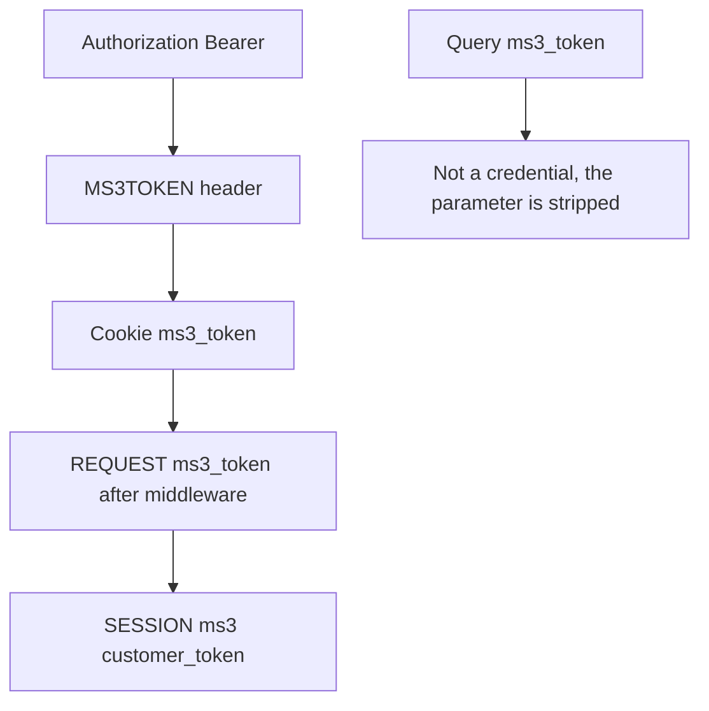
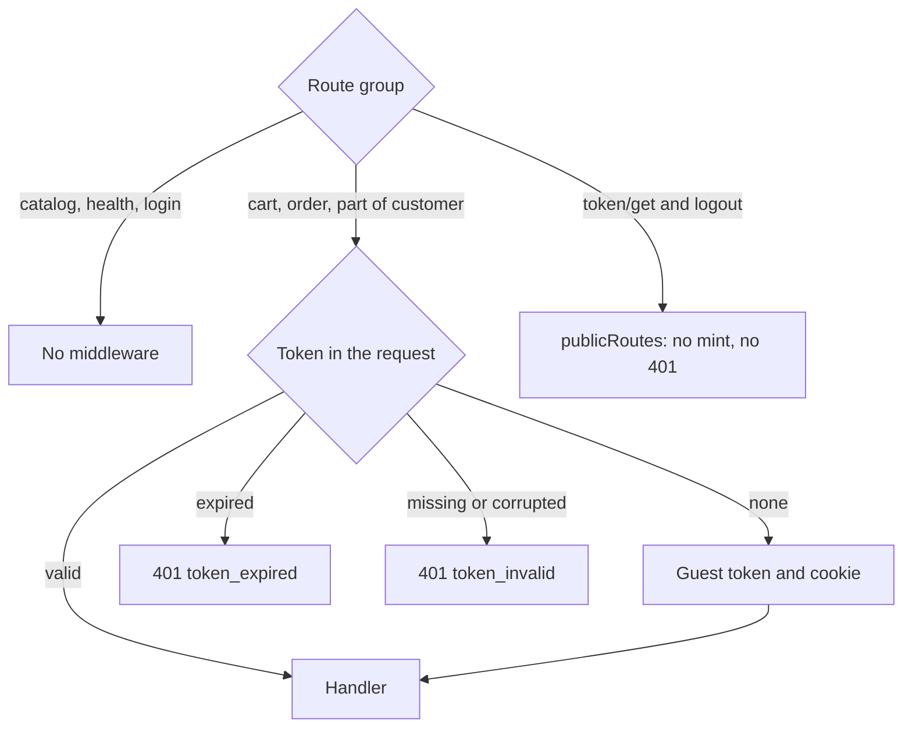

# Authorization

Web API does not use the MODX manager session. The client sends a customer token — either a guest one or an authenticated one.

## Where the server looks for the token



Source order in `TokenService::resolveTokenFromRequest()`:

1. `Authorization: Bearer {token}`
2. `MS3TOKEN` header (legacy)
3. httpOnly cookie `ms3_token`
4. `$_REQUEST['ms3_token']` (after the middleware that injects the cookie into the request)
5. `$_SESSION['ms3']['customer_token']`

The server does not accept the `ms3_token` query parameter as a way to authorize and removes it from the request. The `token` query parameter does not authorize either, but it is kept: `GET /customer/email/verify` uses it. Do not copy old examples with `?ms3_token=` in the URL.

## Cookie vs Bearer

| Mode | How to send | When |
| --- | --- | --- |
| Same-site storefront | cookie `ms3_token` + `credentials: 'include'` | Browser on the same site |
| Nuxt BFF / mobile | `Authorization: Bearer` | Different origin or server proxy |

Do not store the API token in `localStorage`: for a browser on the same origin the main way is the httpOnly `ms3_token` cookie. Storefront scripts: [Frontend JavaScript](/en/components/minishop3/development/frontend-js).

The cookie inherits MODX session parameters: `session_cookie_domain`, `session_cookie_path`, `session_cookie_secure`, `session_cookie_samesite`.

## Auto-mint



On routes with `TokenMiddleware` (cart, order, part of customer) the server creates a guest token and sets a cookie when the request carries no token at all. The catalog routes and `/health` do not use the middleware at all.

A guest token is minted only when no token arrives. An expired token gets 401 `token_expired`, one that is missing from the database or corrupted gets 401 `token_invalid`: in both cases the server clears the cookie and the session keys instead of issuing a new token. When there is no token and minting fails, the response is 500 `internal_error`.

`GET /customer/token/get` and `POST /customer/logout` do use the middleware, but their paths are listed in `publicRoutes` — the `optional` mode. Without a token the server neither mints a guest token nor returns 401.

## GET /customer/token/get

Public. Returns the current or a new token and sets an httpOnly cookie.

```json
{
  "success": true,
  "message": "",
  "data": {
    "token": "…",
    "lifetime": 86400000
  }
}
```

`lifetime` is milliseconds until expiry: the seconds from `ms3_customer_token_ttl` multiplied by 1000. The internal generator has an `expires` field, but `data` does not return it.

The default for `ms3_customer_token_ttl` is **86400** seconds (24 hours). The transport package creates the setting with that value, and the code falls back to it when the setting is missing from the database.

::: warning Sites upgraded from versions before 1.14.2-beta1
On sites with no such setting in the database, the code before 1.14.2-beta1 fell back to **604800** (7 days). Once you upgrade, customers will have to sign in again after a day rather than a week. Set `ms3_customer_token_ttl` explicitly if you need the week-long lifetime.
:::

## Login / register

`POST /customer/login` and `POST /customer/register` run without TokenMiddleware. JSON body: `email`, `password` (+ registration fields).

After success the server rotates the token (session fixation protection): the old guest token is revoked, the cart draft moves to the customer session, the new token goes into the cookie.

To bind the cart to the customer on a headless login, pass the current guest token — via Bearer or cookie — before the call.

## GET /customer/me

`TokenMiddleware` + auto-mint. The response is built from the current token: `authenticated`, `customer` (or `null`), token metadata (`expires_at`, `customer_id`). Invalid token → 401.

## POST /customer/token/refresh

Rotation: requires a valid token. On success it returns a new token and metadata (`expires_at`, `customer_id`).

## CORS and credentials

For cookies from another origin, list the origins in `ms3_cors_allowed_origins` and send requests with `credentials: 'include'`. The value `*` is incompatible with credentials: see [CORS](cors).

## See also

- [Endpoint map](endpoints)
- [Examples](examples)
- [Customer](customer)
