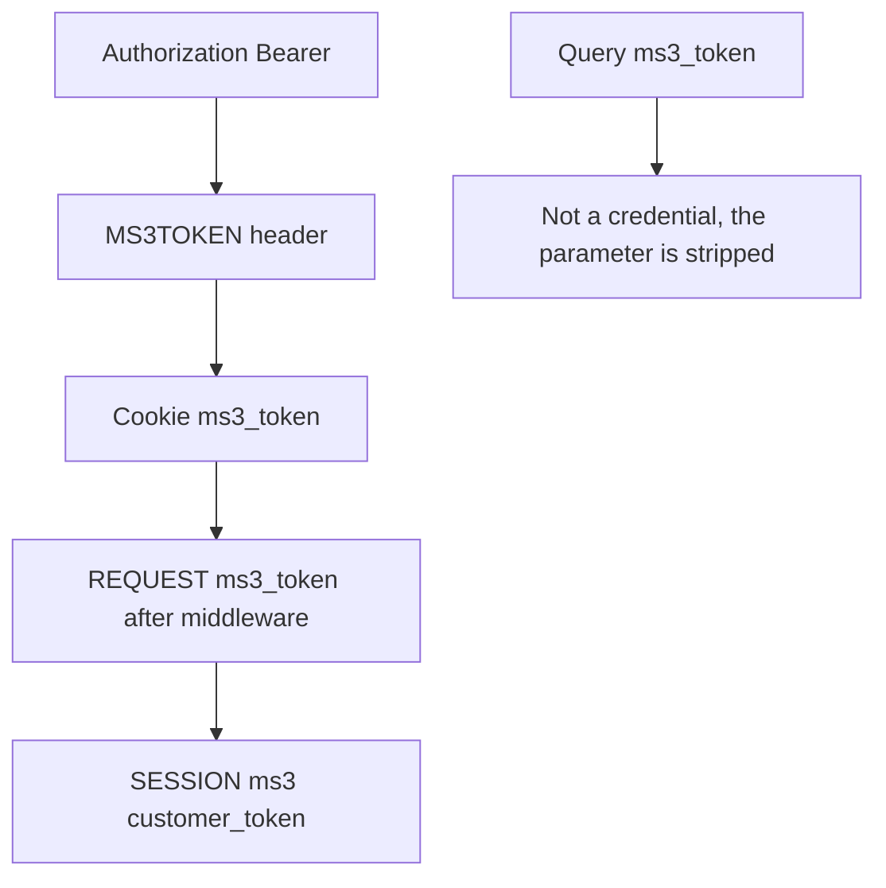
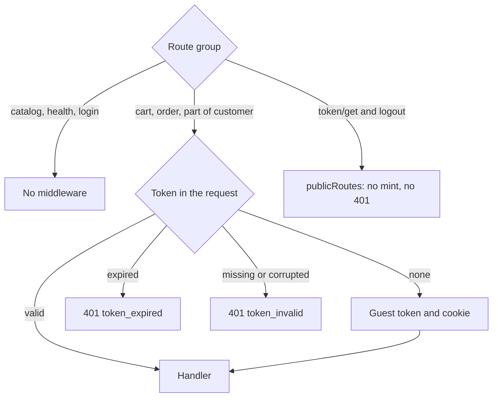

# Authorization

Web API does not use the MODX manager session. The client sends a customer API token: a guest one or an authenticated one.

## Where the server looks for the token



Source order in `TokenService::resolveTokenFromRequest()`:

1. `Authorization: Bearer {token}`
2. `MS3TOKEN` header (legacy)
3. httpOnly cookie `ms3_token`
4. `$_REQUEST['ms3_token']` (after the middleware that injects the cookie into the request)
5. `$_SESSION['ms3']['customer_token']`

The server does not accept the `ms3_token` query parameter as a way to authorize and removes it from the request. The `token` query parameter does not authorize either, but it is kept: `GET /customer/email/verify` uses it. Do not copy old examples with `?ms3_token=` in the URL.

## Cookie vs Bearer

| Mode | How to send | When |
| --- | --- | --- |
| Same-site frontend | cookie `ms3_token` + `credentials: 'include'` | Browser on the same site |
| Nuxt BFF / mobile | `Authorization: Bearer` | Different origin or server proxy |

Do not store the API token in `localStorage`: for a browser on the same origin the main way is the httpOnly `ms3_token` cookie. Frontend scripts: [Frontend JavaScript](/en/components/minishop3/development/frontend-js).

The cookie inherits MODX session parameters: `session_cookie_domain`, `session_cookie_path`, `session_cookie_secure`, `session_cookie_samesite`.

## Auto-mint



On routes with `TokenMiddleware` (cart, order, part of customer) the server creates a guest token and sets a cookie when the request carries no token at all. The catalog routes and `/health` do not use the middleware at all.

A guest token is minted only when no token arrives. An expired token gets 401 `token_expired`, one that is missing from the database or corrupted gets 401 `token_invalid`: in both cases the server clears the cookie and the session keys instead of issuing a new token. When there is no token and minting fails, the response is 500 `internal_error`.

`GET /customer/token/get` and `POST /customer/logout` run the middleware in optional mode: their paths are listed in `publicRoutes`. Without a token the server neither mints a guest token nor returns 401.

## GET /customer/token/get

Public. Returns the current or a new token and sets an httpOnly cookie.

```json
{
  "success": true,
  "message": "",
  "data": {
    "token": "…",
    "lifetime": 86400000
  }
}
```

`lifetime` is the time left, in milliseconds: the seconds from `ms3_customer_token_ttl` multiplied by 1000. The internal generator has an `expires` field, but it does not appear in `data`.

| Setting | Installer value | If the row is missing from the database |
| --- | --- | --- |
| `ms3_customer_token_ttl` | 86400 seconds (24 hours) | The code uses the same 86400 |

::: warning Sites upgraded from versions before 1.14.2-beta1
On sites with no such setting in the database, the code before 1.14.2-beta1 fell back to **604800** (7 days). Once you upgrade, customers will have to sign in again after a day rather than a week. Set `ms3_customer_token_ttl` explicitly if you need the week-long lifetime.
:::

## Login / register

`POST /customer/login` and `POST /customer/register` run without `TokenMiddleware`.

| Method | Body |
| --- | --- |
| `POST /customer/login` | `email`, `password` |
| `POST /customer/register` | `email`, `password`, `first_name`, `last_name`, `phone`, `privacy_accepted` (bool) |
| `POST /customer/forgot-password` | `email` |
| `POST /customer/reset-password` | `token`, `password`, `password_confirm` |

A successful response of both endpoints has the same shape:

```json
{
  "success": true,
  "message": "",
  "data": {
    "customer": { "id": 12, "email": "ivan@example.com", "first_name": "Ivan" },
    "token": "a1b2c3…",
    "expires_at": 1793452800,
    "redirect_url": "https://shop.example.com/cabinet"
  }
}
```

`customer` carries the public customer fields — the same set as [`GET /customer/me`](customer). `redirect_url` comes from the call's `redirect_page_id` property, or from the `ms3_customer_redirect_after_login` setting when that property is absent; with no page set it arrives as an empty string.

The per-IP login attempt limit is hardcoded in the processor: 5 attempts in 300 seconds. It does not read `ms3_customer_max_login_attempts` or `ms3_customer_block_duration` ([bug #902](https://github.com/modx-pro/MiniShop3/issues/902)). Account lockout does use those settings. If the `ms3_customer_block_duration` row is missing from the database, the code uses a lock of 3600 seconds, while the installer writes 300 ([bug #898](https://github.com/modx-pro/MiniShop3/issues/898)).

After a successful login the server rotates the token: it revokes the old guest token and moves the cart draft to the customer session. The new token goes into the cookie.

To bind the cart to the customer on a headless login, send the current guest token in the login request itself, as an `Authorization: Bearer` header or a cookie. Without it there is nothing to move: the server cannot tell which draft belongs to this visitor.

## GET /customer/me

The endpoint goes through `TokenMiddleware` with auto-mint. For a guest the response is successful: `authenticated: false`, `customer: null`. An invalid token returns 401.

## POST /customer/token/refresh

Rotates a valid token, including a guest token. On success it returns a new token and its metadata: `expires_at`, `customer_id`.

## CORS and credentials

For cookies from another origin, list the origins in `ms3_cors_allowed_origins` and send requests with `credentials: 'include'`. The value `*` is incompatible with credentials: see [CORS](cors).

## See also

- [Endpoint map](endpoints)
- [Examples](examples)
- [Customer](customer)
