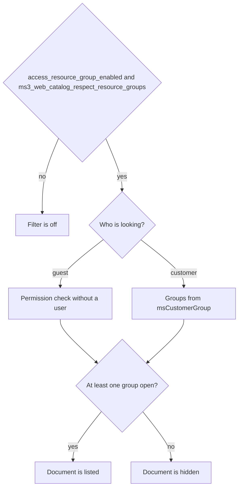

# Catalog

Public endpoints, no API token needed. The data set is the same as on the server-rendered (SSR) frontend.

## Product

| Method | Path | Purpose |
| --- | --- | --- |
| `GET` | `/product/get/{id}` | Product by ID |
| `GET` | `/product/get` | Resolve: `alias` or `uri` parameter, optional `context` |
| `GET` | `/product/list` | List / PLP |
| `GET` | `/product/filters` | Facets (same filters as `list`) |
| `GET` | `/product/{id}/images` | Gallery |

Query parameters for `get` and resolve: `context`, `include_images` (0\|1, default 0), `include_seo` (default 1).

Main query parameters for `list`:

| Parameter | Meaning |
| --- | --- |
| `parent` / `category` | Category ID (kept for backward compatibility; ignored if `parents` is set) |
| `parents` | CSV or array of category IDs. OR condition, and a product matches both by its primary category and by additional links (`msCategoryMember`) |
| `nested` | 0\|1 — expand the tree when using `parents` |
| `price_min`, `price_max` | Price range |
| `in_stock`, `stock_min` | Stock |
| `vendor_id`, `new`, `popular`, `favorite` | Flags / vendor |
| `options` | Options JSON |
| `limit`, `offset` / `page` | Pagination |
| `sort`, `dir`, `query`, `context` | Sort and search |
| `include_options`, `include_content`, `include_images` | Embeds (`include_images` default 0, at most 10 files per product) |
| `include_seo` | [SEO block](#seo); the default is **0** on `list` and **1** on `get` |

`list` response: `{ items, total, limit, offset }` inside `data`.

`filters`: the same filters as `list`, plus `keys`, `include_price` (default 1), `include_vendors` (default 0).

Product fields are returned according to an allowlist in `ProductCatalogService`.

## Category

| Method | Path | Purpose |
| --- | --- | --- |
| `GET` | `/category/get/{id}` | Category by ID |
| `GET` | `/category/get` | Resolve by `alias` / `uri` |
| `GET` | `/category/list` | List |
| `GET` | `/category/tree` | Tree |

`get` parameters: `context`, `include_hidden`, `include_content`, `include_breadcrumbs`, `include_children`, `include_seo` (default 1).

`list` parameters: `parent`, `limit`, `offset` or `page`, `sort`, `dir`, `context`, `include_hidden`, `include_content`, `include_seo` (default 0).

`tree` parameters: `parent`, `depth`, `context`, `include_hidden`, `sort`, `dir`, `include_seo` (default 0).

With `include_children=1` the nested categories in `children` also receive `seo`, unless `include_seo` is off.

## SEO block {#seo}

The block arrives in `seo` when `include_seo` is on. Assembly order:

1. Base values from the resource fields.
2. `canonical`.
3. Overrides from the TV map.
4. The `msOnGetPublicSeo` event.

| Key | Source |
| --- | --- |
| `title`, `description` | Resource fields, overridden by the TV map where present |
| `canonical` | Built with MODX `makeUrl`. With friendly URLs off it comes out as `index.php?id=N`, so the link keeps working |
| `robots` | Either `index,follow` or `noindex,nofollow` — see [`searchable`](#searchable) |
| `og.*` | From the TV map: `og.title`, `og.description`, `og.image`, `og.type` |

The TV map is the `ms3_public_seo_tv_map` system setting: JSON that maps an SEO key to a TV name. Allowed keys are `title`, `description`, `canonical`, `robots`, `og.title`, `og.description`, `og.image`, `og.type`. Invalid JSON is ignored. The setting is empty by default: without it the SEO block is built from the resource fields alone.

### The `searchable` field {#searchable}

Product and category responses carry `searchable` (the "Searchable" flag of the MODX resource). When it is off, `robots` in the SEO block becomes `noindex,nofollow`. Nothing else depends on it: the entry itself stays in the API output.

## Resource group ACL



The filter is on only when both settings are true: MODX `access_resource_group_enabled` (on by default) and `ms3_web_catalog_respect_resource_groups` (the installer writes `true`).

A guest is matched against a permission that is not tied to a user. A customer also receives groups from `msCustomerGroup` through MODX user-group ACL.

Membership is "at least one": the document stays visible when any of its groups grants access, even if another group is closed.

Turn off `ms3_web_catalog_respect_resource_groups` to serve products without resource-group checks.

## Example

```bash
curl -sS 'https://shop.example/assets/components/minishop3/api.php?route=/api/v1/product/list&parents=10&limit=20'
```

See also [Examples](examples), [Frontend: catalog](/en/components/minishop3/frontend/catalog).
