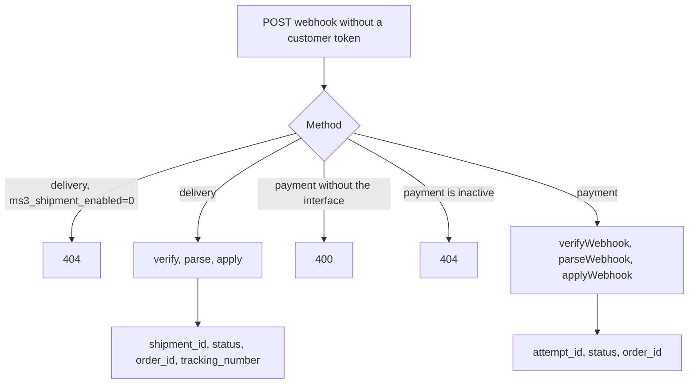
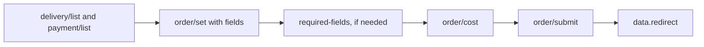

# Checkout

## Public lists

No customer token:

| Method | Path |
| --- | --- |
| `GET` | `/delivery/list` |
| `GET` | `/delivery/get/{id}` |
| `GET` | `/payment/list` |
| `GET` | `/payment/get/{id}` |

Only active methods (`active = 1`) appear in the lists.

| Endpoint | Parameters |
| --- | --- |
| `GET /delivery/list` | `include_payments` (default 1), `include_required_fields` (default 0) |
| `GET /payment/list` | `delivery_id`, `include_delivery_ids` (default 0) |

The server checks the delivery and payment pair at checkout. Without a valid pair, `POST /order/submit` returns an error.

## Webhooks

A webhook comes from the payment service or the delivery service and is authorized by the `handler` signature, not by a customer token. The path prefix is the same: `/api/v1`.

| Method | Path | Condition |
| --- | --- | --- |
| `POST` | `/delivery/webhook/{delivery_id}` | Requires a delivery handler; returns 404 when `ms3_shipment_enabled=0` |
| `POST` | `/payment/webhook/{payment_method_id}` | Requires a payment class that implements `PaymentWebhookHandlerInterface`; otherwise 400 |

Payment: the server reads JSON from the body, then calls `verifyWebhook`, `parseWebhook`, and `PaymentLifecycleService::applyWebhook`. A successful response returns `attempt_id`, `status`, and `order_id`. An inactive payment method answers the webhook with 404.

A successful delivery webhook returns `shipment_id`, `status`, `order_id`, and `tracking_number`. The delivery webhook does not filter on `active`.

A payment extra may keep an entry point of its own — `webhook.php` or `callback.php` under its `assets/components/{ns}/` directory. The MiniShop3 core ships no such files and does not govern their behaviour: check the documentation of that extra.

These routes do not pass `TokenMiddleware`. The public payment prefix in the middleware ends with a slash, so it does not match a path with `{id}`. Until the middleware is attached to the group, webhooks are unaffected ([bug #903](https://github.com/modx-pro/MiniShop3/issues/903)).

## Order draft

Every `/order/*` path goes through `TokenMiddleware` with token auto-mint.

| Method | Path | Purpose |
| --- | --- | --- |
| `GET` | `/order/get` | Draft |
| `POST` | `/order/add` | One field: body `key` and `value` |
| `POST` | `/order/set` | Several fields: a `fields` object. Flat JSON without `fields` returns 400 |
| `POST` | `/order/remove` | Remove a field: body `key` |
| `POST` | `/order/clean` | Clear draft |
| `POST` | `/order/address/set` | Saved address: `address_hash` |
| `POST` | `/order/address/clean` | Clear address |
| `GET` | `/order/delivery/validation-rules` | Field rules by delivery |
| `GET` | `/order/delivery/required-fields` | Required fields |
| `GET` | `/order/cost` | Full calculation |
| `GET` | `/order/cost/cart` | Cart only |
| `GET` | `/order/cost/delivery` | Delivery |
| `GET` | `/order/cost/payment` | Payment fee |
| `POST` | `/order/submit` | Submit. Optional `data` object. An empty body is sent as an empty array |

A draft usually holds `delivery_id`, `payment_id`, `address_*`, and contact fields. The exact set depends on the delivery rules. The frontend script calls `order/add` for a single field, not `order/set`.

### Fields the frontend may not change {#protected-fields}

Since 1.14.2-beta1 the internal draft columns are closed for frontend writes. Before that `/order/add` accepted any key backed by a column of the same name: a visitor holding their own cart token could set someone else's `customer_id` or zero out `cost`.

| Object | Closed columns |
| --- | --- |
| Order | `id`, `user_id`, `customer_id`, `token`, `uuid`, `idempotency_key`, `createdon`, `updatedon`, `num`, `cost`, `cart_cost`, `delivery_cost`, `weight`, `status_id`, `context`, `properties` |
| Address | `id`, `order_id`, `createdon`, `updatedon`, `properties` |

Writable: form fields (`delivery_id`, `payment_id`, `order_comment`), the remaining address columns, and your own columns added through Extra fields. A key that matches no order or address column still lands in `properties['_validated']`.

What happens on a closed key:

| Request | Response |
| --- | --- |
| `POST /order/add` | `400`, `error_code: business_rule`, lexicon `ms3_err_field_protected` |
| `POST /order/set` | `422`, `error_code: validation_failed`, the key appears in `errors` |
| `POST /order/remove` | `404`, lexicon `ms3_err_field_nf` |
| `POST /order/submit` | the key in `data` is dropped silently, checkout continues |

::: tip Writing an internal order field from an add-on
The closed columns are the `OrderFieldManager` constants. To change the list, replace the `ms3_order_field_manager` DI key with your own subclass in [`core/config/ms3.services.d/*.php`](/en/components/minishop3/development/services). That directory sits outside the component and survives upgrades. From PHP the internal fields are reachable without the override: `OrderDraftManager::updateField()`, `attachCustomer()`, `setDeliveryCost()`.
:::

## POST /order/submit

On success the URL arrives in JSON, under `data.redirect`. Submit has no `Location` header: `Response::redirect` is used when email is confirmed with `html=1`.

Online payment is handled by a payment extra. A base method without `class` only records the choice.

## Typical sequence

1. `GET /delivery/list`, `GET /payment/list`
2. `POST /order/set` with a `fields` object: `delivery_id`, `payment_id`, address
3. `GET /order/delivery/required-fields` if needed
4. `GET /order/cost`
5. `POST /order/submit`

A Fenom frontend can build the form with `msOrder`. A headless client uses the lists above. See [Examples](examples).
