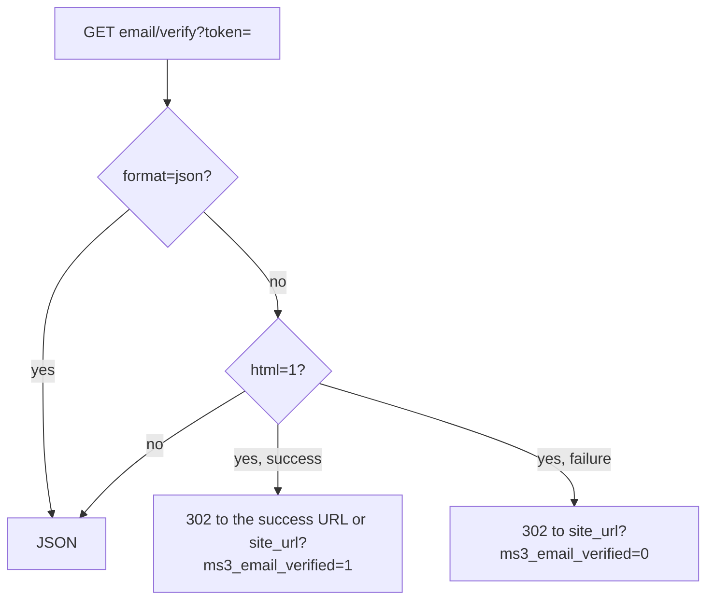

# Customer

Customer account and profile. Auth flows: [Authorization](auth).

## Session

`GET /customer/me` for a guest:

```json
{
  "success": true,
  "message": null,
  "data": {
    "authenticated": false,
    "customer": null,
    "token": {
      "expires_at": "2026-10-16 18:00:00",
      "customer_id": 0
    }
  }
}
```

After login `authenticated` becomes `true`, and `customer` carries the public fields: `id`, `first_name`, `last_name`, `email`, `phone`, `email_verified_at`, `is_active`, `created_at`, `updated_at`, `last_login_at`, `orders_count`, `total_spent`, `last_order_at`, `privacy_accepted_at`.

The list grows with the customer's active [extra fields](../../interface/utilities/extra-fields): keys of `msCustomer` fields with `active = 1` are added to the public set automatically.

| Method | Path | Notes |
| --- | --- | --- |
| `GET` | `/customer/me` | For a guest: `authenticated: false`, `customer: null` |
| `POST` | `/customer/token/refresh` | Rotates a guest token too |
| `POST` | `/customer/logout` | Token is optional |
| `POST` | `/customer/login` | No `TokenMiddleware` |
| `POST` | `/customer/register` | No `TokenMiddleware` |
| `POST` | `/customer/forgot-password` | |
| `POST` | `/customer/reset-password` | |

## Profile

| Method | Path | Notes |
| --- | --- | --- |
| `PUT` | `/customer/profile` | |
| `POST` | `/customer/add` | Quick single field |
| `POST` | `/customer/changeAddress` | Address into order draft |

The server accepts only profile fields from its allowlist. With a guest token, `profile` and `add` return `401` (`ms3_customer_err_login_required`), while `changeAddress` returns `400` with `error_code: business_rule` and the key `ms3_err_customer_required` — a business-rule refusal, not an authorization one.

A guest can reach `me`, `token/refresh`, `logout` (the token is optional, and a fresh guest token comes back) and `email/verify`, which runs without `TokenMiddleware` at all, on the confirmation token from the link.

The body of `POST /customer/add` is `key` and `value`. The body of `POST /customer/changeAddress` is `address_hash` or `value`.

## Addresses

| Method | Path |
| --- | --- |
| `GET` | `/customer/addresses` |
| `GET` | `/customer/addresses/{id}` |
| `POST` | `/customer/addresses` |
| `PUT` | `/customer/addresses/{id}` |
| `DELETE` | `/customer/addresses/{id}` |
| `PUT` | `/customer/addresses/{id}/set-default` |

`POST` answers 201. `name`, `city`, and `street` are required. Without them the server returns 422 with `validation_failed`.

An address matching one already saved is refused with **409** and `error_code: conflict`; `data` carries `existing_id`, the id of the existing record, so the client can simply select it instead of creating a duplicate. The match is computed from the address hash, not from an id.

The address list comes back as `{ "items": [...], "total": N }`.

## Account orders

| Method | Path |
| --- | --- |
| `GET` | `/customer/orders` |
| `GET` | `/customer/orders/{id}` |
| `POST` | `/customer/orders/{id}/cancel` |

The list contains only the customer's submitted orders. The draft from `/order/get` is not in it.

List parameters: `limit` (default 20, maximum 100), `offset`, and `status`. The list itself arrives twice, under `orders` and under `items`.

An order can be cancelled in the statuses from `ms3_customer_cancel_allowed_statuses`. If the setting is empty, those are new and paid. A successful response returns `order_id` and `status_id`. An order in another status gets 400.

## Email



| Method | Path | Notes |
| --- | --- | --- |
| `GET` | `/customer/email/verify` | Public. Query parameter `token`. With `format=json` the response is always JSON. With `html=1` it is a 302 |
| `POST` | `/customer/email/resend-verification` | Needs an authenticated token |

With `html=1`, success goes to `ms3_email_verification_success_url` or to `site_url` with `ms3_email_verified=1`. A failure goes to `site_url?ms3_email_verified=0`.

`ms3_email_verification_url` sets the link address in the email. The template accepts both `[[+token]]` and `{token}`. If the setting is empty, the link points at `api.php?route=…/email/verify` and already includes `html=1`.

## Related pages

- [Frontend: authorization](/en/components/minishop3/frontend/customer-auth)
- [Endpoint map](endpoints)
- [Examples](examples)
