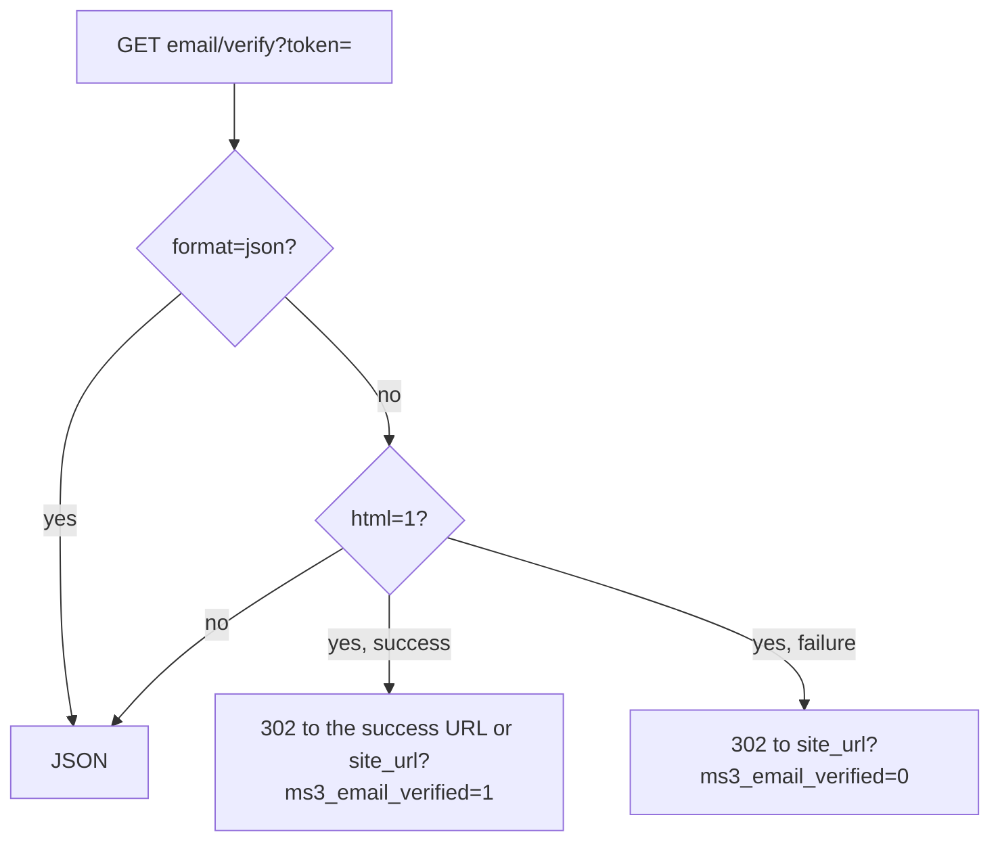

# Customer

Customer account and profile. Auth flows: [Authorization](auth).

## Session

| Method | Path | Notes |
| --- | --- | --- |
| `GET` | `/customer/me` | `authenticated`, `customer`, token meta |
| `POST` | `/customer/token/refresh` | Rotates a guest token too |
| `POST` | `/customer/logout` | optional token |
| `POST` | `/customer/login` | no middleware |
| `POST` | `/customer/register` | no middleware |
| `POST` | `/customer/forgot-password` | |
| `POST` | `/customer/reset-password` | |

## Profile

| Method | Path | Notes |
| --- | --- | --- |
| `PUT` | `/customer/profile` | |
| `POST` | `/customer/add` | Quick single field |
| `POST` | `/customer/changeAddress` | Address into order draft |

The server trims profile fields by an allowlist. A guest token gets an authorization error on `profile`, `add` and `changeAddress`, while `me` and `token/refresh` succeed for a guest.

## Addresses

| Method | Path |
| --- | --- |
| `GET` | `/customer/addresses` |
| `GET` | `/customer/addresses/{id}` |
| `POST` | `/customer/addresses` |
| `PUT` | `/customer/addresses/{id}` |
| `DELETE` | `/customer/addresses/{id}` |
| `PUT` | `/customer/addresses/{id}/set-default` |

`POST` answers 201. `name`, `city` and `street` are required — without them the response is 422 `validation_failed`.

## Account orders

| Method | Path |
| --- | --- |
| `GET` | `/customer/orders` |
| `GET` | `/customer/orders/{id}` |
| `POST` | `/customer/orders/{id}/cancel` |

Submitted customer orders, not the `/order/get` draft.

## Email

| Method | Path | Notes |
| --- | --- | --- |
| `GET` | `/customer/email/verify` | Public. Query token, `html=1` for page |
| `POST` | `/customer/email/resend-verification` | Requires authenticated token |

Custom email URL: `ms3_email_verification_url`. Otherwise the link points to `api.php?route=…/email/verify`.

## Related pages

- [Frontend: authorization](/en/components/minishop3/frontend/customer-auth)
- [Endpoint map](endpoints)
- [Examples](examples)
