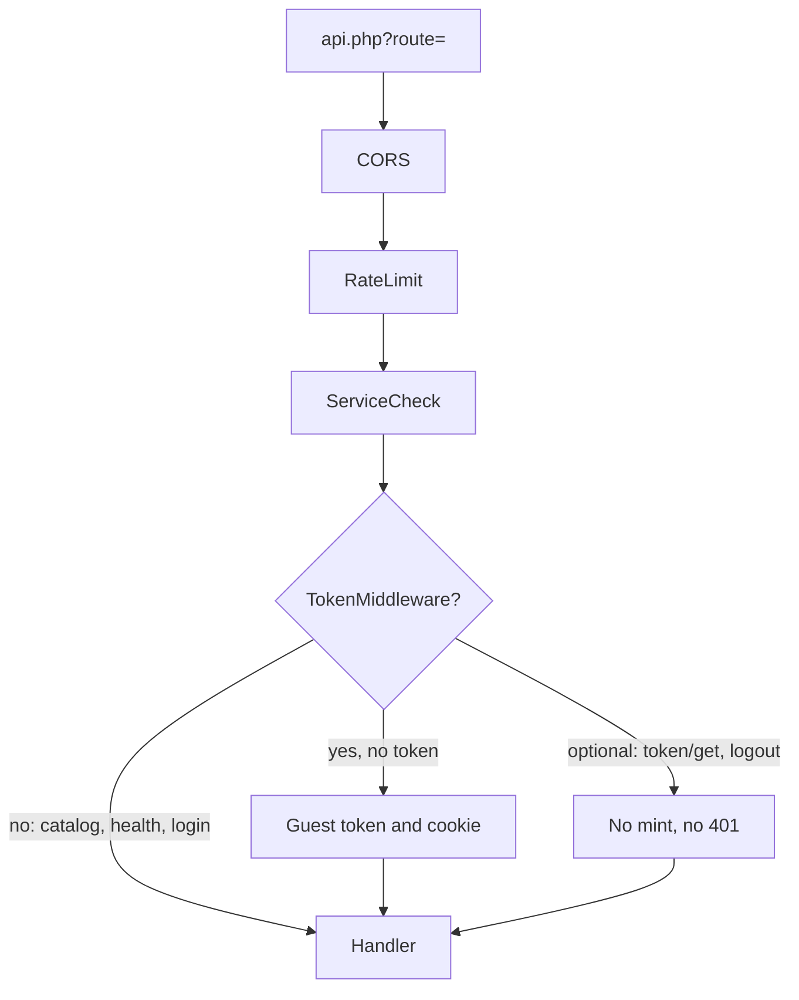

# Web API

Storefront and headless entry point:

```text
/assets/components/minishop3/api.php?route=/api/v1/{path}
```

The `route` parameter is required. The `/api/v1` group always runs three middleware layers: CORS → RateLimit → ServiceCheck. `TokenMiddleware` is not applied to the whole group; it is attached to cart, order, and part of customer.

Manager API (`connector.php`) is not documented on this page.

## Envelope

With an empty `route` the server answers 400 before the router runs:

```json
{
  "success": false,
  "message": "Route parameter is required",
  "code": 400
}
```

A router response carries `success`, `message` and `data`. An error adds `code`, `errors` and `error_code`.

**Success.** `message` is most often `null`: the catalog and account controllers do not pass it. An empty string arrives where the calling code passed `''` — `GET /customer/token/get`, for one. Cart and order routes return the lexicon entry of the operation: `GET /cart/get` answers with `Cart data retrieved`.

```json
{
  "success": true,
  "message": null,
  "data": {}
}
```

**Error:**

```json
{
  "success": false,
  "message": "…",
  "code": 400,
  "errors": null,
  "error_code": "bad_request"
}
```

The `errors` key is always present in error bodies (often `null`). `error_code` is resolved on the server. Details: [Errors](errors).

## Middleware



| Order | Middleware | Purpose |
| --- | --- | --- |
| 1 | `CorsMiddleware` | Origins from `ms3_cors_allowed_origins` |
| 2 | `RateLimitMiddleware` | `ms3_rate_limit_*` |
| 3 | `ServiceCheckMiddleware` | MS3 services available |
| (per route) | `TokenMiddleware` | Resolve / auto-mint token |

CORS and rate limit settings: [CORS](cors), [System settings](/en/components/minishop3/settings#api).

## Sections

1. [Authorization](auth)
2. [Endpoint map](endpoints)
3. [Catalog](catalog)
4. [Cart](cart)
5. [Checkout](checkout)
6. [Customer](customer)
7. [Errors](errors)
8. [CORS and rate limit](cors)
9. [Examples](examples)

Custom routes and FastRoute details: [API Router](/en/components/minishop3/development/routing).
