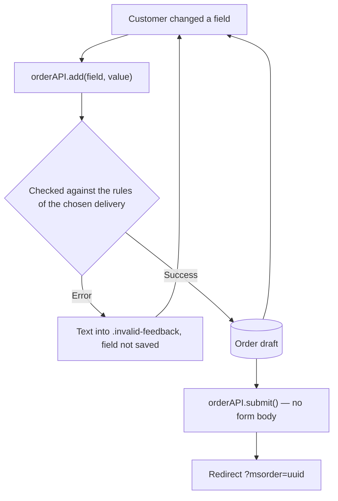

# Checkout

Last purchase step: contacts, delivery, payment, address. The package ships a page template and form chunk.

<!--  -->

## Page structure

| Component | File | Chunk name in DB | Purpose |
| --- | --- | --- | --- |
| Page template | `elements/templates/order.tpl` | — | Page layout, msOrder call |
| Form chunk | `elements/chunks/ms3_order.tpl` | `tpl.msOrder` | Checkout form |

### Snippet call

```fenom
{'!msOrder' | snippet : [
    'tpl' => 'tpl.msOrder'
]}
```

::: warning Caching
The msOrder snippet must be called **uncached** (`!msOrder`) because it works with the user session.
:::

The form is not submitted as a whole. Every field goes to the server in its own request right after it changes and fills the order draft; the «Place order» button sends an empty request, and the order is assembled from the accumulated draft.



Two common mistakes: a form without `data-ms3-form="order"` and a field without a `<div>` wrapper never get their values into the draft. On submit the customer then sees an «empty field» error although everything was filled in.

## Order form

| Section | Description |
| --- | --- |
| Empty cart | Message and link to the catalog (if the cart is empty) |
| Contact details | First name, last name, email, phone, comment |
| Payment methods | Radio buttons with logo and description |
| Delivery methods | Radio buttons with logo and description |
| Delivery address | Postal code, region, city, street, building, entrance, floor, apartment |
| Saved addresses | Dropdown of previously saved addresses (for logged-in customers) |
| Summary panel | Product cost, delivery cost, total, cancel and submit buttons |

### Placeholders

Available in the form chunk:

| Placeholder | Type | Description |
| --- | --- | --- |
| `$isCartEmpty` | bool | Cart is empty |
| `$form` | array | Form field values (`$form.first_name`, `$form.email`, etc.) |
| `$order` | array | Order data (`$order.cost`, `$order.delivery_cost`, `$order.cart_cost`) |
| `$deliveries` | array | Delivery methods |
| `$payments` | array | Payment methods |
| `$addresses` | array | Customer saved addresses |
| `$isCustomerAuth` | bool | Customer is logged in |

### Delivery and payment linkage

Each delivery includes a `payments` array with IDs of allowed payment methods. Links are set in the admin on the delivery card (`msDeliveryMember`).

Filtering the payments on delivery change is up to you: the package checks the pair on the server only. An invalid pair returns an error on submit and on finalization in the admin.

## Guest and authenticated customer

| Mode | What happens |
| --- | --- |
| Guest | Fills contacts manually. No saved addresses |
| Authenticated | Form shows an address list. Contacts can come from the profile |

### Auto-registration on checkout

Keys:

- `ms3_customer_auto_register_on_order` (on by default)
- `ms3_customer_auto_login_on_order` (on by default)

On submit, a guest with a valid email can get an `msCustomer` row and session without a separate registration. Turn the keys off if accounts are created only via the account form.

Separately: `ms3_order_register_user_on_submit` creates a `modUser` on checkout (off by default). That is not the same as `msCustomer`.

Manual login and registration: [Login and registration](/en/components/minishop3/frontend/customer-auth).

## Validation

### How field validation works

Required fields and rules are set **per delivery method** in the admin. Courier needs an address; pickup often needs only phone and email.

Rule setup: [Deliveries → Validation](/en/components/minishop3/interface/settings/deliveries#order-field-validation).

### Validation process

1. On delivery change `OrderUI` saves the value to the draft and recalculates the cost.
2. On `ms3.orderAPI.add(key, value)` the server checks the field against the current delivery rules.
3. On submit the server checks all required fields.
4. On a submit error `OrderUI` sets the `data-ms3-error` attribute and the `ms3_field_error` class on the field. When a single field fails to autosave, it also adds `is-invalid` and writes the text into `.invalid-feedback`.

The package does not hide fields on delivery change. `GET /api/v1/order/delivery/validation-rules` and `GET /api/v1/order/delivery/required-fields` do exist in the Web API, but the storefront never calls them. Form behaviour on delivery change is up to you.

### Saved addresses

The `msOrder` snippet loads `order-addresses.js` (not part of `ms3_frontend_assets`). In the chunk — `<select id="saved_address_id">` with `<option data-address='{"city":"..."}'>`: selecting an option fills the form fields automatically.

Two API paths:

| Scenario | Endpoint |
| --- | --- |
| Checkout: apply address to draft | `POST /api/v1/order/address/set` |
| Pick address from list (`CustomerUI` / msCustomer) | `POST /api/v1/customer/changeAddress` |

Clear address fields: `POST /api/v1/order/address/clean`.

### Custom form fields (`_validated`)

A field that neither the order nor the address has a column for (for example a consent checkbox `agreement`) goes into the draft and is stored in `msOrder.properties['_validated']`. On order-create events such fields are available as `customFields`.

On the storefront the checkbox must send `input.checked` (`1` / `0`), not a static `value`. For consent use the `accepted` rule on the delivery.

::: tip A custom field named after an order column will not go through
The internal columns are closed since 1.14.2-beta1: the server returns an error and the key is not stored in properties. The list is in [fields the storefront may not change](/en/components/minishop3/development/web-api/checkout#protected-fields).
:::

## JavaScript API

Public facade is `ms3.orderAPI` (not `ms3.order`). The UI form calls it through `OrderUI`.

```javascript
// Submit order
const response = await ms3.orderAPI.submit()
if (response.success) {
  window.location.href = response.data.redirect
}

// Delivery / payment method
await ms3.orderAPI.add('delivery_id', deliveryId)
await ms3.orderAPI.add('payment_id', paymentId)

// Address and order fields
await ms3.orderAPI.add('city', 'Moscow')
await ms3.orderAPI.add('order_comment', 'Call before delivery')
// address.comment (address comment): await ms3.orderAPI.add('comment', '…')
```

### Hooks

There are no `ms3:order:*` DOM events. Use hooks:

```javascript
ms3Hooks.addHook('beforeSubmitOrder', async (data) => {
  // There is no order data here — the object is empty.
  // Form fields live in the beforeFormSubmit hook; here you can only cancel
  data.cancel = true
})

ms3Hooks.addHook('afterSubmitOrder', async ({ response }) => {
  if (response.success) {
    console.log('order_id:', response.data.order_id)
  }
})

ms3Hooks.addHook('afterAddOrder', async ({ key, value, response }) => {
  if (key === 'delivery_id') {
    console.log('Delivery:', value)
  }
})
```

See [Frontend JS — hooks](/en/components/minishop3/development/frontend-js).

## Server events

### Order field events

| Event | When | Parameters |
| --- | --- | --- |
| `msOnBeforeAddToOrder` | Before adding a field | `key`, `value`, `draft` |
| `msOnAddToOrder` | After adding a field | `key`, `value`, `draft` |
| `msOnBeforeRemoveFromOrder` | Before removing a field | `key`, `draft` |
| `msOnRemoveFromOrder` | After removing a field | `key`, `draft` |

### Validation events

| Event | When | Parameters |
| --- | --- | --- |
| `msOnBeforeValidateOrderValue` | Before value validation | `key`, `value`, `orderData` |
| `msOnValidateOrderValue` | Validation passed | `key`, `value` |
| `msOnErrorValidateOrderValue` | Validation error | `key`, `value`, `error` |

### Checkout events

| Event | When | Parameters |
| --- | --- | --- |
| `msOnSubmitOrder` | Before checkout starts | `handler`, `draft`, `orderData`, `data` |
| `msOnBeforeCreateOrder` | Before order creation | `handler`, `msOrder` |
| `msOnCreateOrder` | After order creation | `handler`, `msOrder` |

Full parameter lists and plugin examples: [Order events](/en/components/minishop3/development/events/order).

## Customization

### Changing the order form

1. Create your own chunk, e.g. `tpl.myOrder`
2. Specify it in the call: `'tpl' => 'tpl.myOrder'`
3. Use the available placeholders from the [msOrder documentation](/en/components/minishop3/snippets/msorder)

### Adding custom fields

A field that neither the order nor the address has a column for takes two steps.

**1. Validation.** Add rules in [delivery settings](/en/components/minishop3/interface/settings/deliveries#order-field-validation):

```json
{
  "first_name": "required",
  "email": "required|email",
  "agree": "accepted"
}
```

**2. Saving.** Standard fields (`first_name`, `email`, `city`, etc.) write themselves. Put foreign keys (not from `msOrder` / `msOrderAddress`) into order `properties` with a plugin if you need them after checkout:

<!-- FACT? the section above says such keys go into `properties['_validated']` on their own, and the example reads them from the address `properties` -->

```php
switch ($modx->event->name) {
    case 'msOnBeforeCreateOrder':
        // $msOrder is available from event parameters
        $address = $msOrder->Address;
        if ($address) {
            $properties = $msOrder->get('properties') ?: [];
            $properties['agree'] = $address->get('properties')['agree'] ?? '';
            $msOrder->set('properties', $properties);
        }
        break;
}
```

### Responsive layout

The form uses Bootstrap 5 Grid:

| Screen | Columns |
| --- | --- |
| < 992px | One section per row (100%) |
| ≥ 992px | Two sections per row (50% + 50%) |
