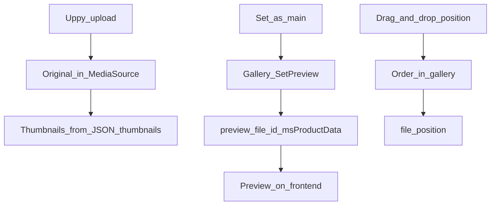

# Product gallery


A tab on the product card: upload, thumbnails, sorting.

## Image processing technology

MiniShop3 uses the [Intervention Image](https://image.intervention.io/) v3 library instead of the obsolete phpThumb.

**Requirements:**

- PHP 8.2+
- Imagick (recommended) or the GD extension
- For AVIF — Imagick built with libheif (the code only checks that the `imagick` extension is present)

### Supported formats

| Format | Read | Write | Note |
| --- | --- | --- | --- |
| JPEG | ✅ | ✅ | Primary format |
| PNG | ✅ | ✅ | With transparency |
| GIF | ✅ | ✅ | Animation (first frame only) |
| WebP | ✅ | ✅ | Roughly a quarter smaller than JPEG (approximate, depends on the content) |
| AVIF | ✅ | ✅ | Roughly half the size of JPEG (approximate); writing requires Imagick |
| HEIC | depends on the build | ❌ | Reading depends on Imagick with libheif — the code does not check it |

## Management interface

- **Image grid** — drag-and-drop sort, search, and pagination
- **Context menu** — right-click: edit, show, set as main, generate thumbnails, delete
- **Toolbar** — Media Source selection, bulk delete and thumbnail regeneration
- **Edit dialog** — file name, title (goes into `alt` on the frontend), description

### Changing Media Source

Selecting a file source in the toolbar switches Media Source without saving the whole product form. Uses the `Product\UpdateSource` processor.

### Main image (preview)

The “Set as main” action in the context menu does **not** change `position` in the gallery. It calls processor `MiniShop3\Processors\Gallery\SetPreview`, which writes `preview_file_id` to `msProductData`. Method `ProductImageService::setProductPreview()` links the file to the product card. Drag-and-drop sort and the preview on the frontend are separate mechanisms.



## Image uploader

The uploader is built on the [Uppy](https://uppy.io/) library.

**Features:**

- **Drag & Drop** — drag files into the upload area
- **Multiple upload** — several files at once
- **Preview** — thumbnails before upload
- **Progress** — upload progress display
- **Validation** — file type and size checks

### Uploader parameters

| Parameter | Default | Description |
| --- | --- | --- |
| `maxFileSize` | 10 MB | Maximum file size |
| `allowedFileTypes` | JPEG, PNG, GIF, WebP, AVIF, HEIC | Allowed types |

Upload has no width or height limits: only file type and size are checked. The Media Source properties `maxUploadWidth` / `maxUploadHeight` do not affect upload.

### Image editor

Before upload you can edit the image:

- **Crop** — select the desired area
- **Rotate** — 90° in any direction
- **Flip** — horizontal/vertical
- **Scale** — resize

[](https://file.modx.pro/files/9/c/a/9caa72a7b355926f74132f2b61db90d1.png)

[](https://file.modx.pro/files/e/9/a/e9ab2d93401728e0a90735592f690407.png)

## Thumbnail configuration

### Where to configure

Thumbnail configuration is stored in **Media Source**:

1. Go to **Media → File sources**
2. Open the product source (default: `MS3 Images`)
3. Find the `thumbnails` property
4. Enter JSON configuration

### Configuration format

```json
{
  "small": {
    "width": 150,
    "height": 150,
    "quality": 85,
    "mode": "cover",
    "format": "webp"
  },
  "medium": {
    "width": 400,
    "height": 400,
    "quality": 88,
    "mode": "cover",
    "format": "webp"
  },
  "large": {
    "width": 800,
    "height": 800,
    "quality": 90,
    "mode": "max",
    "format": "jpg"
  }
}
```

### Thumbnail parameters

| Parameter | Type | Description |
| --- | --- | --- |
| `width` | int | Width in pixels |
| `height` | int | Height in pixels |
| `quality` | int | Compression quality (0-100) |
| `mode` | string | Scaling mode |
| `format` | string | File format |

### Scaling modes (mode)

| `mode` | Behavior | When to use |
| --- | --- | --- |
| `cover` | Fills the area and crops the rest | One fixed size: product cards, grids, thumbnails |
| `contain` | Fits inside with proportions kept, via `scale()`. The code draws no background and ignores a `background` parameter | Show the whole object without cropping |
| `max` | Shrinks to the given size, never enlarges | Product gallery and zoom: keep the quality |
| `stretch` | Exactly `width`×`height`, proportions not kept (`resize()`) | A strict rectangle, distortion acceptable |

## Ready configurations

### Basic (minimal)

For small shops with limited disk space.

```json
{
  "thumb": {
    "width": 150,
    "height": 150,
    "quality": 80,
    "mode": "cover",
    "format": "webp"
  },
  "medium": {
    "width": 600,
    "height": 600,
    "quality": 85,
    "mode": "cover",
    "format": "webp"
  },
  "large": {
    "width": 1200,
    "height": 1200,
    "quality": 85,
    "mode": "max",
    "format": "jpg"
  }
}
```

**Result (approximate):** ~256 KB per image, 12-20 files per product — depends on the content and the settings.

### Optimal (recommended)

Balance of quality and performance with support for all browsers.

```json
{
  "thumb_webp": {
    "width": 150,
    "height": 150,
    "quality": 80,
    "mode": "cover",
    "format": "webp"
  },
  "thumb_jpg": {
    "width": 150,
    "height": 150,
    "quality": 85,
    "mode": "cover",
    "format": "jpg"
  },
  "card_webp": {
    "width": 300,
    "height": 300,
    "quality": 82,
    "mode": "cover",
    "format": "webp"
  },
  "card_jpg": {
    "width": 300,
    "height": 300,
    "quality": 85,
    "mode": "cover",
    "format": "jpg"
  },
  "gallery_webp": {
    "width": 800,
    "height": 800,
    "quality": 85,
    "mode": "max",
    "format": "webp"
  },
  "gallery_jpg": {
    "width": 800,
    "height": 800,
    "quality": 88,
    "mode": "max",
    "format": "jpg"
  },
  "zoom": {
    "width": 1500,
    "height": 1500,
    "quality": 90,
    "mode": "max",
    "format": "jpg"
  }
}
```

**HTML with fallback:**

```html
<picture>
  <source srcset="[[+card_webp]]" type="image/webp">
  
</picture>
```

### Premium (with Retina)

Maximum quality for large stores.

```json
{
  "card_webp": {
    "width": 350,
    "height": 350,
    "quality": 82,
    "mode": "cover",
    "format": "webp"
  },
  "card_webp_2x": {
    "width": 700,
    "height": 700,
    "quality": 78,
    "mode": "cover",
    "format": "webp"
  },
  "card_jpg": {
    "width": 350,
    "height": 350,
    "quality": 85,
    "mode": "cover",
    "format": "jpg"
  }
}
```

**HTML with Retina:**

```html
<picture>
  <source
    srcset="[[+card_webp]] 1x, [[+card_webp_2x]] 2x"
    type="image/webp">
  
</picture>
```

## Watermarks

```json
{
  "watermarked": {
    "width": 800,
    "height": 600,
    "quality": 85,
    "mode": "cover",
    "format": "jpg",
    "watermark": {
      "enabled": true,
      "path": "assets/watermark.png",
      "position": "bottom-right",
      "offset_x": 10,
      "offset_y": 10,
      "opacity": 50
    }
  }
}
```

| Key | Description |
| --- | --- |
| `enabled` | Turns the watermark on. If the watermark is on and `path` is empty, the thumbnail is built without it and the reason goes to the log |
| `path` | A path from the site root, with or without a leading slash. A file outside the site root, or an unreadable one, is rejected and logged |
| `position` | Intervention names: `top-left`, `top`, `top-right`, `left`, `center`, `right`, `bottom-left`, `bottom`, `bottom-right`, plus `tile` — the watermark fills the whole frame. Case and spaces do not matter, an empty value gives `bottom-right` |
| `offset_x`, `offset_y` | Margins from the edge in pixels. With `tile` they are the gaps between tiles |
| `opacity` | 0–100: the value is cast to an integer, anything outside the range is clamped; empty or `null` gives 100. Works on both GD and Imagick, including transparent PNG and WebP |

phpThumb and miniShop2 codes (`BR`, `C`, `*` and the like) are not supported: an unknown value leaves the image without a watermark and logs `Unknown watermark position`.

### Text watermark

The watermark can be text instead of an image — the `type: text` key:

```json
{
  "watermark": {
    "enabled": true,
    "type": "text",
    "text": "© My store",
    "font": "assets/fonts/roboto.ttf",
    "size": 24,
    "color": "#ffffff",
    "angle": 0,
    "position": "bottom-right",
    "opacity": 60
  }
}
```

`font` is required — a path to a TTF file from the site root. With no font or no text the watermark is skipped and the reason goes to the log. The `position`, `offset_x`, `offset_y` and `opacity` keys work as they do for an image, but `tile` is not available for text.

## Quality recommendations

| Image type | WebP | JPEG | Comment |
| --- | --- | --- | --- |
| Thumbnails (≤200px) | 75-80% | 85% | Artifacts not visible |
| Cards (200-400px) | 80-85% | 85-88% | Optimal balance |
| Gallery (400-1000px) | 85% | 88-90% | Details matter |
| Zoom (>1000px) | — | 90-92% | Maximum quality |

::: tip Rule
Roughly speaking, WebP can use 3-5% lower quality than JPEG for the same visual result (a measurement, not a guarantee from the component).
:::

## File structure

```text
assets/images/products/
└── {product_id}/
    ├── photo.jpg           # Original
    ├── thumb_webp/
    │   └── photo.webp      # WebP thumbnail
    ├── thumb_jpg/
    │   └── photo.jpg       # JPEG thumbnail
    ├── card_webp/
    │   └── photo.webp
    ├── card_jpg/
    │   └── photo.jpg
    └── ...
```

## Developer API

Service `ms3_image`:

```php
// Get the service
$imageService = $modx->services->get('ms3_image');

// Generate thumbnail
$thumbnailData = $imageService->makeThumbnail($sourceInfo, [
    'width' => 300,
    'height' => 200,
    'quality' => 85,
    'mode' => 'cover',
    'format' => 'webp'
]);

// Save to Media Source
$path = $imageService->saveThumbnailToSource(
    $thumbnailData,
    'products/123/',
    'photo_thumb.webp',
    $mediaSource
);

// Driver info
$driverInfo = $imageService->getDriverInfo();
// ['name' => 'Imagick'|'GD', 'supports_webp' => true, 'supports_avif' => true|false]
```

## Troubleshooting

### Thumbnails not created

**Check:**

1. Imagick or GD: `php -m | grep -E "(imagick|gd)"`
2. Write permissions for `assets/images/products/`
3. Valid JSON in Media Source settings
4. MODX logs in `core/cache/logs/error.log`

### WebP not generated

**Requirements:**

- Imagick with WebP support, or GD compiled with `--enable-webp`

**Check:**

```php
$imageService = $modx->services->get('ms3_image');
$info = $imageService->getDriverInfo();
var_dump($info['supports_webp']);
```

### AVIF not generated

AVIF requires Imagick with libheif. GD does not support AVIF.

**Check:**

```bash
php -r "var_dump(Imagick::queryFormats('AVIF'));"
```

### Images upload but don't display

**Check:**

- Media Source URL in settings
- File accessibility at the given path
- `.htaccess` for static files

## Related pages

- [Utilities: Gallery](utilities/gallery) — bulk thumbnail regeneration
- [msGallery](../snippets/msgallery) — gallery output snippet on the site
