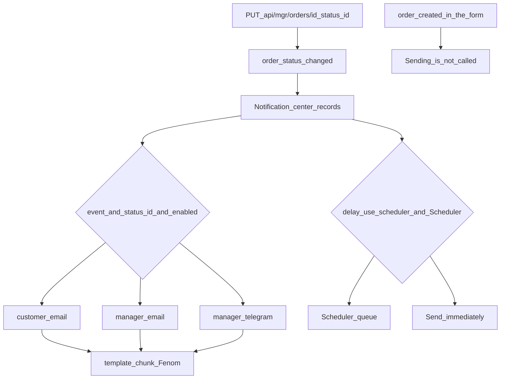

# Notification center


Open **Extras → MiniShop3 → Notifications**. Here you set who gets a message on an order status change, through which channel and from which template.

## Typical records



- Email to the customer when an order is created.
- Email to the manager about a new order.
- Customer notification when the order moves to Paid, Shipped or Delivered.
- Duplicate notification to a Telegram channel for managers.
- Any combination of "event → status → recipient → channel".

## Notification fields

| Field | Type | Description |
| --- | --- | --- |
| `event` | string | Event type: order status change, order creation |
| `status_id` | int | Order status ID. Only for "status change" events. Empty = trigger on any status |
| `recipient_type` | string | Recipient: `customer` or `manager` |
| `channel` | string | Delivery channel: `email`, `telegram`, etc. |
| `enabled` | bool | Enabled / disabled |
| `subject` | string | Email subject. Email only, takes order placeholders |
| `template` | string | Chunk name for the message body. Empty: the email is **not sent**; Telegram and SMS build a default message |
| `delay` | int | Send delay in seconds. Works only with the `ms3_use_scheduler` setting on and Scheduler installed |
| `position` | int | Send order when multiple notifications exist for one event |
| `config` | JSON | Internal channel setting. Empty by default, not editable in the form — code only |

## Events

The record is picked by event and `status_id`.

| Event | ID | Works now |
| --- | --- | --- |
| Order status changed | `order_status_changed` | Yes |
| Order created | `order_created` | No — the option is in the form, but nothing is sent for it |

::: warning order_created
You can pick `order_created` in the form, but notifications with it are **not sent** — neither on a frontend form submit nor on draft finalization. Tracking: [MiniShop3#811](https://github.com/modx-pro/MiniShop3/issues/811). Until the bug is closed, configure new order alerts through `order_status_changed` and the `status_id` you need.
:::

## Recipients

| Recipient | Where contacts come from |
| --- | --- |
| Customer (`customer`) | From the order: email, phone, Telegram chat_id if set |
| Manager (`manager`) | From channel system settings: `ms3_email_manager`, `ms3_telegram_manager` (Telegram), `ms3_phone_manager` (SMS) |

## Channels

### Email (built-in)

Default channel. Uses MODX SMTP settings.

System settings:

- `ms3_email_manager` — manager addresses, comma-separated. Empty — `emailsender` is used.
- `emailsender` (MODX core setting) — sender address; the sender name comes from `site_name`. The store has no separate "from" setting.

The email subject (`subject`) takes order placeholders in three shapes:

```fenom
Order #{num} — status change
Order #{$num} — status change
Order #[[+num]] — status change
```

All three are equivalent. Before 1.14.2-beta1 the plain `{num}` form combined with any Fenom construct on the same line produced an empty subject — for instance `Order #{num} / {$status_name}`.

### Telegram

The bot writes to the customer by `chat_id` or to a manager channel (chat).

System settings:

- `ms3_telegram_bot_token` — bot token from `@BotFather`.
- `ms3_telegram_manager` — manager chat IDs, comma-separated.

The channel writes to a customer only when the order has `telegram_chat_id` — a custom field or Telegram bot authorization. Without it the customer gets nothing.

### SMS and custom channels

An SMS channel skeleton exists in code. Any extra registers its own channel through the `msOnRegisterNotificationChannels` event, see [Notification events](../development/events/notifications.md). Registered channels appear in the form list.

## Message templates

The `template` field holds a MODX chunk name; Fenom renders its body.

| Placeholder | Contents |
| --- | --- |
| `{$order}` | Order fields: `num`, `cost`, `status_id` and so on. Without `token` and `idempotency_key`, `uuid` is there |
| `{$customer}` | The customer's public fields and their custom fields. No password, no token |
| `{$address}` | Order address fields |
| `{$delivery}`, `{$payment}` | Delivery method and payment method. Five fields only: `id`, `name`, `description`, `price`, `logo` |
| `{$products}` | Order line items |
| `{$total}` | Totals with formatted sums |
| `{$status_name}`, `{$old_status_name}` | Order statuses, status change event only |
| `{$site_name}` | Store name (the `site_name` setting) |

::: warning Customer data in a template is text, not markup
MODX tags and Fenom constructs that end up in an order comment, a name or an address are not executed in the email — before 1.14.2-beta1 they were parsed on the server. The shipped chunks escape customer fields, and your own chunks should do the same, or a customer can slip their own link or image into the email a manager reads:

```fenom
<td>{$address.comment | e}</td>
```
:::

Minimal chunk example `tpl.msEmail.order.new`:

```fenom
<h1>Thank you for order #{$order.num}</h1>
<p>Total: {$order.cost}</p>
<ul>
{foreach $products as $product}
    <li>{$product.name} × {$product.count}</li>
{/foreach}
</ul>
```

No chunk: the email is not sent, Telegram and SMS build a default message from the lexicon. Chunk set but missing: sending fails with an error in the MODX log.

## Send delay

The `delay` field (in seconds) defers sending: an email 24 hours after payment, or 7 days after delivery.

Delay works only with the **`ms3_use_scheduler` system setting on** and **Scheduler** installed: the notification is queued and sent on schedule. With the setting off (the default) or without Scheduler, `delay` is ignored and the notification is sent immediately.

## Multiple notifications per event

You can configure any number of records for one event. The `position` field defines send order within one event: lower value sends earlier.

Typical setup for a new order:

| Position | Event | Status | Recipient | Channel | Subject / Template |
| --- | --- | --- | --- | --- | --- |
| 1 | `order_status_changed` | "New" ID | customer | email | "Thank you for order #{$num}" / `tpl.msEmail.order.thanks` |
| 2 | `order_status_changed` | "New" ID | manager | email | "New order #{$num}" / `tpl.msEmail.order.new.manager` |
| 3 | `order_status_changed` | "New" ID | manager | telegram | — / `tpl.msTelegram.order.new` |

## Grid filters

Three filters above the notification list:

- **Order status** — show only notifications for a specific status.
- **Channel** — filter by channel type (email / telegram / ...).
- **Recipient** — customer or manager.

Filters apply on **Apply** and reset on **Clear**.

## Actions

- **Add notification** — opens the create dialog.
- **Edit** (pencil icon) — edit dialog for the record.
- **Enable / disable** — checkbox in the first grid column toggles `enabled` without opening the editor.
- **Delete** (trash icon) — with confirmation.

## Related sections

- [System settings](../settings.md) — `ms3_email_manager`, `ms3_telegram_bot_token`, `ms3_telegram_manager`, `ms3_use_scheduler`, etc.
- Order status directory — defines available `status_id` values for binding. Configured in the admin area (**MiniShop3 → Settings → Statuses**).
- [Notification events](../development/events/notifications.md) — plugin subscriptions, custom channel registration.

## FAQ

**Emails are not sent.**

Check:

- the `template` field is filled: without a chunk the email channel sends nothing;
- the `emailsender` sender setting and MODX SMTP settings;
- the MODX error log: a channel send error is logged with `[ms3] Notification error`;
- the **Enabled** flag on the record in the Notification center.

**The email went to an address other than the one from the order form.**

The email from the order address (`msOrderAddress`) is taken first. The `msCustomer` email is used only when that field is empty.

**I want a custom delivery channel (for example, push to a mobile app).**

You need a plugin on `msOnRegisterNotificationChannels` that registers a channel class implementing `ChannelInterface`. See [notification events](../development/events/notifications.md).
