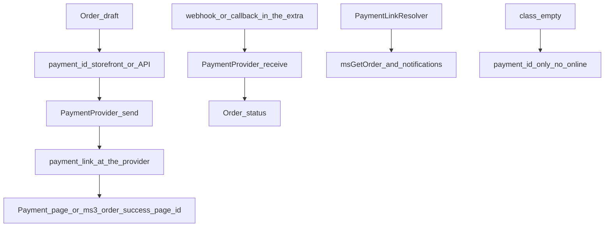

# Payment methods


Open **Extras → MiniShop3 → Settings → Payments**.

## For the store owner

1. Create a payment method: name, description, logo, and the active flag.
2. Link it to the [deliveries](/en/components/minishop3/interface/settings/deliveries) you need. Without that link an unlinked pair can still be selected at the `order/add` step — the refusal comes later, at `order/submit`, with the `ms3_order_err_payment_delivery` lexicon entry.
3. For payment on delivery, leave `class` empty. The order stores the selected `payment_id`.
4. For online payment, install a payment extra from the catalog (for example [msp3YooKassa](/en/components/msp3yookassa/), [mspTBank](/en/components/msptbank/), [msp3Sberbank](/components/msp3sberbank/)) and set the handler class in `class`, as that package's docs describe.
5. Check the redirect after payment: `ms3_order_success_page_id` and the Thank-you page with `msGetOrder`.

Surcharge in the `price` field:

- `100` is a fixed amount added to the order
- `3%` is a percent of the cart total — delivery is not part of the commission base
- `-5%` — a negative value works as a discount

The allowed percent runs from −100 to 100. Outside that range the surcharge is zeroed and the value is written to the error log.

## Payment fields

| Field | Type | Description |
| --- | --- | --- |
| `name` | string | Payment method name |
| `description` | text | Description for the customer |
| `price` | string | Surcharge (a number or a percent) |
| `logo` | string | Path to the image |
| `position` | int | Sort order |
| `active` | bool | Active flag |
| `class` | string | PHP class of the payment handler |
| `properties` | JSON | Handler settings |

## Link with delivery

You edit the pairs on the delivery card. Typical sets:

- Pickup: cash, card on delivery
- Courier: cash, card, online
- Post: cash on delivery, online

## Payment handlers

There are no built-in handlers. Online payment comes from a payment extra in the catalog, or from your own class. The class extends the abstract `Payment` and is set on the payment method card. Ready-made payment services are described in the extra's documentation. Only `send()` and `receive()` are required:

```php
<?php
namespace MyComponent\Payment;

use MiniShop3\Controllers\Payment\Payment;
use MiniShop3\Model\msOrder;

class MyPayment extends Payment
{
    public function send(msOrder $order): array
    {
        // Create a payment at the provider. return_url: ms3_order_success_page_id
        // Payment row of the method: $this->config['payment']
        return [
            'success' => true,
            'data' => ['payment_link' => '...'],
        ];
    }

    public function receive(msOrder $order): array
    {
        // Provider webhook or callback
        return ['success' => true, 'message' => 'Payment received'];
    }
}
```

You do not need to override the constructor. The base `Payment::__construct(MiniShop3 $ms3, array $config = [])` sets `$this->modx` and `$this->ms3`. The service builds the handler as `new $class($ms3, ['payment' => $payment])`. If you need keys from `properties`, call `parent::__construct($ms3, $config)` in your own constructor. `getCost()` (the surcharge from the `price` field), `getPaymentLink()`, and `getOrderHash()` (HMAC-SHA256 over `ms3_payment_secret`) are already implemented in the base class. Override only your own logic.

Registration in the `class` field:

```text
MyComponent\Payment\MyPayment
```

Payment service secrets go in `properties` (JSON) on the payment card. The settings interface does not edit that field — it is absent from both the payment and the delivery dialog: write the value through the Manager API (`PUT /api/mgr/payments/{id}`), from the payment extra's own page, or directly in the database.

```json
{
  "shop_id": "123456",
  "secret_key": "live_xxx...",
  "test_mode": false
}
```

In code: `$this->config['payment']->get('properties')`.

## Payment notifications (webhook / callback)

The core ships a receiver of its own: `POST /api/v1/payment/webhook/{payment_method_id}`. The route is public — `TokenMiddleware` lets it through, and the handler verifies the signature itself.

The payment class implements `PaymentWebhookHandlerInterface` with two methods: `verifyWebhook()` for authenticity, taking the raw body, the parsed payload and the headers, and `parseWebhook()` which turns the payload into a `PaymentWebhookEvent`. For HMAC the base class offers `Payment::verifyWebhookHmac()`; the secret comes from the payment card `properties` under `secret`, `secret_key` or `webhook_secret`, and falls back to the `ms3_payment_secret` system setting. `PaymentLifecycleService` (the `ms3_payment_lifecycle` service) applies the event.

Some payment extras still keep a receiver of their own (`webhook.php` or `callback.php` under `assets/components/{ns}/`) — see the docs of that service ([msp3YooKassa](/en/components/msp3yookassa/), [mspTBank](/en/components/msptbank/), and others).

The payment class implements `send()` and accepts the notification. From that notification it changes the order status. The payment link in emails and in `msGetOrder` is built by `PaymentLinkResolver`.



## API

### Deliveries and payments in the order draft

Public lists (no token): `GET /api/v1/delivery/list`, `GET /api/v1/payment/list`. There is no separate `GET /api/v1/order/payments`.

The draft:

```http
GET /api/v1/order/get
```

`data.order` holds the order fields, including `delivery_id` / `payment_id` and `address_*`. To change the method, call `POST /api/v1/order/add` or `POST /api/v1/order/set` with a wrapper body `{"fields": {"payment_id": 2}}`. The Fenom storefront can render the choice through `msOrder`.

### Payment cost

The endpoint computes the fee for the payment method already set on the draft and reads no request parameters. To price another method, write it first through `order/add` or `order/set`.

```http
GET /api/v1/order/cost/payment
```

**Response:**

```json
{
    "success": true,
    "data": {
        "cost": 150.00
    }
}
```

Full totals (cart, delivery, and payment): `GET /api/v1/order/cost`. Web API map: [Checkout](/en/components/minishop3/development/web-api/checkout).

## Payment link (`payment_link`)

On the thank-you page and in emails, `PaymentLinkResolver` (`ms3_payment_link_resolver`) builds the payment URL:

- in **msGetOrder**, the `payStatus` parameter (a CSV of statuses)
- in **notifications**, the setting `ms3_payment_link_statuses` (a CSV of status ids, hidden, not declared in System settings, set directly in the database or in code). If it is empty, `ms3_status_new` is used
- the link is **not** shown for final statuses or the paid status

The payment method handler must return a URL from the payment method (see the `send()` example above). Details: [msGetOrder](/en/components/minishop3/snippets/msgetorder#payment-link).
