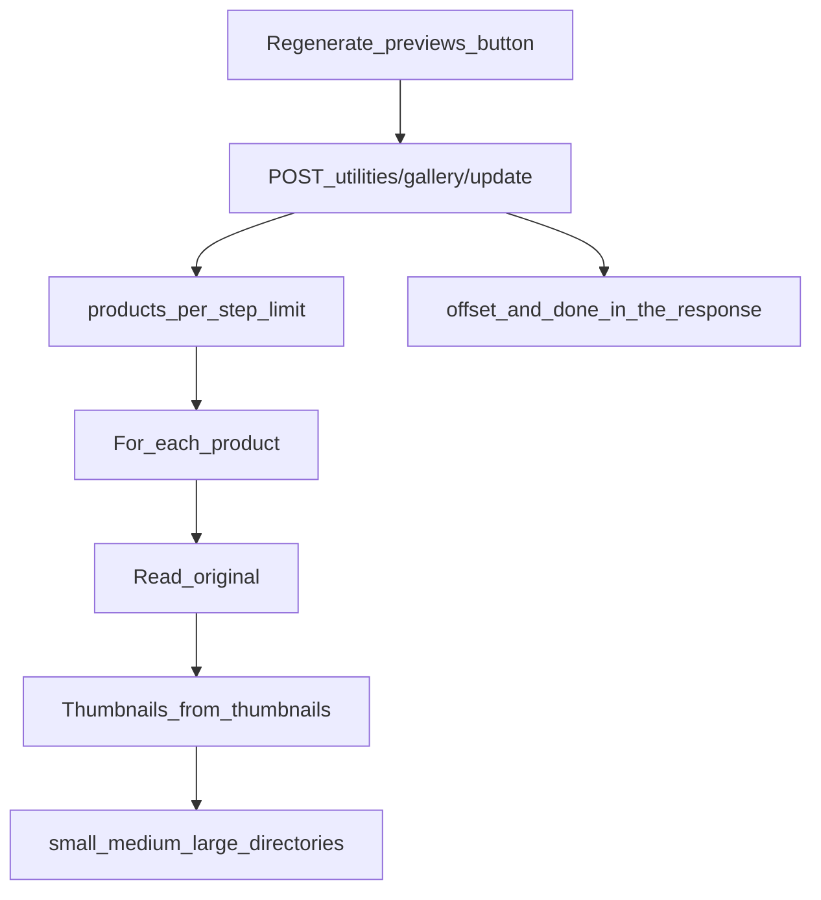

# Utilities: Gallery

Bulk regeneration of thumbnails for every product.

## Purpose

On upload, MiniShop3 creates thumbnails of several sizes at once. Use the utility after you change preview settings, or when you want to rebuild every thumbnail.

## When to use

- After changing the `thumbnails` JSON on the Media Source
- After migrating the site to a new server
- After a bulk image update over FTP
- When thumbnails are damaged or missing
- After a MiniShop3 update that changes image processing

## Interface

Regeneration starts from a button and runs in batches:



### Info panel

Current gallery state:

- **Selected file source** shows the source name and ID
- **Total products** counts every product in the catalogue, whether or not it has a gallery
- **Images** counts originals only (`msProductFile` with `parent_id = 0`); previews are not included

### Preview settings

The collapsible section prints the JSON of each key in the product Media Source property **`thumbnails`** (the same source the gallery uses). Example: `small: {"width":120,"height":120,"mode":"cover",…}`.

::: tip Preview key on the product card
`ms3_product_thumbnail_size` (default `small`) is the **key name** from `thumbnails` that fills the product preview field in the manager. Edit the sizes on the file source: **Media → Media Sources → `thumbnails` property**. An empty JSON uses `small` at 120×120.
:::

### Processing parameters

| Parameter | Description | Default |
| --- | --- | --- |
| Products per step | How many products one iteration processes | 10 |

::: warning Recommendations

The numbers are empirical and depend on the server. The code only fixes the default (10).

- On a weak server, lower the value to 5
- On a strong server, raise it to 20-30
- A large value can hit the timeout
:::

## Workflow

1. Check preview settings and free disk space. Run this when the site is quiet.
2. Click **Regenerate previews**. The utility processes products in batches. The page shows the percent and the current iteration.
3. Closing the page stops the run. When it finishes, the page shows how many products were processed. **Reset** prepares another run.

## Technical details

### Processor

The utility calls `MiniShop3\Processors\Utilities\Gallery\Update` (manager API or `$modx->runProcessor()` with the full class name).

### API endpoint

```http
POST /api/mgr/utilities/gallery/update
```

The route requires `msproductfile_generate`.

**Parameters:**

- `limit` is how many products one iteration processes
- `offset` is the shift for the next batch

**Response:**

```json
{
  "success": true,
  "data": {
    "updated": 10,
    "total": 150,
    "offset": 10,
    "done": false,
    "limit": 10
  }
}
```

### Processing

For each product the utility reads the originals, builds thumbnails for the keys of `thumbnails`, and updates metadata in the database.

### File storage

Directory names are the keys of the `thumbnails` property on your Media Source, and the file extension comes from that key's `format`. The package ships four keys: `thumb`, `small`, `medium` (webp) and `large` (jpg). The file name matches the uploaded one — that is the default `imageNameType: friendly` mode. The tree looks like this:

```text
assets/images/products/
├── {product_id}/
│   ├── smartphone.jpg     # Original (the uploaded file name)
│   ├── thumb/             # 150×150 webp
│   │   └── smartphone.webp
│   ├── small/             # 300×300 webp
│   │   └── smartphone.webp
│   ├── medium/            # 600×600 webp
│   │   └── smartphone.webp
│   └── large/             # 1200×1200 jpg
│       └── smartphone.jpg
```

## Troubleshooting

### Process stops

**Symptom:** Processing stops at a certain percent.

**What to try:**

- Lower the products per step
- Raise `max_execution_time` in PHP
- Check the server error log

### Thumbnails are not created

**Symptom:** Previews are still missing after the run.

**Check:**

- Write permission on `assets/images/`
- GD or ImageMagick on the server
- Preview settings in the system settings

### Error "No products"

**Symptom:** There are no products to process.

**Causes:**

- The catalogue has no products at all, or `offset` ran past the end of the set

There is no other cause: neither the presence of images nor the state of the gallery table affects this error, and products without images are processed silently.
