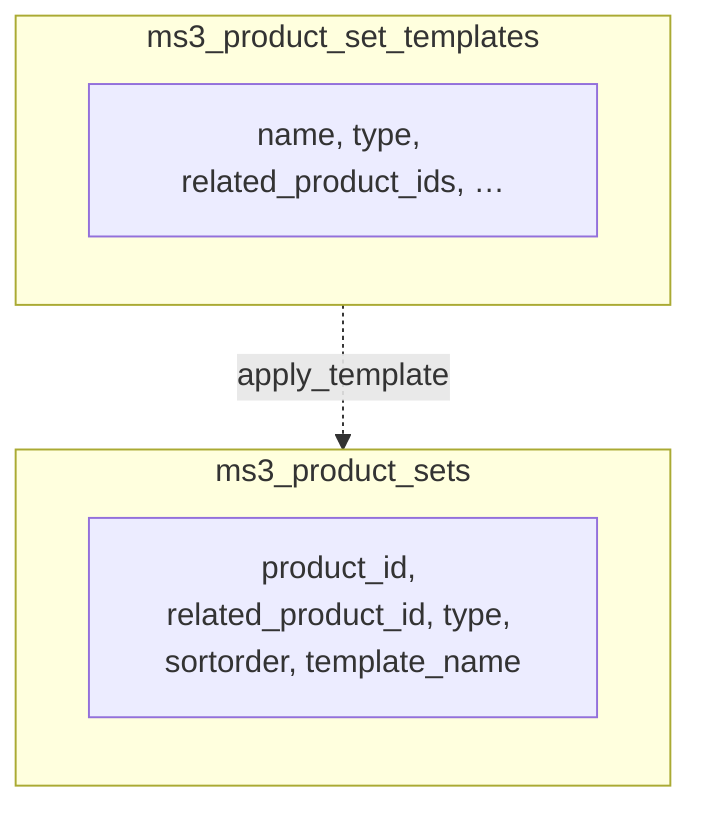
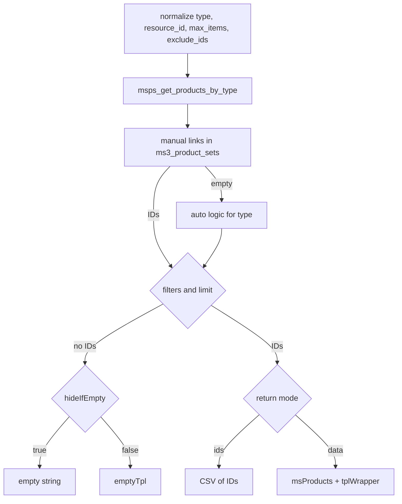
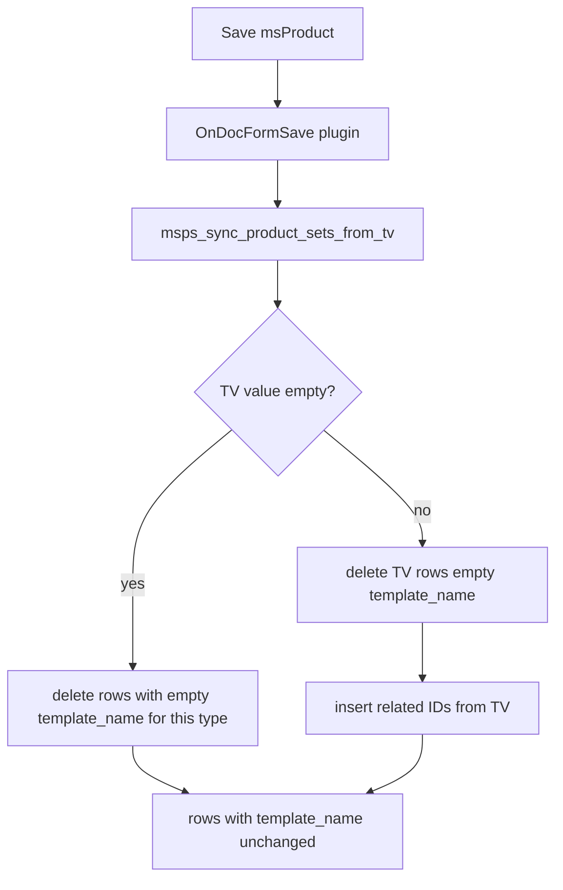

# ms3ProductSets architecture

Related: [Flows](/en/components/ms3productsets/flows), [API](/en/components/ms3productsets/api), [Set types](/en/components/ms3productsets/types).

## Component overview

- **Output snippet:** `ms3ProductSets`. Builds an ID list for the set type and renders via `msProducts`.
- **Lexicon/config snippet:** `mspsLexiconScript`. Exposes `window.mspsLexicon` and `window.mspsConfig`.
- **Connector:** `assets/components/ms3productsets/connector.php`. Single entry for frontend and manager actions.
- **Helpers:** `core/components/ms3productsets/include/helpers.php`. Shared logic for sets, templates and utilities.
- **Plugins:**
  - `OnDocFormSave`: sync TVs into the link table
  - `OnResourceDelete`: clean links for the deleted resource
- **Manager UI:** Vue app in `assets/components/ms3productsets/js/mgr/`.

## Database tables

`template_name` on `ms3_product_sets` rows matches the template name:

### `ms3_product_sets`

Links used to output sets.

- `product_id`: product whose card shows the set
- `related_product_id`: recommended product
- `type`: set type
- `sortorder`: order
- `template_name`: template name when the link came from bulk apply
- `discount`: present in the schema. Helpers never read or write it.
- unique key: (`product_id`, `related_product_id`, `type`)

### `ms3_product_set_templates`

Templates for bulk apply to categories.

- `name`
- `type`
- `related_product_ids` (comma-separated IDs)
- `sortorder`
- `description` (added by upgrade resolver)

## Selection algorithm

1. Normalize parameters (`type`, `resource_id`, `max_items`, `exclude_ids`, chunks).
2. Call `msps_get_products_by_type(...)`: manual links from `ms3_product_sets` first (published, not deleted `msProduct` only). If that list is empty and `ms3productsets.auto_recommendation` is 1, the type's auto logic runs. `vip` does not read the setting. It loads `vip_set_{set_id}`.
3. If no IDs:
   - `hideIfEmpty=true` → `''`
   - else output `emptyTpl`
4. If `return=ids` → return CSV of IDs.
5. Else output via `msProducts` + optional `tplWrapper`.

## Per-type logic

Shared order: manual links in `ms3_product_sets`, then auto when `ms3productsets.auto_recommendation` is 1, then `exclude_ids` and the limit through `msps_apply_set_filters`.

- `vip`: manual `type=vip`. Fallback: `ms3productsets.vip_set_{set_id}`. The auto setting is not read.
- `auto_sales`: table, otherwise co-purchase from orders (statuses `2,4,5`). Fallback `similar` only when that SQL array is empty. Order ids are not filtered before `msProducts`. `category_id` is not used.
- `buy_together`, `also-bought`, `cross-sell`: table, otherwise `auto_sales`, otherwise category auto (`msps_get_auto_recommendations`, including `category_id`).
- `similar`: table, otherwise `msps_get_similar_products` (same `parent`, shuffle). `category_id` is not read.
- `cart_suggestion`: table, otherwise category auto / `category_id`.
- `popcorn`: table, otherwise the current product's category, otherwise auto with `resource_id=0`.
- `auto`, `custom`: table for that `type`, otherwise category auto.

Manual table rows also pass through `exclude_ids`.

## Set cache

When `ms3productsets.cache_lifetime` is greater than 0, `msps_get_products_by_type` is cached.

Key: `ms3productsets/sets/{generation}/{md5(...)}`. `generation` is the counter from `msps_get_cache_generation()`. `msps_bump_cache_generation` runs on template save/delete, apply/unbind, TV sync, and resource cleanup.

The md5 includes `type`, `resource_id`, `category_id`, `set_id`, `limit`, and sorted `exclude_ids`.

## TV -> table data flow

1. Manager fills set TVs (`ms3productsets_*`) on the product.
2. `OnDocFormSave` checks those TVs exist on the resource template.
3. `msps_sync_product_sets_from_tv`:
   - TV **has a value:** removes only rows with empty `template_name` (TV rows), then inserts new IDs from the TV. Template-based links stay.
   - TV is **empty:** removes only rows **without** `template_name`. Links created by bulk category templates are kept.

## Bulk template apply flow

1. Manager UI calls `apply_template`.
2. Categories expand recursively down to products (`msProduct`).
3. Template is read from `ms3_product_set_templates`.
4. Rows are inserted into `ms3_product_sets` with `template_name`.
5. With `replace=true`, only links of this `type` **and** this `template_name` are removed first. Other templates and TV rows stay.
