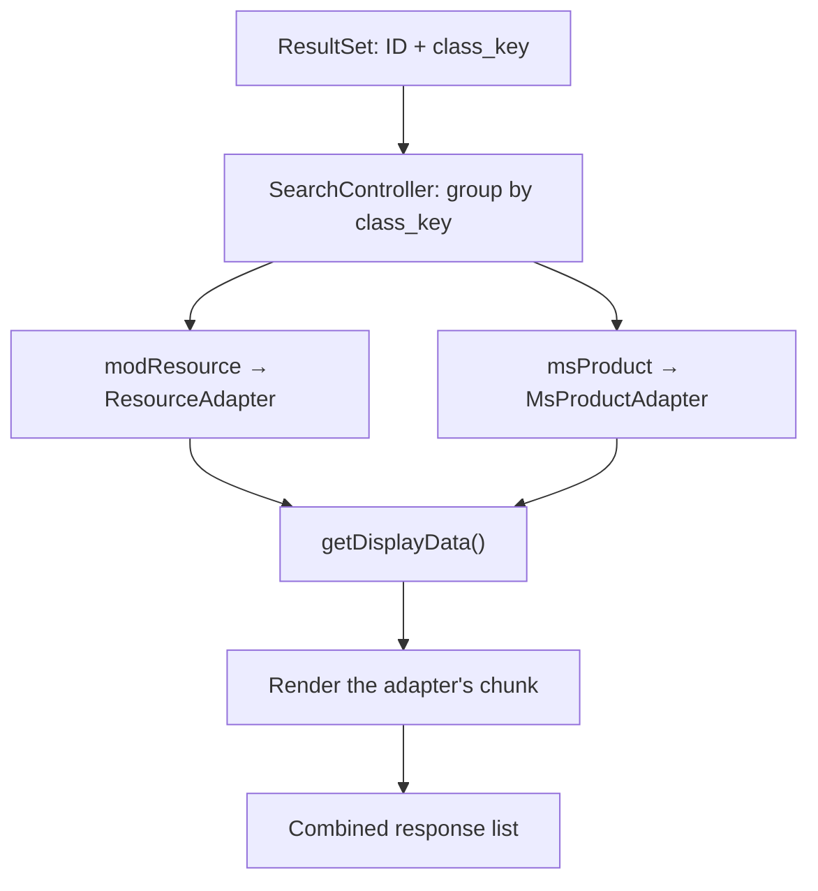

# Extending the component

The mSearch architecture is built around **adapters**: each object type is served by its own adapter implementing `ContentAdapterInterface`. The interface is designed for any xPDO objects — comments, products, users, third-party models.

::: warning Indexing is limited to resources in the current version
`Indexer::indexResource()` loads every object as `modResource` by its ID, and `$msearch->index()` and batch indexing go through it. So in practice the index gets only `modResource` and its subclasses (e.g. miniShop3 products). An adapter for a model that is not a resource (like the Tickets comments example below) is registered, but its objects are not indexed correctly: the indexer looks for a resource with the same ID.
:::

## Architecture

```
┌──────────────────────────────────────────────────────────────┐
│                          Indexer                             │
│   ┌──────────────┐  ┌──────────────┐  ┌──────────────────┐   │
│   │ Resource     │  │ MsProduct    │  │ Custom           │   │
│   │ Adapter      │  │ Adapter      │  │ Adapter          │   │
│   │ priority 0   │  │ priority 10  │  │ priority N       │   │
│   └──────────────┘  └──────────────┘  └──────────────────┘   │
└──────────────────────────────────────────────────────────────┘
                          ▼
┌──────────────────────────────────────────────────────────────┐
│                       Index tables                           │
│   mse_words (resource, field, word, count, class_key)        │
│   mse_intro (resource, intro, class_key)                     │
└──────────────────────────────────────────────────────────────┘
```

The adapter's responsibilities are described in `ContentAdapterInterface` — every method has a comment.

## ContentAdapterInterface

```php
<?php

namespace MSearch\Adapters;

interface ContentAdapterInterface
{
    /**
     * Whether the adapter supports the given class
     */
    public function supports(string $className): bool;

    /**
     * Short type identifier (e.g. "resource", "product")
     * Used for routing suggestion chunks
     */
    public function getType(): string;

    /**
     * Indexable fields with weights: [field => weight]
     */
    public function getIndexableFields(): array;

    /**
     * Extracts text from an object field
     */
    public function extractContent(object $object, string $field): string;

    /**
     * Iterator of objects for batch indexing
     */
    public function getObjects(array $criteria, int $limit, int $offset): iterable;

    /**
     * Total number of objects
     */
    public function getTotal(array $criteria = []): int;

    /**
     * Adapter priority (higher = picked earlier when supports() matches)
     */
    public function getPriority(): int;

    /**
     * Batch loading of placeholders for rendering suggestions/results.
     *
     * Returns [id => array_of_placeholders]. The adapter highlights
     * the needed fields itself when $query is not empty and adds computed
     * fields (url, type, class_key, context_key).
     *
     * $options may contain `element` (name of an external loader snippet)
     * and `elementProperties` — the adapter decides whether to use them.
     */
    public function getDisplayData(array $ids, string $query = '', array $options = []): array;

    /**
     * Default chunk name for an autocomplete suggestion row
     */
    public function getDefaultSuggestTpl(): string;

    /**
     * Default chunk name for a full search result row
     */
    public function getDefaultResultTpl(): string;
}
```

## AbstractAdapter base class

Extend `AbstractAdapter`: it provides default implementations and helper methods.

### Default implementations

| Method | Default behavior |
|--------|------------------|
| `getPriority()` | `0` |
| `getType()` | Class name in lowercase without the `Adapter` suffix |
| `getDisplayData()` | Empty array (the adapter does not take part in rendering) |
| `getDefaultSuggestTpl()` | `'mSearch.suggest.row'` |
| `getDefaultResultTpl()` | `'mSearch.row'` |

### Methods you must implement

`AbstractAdapter` does not implement these methods — a subclass must provide them:

- `supports(string $className): bool`
- `getIndexableFields(): array`
- `extractContent(object $object, string $field): string`
- `getObjects(array $criteria, int $limit, int $offset): iterable`
- `getTotal(array $criteria = []): int`

The other interface methods have working default implementations (see the table above) and are overridden as needed.

### Helper methods

| Method | Purpose |
|--------|---------|
| `cleanText(string $text)` | Strips HTML tags, decodes HTML entities, normalizes whitespace |
| `parseFieldWeights(string $fields)` | Parses a `field1:3,field2:1` string into `[field => weight]` |
| `extractTvContent(object $object, string $tvName)` | Extracts a TV value — supports scalars and JSON (MIGX) |
| `flattenArray(array $array)` | Turns a multidimensional array into a string of its string leaf values |
| `loadIntros(int[] $ids)` | Batch loading of `mse_intro` by a list of IDs |
| `loadViaElement(string $element, int[] $ids, array $extraProps = [])` | Calls an external snippet (`runSnippet`) with an existence check and JSON response validation. The `resources` and `return` keys are always overridden |
| `highlight(string $text, string $query, array $options = [])` | Wrapper over `MSearch::highlight()` — returns an HTML-safe string (escape + `<mark>`) |
| `parseTvFields(string $includeTVs, string $tvPrefix = '')` | Parses a comma-separated TV list into placeholder names (with the prefix), collapses duplicates |
| `highlightableTvFields(array $tvFields, array $extraReserved = [], string $processTVs = '', string $prepareTVs = '', string $tvPrefix = '')` | Selects TVs that can be highlighted: excludes reserved fields and those rendered via `processTVs`/`prepareTVs` |
| `highlightTvFields(array $data, array $row, array $tvFields, string $query)` | Highlights the listed TV values in `$data` using the raw values from `$row`, returns a modified copy |

### Constructor

```php
public function __construct(
    \MODX\Revolution\modX $modx,
    \MSearch\MSearch $msearch,
    array $config = []
)
```

## Registering an adapter via `mseOnRegisterAdapters`

The adapter is registered in Indexer at startup — by subscribing to the event:

| Event parameter | Type | Description |
|-----------------|------|-------------|
| `indexer` | `Indexer` | Indexer service. Call `addAdapter()` on it |

```php
<?php
// Plugin on the mseOnRegisterAdapters event
/** @var MSearch\Services\Indexer\IndexerInterface $indexer */
$indexer = $scriptProperties['indexer'];

if (class_exists(\MyApp\Model\Article::class)) {
    $indexer->addAdapter(new \MyApp\Adapters\ArticleAdapter(
        $modx,
        $modx->services->get('msearch')
    ));
}
```

All events are described in detail in [Plugin and events](/en/components/msearch/plugin-and-events).

## Example: adapter for Tickets comments {#tickets-comments-adapter}

Suppose you have a `Tickets\Model\TicketComment` model and want to index comment texts.

::: warning Not indexed in the current version
`TicketComment` is not a resource, so with the current `Indexer` (see the note at the top of the page) comments do not get into the index. The example shows the adapter contract: `getDisplayData()`, the suggestion chunk and registration work as described.
:::

### Step 1. Adapter class

File: `core/components/tickets/src/Adapters/TicketCommentAdapter.php`

```php
<?php

namespace Tickets\Adapters;

use MSearch\Adapters\AbstractAdapter;
use Tickets\Model\TicketComment;

class TicketCommentAdapter extends AbstractAdapter
{
    public function getType(): string
    {
        return 'comment';
    }

    public function getPriority(): int
    {
        return 10;
    }

    public function supports(string $className): bool
    {
        if (!class_exists(TicketComment::class)) {
            return false;
        }
        return $className === TicketComment::class
            || is_subclass_of($className, TicketComment::class);
    }

    public function getIndexableFields(): array
    {
        return [
            'text' => 1,
            'name' => 2,
        ];
    }

    public function extractContent(object $object, string $field): string
    {
        $value = $object->get($field);
        return $value === null ? '' : $this->cleanText((string) $value);
    }

    public function getObjects(array $criteria, int $limit, int $offset): iterable
    {
        $c = $this->modx->newQuery(TicketComment::class);
        $c->where([
            'published' => true,
            'deleted' => false,
        ]);
        $c->sortby('id', 'ASC');
        $c->limit($limit, $offset);

        return $this->modx->getIterator(TicketComment::class, $c);
    }

    public function getTotal(array $criteria = []): int
    {
        return $this->modx->getCount(TicketComment::class, [
            'published' => true,
            'deleted' => false,
        ]);
    }

    public function getDisplayData(array $ids, string $query = '', array $options = []): array
    {
        if (empty($ids)) {
            return [];
        }

        // Batch-load comments via raw PDO for speed
        $table = $this->modx->getTableName(TicketComment::class);
        $placeholders = implode(',', array_fill(0, count($ids), '?'));
        $sql = "SELECT id, text, name, createdon, ticket_id FROM {$table}
                WHERE id IN ({$placeholders}) AND published = 1 AND deleted = 0";

        $rows = [];
        $stmt = $this->modx->prepare($sql);
        if ($stmt && $stmt->execute(array_values($ids))) {
            while ($row = $stmt->fetch(\PDO::FETCH_ASSOC)) {
                $rows[(int) $row['id']] = $row;
            }
            $stmt->closeCursor();
        }

        $result = [];
        foreach ($ids as $id) {
            if (!isset($rows[$id])) {
                continue;
            }
            $row = $rows[$id];
            $ticketUrl = $this->modx->makeUrl((int) $row['ticket_id'], '', '', 'full');

            $result[$id] = [
                'id' => (int) $id,
                'type' => $this->getType(),
                'url' => $ticketUrl . '#comment-' . $id,
                'text' => $this->highlight((string) $row['text'], $query),
                'name' => $this->highlight((string) $row['name'], $query),
                'name_raw' => (string) $row['name'],
                'createdon' => $row['createdon'],
            ];
        }

        return $result;
    }

    public function getDefaultSuggestTpl(): string
    {
        return 'mSearch.suggest.comment';
    }

    public function getDefaultResultTpl(): string
    {
        return 'mSearch.row.comment';
    }
}
```

### Step 2. Registration plugin

Create a MODX plugin subscribed to `mseOnRegisterAdapters`:

```php
<?php
/** @var MSearch\Services\Indexer\IndexerInterface $indexer */
$indexer = $scriptProperties['indexer'];

if (!class_exists(\Tickets\Model\TicketComment::class)) {
    return;
}

$indexer->addAdapter(new \Tickets\Adapters\TicketCommentAdapter(
    $modx,
    $modx->services->get('msearch')
));
```

### Step 3. Auto-indexing on save

Create a plugin subscribed to Tickets events (the names may differ depending on the component version):

```php
<?php
if (!$modx->services->has('msearch')) {
    return;
}

/** @var \MSearch\MSearch $msearch */
$msearch = $modx->services->get('msearch');

switch ($modx->event->name) {
    case 'OnTicketCommentSave':
        /** @var \Tickets\Model\TicketComment $comment */
        $comment = $scriptProperties['object'];

        if ($comment->get('published') && !$comment->get('deleted')) {
            $msearch->index($comment->get('id'));
        } else {
            $msearch->removeFromIndex($comment->get('id'));
        }
        break;

    case 'OnTicketCommentRemove':
        $comment = $scriptProperties['object'];
        $msearch->removeFromIndex($comment->get('id'));
        break;
}
```

::: warning
`$msearch->index()` and `$msearch->removeFromIndex()` take a **resource** ID. In the current version calling them with a comment ID indexes or removes the resource with the same ID, not the comment.
:::

### Step 4. Suggestion chunk

The adapter's default name is `mSearch.suggest.comment`. Create the chunk in the manager:

```fenom
<a href="{$url}" class="mse-suggest-item mse-suggest-item--comment">
    <span class="mse-suggest-body">
        <span class="mse-suggest-title">{$name}</span>
        <span class="mse-suggest-text">{$text}</span>
        <span class="mse-suggest-date">{$createdon | date : 'd.m.Y'}</span>
    </span>
</a>
```

Since your adapter builds the placeholders, you are free to choose any names — they just have to match in `getDisplayData()` and in the chunk.

## Example: extending MsProductAdapter

The built-in `MsProductAdapter` for miniShop3 is already registered automatically when `class_exists(\MiniShop3\Model\msProduct::class)`. If you need to change its behavior (e.g. add your own fields or different loading logic), extend it and register your adapter with a higher priority:

```php
<?php

namespace MyApp\Adapters;

use MSearch\Adapters\MsProductAdapter;

class MyProductAdapter extends MsProductAdapter
{
    public function getPriority(): int
    {
        return 20; // higher than the built-in one (10)
    }

    public function getIndexableFields(): array
    {
        return array_merge(parent::getIndexableFields(), [
            'tv_bundle_keywords' => 4,
            'tv_seo_text' => 2,
        ]);
    }

    public function extractContent(object $object, string $field): string
    {
        // Delegate standard TV field handling to the parent
        return parent::extractContent($object, $field);
    }
}
```

It is registered the same way — with a plugin on `mseOnRegisterAdapters`.

## Integration via an external snippet (element)

In the `mSearchForm` snippet you can set `&element=msProducts` — then the adapter loads data through that snippet instead of its own SQL. This gives access to all the snippet's events (e.g. miniShop3 discount plugins) and its own formatting.

In an adapter, element integration is implemented with the `loadViaElement()` helper:

```php
public function getDisplayData(array $ids, string $query = '', array $options = []): array
{
    $element = (string) ($options['element'] ?? '');
    $elementProps = is_array($options['elementProperties'] ?? null)
        ? $options['elementProperties']
        : [];

    $rows = $element !== ''
        ? $this->loadViaElement($element, $ids, $elementProps)
        : $this->loadNatively($ids);

    if (empty($rows)) {
        return [];
    }

    return $this->enrich($rows, $ids, $query);
}
```

The adapter decides whether it supports the given `element` — if not, it can ignore `$options['element']` and always take the native path.

`loadNatively()` and `enrich()` in the example are not `AbstractAdapter` methods but the adapter's own methods written by its author (as in `MsProductAdapter`). The base class provides only `loadViaElement()`, `loadIntros()` and the other helpers from the table above.

::: warning Security
`$element` comes from the `mSearchForm` snippet configuration stored in the MODX cache. Never pass a value that comes directly from the client to `loadViaElement()` — `runSnippet()` executes the named snippet, and with an arbitrary name this becomes RCE.
:::

## Programmatic usage

### Indexing

```php
<?php
/** @var \MSearch\MSearch $msearch */
$msearch = $modx->services->get('msearch');

// A single resource
$msearch->index($resourceId);

// Batch indexing
$result = $msearch->indexBatch([
    'limit' => 100,
    'offset' => 0,
]);
// ['indexed' => 95, 'offset' => 100, 'total' => 500, 'done' => false]

// Remove from the index
$msearch->removeFromIndex($resourceId);

// Clear the whole index
$msearch->clearIndex();
```

### Search and working with ResultSet

```php
<?php
/** @var \MSearch\MSearch $msearch */
$msearch = $modx->services->get('msearch');

$results = $msearch->search('buy smartphone', [
    'limit' => 20,
    'offset' => 0,
    'contexts' => ['web'],
    // 'class_keys' => ['MiniShop3\Model\msProduct'], // filter by class (optional)
]);

$results->getTotal();        // total count
$results->getIds();          // array of IDs in relevance order
$results->toArray();         // [id => weight]
$results->isEmpty();         // no results?

// Resource class by ID (mSearch 1.3.0+)
$results->getClassKey(123);  // 'MODX\Revolution\modResource' / 'MiniShop3\Model\msProduct' / ...

// All classes at once
$results->getClasses();      // [id => class_key]

// Grouping by class — for routing to adapters
$grouped = $results->groupByClass();
// [
//     'MODX\Revolution\modResource' => [12, 34, 56],
//     'MiniShop3\Model\msProduct' => [78, 90],
// ]

foreach ($results as $id => $weight) {
    // iteration in relevance order
}
```

### Highlighting

```php
<?php
/** @var \MSearch\MSearch $msearch */
$msearch = $modx->services->get('msearch');

$highlighted = $msearch->highlight($text, $query, [
    'tagOpen' => '<mark>',
    'tagClose' => '</mark>',
]);
```

`highlight()` highlights the whole text without truncation. The default tags are `<mark class="mse-highlight">` and `</mark>`. The `ellipsisLength` and `ellipsis` options are accepted but have no effect on `highlight()`.

::: tip HTML-safe by default
Since version 1.3.0 `Highlighter` escapes the input text with `htmlspecialchars` **before** wrapping matches in `<mark>`. The result can be safely inserted into the DOM via `innerHTML` or output in a chunk without an extra `|escape`.
:::

## Adapter priority

Adapters are sorted by priority (`getPriority()`) — a larger value means closer to the start. When indexing each object, `Indexer::getAdapter()` returns the **first** adapter whose `supports($className)` returned `true`.

```
MyProductAdapter   (priority 20)   ← checked first
MsProductAdapter   (priority 10)
TicketCommentAdapter (priority 10)
ResourceAdapter    (priority 0)    ← fallback for everything modResource-related
```

`ResourceAdapter` has priority `0` and `supports(modResource::class || is_subclass_of)` — it picks up any `modResource` descendant that has no specialized adapter. So to add your own adapter it is enough to give it a priority `> 0`.

## The class_key field

The `mse_words` and `mse_intro` index tables store the `class_key` of every entry. Thanks to this:

- Resources, products and other models coexist in the same tables.
- During a search `Searcher` returns a `ResultSet` in which every ID is mapped to its `class_key`.
- `SearchController` groups results by `class_key` and for each group calls its adapter with its own `getDisplayData()` and row template.
- Suggestion chunk routing is transparent for the snippet user (see "Chunk naming conventions" below).



## Chunk naming conventions

Default names for the built-in adapters:

| Adapter | Suggest | Result |
|---------|---------|--------|
| `ResourceAdapter` | `mSearch.suggest.row` | `mSearch.row` |
| `MsProductAdapter` | `mSearch.suggest.row` | `mSearch.row` |

Since version 1.3.0 all built-in adapters use **one shared** `mSearch.suggest.row` chunk — it branches on the `{$type}` placeholder (`product` / `resource`). Your own adapter can set its own name via `getDefaultSuggestTpl()` — e.g. `mSearch.suggest.comment` for comments.
