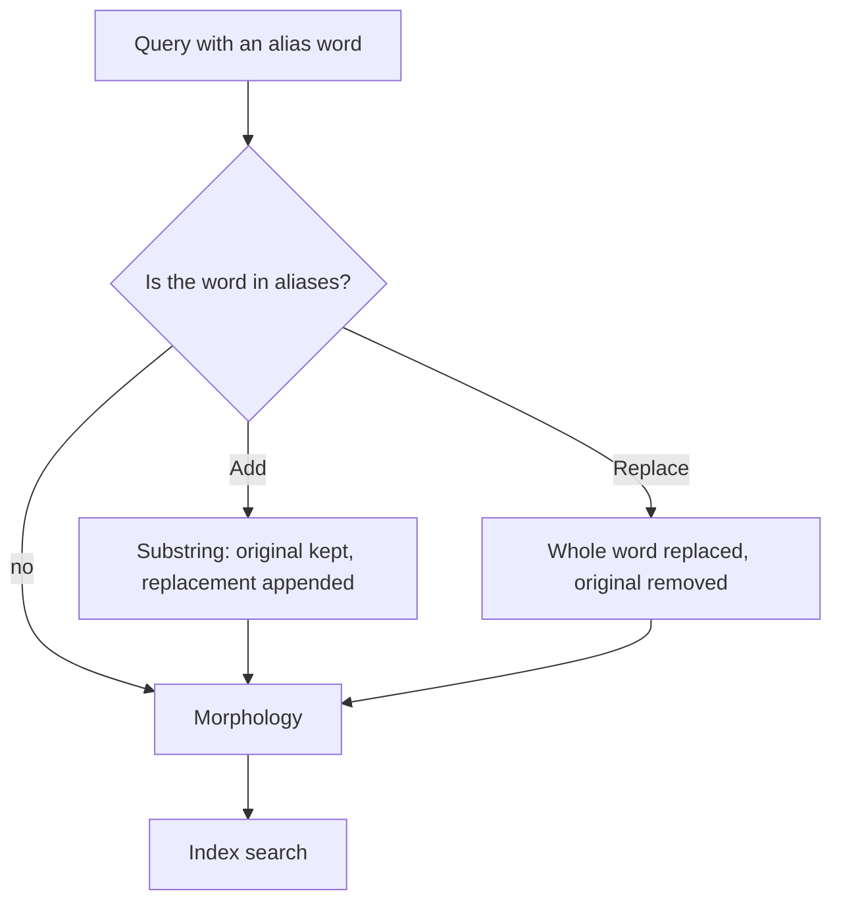

# Aliases

Tab for managing synonyms and replacements of search words.

## Purpose

Aliases link different spellings of words and broaden search results. They are used for:

- Fixing typos
- Adding synonyms
- Transliteration
- Linking brands with alternative names

## Modes

In the manager the mode is set by the **Full replace** flag and shown in the table as "Add" or "Replace".

### Add (synonym)

The "Full replace" flag is off. The replacement is appended to the query, the original is kept.

**Example:** alias `notebook` → `laptop`

- Query: "notebook bag"
- Searching for: "notebook", "laptop", "bag"

It triggers on a substring match: if "notebook" occurs inside another word, the replacement is still appended to the end of the query. The match ignores case only for Latin letters: for a word in another script (e.g. Cyrillic) the case in the query must match the alias.

### Replace

The "Full replace" flag is on. The original word is replaced with the replacement.

**Example:** alias `notbook` → `notebook`

- Query: `notbook bag`
- Searching for: "notebook", "bag"

It triggers only on a whole word (by word boundaries) — occurrences inside other words are not affected. The match is case-insensitive.

## Interface

### Aliases table

| Column | Description |
|--------|-------------|
| Word | Original word (what the user searches for) |
| Replacement | Word to replace with / append |
| Full replace | `Replace` — replacement, `Add` — synonym |
| Active | Alias status |

### Actions

| Button | Description |
|--------|-------------|
| Create alias | Add a new alias |
| Edit | Change an existing alias |
| Remove | Remove an alias (asks for confirmation) |

## Creating an alias

1. Click **Create alias**
2. Fill in the fields:
   - **Word** — what the user searches for (required)
   - **Replacement** — what to replace it with or what to append (required)
   - **Full replace** — turn on for the replace mode
   - **Active** — enable/disable the alias
3. Click **Save**

The "Word" and "Replacement" fields are required — saving fails without them.

## Usage examples

### Fixing typos

| Word | Replacement | Mode |
|------|-------------|------|
| `samsumg` | `samsung` | Replace |
| `aple` | `apple` | Replace |
| `xiomi` | `xiaomi` | Replace |

### Adding synonyms

| Word | Replacement | Mode |
|------|-------------|------|
| `phone` | `smartphone` | Add |
| `notebook` | `laptop` | Add |
| `printer` | `mfp` | Add |

### Brand transliteration

| Word | Replacement | Mode |
|------|-------------|------|
| `найк` | `nike` | Replace |
| `адидас` | `adidas` | Replace |
| `пума` | `puma` | Replace |

### Abbreviations

| Word | Replacement | Mode |
|------|-------------|------|
| `pc` | `computer` | Add |
| `tv` | `television` | Add |
| `cell` | `mobile phone` | Replace |

## Recommendations

### Analyze queries

Check the [Queries](/en/components/msearch/interface/queries) tab regularly:

1. Find queries with zero results
2. Check whether there is relevant content
3. If there is, create an alias

### Do not overuse

- Create aliases only for real synonyms
- Avoid overly generic replacements
- Test search results after adding an alias

### Aliases come before morphology

Aliases are applied **before** morphological analysis. If a word is recognized by the morphological dictionary, its word forms are taken into account too.

Words shorter than `mse_index_min_word_length` (3 by default) are dropped from the query after aliases are applied — so the replacement or the appended synonym must be at least that long, otherwise it does not affect the search.

## Differences from mSearch2

| Aspect | mSearch2 | mSearch |
|--------|----------|---------|
| Name | Synonyms | Aliases |
| Modes | Synonyms only (add) | Add and replace |
| Interface | ExtJS | Vue 3 + PrimeVue |
