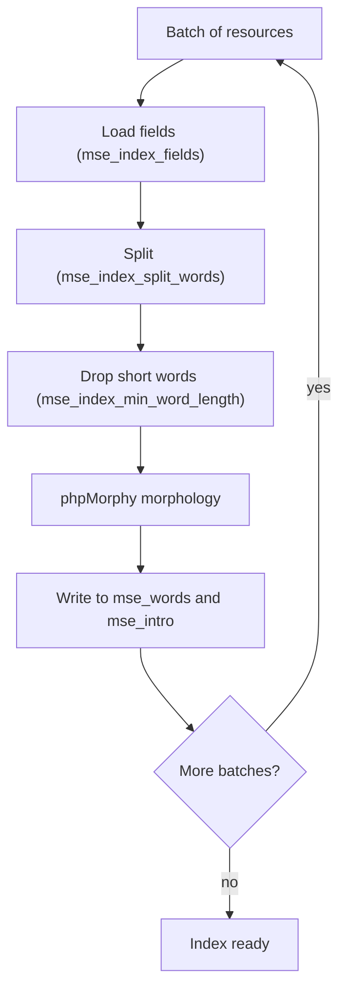

# Indexing

Tab for creating and managing the search index (the **Index** tab in the manager).

## Purpose

Building the index is a resource-heavy operation, so it runs in batches via Ajax requests.

## Interface


### Statistics

| Metric | Description |
|--------|-------------|
| Total resources | Number of indexable resources: published, not in the trash, with searchable set (not all resources in the tree) |
| Indexed | Number of resources in the index |
| Words in index | Total number of words |

### Controls

| Control | Description |
|---------|-------------|
| Batch size | Number of resources processed per request (1–500, default 50) |
| Create index | Start indexing |
| Clear index | Remove all entries from the index (asks for confirmation) |

### Progress bar

Shows the completion percentage during indexing.

## How indexing works

1. **Data extraction** — resource fields are loaded from the database according to the `mse_index_fields` setting
2. **Splitting into words** — the text is split by the regular expression from `mse_index_split_words`
3. **Filtering** — words shorter than `mse_index_min_word_length` characters are dropped
4. **Morphological analysis** — base forms are generated for each word via phpMorphy
5. **Saving** — words with their counts are written to the index table, and the full text of the indexed fields to `mse_intro`



## System settings

The related settings are in the **Indexing** area — see the full description on the [System settings](/en/components/msearch/system-settings#index-settings) page.

## Field weights

The `mse_index_fields` setting defines how valuable words in different fields are. Format:

```
field1:weight1,field2:weight2,...
```

The higher the weight, the higher results with matches in that field rank.

### Example configurations

**Standard:**

```
pagetitle:3,longtitle:2,description:2,introtext:2,content:1
```

**With TVs:**

```
pagetitle:3,content:1,tv_subtitle:2,tv_keywords:3
```

**For MiniShop3 products** — weights are set in a separate setting, `mse_index_fields_product` (not in `mse_index_fields`): products are indexed by a separate adapter.

```
pagetitle:3,longtitle:2,description:2,introtext:2,article:3
```

The `article` field is specific to `msProduct`. There is no point in listing fields a product does not have (e.g. the vendor name) — the adapter returns nothing for them.

## When to reindex

The index is updated automatically when resources are saved. A full reindex is needed:

- On the first installation of the component
- After changing the indexing system settings
- After a bulk content import

## Recommendations

| Batch size | Use case |
|-------|----------|
| 50 | Default value for most servers |
| 10–20 | For weak servers or large documents |
| 100+ | For powerful servers with fast hosting |

::: tip Optimal value
If you get timeout errors during indexing, reduce the batch size.
:::

## Scheduler integration

mSearch supports deferred indexing via the [Scheduler](/en/components/scheduler/) component. It lets you index resources in the background without slowing down document saves.

### Enabling

1. Install the **Scheduler** component
2. Turn on the `mse_use_scheduler` system setting

### How it works

On resource save:

| Without Scheduler | With Scheduler |
|-------------------|----------------|
| Indexing runs immediately | A task is added to the queue |
| Slows down saving | Saving is instant |
| Blocks the interface | Indexing runs in the background |

### The mse_index_resource task

The task is registered automatically when mSearch is installed (if Scheduler is already installed).

**Parameters:**

| Parameter | Description |
|-----------|-------------|
| `resource_id` | ID of the resource to index |
| *(no parameters)* | Full reindex of all resources |

### Running a full reindex manually

You can run a full reindex via Scheduler:

1. Go to **Extras → Scheduler**
2. Find the `mse_index_resource` task (namespace: `msearch`)
3. Run the task without parameters

::: tip Regular reindex
With Scheduler you can set up a periodic reindex, e.g. once a week.
:::

### Logging

The task writes its progress to the MODX log:

```
[mSearch indexResource task] Starting full reindex...
[mSearch indexResource task] Progress: 100/500 (indexed: 100)
[mSearch indexResource task] Progress: 200/500 (indexed: 200)
...
[mSearch indexResource task] Full reindex completed. Total indexed: 500
```

### Fallback without Scheduler

If Scheduler is not installed or the task is not found, mSearch automatically switches to direct indexing.

## Events

Events are fired during indexing — see their full description on the [Plugin and events](/en/components/msearch/plugin-and-events) page.

### Example: adding a field conditionally

With `mseOnGetWorkFields` you can modify the list of indexed fields **on the fly** — for example, raise the `pagetitle` weight or add TV fields for a particular resource type:

```php
<?php
/** @var array $fields by reference */
$fields = &$scriptProperties['fields'];
/** @var modResource $resource */
$resource = $scriptProperties['resource'];

if ($resource->get('class_key') === \MyApp\Model\News::class) {
    $fields['pagetitle'] = 5;
    $fields['tv_tags'] = 3;
}
```

### Example: indexing MiniShop3 product options with your own adapter

To index related data of your models, the right way is your own adapter implementing `ContentAdapterInterface`. The adapter is registered via the `mseOnRegisterAdapters` event:

```php
<?php
// Plugin on the mseOnRegisterAdapters event
/** @var MSearch\Services\Indexer\IndexerInterface $indexer */
$indexer = $scriptProperties['indexer'];

$indexer->addAdapter(new \MyApp\Adapters\MsProductWithOptionsAdapter(
    $modx,
    $modx->services->get('msearch')
));
```

The adapter decides which fields go into the index via `getIndexableFields()` and how to extract their content from the object via `extractContent()`. To take priority over the built-in `MsProductAdapter`, give it a priority above `10`. More details: [Extending the component](/en/components/msearch/extending).
