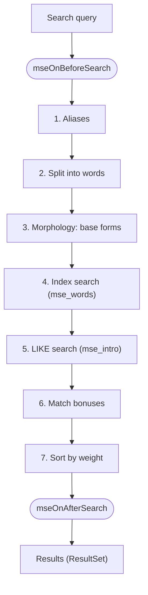

# Search

Tab for testing search queries in the admin panel.

## Purpose

The search uses the same algorithm and index as the [mSearch](/en/components/msearch/snippets/msearch) snippet. The results contain only published, not deleted resources with the searchable flag set: exactly what a site visitor will see. Queries run on this tab are not recorded in [query statistics](/en/components/msearch/interface/queries).

## Interface

### Search form

- **Input** — enter a search query
- **"Search" button** — run the search (or press Enter)

An empty query is not sent — the "Please enter a search query" warning is shown.

### Results table

| Column | Description |
|--------|-------------|
| ID | Resource ID |
| Title | Page title (pagetitle). Clickable — opens the resource in a new tab |
| Weight | Result relevance |

If nothing is found, the "No results found" message is shown. If the request fails, a notification with the error text is shown.

## Use cases

Use this tab for:

- **Checking indexing** — make sure the right pages are found
- **Debugging morphology** — check how word forms are handled
- **Testing aliases** — make sure synonyms work
- **Evaluating weights** — see the final relevance of results; the field weights themselves are set by the `mse_index_fields` setting, not on this tab

## Search algorithm

1. [Aliases](/en/components/msearch/interface/aliases) (synonyms and replacements) are applied to the query
2. The query is split into words
3. Base forms are found for each word via morphological analysis
4. Words are looked up in the index
5. An additional LIKE search of the whole query in the full text
6. Bonuses for exact matches are applied
7. Results are sorted by relevance

