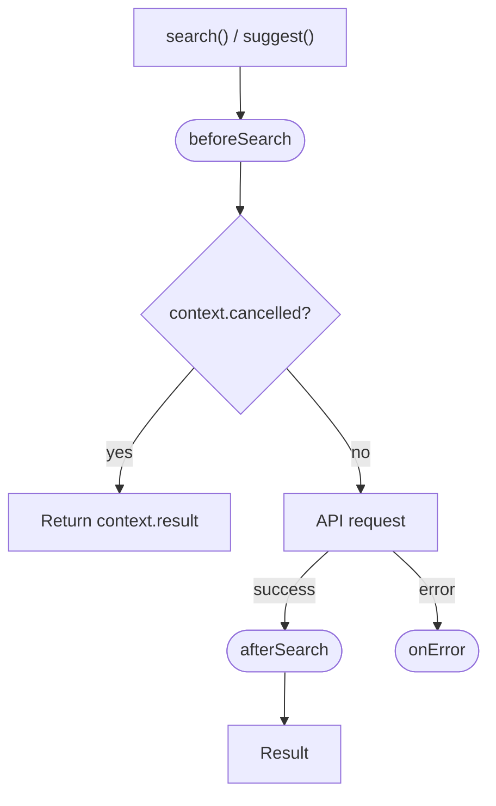

# JavaScript API

The JavaScript is layered. Two modes are available: the full stack with UI (the `mSearchForm` snippet scenario) or headless for your own interfaces on React, Vue, Svelte, etc.

## Architecture

```
window.MSearchApiClient  — HTTP client for the API
    ↓
window.MSearchAPI        — search API facade
    ↓
window.msearchHooks      — hook system (optional)
    ↓
window.msearch           — headless entry point
    ↓
window.MSearchUI         — autocomplete UI layer (optional)
    ↓
msearch.js               — auto-initialization by data-msearch-form (optional)
```

You only need `window.msearch` directly (and `window.msearchHooks` for extending). `MSearchApiClient` and `MSearchAPI` are internal layers; you do not need to call them by hand.

## Public API endpoint

All JS requests go to `assets/components/msearch/api.php`.

### Contract

The API accepts a minimal set of parameters from the client — see the table below.

Rendering parameters (`tpl`, the chunk name), `limit`, the external snippet name `element` and `elementProperties` are stored **in the MODX cache** and looked up by `form`. This closes the SSTI vector: the client cannot inject an arbitrary chunk or snippet.

### Parameters

| Parameter | Type | Description | Applies to |
|-----------|------|-------------|------------|
| `query` | string | Search query | `/search`, `/search/suggest` |
| `offset` | int | Pagination offset, default `0` | `/search` |
| `form` | string | 12-character formId of the snippet form. The server uses it to fetch `tpl`/`limit`/`element` from the cache | `/search`, `/search/suggest` |
| `ctx` | string | Comma-separated contexts (`web`, `web,shop`). If the form cache has a non-empty `ctx`, the query value is ignored | `/search`, `/search/suggest` |

### Search

```
GET /assets/components/msearch/api.php?route=/search&query=text&offset=0&form=abc123def456
```

Response:

```json
{
    "success": true,
    "total": 42,
    "limit": 10,
    "offset": 0,
    "query": "text",
    "items": [
        {
            "id": 123,
            "url": "https://site.com/page/alias",
            "type": "resource",
            "html": "<div class=\"mse-result\">...</div>",
            "weight": 45
        }
    ]
}
```

### Autocomplete

```
GET /assets/components/msearch/api.php?route=/search/suggest&query=te&form=abc123def456
```

Response:

```json
{
    "success": true,
    "items": [
        {
            "id": 123,
            "url": "https://site.com/page/alias",
            "type": "product",
            "html": "<a href=\"...\" class=\"mse-suggest-item...\">...</a>",
            "weight": 15
        }
    ]
}
```

Each item also carries a `pagetitle` field — the plain title without `<mark>`. It is a service field for the admin preview; the frontend ignores it and reads `html`.

### The `html` field

The server renders each result in advance via `pdoTools::getChunk` with the template from the snippet form (`&tpl=`). The client receives ready HTML to insert via `innerHTML`.

The placeholders available in the chunk depend on the adapter:

- **`type = 'resource'`** (handled by `ResourceAdapter`) — `pagetitle`, `longtitle`, `description`, `intro`, etc.
- **`type = 'product'`** (handled by `MsProductAdapter`, when miniShop3 is installed) — `price_display`, `old_price_display`, `thumb`, `article`, `has_discount`.

### Headless without the snippet

If a request comes **without** `form` (for example, an SPA on another domain calls the API directly, without the `mSearchForm` snippet), the server uses defaults: `limit=5` for suggest and `limit=10` for search, `tpl` from the adapter, `ctx` from the query parameter if given, otherwise no filter. The response still has `html` — rendering happens on the server.

::: warning No "raw data"
The endpoint always returns HTML in the `html` field. To get structured data on the SPA side, either go through the snippet on a page (it writes a `formId` to the cache with a minimal chunk that outputs JSON), or add a server-side extension via the `mseOnAfterSearch` event and build your own response.
:::

### Edge cases

The endpoint answers `200 OK` even for invalid input — there are no error codes (4xx) in these cases:

| Situation | Response |
|-----------|----------|
| Query shorter than `mse_suggest_min_query_length` (suggest) | `{"success":true,"items":[]}` |
| Empty `query` | `{"success":true,"items":[]}` (for `/search` also with `total: 0`) |
| Unknown `form` (not in the cache) | Falls back to the default configuration — the search runs, `items` are filled |

So an invalid formId does not cause an error: the server just takes the defaults, as in "Headless without the snippet". Check `success` and the length of `items`, not the HTTP code.

## Headless mode

`window.msearch` provides a programmatic API not tied to the DOM. Suitable for React, Vue, Svelte and any custom interface.

### Loading

```html
<script src="/assets/components/msearch/js/web/core/ApiClient.js"></script>
<script src="/assets/components/msearch/js/web/core/SearchAPI.js"></script>
<script src="/assets/components/msearch/js/web/modules/hooks.js"></script>
<script src="/assets/components/msearch/js/web/msearch.headless.js"></script>
```

### Configuration

```html
<script>
window.msearchConfig = {
    apiUrl: '/assets/components/msearch/api.php',
    ctx: 'web',
    autoInit: true
};
</script>
```

Auto-initialization after the DOM loads and the `msearch:ready` event happen only when the `window.msearchConfig` object is present (and `autoInit !== false`). Without `msearchConfig` the `window.msearch` object still exists but initializes lazily — on the first `search()`/`suggest()` call or an explicit `init()`.

`ctx` in `msearchConfig` is a public context filter; it is passed with every request unless the call options specify it explicitly.

### Usage

```js
// Search
const result = await msearch.search('smartphone', { offset: 0 });
console.log(result.total);   // 42
console.log(result.items);   // [{id, url, type, html, weight}, ...]

// Autocomplete
const suggestions = await msearch.suggest('sm');
console.log(suggestions.items); // [{id, url, type, html, weight}, ...]
```

### Call options

| Option | Applies to | Description |
|--------|------------|-------------|
| `form` | search, suggest | formId linking to the server-side configuration of the `mSearchForm` snippet |
| `ctx` | search, suggest | Comma-separated string of contexts or an array. Overrides `msearchConfig.ctx` |
| `offset` | search | Pagination offset |

### Manual initialization

```js
await msearch.init({
    apiUrl: '/assets/components/msearch/api.php',
    ctx: 'web'
});
```

### Destroying

For SPAs where the search component is mounted and unmounted, `msearch.destroy()` is available — it drops the HTTP client, the API and the link to hooks and returns the object to the uninitialized state (the next `search()`/`suggest()` initializes it again).

```js
msearch.destroy();
```

### DOM events

| Event | Description |
|-------|-------------|
| `msearch:ready` | Headless API initialized |
| `msearch:ui:ready` | UI layer initialized (if loaded) |

```js
document.addEventListener('msearch:ready', (e) => {
    const msearch = e.detail.msearch;
    // API is ready to use
});
```

## Hook system {#hooks}

Hooks extend search behavior on the client side — modify requests, process results, log.

### Available hooks

| Hook | Description |
|------|-------------|
| `beforeSearch` | Before sending a search request |
| `afterSearch` | After receiving search results |
| `beforeSuggest` | Before an autocomplete request |
| `afterSuggest` | After receiving suggestions |
| `onError` | On an error in any request |

### Subscribing

```js
// Add a hook (returns an unsubscribe function)
const unsubscribe = msearchHooks.add('beforeSearch', function(context) {
    console.log('Searching:', context.query);
    // Available for modification:
    //   context.query    — search query
    //   context.options  — request parameters (ctx, offset, form)
    //   context.cancelled = true — cancel the request
    //   context.result   — substituted result (if cancelled)
});

// Unsubscribe
unsubscribe();
```

### `msearchHooks` methods

| Method | Description |
|--------|-------------|
| `add(name, fn, priority = 10)` | Subscribe a callback to a hook; returns an unsubscribe function |
| `remove(name, fn)` | Remove a specific callback from a hook |
| `clear(name)` | Remove all handlers of a hook; without an argument, clear all hooks |
| `has(name)` | `true` if the hook has at least one callback |
| `count(name)` | Number of callbacks subscribed to the hook |

### Priorities

A hook with a **lower** priority runs earlier.

```js
msearchHooks.add('afterSearch', analyticsHook, 5);    // first
msearchHooks.add('afterSearch', transformHook, 10);   // second
msearchHooks.add('afterSearch', renderHook, 20);      // third
```



`suggest()` goes through the same steps with the `beforeSuggest` and `afterSuggest` hooks.

### Examples

#### Logging queries

```js
msearchHooks.add('afterSearch', function(context) {
    if (context.result && context.result.total > 0) {
        console.log(`Found ${context.result.total} for "${context.query}"`);
    }
});
```

#### Forcing a context filter

```js
msearchHooks.add('beforeSearch', function(context) {
    context.options.ctx = 'web';
});
```

#### Cancelling a request

```js
msearchHooks.add('beforeSearch', function(context) {
    if (context.query.length < 3) {
        context.cancelled = true;
        context.result = { success: true, items: [], total: 0 };
    }
});
```

#### Error handling

```js
msearchHooks.add('onError', function(context) {
    showNotification('Search error: ' + context.error.message);
});
```

## UI layer

The `MSearchUI` layer adds autocomplete to forms with the `data-msearch-form` attribute. It is loaded automatically by the `mSearchForm` snippet with `autocomplete=1`.

### Race protection

During fast typing the UI drops stale responses — each request gets a sequence number (`requestSeq`) that is compared with the current one when the response arrives. Responses to earlier requests are ignored; a new request does not abort the old one — filtering happens on the consumer side only.

### Manual creation

```js
const instance = MSearchUI.create(document.querySelector('#my-form'), {
    minQueryLength: 2,
    debounceDelay: 300,
    formId: 'abc123def456'
});
```

### Options

| Option | Default | Description |
|--------|---------|-------------|
| `inputSelector` | `.mse-input` | CSS selector of the input inside the form |
| `resultsSelector` | `.mse-results` | CSS selector of the results container (reserved) |
| `autocomplete` | `true` | Enable autocomplete |
| `minQueryLength` | `2` | Minimum query length on the client. By default it is taken from the `mse_suggest_min_query_length` setting (the snippet passes it to `window.msearchConfig`); `data-min-query-length` overrides it |
| `debounceDelay` | `300` | Debounce delay, ms |
| `connectorUrl` | `''` | API endpoint URL (usually taken from `data-connector-url`) |
| `formId` | `''` | Snippet formId (usually taken from `data-form-id`) |

### Form data attributes

UI options can be set with data attributes directly on the form:

| Attribute | Description |
|-----------|-------------|
| `data-msearch-form` | Marker for `msearch.js` auto-initialization |
| `data-connector-url` | API endpoint URL |
| `data-form-id` | 12-character formId linking the form to the server-side configuration |
| `data-autocomplete` | `true` / `false` — enable autocomplete |
| `data-min-query-length` | Overrides `minQueryLength` |
| `data-debounce-delay` | Overrides `debounceDelay` (ms) |

::: tip Where to get formId
formId is generated by the `mSearchForm` snippet and reaches the form chunk through the `{$formId}` placeholder. The default `mSearch.form` chunk already has it in `data-form-id`. When you build a form by hand with `MSearchUI.create()` without the snippet, formId is not needed — the server uses default parameters.
:::

### CSS classes

#### Base

| Class | Element |
|-------|---------|
| `.mse-form` | Search form |
| `.mse-input` | Input |
| `.mse-button` | Submit button |
| `.mse-autocomplete` | Suggestions dropdown (`<ul>`) |
| `.mse-autocomplete.active` | Open dropdown |
| `.mse-autocomplete-item` | Suggestion item (`<li>`) |
| `.mse-autocomplete-item.active` | Item selected with the arrow keys |

#### Suggestion row (inside `.mse-autocomplete-item`)

These classes are used in the default `mSearch.suggest.row` chunk:

| Class | Purpose |
|-------|---------|
| `.mse-suggest-item` | Root `<a>` link inside `<li>` |
| `.mse-suggest-item--resource` | Modifier for regular resources |
| `.mse-suggest-item--product` | Modifier for msProduct products |
| `.mse-suggest-thumb` | Product thumbnail (``) |
| `.mse-suggest-body` | Container for text fields |
| `.mse-suggest-title` | Title |
| `.mse-suggest-article` | Product article (SKU) |
| `.mse-suggest-intro` | Text excerpt (for resources) |
| `.mse-suggest-price` | Price container |
| `.mse-suggest-price-current` | Current price |
| `.mse-suggest-price-old` | Old price (struck through, when there is a discount) |
| `.mse-highlight` | Match highlighting in text (generated on the server as `<mark>`) |

### Managing instances

```js
// Get an instance by form id
const instance = MSearchUI.get('my-form-id');

// Destroy an instance
MSearchUI.destroy('my-form-id');
```

## Integration examples

### Vue 3

```html
<script src="/assets/components/msearch/js/web/core/ApiClient.js"></script>
<script src="/assets/components/msearch/js/web/core/SearchAPI.js"></script>
<script src="/assets/components/msearch/js/web/modules/hooks.js"></script>
<script src="/assets/components/msearch/js/web/msearch.headless.js"></script>
```

```js
import { ref, onMounted } from 'vue';

export default {
    setup() {
        const query = ref('');
        const results = ref([]);
        const total = ref(0);

        async function doSearch() {
            if (query.value.length < 2) return;
            const data = await window.msearch.search(query.value, { ctx: 'web' });
            results.value = data.items;
            total.value = data.total;
        }

        return { query, results, total, doSearch };
    }
};
```

`items[].html` is ready HTML, so in Vue output it with `v-html`:

```html
<div v-for="item in results" :key="item.id" v-html="item.html" />
```

### React (minimal example)

```jsx
function Search() {
    const [query, setQuery] = useState('');
    const [items, setItems] = useState([]);

    useEffect(() => {
        if (query.length < 2) { setItems([]); return; }
        const t = setTimeout(() => {
            window.msearch.suggest(query, { ctx: 'web' })
                .then(res => setItems(res.items));
        }, 300);
        return () => clearTimeout(t);
    }, [query]);

    return (
        <div>
            <input value={query} onChange={e => setQuery(e.target.value)} />
            <ul>
                {items.map(it => (
                    <li key={it.id} dangerouslySetInnerHTML={{ __html: it.html }} />
                ))}
            </ul>
        </div>
    );
}
```

## CORS

The public API (`api.php`) allows only same-origin requests by default. For cross-domain requests set the allowed Origin in the `mse_cors_origin` system setting — see [System settings → mse_cors_origin](/en/components/msearch/system-settings#mse_cors_origin).

In headless mode without the `mSearchForm` snippet no cookies are needed (formId is not sent, the server-side configuration is not used) — standard CORS works.

## Contract security

- The client **cannot** set the chunk name, the snippet name (`element`), `limit` or `elementProperties` — these parameters come only from the server cache by `formId`.
- `ctx` is a public filter on the `context_key` column and is safe to accept from the client.
- `Highlighter` escapes the input text (`htmlspecialchars`) before wrapping it in `<mark>` — the `html` field is HTML-safe, and inserting it via `innerHTML` / `v-html` / `dangerouslySetInnerHTML` does not open XSS.
- formId is validated against the regex `^[a-f0-9]{12}$` — attempts to pass `../../etc/passwd` or a script are rejected.
