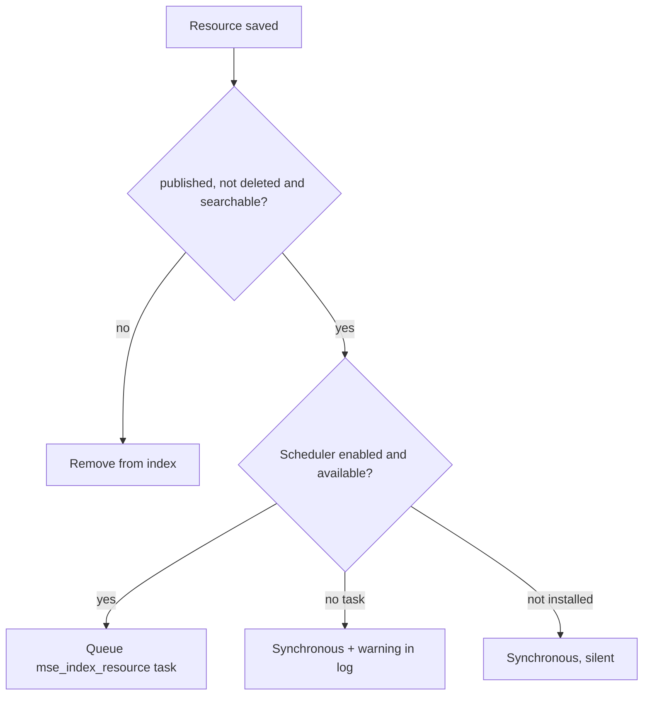
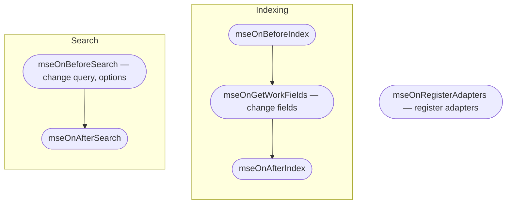

# Plugin and events

The `mSearch` MODX plugin keeps the index up to date automatically. The component also publishes system events for extending indexing and search.

## mSearch plugin

### Purpose

The plugin is subscribed to three MODX events and keeps the index in sync with the state of resources: on save it indexes the resource or removes it, on delete it removes the index entry.

### MODX events

| Event | Action |
|-------|--------|
| `OnDocFormSave` | Resource saved in the manager. If the resource is published, not deleted and `searchable=1`, it is added to the index. Otherwise it is removed from the index |
| `OnResourceDelete` | Resource deleted (moved to the trash). The entry is removed from the index. Restoring from the trash is not tracked by the plugin — the resource returns to the index only on its next save |
| `OnEmptyTrash` | Trash emptied. No extra action — the entries were already removed on `OnResourceDelete` |

### Indexing logic on save

```
if resource published=1 AND deleted=0 AND searchable=1:
    index
else:
    remove from index
```

So clearing either the `published` or the `searchable` flag, or setting `deleted`, automatically drops the resource from suggestions and search results.

### Scheduler integration

If the **`mse_use_scheduler=1`** setting is on and the Scheduler component is installed, indexing on save runs asynchronously:

- The plugin queues the `mse_index_resource` task.
- The task runs in the background (via `cron` or manually from the Scheduler UI).
- The manager is not blocked while heavy resources are indexed.

If Scheduler is installed but the task is not registered, the plugin falls back to synchronous indexing and writes a warning to the log. If Scheduler is not installed at all, indexing runs synchronously and silently, without a log entry.

::: tip When to enable Scheduler
Only if resources are heavy (TV fields with large JSON, content of tens of thousands of characters) or there are hundreds of thousands of them. For a typical site direct indexing is faster — a single resource is indexed in milliseconds.
:::



### What the plugin does NOT do

- It does not index resources changed via a direct SQL query (reindex from the manager is needed).
- It does not track TV changes separately from the resource (TVs are saved together with the resource — this covers most cases).
- It does not index models that are not resources (comments, orders, your own xPDO classes). It handles `modResource` and its subclasses — including miniShop3 products, which are indexed by `MsProductAdapter`.

## mSearch system events

All component events have the `mse` prefix and are grouped in the **mSearch** category in the plugin settings.



### mseOnRegisterAdapters

**When fired:** on the first access to `Indexer` — right after the built-in adapters (`ResourceAdapter`, `MsProductAdapter`) are registered.

**Arguments:**

| Parameter | Type | Description |
|-----------|------|-------------|
| `indexer` | `Indexer` | Indexer service; register your adapters on it with `addAdapter()` |

**Purpose:** registering adapters for your own models (comments, orders, your xPDO classes).

**Plugin example:**

```php
<?php
/** @var modX $modx */
/** @var MSearch\Services\Indexer\IndexerInterface $indexer */
$indexer = $scriptProperties['indexer'];

if (class_exists(\MyApp\Model\Article::class)) {
    $indexer->addAdapter(new \MyApp\Adapters\ArticleAdapter($modx, $modx->services->get('msearch')));
}
```

::: warning Security
The adapter must implement `ContentAdapterInterface`. Never register a snippet name that comes from the client — `runSnippet()` inside `AbstractAdapter::loadViaElement()` can execute arbitrary code.
:::

### mseOnBeforeIndex

**When fired:** in `Indexer::indexResource()` before indexing a single resource starts, after a matching adapter is found.

**Arguments:**

| Parameter | Type | Description |
|-----------|------|-------------|
| `resource` | `modResource` | The resource object that will be indexed |
| `adapter` | `ContentAdapterInterface` | The adapter that will do the indexing |

**Purpose:** extra preparation before indexing — warming up related data, logging. There is no built-in way to cancel indexing a resource in this event: the handler's return value and `$modx->event->_output` are not checked. To exclude a resource from the index, empty `$fields` in `mseOnGetWorkFields` (see below).

### mseOnGetWorkFields

**When fired:** in `Indexer::indexResource()` after the adapter returns the list of indexable fields, before their content is extracted.

**Arguments:**

| Parameter | Type | Description |
|-----------|------|-------------|
| `fields` | `array` *(by ref)* | Array `[field_name => weight]`. Can be modified on the fly |
| `resource` | `modResource` | Current resource |

**Purpose:** conditional modification of the indexed field set. For example, for a particular resource type add a TV, raise the `pagetitle` weight or drop `content` from indexing altogether.

**Plugin example:**

```php
<?php
/** @var array $fields by reference */
$fields = &$scriptProperties['fields'];
/** @var modResource $resource */
$resource = $scriptProperties['resource'];

// For news raise the pagetitle weight and add the "tags" TV
if ($resource->get('class_key') === \MyApp\Model\News::class) {
    $fields['pagetitle'] = 5;
    $fields['tv_tags'] = 3;
}
```

### mseOnAfterIndex

**When fired:** in `Indexer::indexResource()` after the words and intro are written to the database.

**Arguments:**

| Parameter | Type | Description |
|-----------|------|-------------|
| `resource` | `modResource` | The indexed resource |
| `words` | `array` | Array of indexed words: `[field => [word => count]]` |
| `adapter` | `ContentAdapterInterface` | The adapter that did the indexing |

**Purpose:** notifications, cache reset, sync with external search services (Elasticsearch, Sphinx).

### mseOnBeforeSearch

**When fired:** in `Searcher::search()` right after the query is received, before alias processing, splitting into words and the index search.

**Arguments:**

| Parameter | Type | Description |
|-----------|------|-------------|
| `query` | `string` *(by ref)* | Search query. Can be modified |
| `options` | `array` *(by ref)* | Search options (`limit`, `offset`, `contexts`, `class_keys`, `log`). Can be modified; e.g. `$options['log'] = false` disables recording the query in statistics |

**Purpose:** query normalization, adding automatic filters, A/B testing, redirecting short queries to popular ones.

**Plugin example:**

```php
<?php
/** @var string $query by reference */
$query = &$scriptProperties['query'];

// Normalization: strip special characters
$query = preg_replace('/[^\p{L}\p{N}\s\-]/u', '', $query);
```

### mseOnAfterSearch

**When fired:** in `Searcher::search()` after the results are sorted and pagination is applied, before returning from the method.

**Arguments:**

| Parameter | Type | Description |
|-----------|------|-------------|
| `query` | `string` | Final query (after alias processing) |
| `results` | `ResultSet` | Results object. Has the `getIds()`, `getClasses()`, `groupByClass()`, `filter()`, `merge()` methods |

**Purpose:** logging queries under special conditions, merging with other sources through in-place mutation.

::: warning You cannot filter the results here
`results` is not passed by reference, and `Searcher` ignores the handler's return value. The `filter()` and `slice()` methods return a **new** `ResultSet` object — it is discarded. The results can be changed only by a method that mutates in place (`merge()`). There is no mechanism for real result filtering at the event level.
:::

**Plugin example:**

```php
<?php
/** @var MSearch\Services\Searcher\ResultSet $results */
$results = $scriptProperties['results'];
$query = $scriptProperties['query'];

// Log queries that returned nothing to your own analytics table
if ($results->isEmpty()) {
    $modx->log(modX::LOG_LEVEL_ERROR, "[Analytics] Empty result for: {$query}");
}
```

## Practical scenarios

### Searching Tickets comments

1. Create a `TicketCommentAdapter` class implementing `ContentAdapterInterface`:
   - `supports()` — returns `true` for the comment class.
   - `getIndexableFields()` — `[text => 1, author => 1]`.
   - `extractContent($object, $field)` — returns the field value.
   - `getObjects()` / `getTotal()` — selection via xPDO.
   - `getDisplayData()` — fills placeholders for rendering in a suggestion.
   - `getDefaultSuggestTpl()` — chunk name for the row.

2. Create a MODX plugin on the `mseOnRegisterAdapters` event that registers the adapter.

3. Run a reindex from the manager.

4. Create a suggestion chunk (e.g. `mSearch.suggest.comment`) — it is picked automatically via the adapter's `getDefaultSuggestTpl()`.

::: warning Non-resource models are not indexed in the current version
The indexer loads every object as `modResource` by its ID, so comments and other non-resource models do not get into the index. See [Extending the component → Adapter for Tickets comments](/en/components/msearch/extending#tickets-comments-adapter).
:::

### Excluding specific containers from the index

Exclusion is done in `mseOnGetWorkFields` by emptying the field list — there is nothing left to index, and the resource does not get into the index:

```php
<?php
// Plugin on mseOnGetWorkFields
/** @var array $fields by reference */
$fields = &$scriptProperties['fields'];
/** @var modResource $resource */
$resource = $scriptProperties['resource'];

// Do not index resources from the service section (id=42)
$ancestors = $modx->getParentIds($resource->get('id'));
if (in_array(42, $ancestors)) {
    $fields = [];
}
```

### Tracking popular queries

```php
<?php
// Plugin on mseOnAfterSearch
/** @var MSearch\Services\Searcher\ResultSet $results */
$results = $scriptProperties['results'];
$query = $scriptProperties['query'];

// Save to your own table for a "popular queries" widget
if (!$results->isEmpty()) {
    /** @var \PDOStatement $stmt */
    $stmt = $modx->prepare('INSERT INTO my_popular_queries (query, count, last_seen) VALUES (?, 1, NOW()) ON DUPLICATE KEY UPDATE count = count + 1, last_seen = NOW()');
    $stmt->execute([mb_strtolower($query)]);
}
```

## JavaScript API hooks

Besides the server-side PHP events, mSearch provides a client-side hook system — for extending autocomplete and AJAX search without editing the JS stack. See [JavaScript API → msearchHooks](/en/components/msearch/javascript-api#hooks).
