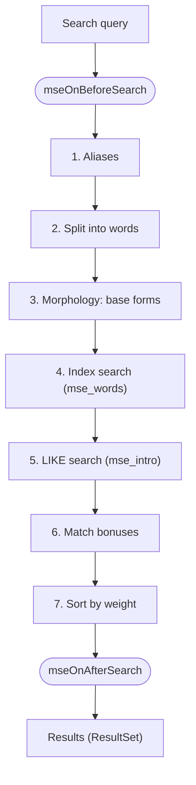

# mSearch

Snippet for running a search and outputting results.

Results are output through pdoTools. The pdoFetch configuration is fixed: the snippet does **not** pass arbitrary pdoTools properties (`&where`, `&includeTVs`, `&sortby` and others) to pdoFetch, and the set of fields available in the chunk is defined by the adapter. If you need flexible output — a `&where` filter, TV output, custom sorting — use the `return=ids` + `pdoResources`/`msProducts` pattern (examples below): it accepts any pdoTools properties.

::: warning Uncached call
Call the snippet **uncached** (with `!`), as it depends on the search query from `$_REQUEST`.
:::

## Parameters

| Parameter | Default | Description |
|-----------|---------|-------------|
| **query** | | Search query. The HTTP parameter named in `queryVar` takes precedence: `&query` is used only when the request has no such parameter |
| **queryVar** | `mse_query` | Name of the HTTP parameter the search query is read from. Validated against `^[a-zA-Z_][a-zA-Z0-9_]*$`; an invalid name falls back to `mse_query` |
| **tpl** | `mSearch.row` | Chunk for each result |
| **tplWrapper** | | Chunk wrapping all results |
| **limit** | `10` | Results limit. `0` means no limit (useful for `return=ids`) |
| **offset** | `0` | Offset for pagination (pdoPage passes it itself with `element=mSearch`) |
| **toPlaceholder** | | Save results to a placeholder instead of outputting them |
| **contexts** | current context | Contexts to filter by, comma-separated (e.g. `web,ru`). An empty string keeps the **current** context; to search all contexts, pass `,` |
| **return** | `chunks` | Output format: `chunks`, `ids`, `json`, `data` |
| **outputSeparator** | `\n` | Separator between results with `return=chunks`. Inserted as is (see the note below) |
| **log** | `1` | Whether to record the query in query statistics. `0` disables it (for service calls). Only the first page is logged |

::: tip Output separator
`&outputSeparator` is inserted as is. The field is single-line, so `\n` will not turn into a line break — it is output literally; for a visible separator use HTML (`<hr>`). By default results are separated by a line break (a space in HTML): if your cards are laid out with `inline-block` and a gap appears, output them back to back with `&outputSeparator=``.
:::

### return parameter

| Value | Description |
|-------|-------------|
| `chunks` | Output via chunks (default) |
| `ids` | Comma-separated IDs of found resources only |
| `json` | JSON array of resource data |
| `data` | Data array (for use in other snippets) |

## Placeholders

### Global placeholders

After running, the snippet sets:

| Placeholder | Description |
|-------------|-------------|
| `[[+mse.total]]` | Total number of results found |
| `[[+mse.query]]` | Search query |

### Placeholders in the tpl chunk

| Placeholder | Description |
|-------------|-------------|
| `[[+id]]` | Resource ID |
| `[[+pagetitle]]` | Title |
| `[[+longtitle]]` | Long title |
| `[[+introtext]]` | Intro text |
| `[[+weight]]` | Result relevance (weight) |
| `[[+intro]]` | The whole `introtext` with matches highlighted in `<mark>` (HTML-safe) |
| `[[+idx]]` | Number in the list (continues across pages: on page 2 it starts at `offset + 1`) |
| *other resource fields...* | All fields loaded by pdoFetch are available |

::: warning The content field is not available
The snippet loads a fixed set of fields and does not pass `content` to the chunk — the `[[+content]]` placeholder will not work, and the snippet does not read `&includeContent`. If you need `content` in results, output them via `return=ids` + `pdoResources` with `&includeContent=`1``.
:::

### Placeholders in the tplWrapper chunk

| Placeholder | Description |
|-------------|-------------|
| `[[+output]]` | All results joined together |
| `[[+total]]` | Number of results |
| `[[+query]]` | Search query |
| `[[+offset]]` | Current offset |
| `[[+limit]]` | Results limit |

## Examples

### Basic call

```fenom
{'!mSearch' | snippet}
```

### Custom chunk

```fenom
{'!mSearch' | snippet : [
    'tpl' => 'mySearchResult',
    'limit' => 20
]}
```

### With wrapper

```fenom
{'!mSearch' | snippet : [
    'tpl' => 'mSearch.row',
    'tplWrapper' => 'mSearch.wrapper',
    'limit' => 10
]}
```

Default `mSearch.wrapper` chunk:

```fenom
<div class="mse-results">
    <div class="mse-results-header">
        <p class="mse-results-info">{'mse_results_found' | lexicon : ['total' => $total, 'query' => $query]}</p>
    </div>
    <div class="mse-results-list">
        {$output}
    </div>
</div>
```

The wrapper is applied only when there are results: with an empty result the snippet returns an empty string.

### Pagination with pdoPage

`mSearch` reads `offset` and writes the total number of results to `totalVar`, so pdoPage can page through it directly:

```fenom
{'!pdoPage' | snippet : [
    'element' => 'mSearch',
    'totalVar' => 'page.total',
    'tpl' => 'mSearch.row',
    'limit' => 10
]}

{$_modx->getPlaceholder('page.nav')}
```

miniShop3 products are rendered by `msProducts`, not `mSearch`, so for them use the `return=ids` pattern (see "MiniShop3 product search" below): `mSearch` returns IDs, `pdoPage` pages through them.

### Get IDs only

Useful for passing to other snippets:

```fenom
{set $ids = '!mSearch' | snippet : [
    'return' => 'ids',
    'limit' => 0
]}

{if $ids}
{'msProducts' | snippet : [
    'resources' => $ids,
    'sortby' => 'ids'
]}
{else}
<p>No products found</p>
{/if}
```

### MiniShop3 product search

```fenom
{'!pdoPage' | snippet : [
    'element' => 'msProducts',
    'parents' => 0,
    'resources' => '!mSearch' | snippet : ['return' => 'ids', 'limit' => 0] | default : '999999',
    'sortby' => 'ids',
    'tpl' => 'tpl.msProducts.row'
]}

{$_modx->getPlaceholder('page.nav')}
```

::: tip The default filter
`| default : '999999'` substitutes a non-existent ID when the search returns nothing. This prevents listing all products for an empty query.
:::

### JSON for AJAX

```fenom
{'!mSearch' | snippet : [
    'return' => 'json',
    'limit' => 5
]}
```

The response is an array of objects. Each object carries **the full set of resource fields from pdoFetch** plus the computed `weight` and `intro` (highlighted `introtext`). Example of one item (long text fields are shortened, the rest are shown as is):

```json
{
    "id": 152243,
    "type": "document",
    "pagetitle": "Xiaomi Mi Classic 64GB smartphone",
    "longtitle": "",
    "description": "…",
    "alias": "smartfon-xiaomi-mi-classic-64gb-16",
    "published": 1,
    "parent": 152132,
    "introtext": "…",
    "template": 3,
    "menuindex": 15,
    "searchable": 1,
    "class_key": "MiniShop3\\Model\\msProduct",
    "context_key": "web",
    "uri": "elektronika/smartfony/knopochnye-telefony/smartfon-xiaomi-mi-classic-64gb-16/",
    "weight": 21,
    "intro": "A compact <mark class=\"mse-highlight\">smartphone</mark> with…"
}
```

There are about forty fields (all `modx_site_content` columns: `createdon`, `publishedon`, `menutitle`, `hidemenu`, etc.) — the key ones are shown above. The field set is defined by the adapter; the snippet does not include the `content` field in the selection.

### Custom HTTP query parameter name

Use it in two cases:

- migrating from a platform where external links already use a different parameter name;
- several search forms with different meaning on one page.

```fenom
{'!mSearch' | snippet : ['queryVar' => 'q']}
```

The snippet reads the query from `$_REQUEST['q']` instead of `$_REQUEST['mse_query']`.

## Default chunk

`mSearch.row` chunk:

```fenom
<div class="mse-result" data-idx="{$idx}">
    <h3 class="mse-result-title">
        <a href="{$id | url}">{$pagetitle}</a>
    </h3>
    {if $intro?}
        <p class="mse-result-intro">{$intro}</p>
    {/if}
    <div class="mse-result-meta">
        <span class="mse-result-date">{$publishedon | date : 'd.m.Y'}</span>
        {if $weight?}
            <span class="mse-result-weight">{'mse_weight' | lexicon}: {$weight | number : 2}</span>
        {/if}
    </div>
</div>
```

## Highlighting

The `[[+intro]]` placeholder is the whole `introtext` with matches highlighted in `<mark class="mse-highlight">`. The text is highlighted in full; there is no "around the match" fragmenting or truncation. Besides the query words, their word forms from the morphological dictionary are highlighted too.

`Highlighter` escapes the source text with `htmlspecialchars` before inserting `<mark>` — the result is HTML-safe and can be output in the chunk without an extra `|escape`.

With `return=chunks` the snippet also registers the CSS file from the `mse_frontend_css` setting — it styles the highlighting markup. With `ids`, `json` and `data` no CSS is registered.

## Context filtering

By default the snippet filters results by the current MODX context. This matters for multi-context (e.g. multilingual) sites, so that visitors of the Russian site do not see pages of the English one in the results.

```fenom
{* Search only in the current context (default) *}
{'!mSearch' | snippet}

{* Search in several contexts *}
{'!mSearch' | snippet : ['contexts' => 'web,ru']}

{* Search in all contexts *}
{'!mSearch' | snippet : ['contexts' => ',']}
```

## Search algorithm

1. **Aliases** — synonyms and replacements are applied to the query
2. **Query splitting** — the query is split into words; words shorter than `mse_index_min_word_length` are dropped
3. **Morphology** — base forms are found for each word
4. **Index search** — words are looked up in the index table, filtered by context
5. **LIKE search** — an additional search of the whole query as a substring of the full text (`mse_intro`)
6. **Bonuses** — weight is added for an exact match of the query and for containing all of its words
7. **Sorting** — results are sorted by relevance (weight descending, then ID ascending)



## Events

During a search `Searcher` fires:

- **mseOnBeforeSearch** — before the search; you can modify the query and options
- **mseOnAfterSearch** — after the search, with the results

The events are fired in `Searcher::search()`, so they work the same for the snippet and for a direct `$msearch->search()` call (e.g. from your own PHP code). Details and limitations: [Plugin and events](/en/components/msearch/plugin-and-events).
