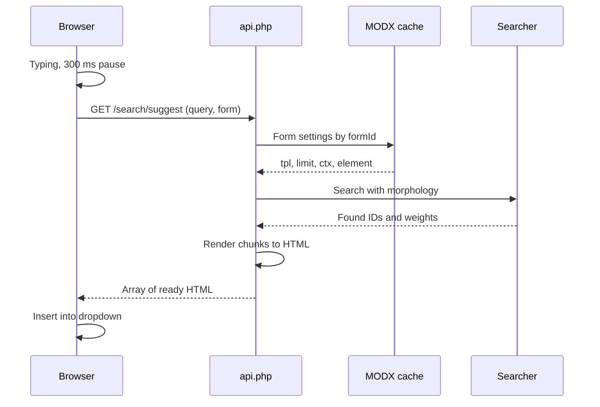

# mSearchForm

Snippet for outputting a search form with optional autocomplete.

::: warning Uncached call
Call the snippet **uncached** (with `!`), as it registers scripts, writes the form configuration to the MODX cache and uses the current query value from `$_REQUEST`.
:::

## Parameters

### Form parameters

| Parameter | Default | Description |
|-----------|---------|-------------|
| **tplForm** | `mSearch.form` | Chunk with the search form markup |
| **queryVar** | `mse_query` | Name of the HTTP parameter that carries the search query. Validated against `^[a-zA-Z_][a-zA-Z0-9_]*$`; an invalid name falls back to `mse_query` |
| **pageId** | current page | ID of the page the search query is submitted to |
| **autocomplete** | `0` | Enable autocomplete (1 — on, 0 — off). With `0` the JavaScript stack is not loaded |

### Autocomplete parameters

These parameters apply only with `autocomplete=1`. The snippet writes them to the MODX cache under a unique `formId`, and the server API reads them from there on every AJAX request — the client never sends them in the URL.

| Parameter | Default | Description |
|-----------|---------|-------------|
| **tpl** | `mSearch.suggest.row` | Chunk for a suggestion row in the dropdown |
| **limit** | `5` | Maximum number of suggestions |
| **ctx** | current context | Contexts to filter by, comma-separated (e.g. `web,shop`) |
| **classKey** | | Restricts the selection by class: one or more class_keys, comma-separated (e.g. `MODX\Revolution\modResource` or `MiniShop3\Model\msProduct`). Unlike `element`, this is the parameter that filters search results by type. Empty — all classes are searched |
| **element** | | Name of an external snippet (e.g. `msProducts`) that loads data for suggestions instead of the built-in adapter. It does **not** restrict the selection by class — use `classKey` for that. See "Integration via element" below |
| **elementProperties** | | Extra properties for `element`. Accepted as a JSON string (standard MODX tag) or as a PHP array (Fenom call via `\| snippet : [...]`). The adapter always overrides the `resources` and `return` keys |
| **includeTVs** | | Comma-separated list of TVs whose values are passed to the suggestion chunk as placeholders. See "TV output in suggestions" below |
| **tvPrefix** | | Prefix for TV placeholders. Empty by default — a TV is available as `[[+tvName]]` |
| **processTVs** | | Comma-separated list of TVs (or `1` for all) to render through pdoFetch output — for `image`/`file` this gives a ready URL with the media source baseUrl and applies output filters. Off by default |
| **prepareTVs** | | Comma-separated list of TVs for pdoFetch pre-processing before output. Off by default |

## Placeholders in the form chunk

| Placeholder | Description |
|-------------|-------------|
| `[[+query]]` | Current search query, escaped with `htmlspecialchars(ENT_QUOTES \| ENT_HTML5)` |
| `[[+queryVar]]` | Name of the HTTP query parameter (the `queryVar` property value) — used in the input's `name="..."` |
| `[[+action]]` | URL of the page the form is submitted to |
| `[[+autocomplete]]` | `true` or `false` — whether autocomplete is enabled |
| `[[+connectorUrl]]` | URL of the public API (`api.php`) |
| `[[+formId]]` | Unique form identifier (a 12-character hash of the properties) — links AJAX requests to the server-side configuration |

## Examples

### Basic call

```fenom
{'!mSearchForm' | snippet}
```

### With autocomplete on the current page

```fenom
{'!mSearchForm' | snippet : ['autocomplete' => 1]}
```

### Form on the home page, results on the search page

```fenom
{'!mSearchForm' | snippet : [
    'pageId' => 5,
    'autocomplete' => 1
]}
```

### Form and results on the same page

```fenom
{'!mSearchForm' | snippet : [
    'pageId' => $_modx->resource.id,
    'autocomplete' => 1
]}

{'!mSearch' | snippet : [
    'tpl' => 'mSearch.row',
    'limit' => 10
]}
```

### Custom HTTP query parameter name

```fenom
{'!mSearchForm' | snippet : [
    'queryVar' => 'q',
    'autocomplete' => 1
]}
```

The input gets `name="q"` and the form submits `?q=...`. Call the `mSearch` snippet on the results page with the same `queryVar`:

```fenom
{'!mSearch' | snippet : ['queryVar' => 'q']}
```

### Restricting by context

```fenom
{'!mSearchForm' | snippet : [
    'autocomplete' => 1,
    'ctx' => 'web,shop'
]}
```

## Default form chunk

`mSearch.form` chunk:

```fenom
<form action="{$action}" method="get" class="mse-form" data-msearch-form
      data-connector-url="{$connectorUrl}"
      data-form-id="{$formId}"
      data-autocomplete="{$autocomplete}">
    <input type="text" name="{$queryVar}" value="{$query}" placeholder="{'mse_search_placeholder' | lexicon}" class="mse-input" autocomplete="off">
    <button type="submit" class="mse-button">{'mse_search_button' | lexicon}</button>
</form>
```

The `data-msearch-form` attribute marks the form for automatic JavaScript UI initialization. The `data-form-id` attribute links the form to the server-side configuration.

## Autocomplete

The snippet always registers the CSS file from the `mse_frontend_css` system setting (if it is not empty). With `autocomplete=1` it also:

1. Writes the configuration (`tpl`, `limit`, `ctx`, `classKey`, `element`, `elementProperties`, `includeTVs`, `tvPrefix`, `processTVs`, `prepareTVs`) to the MODX cache under the `formId` key (TTL 24 hours, partition `msearch/forms`).
2. Registers the JavaScript layer (6 files in the right order):
   - `core/ApiClient.js` — HTTP client
   - `core/SearchAPI.js` — search API facade
   - `modules/hooks.js` — hook system
   - `msearch.headless.js` — headless entry point (`window.msearch`)
   - `ui/SearchUI.js` — autocomplete UI layer
   - `msearch.js` — auto-initialization by `[data-msearch-form]`
3. Adds an inline script with `window.msearchConfig`. It contains only public values — `apiUrl`, `autoInit` and `minQueryLength`; no service parameters reach the client.


### How it works

1. The user types a query (at least 2 characters). The `mse_suggest_min_query_length` setting sets the threshold both on the server and on the client: the snippet passes its value to `window.msearchConfig`, and the JS does not send queries shorter than the threshold. For a particular form the threshold can be overridden with the `data-min-query-length` attribute.
2. After a 300 ms delay (debounce) JavaScript sends the request `api.php?route=/search/suggest&query=...&form=...`.
3. The server reads the form configuration from the cache by `formId`, runs a search with morphological analysis, renders each suggestion with the configured `tpl` and returns an array of ready HTML.
4. The UI inserts the ready HTML into the dropdown.



### Security

The server accepts from the client only `query`, `offset` (for the main search) and `ctx` (for headless mode). All other parameters (`tpl`, `limit`, `element`, `elementProperties`) come exclusively from the cache by `formId`. The client cannot substitute the chunk name or inject an arbitrary snippet — this closes the SSTI vector.

### Styling

| Setting | Default | Description |
|---------|---------|-------------|
| `mse_frontend_css` | `[[++assets_url]]components/msearch/css/web/msearch.css` | CSS file URL. An empty value disables registration |
| `mse_suggest_min_query_length` | `2` | Minimum query length. Applies both on the server and on the client — the snippet passes the value to `window.msearchConfig`. Overridden per form with the `data-min-query-length` attribute |

To override the styles, copy the file to your theme and set the new path in `mse_frontend_css`.

## Integration via element

The `element` property loads suggestion data through an external snippet (e.g. `msProducts` from miniShop3) while keeping mSearch's morphological search.

### How it works

1. The search is done by the mSearch `Searcher` — with morphology and weights.
2. The adapter receives the list of found IDs and calls `runSnippet($element, [...])` instead of its own SQL.
3. The snippet applies its own events, plugins (e.g. miniShop3 discounts) and formatting.
4. The adapter enriches the result with highlighting, `url` and `type`. The `idx` (sequence number) and `query` fields are added by the controller when building the response — they are available in the chunk as well.

### Example: miniShop3 products

```fenom
{'!mSearchForm' | snippet : [
    'autocomplete' => 1,
    'element' => 'msProducts',
    'elementProperties' => [
        'parents' => 0,
        'formatPrices' => 1,
        'withCurrency' => 1
    ]
]}
```

What it gives:

- `formatPrices=1` + `withCurrency=1` — prices come back as formatted strings like `1 500 ₽`.
- `parents=0` — `msProducts` searches the whole catalog, not only the children of the current page (important — without it nothing is found).
- Discounts from miniShop3 plugins are applied automatically.

### Passing via a standard MODX tag

In this case `elementProperties` is a JSON string:

```
[[!mSearchForm?
    &autocomplete=`1`
    &element=`msProducts`
    &elementProperties=`{"parents":0,"formatPrices":1,"withCurrency":1}`
]]
```

::: tip Reserved keys
The adapter always sets the `resources` (list of IDs from `Searcher`) and `return` (`json`) keys itself — specifying them in `elementProperties` has no effect.
:::

### Suggestions for mixed results

If the index contains both products and regular resources, `element` is applied **only** to the adapter that supports it (by default `MsProductAdapter`). Regular `modResource` items are handled by the native adapter, which loads data via pdoFetch.

## TV output in suggestions

The `includeTVs` / `tvPrefix` / `processTVs` / `prepareTVs` parameters add TV values to the suggestion chunk. They work both for regular resources and for products.

```fenom
{'!mSearchForm' | snippet : [
    'autocomplete' => 1,
    'includeTVs' => 'subtitle,image'
]}
```

In the suggestion chunk the values are available as placeholders named after the TV (the prefix is set by `tvPrefix`, empty by default):

```fenom
<div class="mse-suggest-item">
    [[+image:notempty=``]]
    <span>[[+pagetitle]]</span>
    <small>[[+subtitle]]</small>
</div>
```

For an image TV that should return a ready URL (with the media source baseUrl), add its name to `processTVs`:

```fenom
{'!mSearchForm' | snippet : [
    'autocomplete' => 1,
    'includeTVs' => 'image',
    'processTVs' => 'image'
]}
```

::: warning Searching by TV needs a reindex, output does not
TV values for suggestions are read on the fly on every request, so you do not need to reindex just to **output** a TV. Reindexing is needed only if you want to **search** by TV content — then the TV is added to the indexed fields setting.
:::

::: tip TV name clashing with a resource field
If a TV name matches a resource field (`pagetitle`, `longtitle`, `description`, `introtext`), set `tvPrefix` (e.g. `tv_`). Otherwise the TV value is not substituted and a collision message is written to the log.
:::

## Customizing the form

### Plain form without the snippet

You can build the form by hand without `mSearchForm`:

```fenom
<form action="{'search' | url}" method="get">
    <input type="text" name="mse_query" value="{$_GET['mse_query']}" placeholder="Search..." />
    <button type="submit">Search</button>
</form>
```

The downside is no autocomplete and no link to the server-side configuration via `formId`.

### Custom form chunk

```fenom
{'!mSearchForm' | snippet : [
    'tplForm' => 'mySearchForm',
    'autocomplete' => 1
]}
```

The `mySearchForm` chunk uses the same placeholders as the default one:

```fenom
<form action="{$action}" method="get" class="search-widget" data-msearch-form
      data-connector-url="{$connectorUrl}"
      data-form-id="{$formId}"
      data-autocomplete="{$autocomplete}">
    <div class="search-input-wrapper">
        <i class="icon-search"></i>
        <input type="text" name="{$queryVar}" value="{$query}" class="mse-input" placeholder="What are you looking for?" autocomplete="off" />
    </div>
    <button type="submit"><span>Search</span></button>
</form>
```

::: warning Required in the chunk
For autocomplete to work, keep the `data-msearch-form`, `data-form-id`, `data-connector-url`, `data-autocomplete` attributes, the `name="{$queryVar}"` field and **the `mse-input` class on the input**. Without the `mse-input` class the input is not found and autocomplete silently does not initialize — there are no errors in the console.
:::

## Headless mode

For React / Vue / SPA integration without rendering the snippet on the page, the global `window.msearch` object is available:

```javascript
window.msearch.suggest('treadmill', { ctx: 'web' })
    .then(result => console.log(result.items));
```

In this mode the server uses default values (`tpl` from the adapter, `limit=5`), because there is no configuration in the cache. The `ctx` parameter can be passed in options — it is accepted as a public filter.

More details: [JavaScript API](/en/components/msearch/javascript-api).
