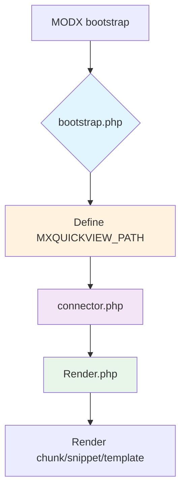

<!-- TODO: translate from docs/components/mxquickview/bootstrap.md -->
# Bootstrap файл

Файл `core/components/mxquickview/bootstrap.php` подключается при загрузке компонента (через `MODX\Revolution\modX::loadExtension` или `modX::boot`). Он задаёт базовый путь к компоненту и определяет константу `MXQUICKVIEW_PATH`.

## Что делает файл

```php
<?php
/**
 * Bootstrap mxQuickView.
 * @var \MODX\Revolution\modX $modx
 * @var array $namespace (optional, when loaded via namespace)
 */

$componentPath = $namespace['path'] ?? MODX_CORE_PATH . 'components/mxquickview/';

if (!defined('MXQUICKVIEW_PATH')) {
    define('MXQUICKVIEW_PATH', $componentPath);
}
?>
```

- **$namespace['path']** – путь к компоненту, если он загружается через namespace. Если namespace не передан, используется стандартный путь `MODX_CORE_PATH . 'components/mxquickview/'`.
- **Константа `MXQUICKVIEW_PATH`** – фиксирует абсолютный путь к корню компонента. Дальнейший код (например, `connector.php`, `processors/`) использует эту константу для построения путей к файлам и ресурсам.

## Когда подключается

- При установке пакета через Transport – MODX автоматически загружает `bootstrap.php`.
- При вызове сниппета `mxQuickView.initialize` – в начале выполнения сниппет вызывает `require_once $modx->getOption('core_path').'components/mxquickview/bootstrap.php';`.

## Как использовать

Если вы пишете собственные кастомные процессоры или расширения, убедитесь, что загрузили `bootstrap.php` до обращения к файлам компонента, иначе `MXQUICKVIEW_PATH` будет неопределена.

## Связанные элементы

- **Connector API** – использует `MXQUICKVIEW_PATH` для построения пути к `assets/components/mxquickview/connector.php`.
- **Processors** — package has no MODX processors, `Render.php` class is called directly from connector.

## Initialization flow



---
