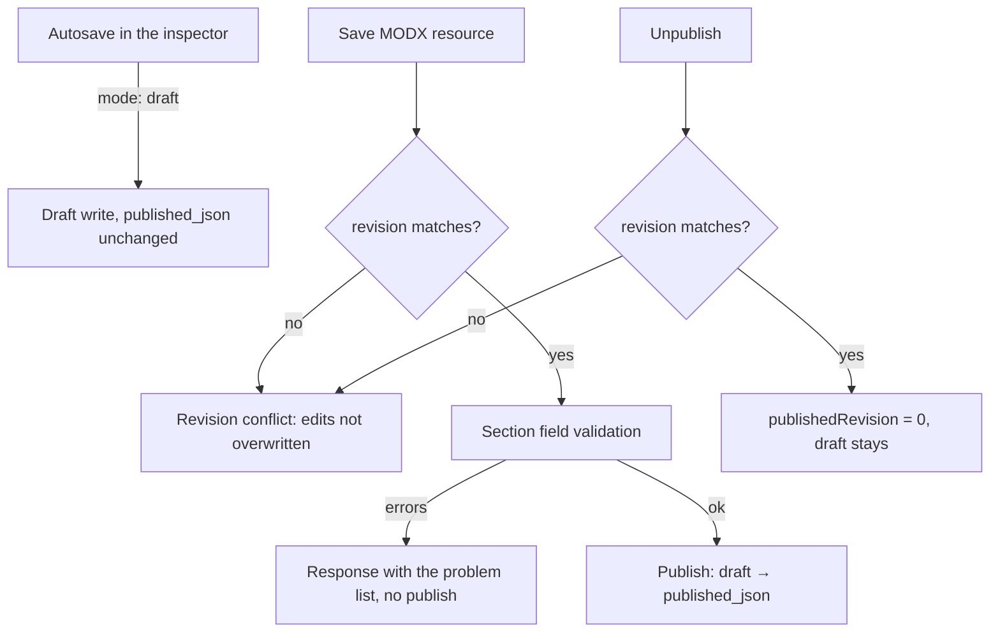

# PageBuilder

You build a page from sections on the **Sections** tab in MODX. Autosave writes the draft. **Save** on the MODX resource validates fields and publishes sections to the site. The resource **Content** field is not used for sections. The `PageBuilder` snippet outputs the blocks on the site.

Start here: [Quick start](quick-start).

## Resource editor

The **Sections** tab holds the editor:

- table or compact editorial list (default from `pagebuilder_resource_view_mode`, toggle in the toolbar)
- add from the catalog, drag to reorder, Alt+↑/↓, duplicate, copy sections from another page
- in the editorial list you enable and disable sections on each row
- deleted sections go to the page trash
- edit content in the **Properties** modal inspector
- while the inspector is open for a newly added section, autosave pauses
- **Cancel** rolls the draft back to the state before the add
- visibility rules (context, UTM) open via **Visibility** when the system setting is enabled
- draft preview in a drawer via a signed link
- undo and redo in the current session
- before publish (**Save** resource) the editor validates required fields

## Draft and publish

Autosave writes the draft only. **Save** on the MODX resource: validate → draft → publish to `published_json`. **Unpublish** clears the published version. The draft remains. On save the server compares revision numbers so concurrent edits are not overwritten.

## Free: sections and fields

11 built-in types: hero, richtext, faq, cta, cards, contact, stats, testimonials, image, spacer, video.

Pro creates a new `gallery` (`authoring: pro`). Rendering an existing `gallery` stays in Free.

In the control panel (**Blocks**):

- **All / From package / Mine** chips
- bulk-hide of preset types
- your own catalog preview instead of the schematic image

35 field types in Free and 27 in Pro (62 total): text, richtext, repeater, migx, file, select, and more. With `pagebuilder_responsive_editor_enabled`, the inspector shows per-device value tabs.

## PageBuilder Pro

- global library (**Shared blocks**): pull from another page (Link | Copy), write-through for linked sections
- page templates and section event journal (View/Restore)
- **Examples** tab in the catalog (Examples toggle / `pagebuilder_catalog_examples_enabled`)
- [Agent API](agent-api) for scripts and agents
- **Basket** in the control panel: sections and table rows across resources
- catalog: [gallery](sections/gallery), features, team, tabs, maps, [forms](sections/contact_form), [quiz](sections/quiz), miniShop3 blocks
- image/gallery crop: capability `image-crop`
- the `video` section is created in Free
- 27 more field types: gallery, map, relation, table, embeddedTable, editorjs, and more

## Resource tables

The **Tables** tab stores large row sets in the database: filters, CSV/JSON import, bulk delete. On the site, `PageBuilderTableRows` outputs rows. The `data_table` section (Pro) embeds a small table in section JSON.

## UTM and contexts

The UTM registry in the control panel requires capability `utm` (Pro). Already published rules still run in Free. Visibility rules (context, UTM, Pro conditions) open via **Visibility** in the inspector when `pagebuilder_inspector_visibility_enabled` is on. Snippets `PageBuilderUtmSession` and `PageBuilderUtmUrl` help on landing pages. Fields support the <code v-pre>{{utm:key}}</code> placeholder. <!-- markdownlint-disable-line MD033 -->

## Collections and control panel

Requires PageBuilder Pro and capability `collections`. With `collections_enabled`, resource tabs (sections, tables, iframe, and more) are configured in the control panel. Without the capability the tabs are absent. **Components → PageBuilder** opens the type builder and Pro tabs. The CMP has no resource list. The section editor is the resource tab.

## Snippets, Public API, and events

| What | Why |
| --- | --- |
| `PageBuilder` | section HTML |
| `PageBuilderResource` | sections from another resource |
| `PageBuilderSitemap` | XML sitemap |
| [Public API](public-api) | published sections as JSON (`api.php`) |
| `pbOn*` events | plugins on save, publish, render, and type registration |

## System requirements

| Requirement | Value |
| --- | --- |
| MODX Revolution | 3.0.3+ |
| PHP | 8.2+ |
| VueTools | 1.1.2+ (manager editor) |
| pdoTools | 3.0+ (Fenom in section chunks) |
| miniShop3 | optional, for Pro catalog sections |

## Packages

| Package | Version | Contents |
| --- | --- | --- |
| `pagebuilder` | 1.0.17-beta | Free: core, sections, control panel, snippets, MIGX, responsive, Save = publish, type filter and custom previews |
| `pagebuilderpro` | 1.0.17-beta | Pro: requires `pagebuilder` ≥ 1.0.17, quiz, library pull, page templates, section journal |

MODX namespace: `pagebuilder`.

## Quick links

| Need | Document |
| --- | --- |
| Feature overview | [Key features](key-features) |
| Install and build the first page | [Quick start](quick-start) |
| All `pagebuilder_*` keys | [System settings](settings) |
| Draft, publish, basket | [Workflow](workflow) |
| Blocks, UTM, Collections, Pro basket | [Control panel](cmp) |
| Permissions, `pbOn*` events, data model | [Manager and events](integration) |
| Template, preview, snippet cache | [Frontend output](frontend) |
| CSS tokens and section BEM | [Design system](design-system) |
| JSON for headless | [Public API](public-api) |
| Snippets and parameters | [Snippets](snippets/) |
| Pro, basket, examples | [PageBuilder Pro](pro) |
| Scripts and agents | [Agent API](agent-api) |
| Custom sections and extensions | [Developer](developer) |
| Landing, lists, forms, UTM, REST | [Recipes](recipes/) |
| 62 inspector field types | [Field type reference](fields/types) |
| 50 built-in blocks | [Section catalog](sections/) |
| Common issues | [FAQ](faq) |

## Entry points

| URL / path | Purpose |
| --- | --- |
| Component `pagebuilder` → `index` | Section type builder and Pro tabs. There is no resource list. The section editor is the resource tab |
| `assets/components/pagebuilder/connector.php` | MGR API (VueTools) |
| `assets/components/pagebuilder/preview.php` | Draft preview in iframe |
| `assets/components/pagebuilder/api.php` | Public API: published sections JSON (headless) |
| `assets/components/pagebuilder/api/v1.php` | REST API v1 (Pro): Bearer tokens, scopes `pages.read` / `catalog.read` |
| Snippet `[[!PageBuilder]]` | Published section HTML on the site |

## Permissions

| Permission | Purpose |
| --- | --- |
| `pagebuilder_view` | Sections tab, type catalog, preview token. `save_document` opens the same |
| `pagebuilder_save` | Draft save and publish (also `save_document`) |
| `pagebuilder_manage_types` | Control panel section types (no `view` substitute) |

Access to a specific resource is also checked by the MODX policy (`view`, `save`).
