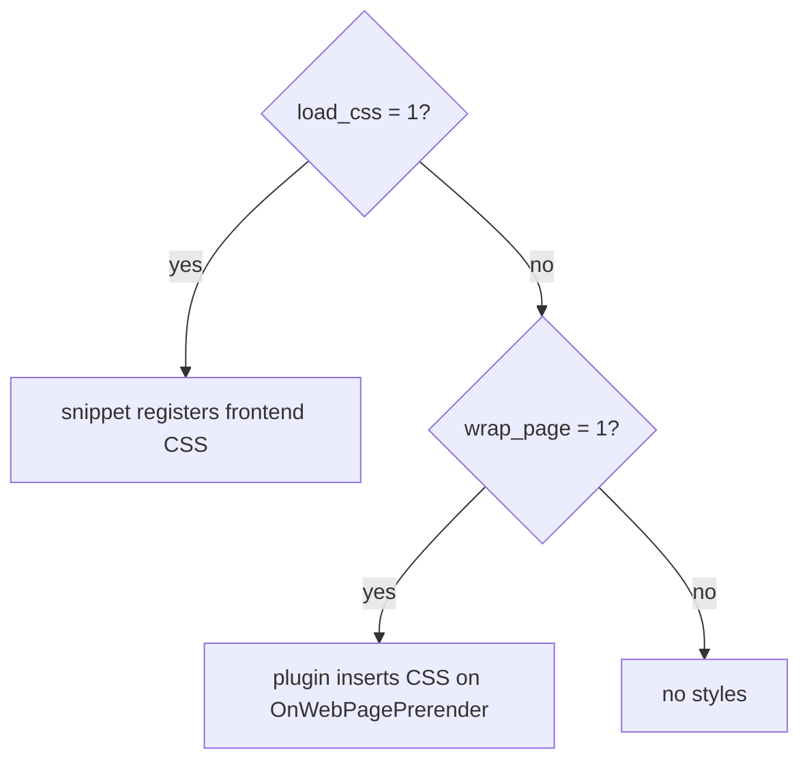
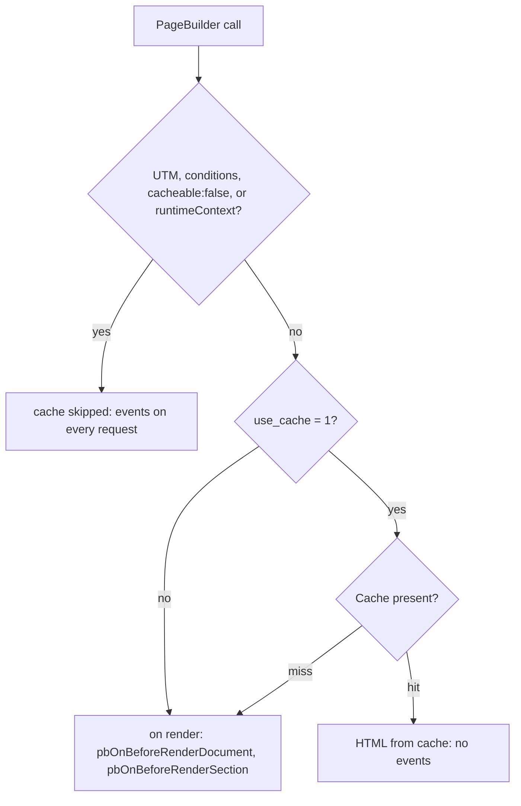

# PageBuilder snippet

Renders **published** resource sections as HTML. The HTML path (`return_values` omitted) returns an empty string until the page is published. With `return_values=1` and no publish, the JSON is the draft.

Each section uses its Fenom chunk: Free `pagebuilder_{key}`, Pro `pagebuilderpro_{key}` (`data_table` → `pagebuilder_data_table`). Chunks have no separate namespace. The `pagebuilder_data_table` chunk is installed with the package.

## Where to call

- Template of a page built in the **Sections** tab.
- Content field when the template outputs `[[*content]]`.
- Uncached call (`[[!PageBuilder]]`). Without `!` the HTML can go stale when sections change.

## Requirements

- Installed **pagebuilder** (or **pagebuilderpro**) component.
- **pdoTools** 3.0+ for Fenom in section chunks.
- Published section snapshot on the resource.

## Parameters

| Parameter | Default | Description |
| --- | --- | --- |
| `resource_id` | `0` | Resource ID. `0` = current |
| `section_types` | empty | Comma-separated keys (`hero,gallery`). Empty = all published |
| `return_values` | `0` | `1` → JSON `{ plainText, sections }` instead of HTML |
| `use_cache` | `1` | MODX cache for HTML. `0` when debugging render events |
| `load_css` | from `pagebuilder_load_frontend_css` | Register `pagebuilder-sections.css` and related bundles |
| `wrap_page` | like `load_css` | Wrapper `<div class="pb-page">` |
| `qa_css` | `0` | `1` registers `pagebuilder-qa.css`. QA CSS also loads on its own when the page has a QA section. It applies only while `load_css` is on |

`load_css`, `wrap_page`, and `qa_css` are not listed in snippet properties, but the call accepts them. See [System settings → Snippet relation](../settings#snippet-relation).

Flags `use_cache`, `load_css`, `wrap_page`, `qa_css`, and `return_values` read a string. `0`, `false`, `no`, `off`, and an empty string turn a flag off. Any other value turns it on. The setting `pagebuilder_load_frontend_css` uses the same rule.

## Basic call

::: code-group

```modx
[[!PageBuilder]]
```

```fenom
{'!PageBuilder' | snippet}
```

:::

## Section type filter

::: code-group

```modx
[[!PageBuilder?
  &section_types=`hero,cta`
]]
```

```fenom
{'!PageBuilder' | snippet : [
  'section_types' => 'hero,cta'
]}
```

:::

## return_values

JSON for SEO plugins. Same shape as `values` in [Public API](../public-api):

::: code-group

```modx
[[!PageBuilder? &return_values=`1`]]
```

```fenom
{'!PageBuilder' | snippet : ['return_values' => 1]}
```

:::

With `return_values=1`, event `pbOnGetValues` runs. CSS and the `pb-page` wrapper are not registered. The source is the published snapshot when `publishedRevision > 0`, otherwise the draft. If no resource can be resolved, the response is an empty string even with `return_values=1`.

## CSS and wrapper

With `load_css=1`, the snippet registers frontend CSS (see [Design system](../design-system)). Pro and commerce bundles load when capability `pro` is active.

Disable CSS globally with `pagebuilder_load_frontend_css` = `0`. For one call use ``&load_css=`0` ``.

With `&wrap_page=`1``, the plugin inserts CSS on `OnWebPagePrerender` even when `load_css=0`. It looks for `class="pb-page"` in the output and ignores the setting. No styles at all: `wrap_page=0`.



## HTML cache

MODX partition: `pagebuilder/{resourceId}`, key `render/{context}/{resourceId}/{publishedRevision}[/{typeHash}]`. Cleared on publish/unpublish. Render errors are not cached.

The cache is skipped entirely when the document has UTM rules, `conditions`, or a section with `cacheable: false`. Same for a type with `runtimeContext: true`: `contact_form`, `form_builder`, `quiz`, `dynamic_list`, `filterable_grid`. On that document the events run on every request.

Events `pbOnBeforeRenderDocument` and `pbOnBeforeRenderSection` run on a cache miss. Disable the cache for one call:

::: code-group

```modx
[[!PageBuilder? &use_cache=`0`]]
```

```fenom
{'!PageBuilder' | snippet : ['use_cache' => 0]}
```

:::



## Skipped sections

A section with unmet `requires` (Pro, miniShop3) is omitted from the HTML. The snippet fires `pbOnCheckSectionRequirement` before that check. An unknown requirement is logged, and the section is skipped.

## See also

- [PageBuilderResource](PageBuilderResource)
- [Frontend output](../frontend)
- [Public API](../public-api)
