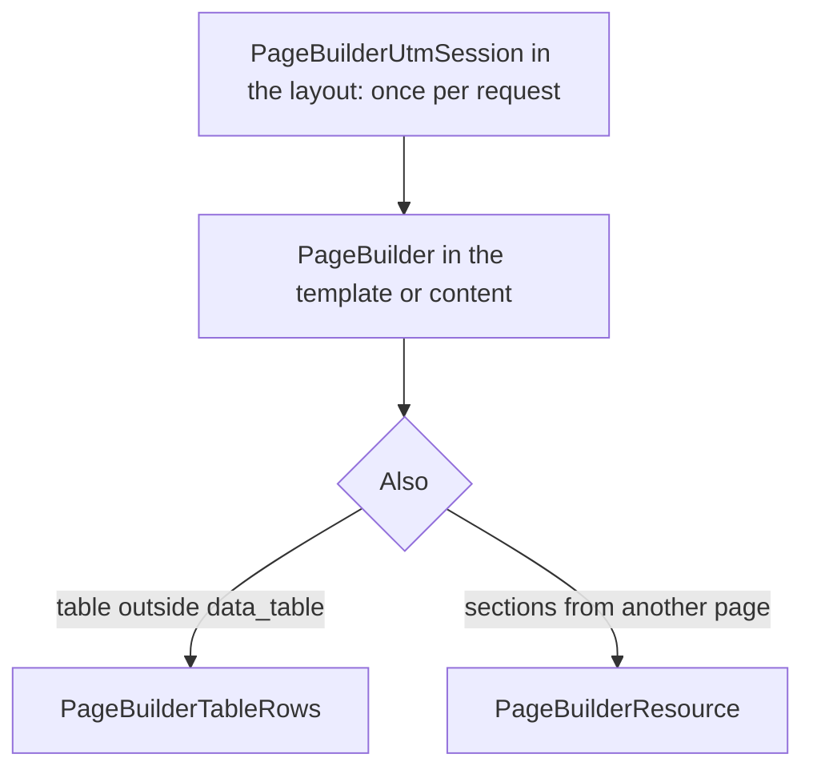

# PageBuilder snippets

Output snippets, plus form handlers in Pro. Section chunk: Free `pagebuilder_{key}`, Pro `pagebuilderpro_{key}` (`data_table` → `pagebuilder_data_table`). Chunks have no namespace: the prefix is the package name. The `pagebuilder_data_table` chunk is installed with the package.

| Snippet | Purpose |
| --- | --- |
| [PageBuilder](PageBuilder) | HTML of published sections for current or given resource |
| [PageBuilderResource](PageBuilderResource) | Sections from another resource (`resource_id`, `0` = current resource) |
| [PageBuilderSitemap](PageBuilderSitemap) | XML sitemap for pages with published sections |
| [PageBuilderUtmSession](PageBuilderUtmSession) | UTM from query string into session for section visibility rules |
| [PageBuilderUtmUrl](PageBuilderUtmUrl) | UTM from control panel registry appended to arbitrary URL |
| [PageBuilderTableRows](PageBuilderTableRows) | Resource table rows (JSON or chunk) |

Pro handlers. Do not call these from a template. The section chunk calls [PageBuilderFetchIt](PageBuilderFetchIt):

| Snippet | Purpose |
| --- | --- |
| [PageBuilderQuiz](PageBuilderQuiz) | Handler for [quiz](../sections/quiz) section |
| [PageBuilderContactForm](PageBuilderContactForm) | Handler for [contact_form](../sections/contact_form) section |
| [PageBuilderFormBuilder](PageBuilderFormBuilder) | Handler for [form_builder](../sections/form_builder) section |
| [PageBuilderFetchIt](PageBuilderFetchIt) | Renders the form through Fenom. The chunk passes the handler in `snippet` |

## Order on a typical page

1. **PageBuilderUtmSession** in shared layout if UTM section rules apply (once per request, before section render).
2. **PageBuilder** in template or resource content field.
3. **PageBuilderTableRows** separately if a table is output outside `data_table` section.

For a block from another page (hero from home, FAQ from landing) use **PageBuilderResource**.

Quiz, lead form, and form builder: add the `quiz`, `contact_form`, or `form_builder` section and install **FetchIt**.

## MODX / Fenom correspondence

| Purpose | MODX | Fenom |
| --- | --- | --- |
| Page sections | `[[!PageBuilder]]` | `{'!PageBuilder' \| snippet}` |
| Filter sections | `` [[!PageBuilder? &section_types=`hero,cta`]] `` | `{'!PageBuilder' \| snippet : ['section_types' => 'hero,cta']}` |
| Another resource | `` [[!PageBuilderResource? &resource_id=`42`]] `` | `{'!PageBuilderResource' \| snippet : ['resource_id' => 42]}` |
| JSON for SEO | `` [[!PageBuilder? &return_values=`1`]] `` | `{'!PageBuilder' \| snippet : ['return_values' => 1]}` |
| Sitemap | `[[!PageBuilderSitemap]]` | `{'!PageBuilderSitemap' \| snippet}` |
| UTM to session | `[[!PageBuilderUtmSession]]` | `{'!PageBuilderUtmSession' \| snippet}` |
| URL with UTM | `` [[!PageBuilderUtmUrl? &url=`/contacts/`]] `` | `{'!PageBuilderUtmUrl' \| snippet : ['url' => '/contacts/']}` |
| Table rows | `` [[!PageBuilderTableRows? &resource_id=`[[*id]]` &table_key=`prices`]] `` | `{'!PageBuilderTableRows' \| snippet : ['resource_id' => $_modx->resource.id, 'table_key' => 'prices']}` |

## Caching

Call `PageBuilder` and `PageBuilderResource` uncached (`[[!...]]` or `{'!...' | snippet}`). Otherwise MODX may serve HTML without a fresh publish.

`PageBuilderUtmSession` is also uncached: the session is filled in the same HTTP request as the UTM link visit.

## See also

- [Frontend output](../frontend)
- [Design system](../design-system)
- [Control panel → UTM](../cmp#utm)
- [Public API](../public-api)
